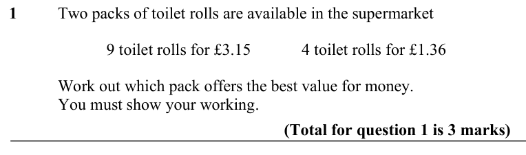
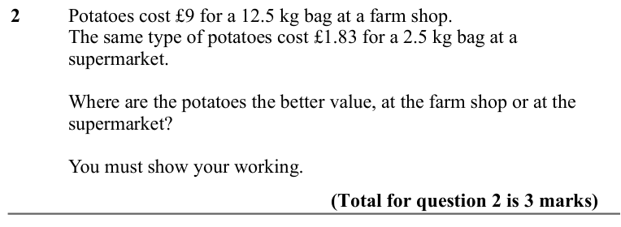
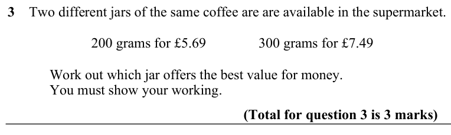
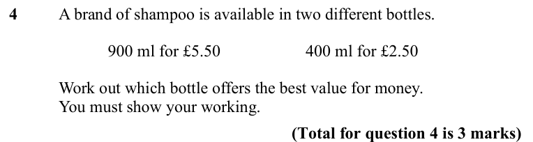
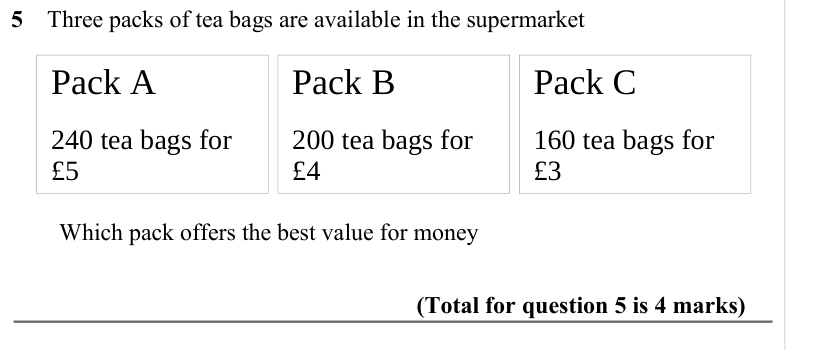
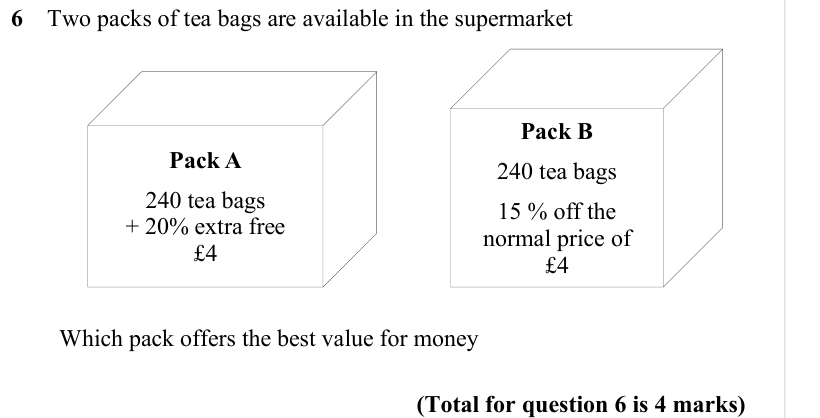

# Best Buy Questions — Exam Questions (IGCSE Maths · Edexcel · Grade 3)

Topic code `3.11` · slug `grade-3-3-11-best-buy-questions` · source sheet sha256 `66a39b6407899100…`

## Q1 (marks not printed)

Text (lossy): 1     / Two packs of toilet rolls are available in the supermarket / 9 toilet rolls for £3.15 / 4 toilet rolls for £1.36 / Work out which pack offers the best value for money. / You must show your working.      /          / (Total for question 1 is 3 marks)

## Q2 (marks not printed)

Text (lossy): 2     / Potatoes cost £9 for a 12.5 kg bag at a farm shop. / The same type of potatoes cost £1.83 for a 2.5 kg bag at a  / supermarket. / Where are the potatoes the better value, at the farm shop or at the  / supermarket? / You must show your working. /          /          / (Total for question 2 is 3 marks)

## Q3 (marks not printed)

Text (lossy): 3    Two different jars of the same coffee are are available in the supermarket. / 200 grams for £5.69 / 300 grams for £7.49 / Work out which jar offers the best value for money. / You must show your working.  /          / (Total for question 3 is 3 marks)

## Q4 (marks not printed)

Text (lossy): 4     / A brand of shampoo is available in two different bottles.  / 900 ml for £5.50 / 400 ml for £2.50 / Work out which bottle offers the best value for money. / You must show your working. / (Total for question 4 is 3 marks)

## Q5 (marks not printed)

Text (lossy): 5    Three packs of tea bags are available in the supermarket / Pack A / Pack B / Pack C / 240 tea bags for  / £5 / 200 tea bags for  / £4 / 160 tea bags for  / £3 /         Which pack offers the best value for money /          /          / (Total for question 5 is 4 marks)

## Q6 (marks not printed)

Text (lossy): 6    Two packs of tea bags are available in the supermarket / Pack B / Pack A / 240 tea bags / 240 tea bags / + 20% extra free / 15 % off the / normal price of / £4 / £4 /         Which pack offers the best value for money /          /          / (Total for question 6 is 4 marks)

