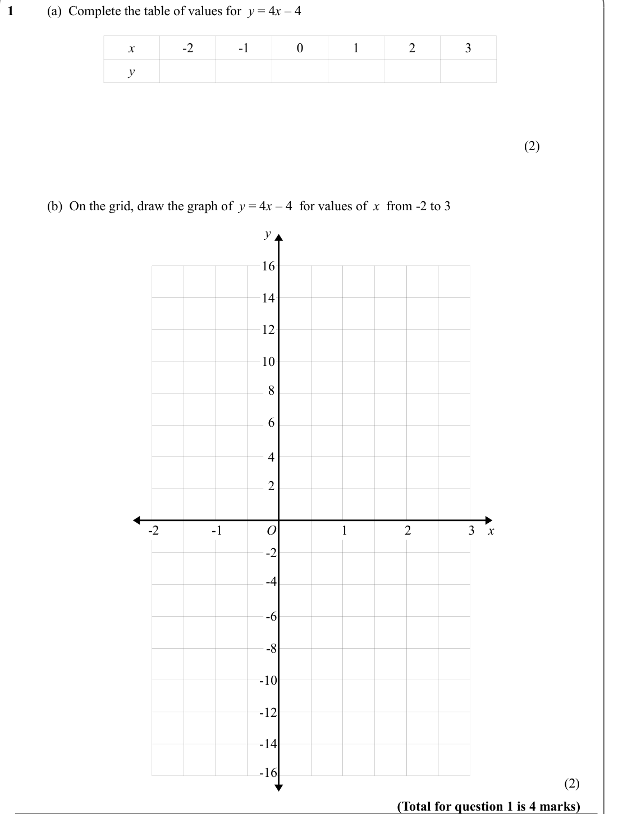
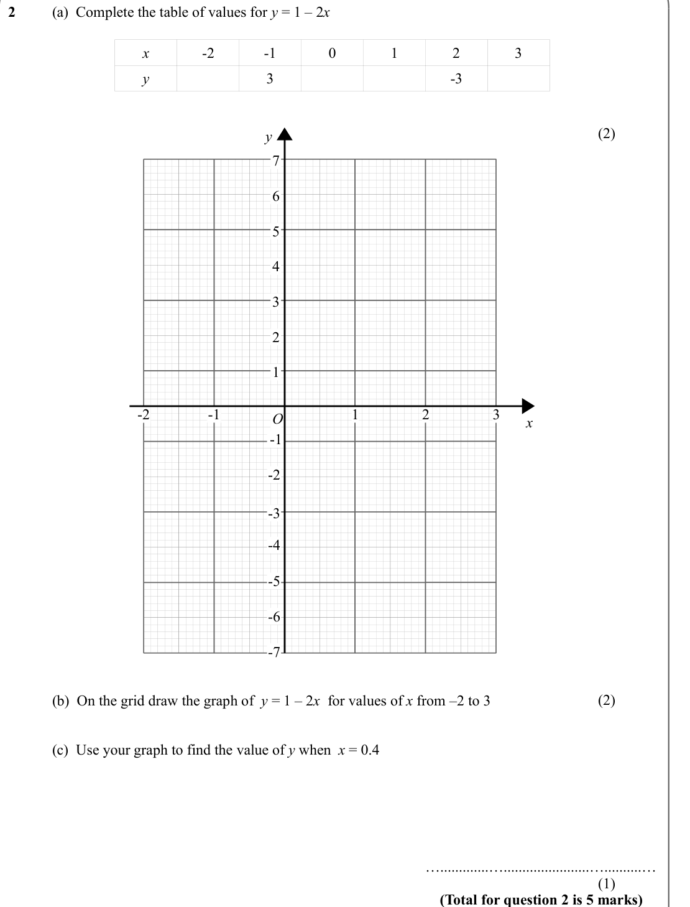
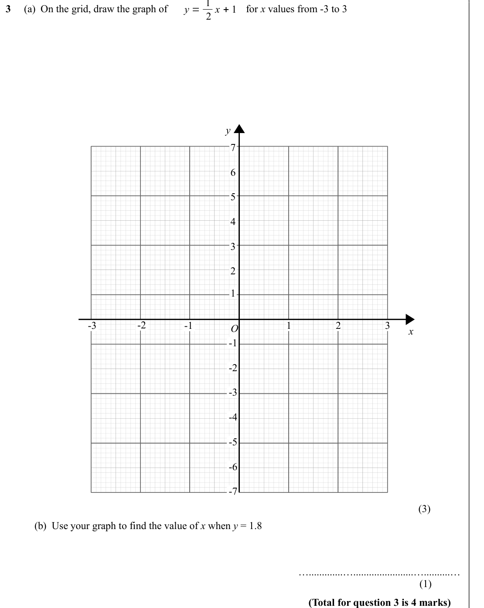
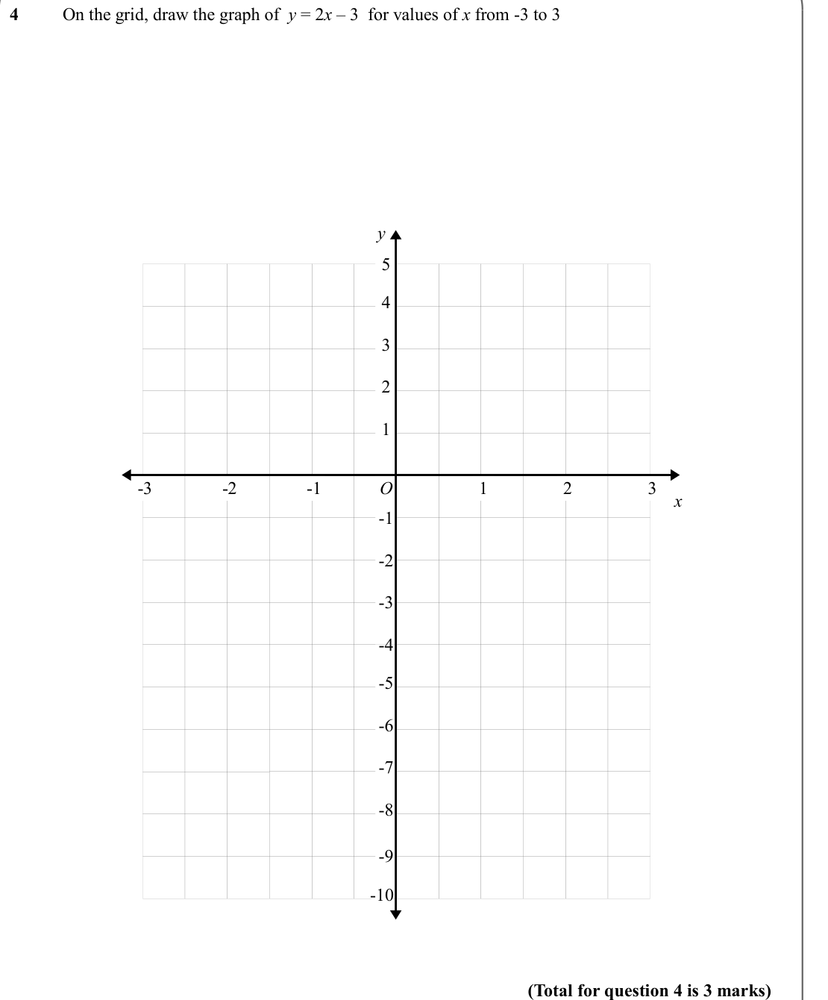
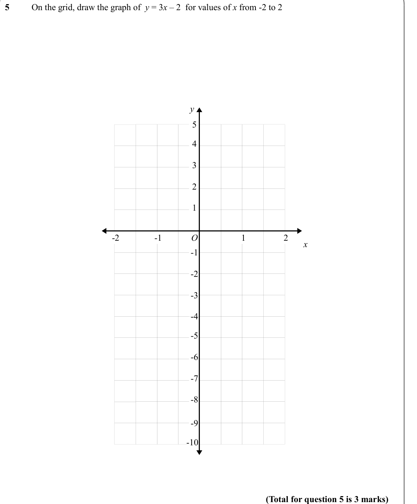
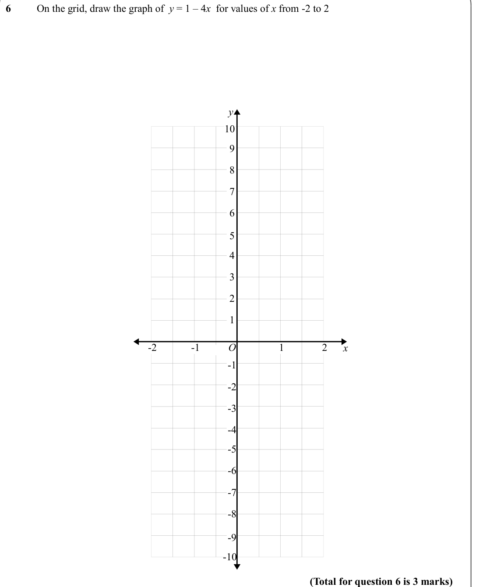
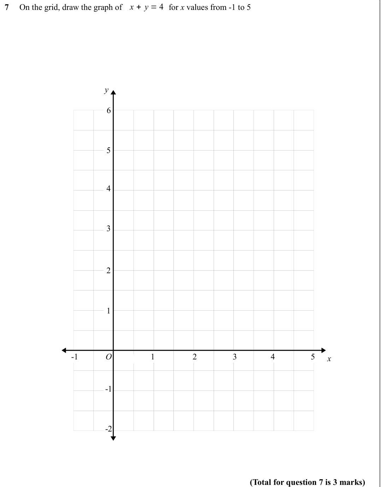

# Drawing Graphs — Exam Questions (IGCSE Maths · Edexcel · Grade 3)

Topic code `3.14` · slug `grade-3-3-14-drawing-graphs` · source sheet sha256 `1a96ce31ee2859fa…`

## Q1 (marks not printed · parts a, b)

Text (lossy): 1    / (a)  Complete the table of values for  y = 4 x – 4  / x / -2 / -1 / 0 / 1 / 2 / 3 / y / (2) / (b)  On the grid, draw the graph of  y = 4 x – 4  for values of  x  from -2 to 3 / y / 16 / 14 / 12 / 10 / 8 / 6 / 4 / 2 / 1 / 2 / -1 / -2 / 3 / O / x / -2 / -4 / -6 / -8 / -10 / -12 / -14 / -16 / (2) / (Total for question 1 is 4 marks)

## Q2 (marks not printed · parts a, b, c)

Text (lossy): 2    / (a)  Complete the table of values for y = 1 – 2 x / x / -2 / -1 / 0 / 1 / 2 / 3 / y / 3 / -3 / (2)             / y / 7 / 6 / 5 / 4 / 3 / 2 / 1 / 1 / -2 / O / -1 / 2 / 3 / x / -1 / -2 / -3 / -4 / -5 / -6 / -7 / (2)             / (b)  On the grid draw the graph of  y = 1 – 2 x  for values of x from –2 to 3 / (c)  Use your graph to find the value of y when  x = 0.4 / ….............…...........

## Q3 (marks not printed · parts b)

Text (lossy): 2 x + 1 / 3     (a)  On the grid, draw the graph of                              for x values from -3 to 3 / y / 7 / 6 / 5 / 4 / 3 / 2 / 1 / -2 / -1 / -3 / 1 / 2 / 3 / O / x / -1 / -2 / -3 / -4 / -5 / -6 / -7 / (3)             / (b)  Use your graph to find the value of x when y = 1.8 / ….............….......................…..........…  / (1)             / (Total for question 3 is 4 marks)

## Q4 (marks not printed)

Text (lossy): 4    / On the grid, draw the graph of  y = 2 x – 3  for values of x from -3 to 3 / y / 5 / 4 / 3 / 2 / 1 / 1 / 2 / -1 / -2 / 3 / O / -3 / x / -1 / -2 / -3 / -4 / -5 / -6 / -7 / -8 / -9 / -10 / (Total for question 4 is 3 marks)

## Q5 (marks not printed)

Text (lossy): 5    / On the grid, draw the graph of  y = 3 x – 2  for values of x from -2 to 2 / y / 5 / 4 / 3 / 2 / 1 / 1 / 2 / -1 / -2 / O / x / -1 / -2 / -3 / -4 / -5 / -6 / -7 / -8 / -9 / -10 / (Total for question 5 is 3 marks)

## Q6 (marks not printed)

Text (lossy): 6    / On the grid, draw the graph of  y = 1 – 4 x  for values of x from -2 to 2 / y / 10 / 9 / 8 / 7 / 6 / 5 / 4 / 3 / 2 / 1 / O / 1 / 2 / -1 / -2 / x / -1 / -2 / -3 / -4 / -5 / -6 / -7 / -8 / -9 / -10 / (Total for question 6 is 3 marks)

## Q7 (marks not printed)

Text (lossy): x + y = 4 / 7     On the grid, draw the graph of                      for x values from -1 to 5 / y / 6 / 5 / 4 / 3 / 2 / 1 / O / 1 / 2 / -1 / 3 / 5 / 4 / x / -1 / -2 / (Total for question 7 is 3 marks)

