# Area and Circumference of Circles — Exam Questions (IGCSE Maths · Edexcel · Grade 3)

Topic code `3.15` · slug `grade-3-3-15-area-and-circumference-of-circles` · source sheet sha256 `f25194f8673ba7e2…`

## Q1 (marks not printed · parts a, b)

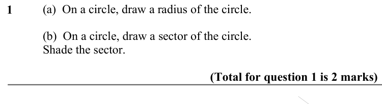

Text (lossy): (a)  On a circle, draw a radius of the circle.  / 1     / (b)  On a circle, draw a sector of the circle. / Shade the sector.   / (Total for question 1 is 2 marks)

## Q2 (marks not printed · parts a, b)

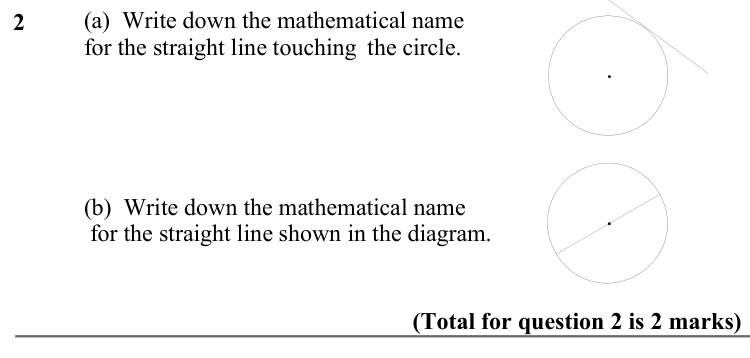

Text (lossy): 2     / (a)  Write down the mathematical name  / for the straight line touching the circle. / (b)  Write down the mathematical name /  for the straight line shown in the diagram.  / (Total for question 2 is 2 marks)

## Q3 (marks not printed)

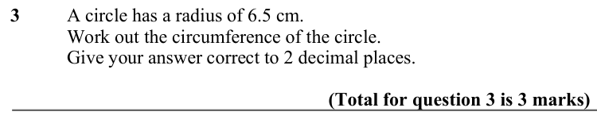

Text (lossy): 3   / A circle has a radius of 6.5 cm.  / Work out the circumference of the circle. / Give your answer correct to 2 decimal places.   / (Total for question 3 is 3 marks)

## Q4 (marks not printed)

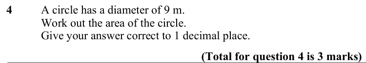

Text (lossy): 4       / A circle has a diameter of 9 m.  / Work out the area of the circle. / Give your answer correct to 1 decimal place.  / (Total for question 4 is 3 marks)

## Q5 (marks not printed)

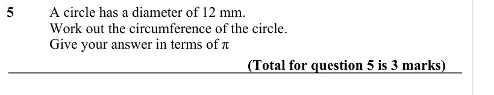

Text (lossy): 5     /        / A circle has a diameter of 12 mm.  / Work out the circumference of the circle. / Give your answer in terms of π / (Total for question 5 is 3 marks)

## Q6 (marks not printed)

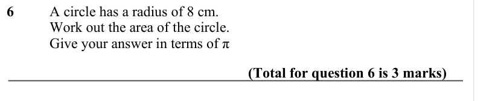

Text (lossy): 6   / A circle has a radius of 8 cm.  / Work out the area of the circle. / Give your answer in terms of π   / (Total for question 6 is 3 marks)

## Q7 (marks not printed)

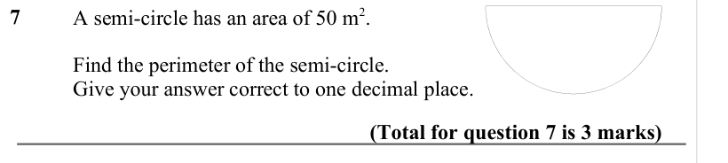

Text (lossy): 7     /        / A semi-circle has an area of 50 m 2.  / Find the perimeter of the semi-circle. / Give your answer correct to one decimal place.  / (Total for question 7 is 3 marks)

## Q8 (marks not printed)

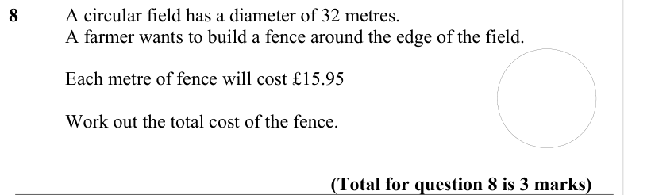

Text (lossy): 8       / A circular field has a diameter of 32 metres.  / A farmer wants to build a fence around the edge of the field.  /        / Each metre of fence will cost £15.95 /        / Work out the total cost of the fence.  / (Total for question 8 is 3 marks)

## Q9 (marks not printed)

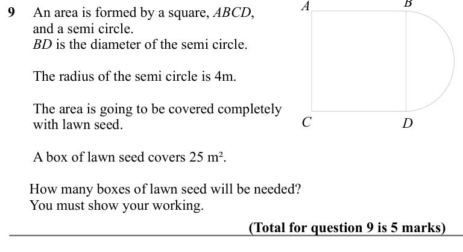

Text (lossy): 9      An area is formed by a square, ABCD, /       and a semi circle. /       BD is the diameter of the semi circle. /   /       The radius of the semi circle is 4m.  /       The area is going to be covered completely  /       with lawn seed.  / C / D /       A box of lawn seed covers 25 m².  /      How many boxes of lawn seed will be needed? /      You must show your working.  / (Total for quest

## Q10 (marks not printed)

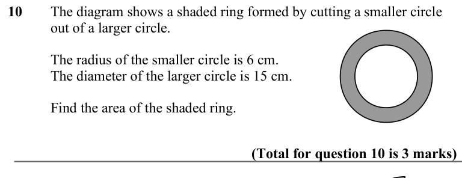

Text (lossy): 10     / The diagram shows a shaded ring formed by cutting a smaller circle  / out of a larger circle.  / The radius of the smaller circle is 6 cm. / The diameter of the larger circle is 15 cm.  / Find the area of the shaded ring.  / (Total for question 10 is 3 marks)

## Q11 (marks not printed)

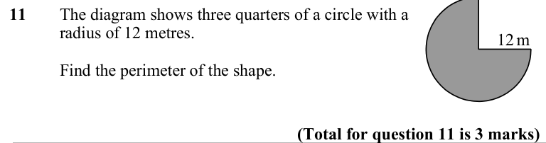

Text (lossy): 11     / The diagram shows three quarters of a circle with a  / radius of 12 metres.  / 12 m / Find the perimeter of the shape.  / (Total for question 11 is 3 marks)

## Q12 (marks not printed)

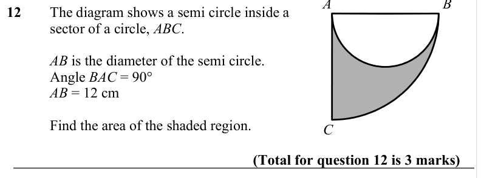

Text (lossy): 12    / The diagram shows a semi circle inside a  / sector of a circle, ABC.  / AB is the diameter of the semi circle. / Angle BAC = 90° / AB = 12 cm / Find the area of the shaded region.  / C / (Total for question 12 is 3 marks)

## Q13 (marks not printed)

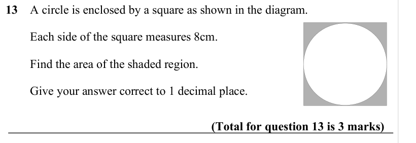

Text (lossy): 13    A circle is enclosed by a square as shown in the diagram.  /         Each side of the square measures 8cm.  /         Find the area of the shaded region.  /         Give your answer correct to 1 decimal place.  / (Total for question 13 is 3 marks)

## Q14 (marks not printed)

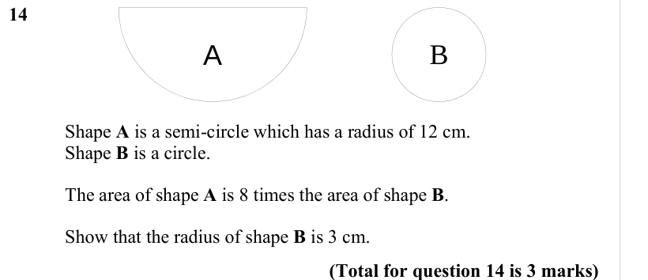

Text (lossy): 14     / B / A /        / Shape A is a semi-circle which has a radius of 12 cm.  / Shape B is a circle.  / The area of shape A is 8 times the area of shape B.  / Show that the radius of shape B is 3 cm. / (Total for question 14 is 3 marks)

