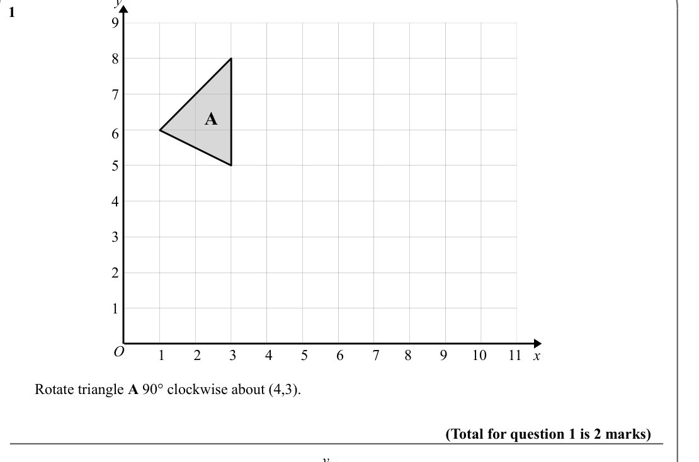
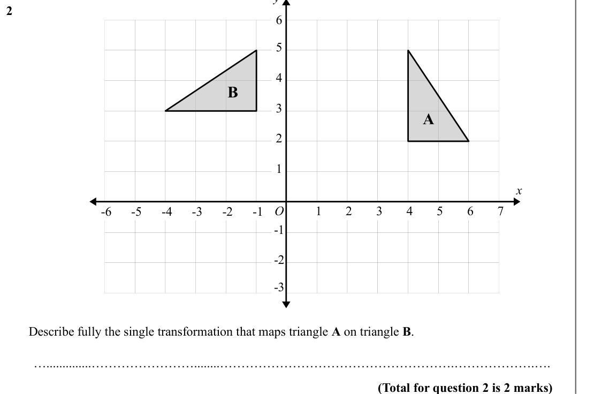
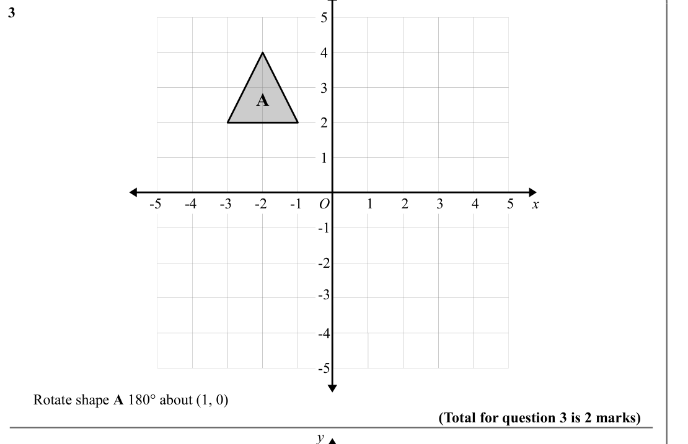
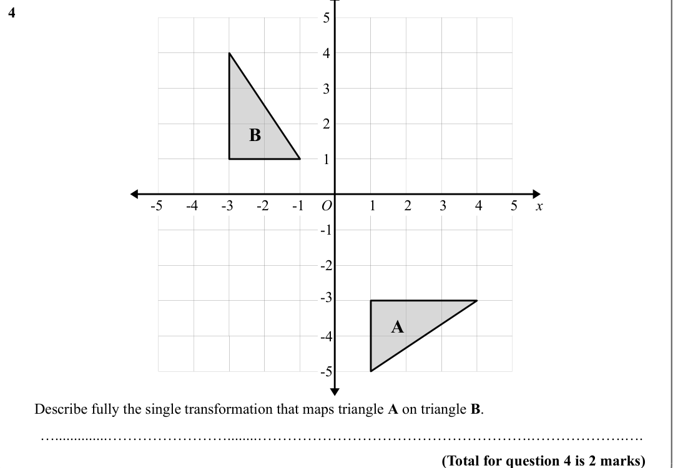
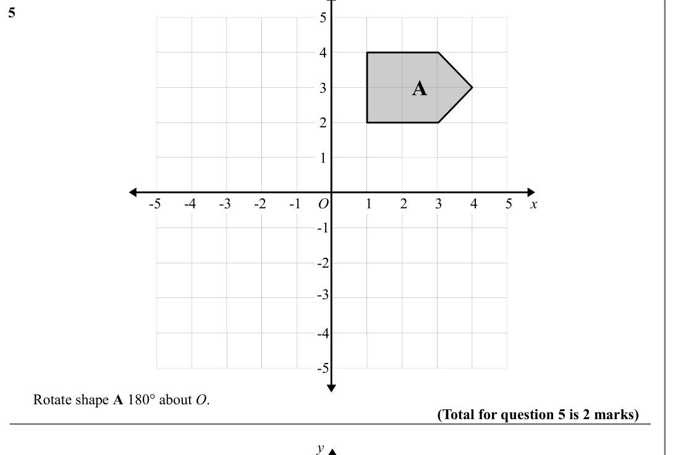
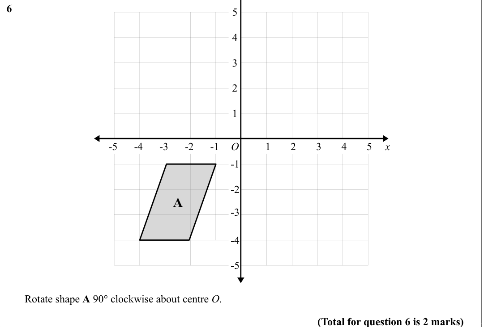
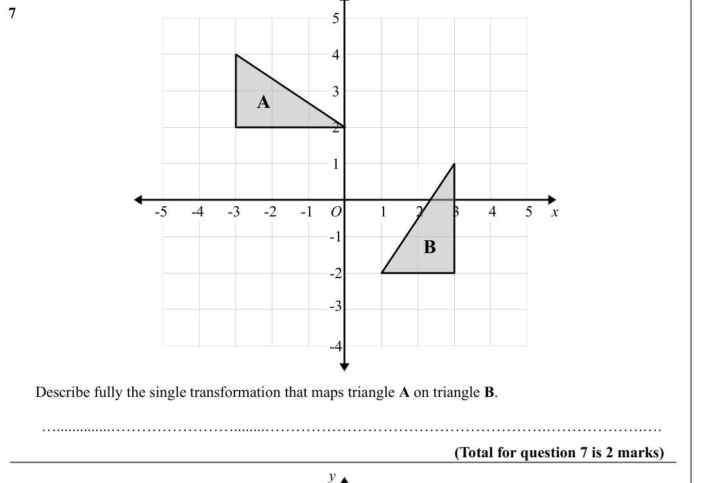
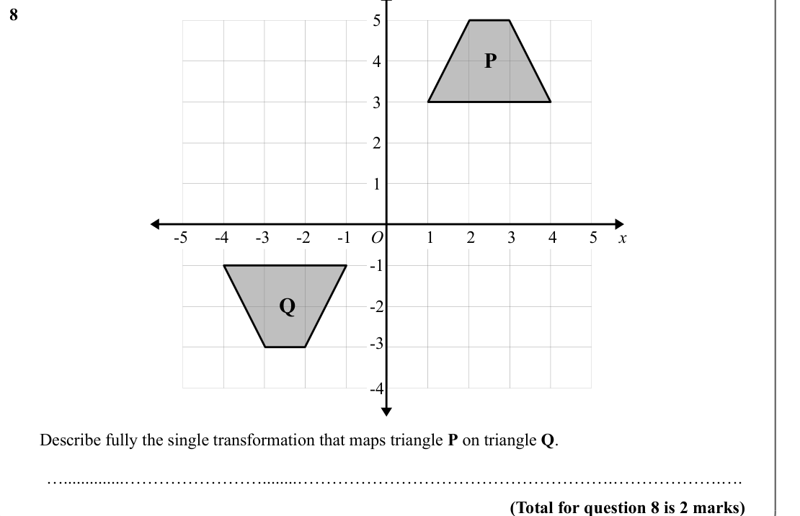

# Transformations — Exam Questions (IGCSE Maths · Edexcel · Grade 3)

Topic code `3.16` · slug `grade-3-3-16-transformations` · source sheet sha256 `f63269fb1add08b9…`

## Q1 (marks not printed)

Text (lossy): 1       / 9 / 8 / 7 / A / 6 / 5 / 4 / 3 / 2 / 1 / O / 1 / 2 / 3 / 4 / 5 / 6 / 7 / 8 / 9 / 10 / 11 / x /        Rotate triangle A 90° clockwise about (4,3).  / (Total for question 1 is 2 marks) / y

## Q2 (marks not printed)

Text (lossy): 2       / 6 / 5 / 4 / B / 3 / A / 2 / 1 / x / -1 / -2 / -3 / -4 / -5 / 6 / 7 / 1 / -5 / 2 / 3 / 4 / 5 / O / -1 / -6 / -2 / -3 /        Describe fully the single transformation that maps triangle A on triangle B.  / …..............……………………........……………………………………………….……………….…. / (Total for question 2 is 2 marks)

## Q3 (marks not printed)

Text (lossy): 3       / 5 / 4 / 3 / A / 2 / 1 / 1 / -1 / -2 / -3 / -4 / -5 / 2 / 3 / 4 / 5 / O / x / -1 / -2 / -3 / -4 / -5 /        Rotate shape A 180° about (1, 0) / (Total for question 3 is 2 marks) / y

## Q4 (marks not printed)

Text (lossy): 4       / 5 / 4 / 3 / 2 / B / 1 / 1 / -1 / -2 / -3 / -4 / -5 / 2 / 3 / 4 / 5 / O / x / -1 / -2 / -3 / A / -4 / -5 /        Describe fully the single transformation that maps triangle A on triangle B.  / …..............……………………........……………………………………………….……………….…. / (Total for question 4 is 2 marks)

## Q5 (marks not printed)

Text (lossy): 5       / 5 / 4 / A / 3 / 2 / 1 / 1 / -1 / -2 / -3 / -4 / -5 / 2 / 3 / 4 / 5 / O / x / -1 / -2 / -3 / -4 / -5 /        Rotate shape A 180° about O.  / (Total for question 5 is 2 marks) / y

## Q6 (marks not printed)

Text (lossy): 6       / 5 / 4 / 3 / 2 / 1 / 1 / -1 / -2 / -3 / -4 / -5 / 2 / 3 / 4 / 5 / O / x / -1 / -2 / A / -3 / -4 / -5 /        Rotate shape A 90° clockwise about centre O.  / (Total for question 6 is 2 marks)

## Q7 (marks not printed)

Text (lossy): 7       / 5 / 4 / 3 / A / 2 / 1 / 1 / -1 / -2 / -3 / -4 / -5 / 2 / 3 / 4 / 5 / O / x / -1 / B / -2 / -3 / -4 /        Describe fully the single transformation that maps triangle A on triangle B.  / …..............……………………........……………………………………………….……………….…. / (Total for question 7 is 2 marks) / y

## Q8 (marks not printed)

Text (lossy): 8       / 5 / P / 4 / 3 / 2 / 1 / 1 / -1 / -2 / -3 / -4 / -5 / 2 / 3 / 4 / 5 / O / x / -1 / Q / -2 / -3 / -4 /        Describe fully the single transformation that maps triangle P on triangle Q.  / …..............……………………........……………………………………………….……………….…. / (Total for question 8 is 2 marks)

