# Estimating — Exam Questions (IGCSE Maths · Edexcel · Grade 3)

Topic code `3.2` · slug `grade-3-3-2-estimating` · source sheet sha256 `173f9d586110c121…`

## Q1 (3 marks)

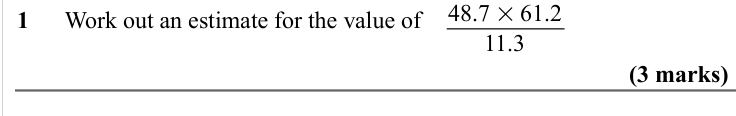

Text (lossy): 1      Work out an estimate for the value of / 11.3 / (3 marks) / 41.2 × 19.8

## Q2 (3 marks)

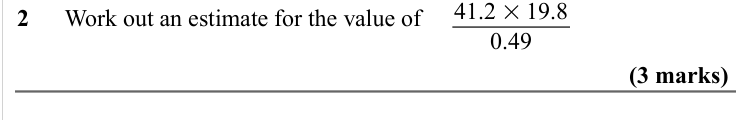

Text (lossy): 2      Work out an estimate for the value of / 0.49 / (3 marks) / 28.4 × 21.05

## Q3 (3 marks)

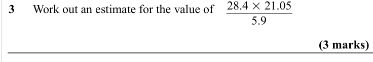

Text (lossy): 3      Work out an estimate for the value of / 5.9 / (3 marks)

## Q4 (3 marks)

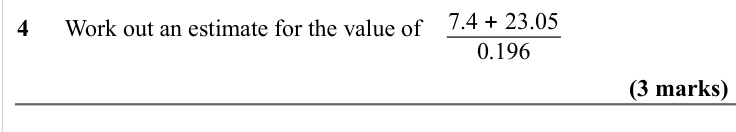

Text (lossy): 4      Work out an estimate for the value of / 7.4 + 23.05 / 0.196 / (3 marks) / 91.25 × 4.87

## Q5 (3 marks)

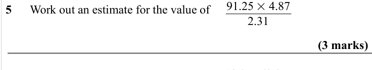

Text (lossy): 5      Work out an estimate for the value of / 2.31 / (3 marks) / 18.3 + 62.8

## Q6 (3 marks)

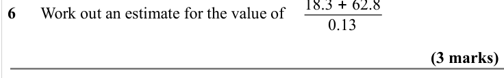

Text (lossy): 6      Work out an estimate for the value of / 0.13 / (3 marks)

## Q7 (3 marks)

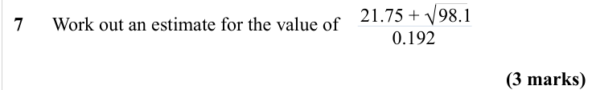

Text (lossy): 7      Work out an estimate for the value of / 21.75 +    98.1 / √ / 0.192 / (3 marks)

## Q8 (3 marks)

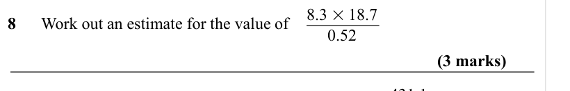

Text (lossy): 8      Work out an estimate for the value of / 8.3 × 18.7 / 0.52 / (3 marks) / 431.1 / 14.3 + 3.8

## Q9 (3 marks)

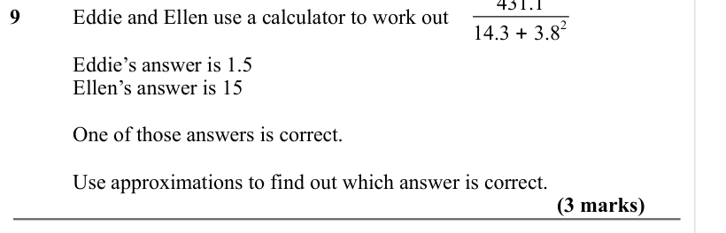

Text (lossy): 9  / Eddie and Ellen use a calculator to work out  / 2 / Eddie’s answer is 1.5 / Ellen’s answer is 15 / One of those answers is correct.  / Use approximations to find out which answer is correct.  / (3 marks)

## Q10 (3 marks · parts a, b)

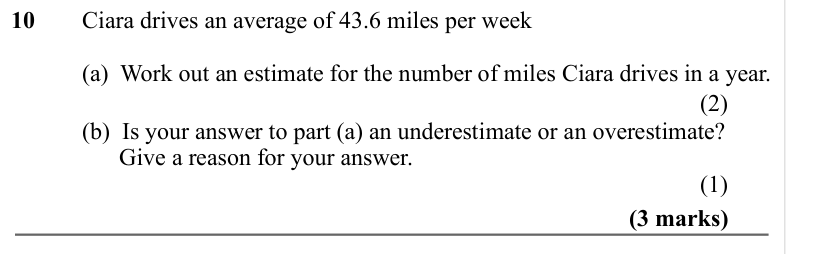

Text (lossy): 10  / Ciara drives an average of 43.6 miles per week / (a)  Work out an estimate for the number of miles Ciara drives in a year. / (2) / (b)  Is your answer to part (a) an underestimate or an overestimate? /                   Give a reason for your answer.  / (1) / (3 marks)

## Q11 (3 marks · parts a, b)

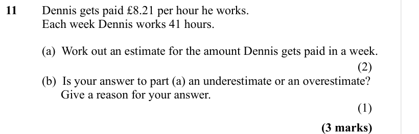

Text (lossy): 11  / Dennis gets paid £8.21 per hour he works.  / Each week Dennis works 41 hours.  / (a)  Work out an estimate for the amount Dennis gets paid in a week. / (2) / (b)  Is your answer to part (a) an underestimate or an overestimate? /                   Give a reason for your answer.  / (1) / (3 marks)

## Q12 (3 marks · parts a, b)

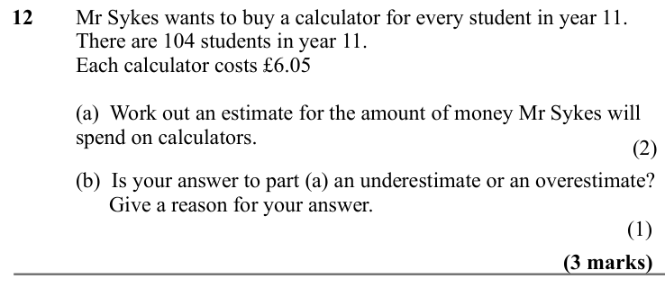

Text (lossy): 12  / Mr Sykes wants to buy a calculator for every student in year 11.  /      / There are 104 students in year 11.  /    / Each calculator costs £6.05 / (a)  Work out an estimate for the amount of money Mr Sykes will  / spend on calculators.  / (b)  Is your answer to part (a) an underestimate or an overestimate? /                   Give a reason for your answer.  / (3 marks)

## Q13 (3 marks · parts a, b)

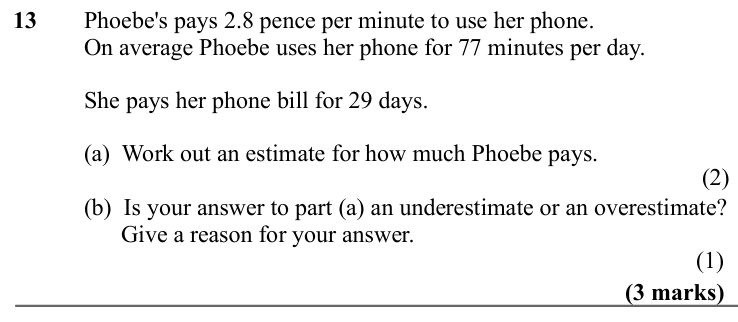

Text (lossy): 13      Phoebe's pays 2.8 pence per minute to use her phone.  /         / On average Phoebe uses her phone for 77 minutes per day.  / She pays her phone bill for 29 days.  / (a)  Work out an estimate for how much Phoebe pays.   / (b)  Is your answer to part (a) an underestimate or an overestimate? /                   Give a reason for your answer.  / (3 marks)

## Q14 (4 marks · parts a, b)

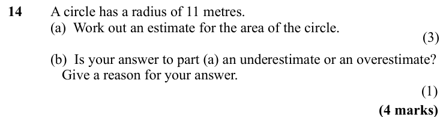

Text (lossy): 14  / A circle has a radius of 11 metres.  / (a)  Work out an estimate for the area of the circle.  / (b)  Is your answer to part (a) an underestimate or an overestimate? /                Give a reason for your answer.   / (4 marks)

## Q15 (4 marks · parts a, b)

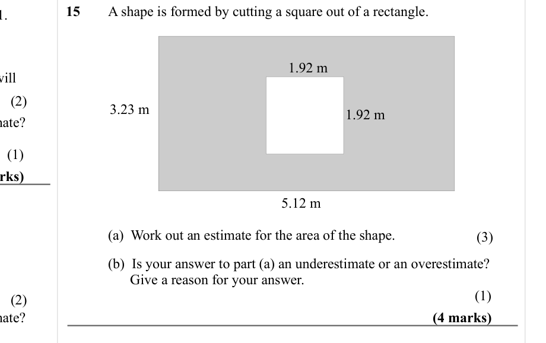

Text (lossy): 15  / A shape is formed by cutting a square out of a rectangle. / 1.92 m / (2) / 3.23 m / 1.92 m / (1) / 5.12 m /   / (a)  Work out an estimate for the area of the shape. / (3) / (b)  Is your answer to part (a) an underestimate or an overestimate? /                   Give a reason for your answer.  / (1) / (2) / (4 marks) / (1)

## Q16 (4 marks)

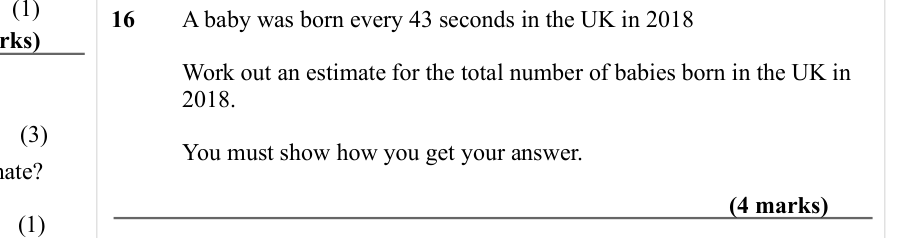

Text (lossy): 16  / A baby was born every 43 seconds in the UK in 2018 / Work out an estimate for the total number of babies born in the UK in  / 2018.  / (3) / You must show how you get your answer.  / (4 marks) / (1)

