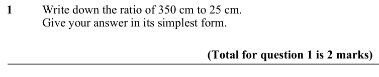
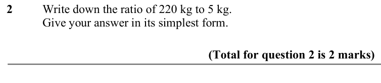
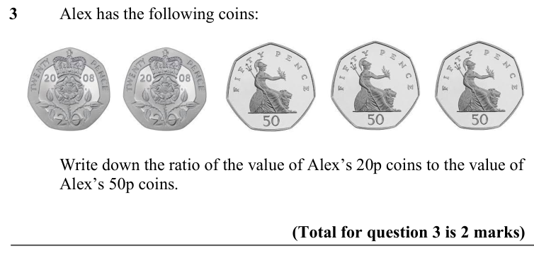
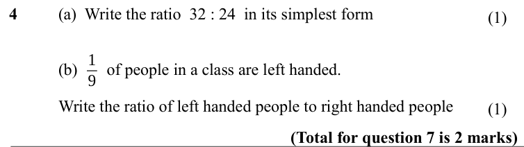
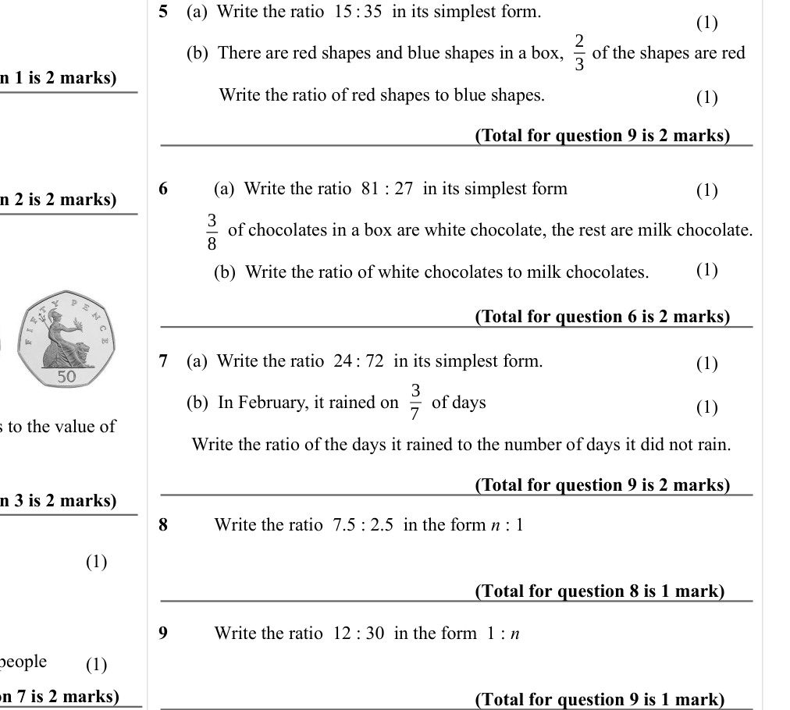

# Writing and Simplifying Ratio — Exam Questions (IGCSE Maths · Edexcel · Grade 3)

Topic code `3.3` · slug `grade-3-3-3-writing-and-simplifying-ratio` · source sheet sha256 `ac8f1073cf634527…`

## Q1 (marks not printed)

Text (lossy): 1       / Write down the ratio of 350 cm to 25 cm.  / Give your answer in its simplest form.  / (Total for question 1 is 2 marks)

## Q2 (marks not printed)

Text (lossy): 2       / Write down the ratio of 220 kg to 5 kg.  / Give your answer in its simplest form.  / (Total for question 2 is 2 marks)

## Q3 (marks not printed)

Text (lossy): 3       / Alex has the following coins: / Write down the ratio of the value of Alex’s 20p coins to the value of  / Alex’s 50p coins.  /                     / (Total for question 3 is 2 marks)

## Q4 (marks not printed · parts a, b)

Text (lossy): 4     / (a)  Write the ratio  32 : 24  in its simplest form / 1 / 9 / (b)       of people in a class are left handed.  / Write the ratio of left handed people to right handed people / (Total for question 7 is 2 marks)

