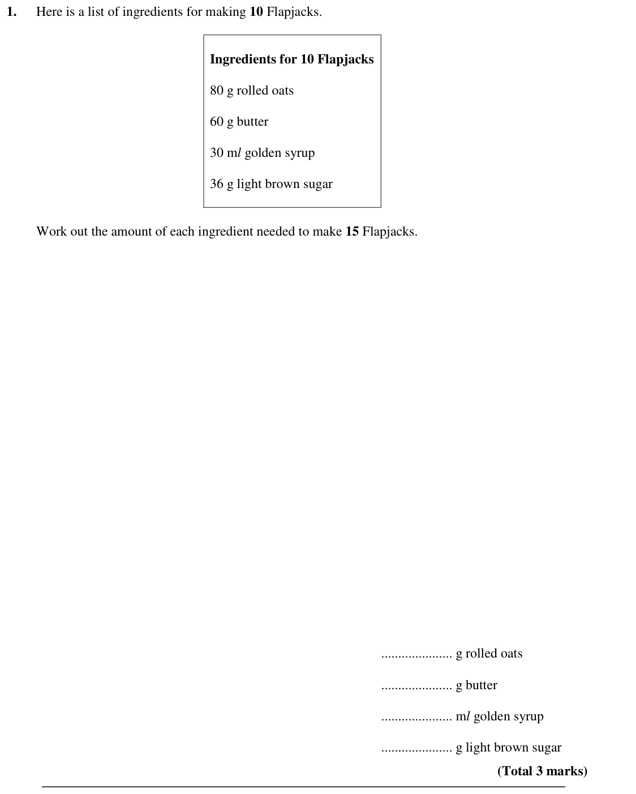
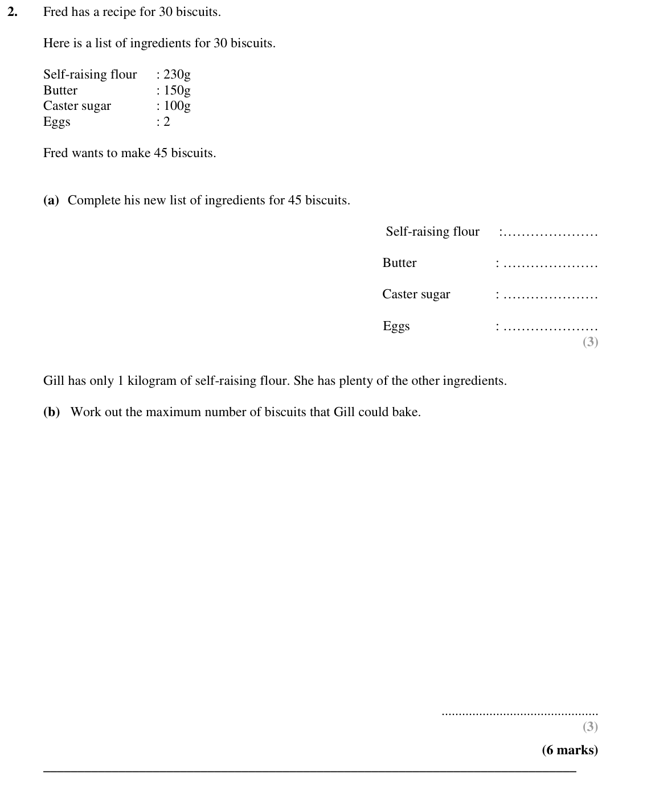
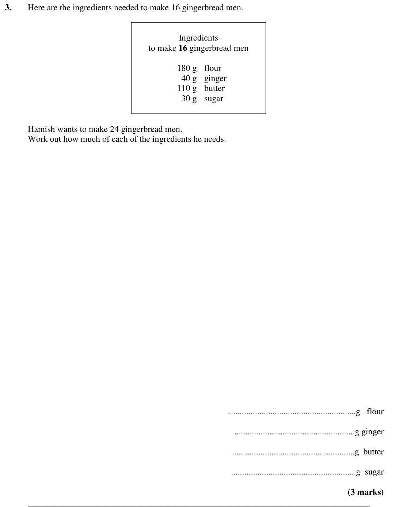
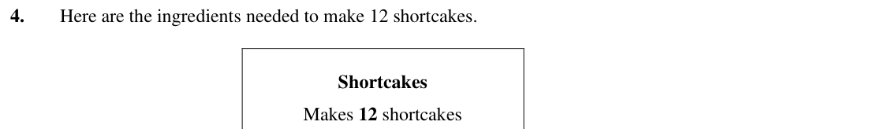
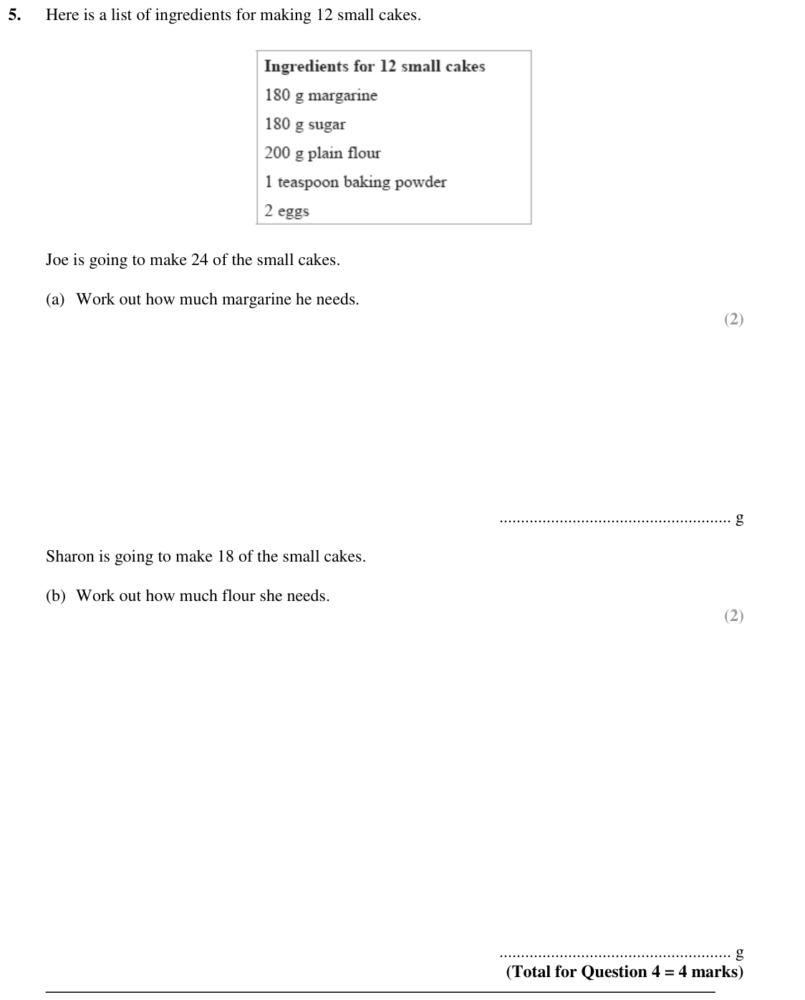
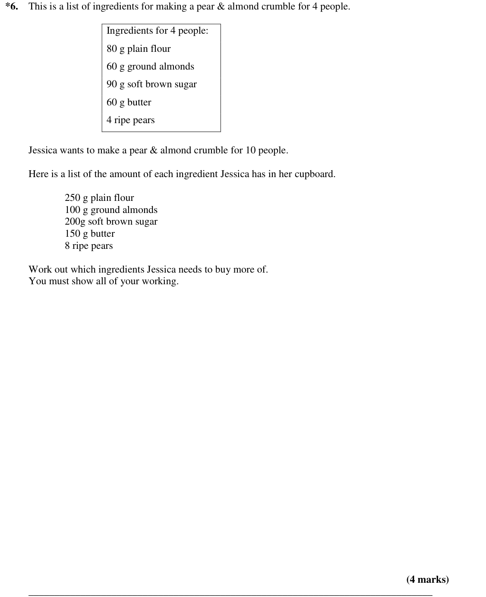

# Proportion — Exam Questions (IGCSE Maths · Edexcel · Grade 3)

Topic code `3.5` · slug `grade-3-3-5-proportion` · source sheet sha256 `64d416d973cc7882…`

## Q1 (marks not printed)

Text (lossy): 1.   / Here is a list of ingredients for making 10 Flapjacks.  /   /   / Ingredients for 10 Flapjacks  /   / 80 g rolled oats  /   / 60 g butter  /   / 30 m l golden syrup  /   / 36 g light brown sugar  /   /   / Work out the amount of each ingredient needed to make 15 Flapjacks.  /   /   /   /   /   /   /   /   /   /   /   /   /   /   /   /   /   /   /   /   /   /   /   /   /   /   /   /   / ....

## Q2 (6 marks · parts a, b)

Text (lossy): 2.  / Fred has a recipe for 30 biscuits.  /   / Here is a list of ingredients for 30 biscuits.  /   / Self-raising flour  / : 230g  / Butter   /   / : 150g  / Caster sugar   / : 100g  / Eggs  /   /   / : 2  /   / Fred wants to make 45 biscuits.  /   /   / (a) Complete his new list of ingredients for 45 biscuits.  /   / Self-raising flour  / :…………………  /   / Butter  /   /   / : …………………  /   / Caster

## Q3 (3 marks)

Text (lossy): 3.   / Here are the ingredients needed to make 16 gingerbread men.  /   /   / Ingredients  / to make 16 gingerbread men  /   /   /             180 g  flour  /   /               40 g  ginger  /   /             110 g  butter  /   /               30 g  sugar  /   /   / Hamish wants to make 24 gingerbread men.  / Work out how much of each of the ingredients he needs.  /   /   /   /   /   /   /   /   /

## Q4 (marks not printed)

Text (lossy): 4.   / Here are the ingredients needed to make 12 shortcakes.  /   /   / Shortcakes  / Makes 12 shortcakes

## Q5 (marks not printed · parts a, b)

Text (lossy): 5.  / Here is a list of ingredients for making 12 small cakes.  /   /   /   / Joe is going to make 24 of the small cakes.  /   / (a)  Work out how much margarine he needs.  / (2)  /   /   /   /   /   /   /   /   /   / ...................................................... g  /   / Sharon is going to make 18 of the small cakes.  /   / (b)  Work out how much flour she needs.  / (2)  /   /   /   /   

