# Percentages — Exam Questions (IGCSE Maths · Edexcel · Grade 3)

Topic code `3.6` · slug `grade-3-3-6-percentages` · source sheet sha256 `26b6477e86233c54…`

## Q1 (marks not printed)

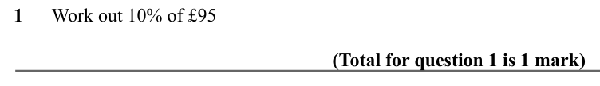

Text (lossy): 1      Work out 10% of £95 /                     / (Total for question 1 is 1 mark)

## Q2 (marks not printed)

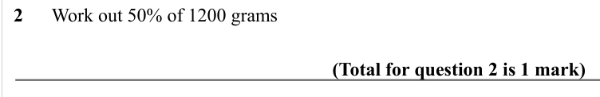

Text (lossy): 2      Work out 50% of 1200 grams /                     / (Total for question 2 is 1 mark)

## Q3 (marks not printed)

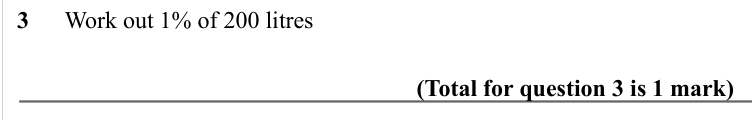

Text (lossy): 3      Work out 1% of 200 litres /                     / (Total for question 3 is 1 mark)

## Q4 (marks not printed)

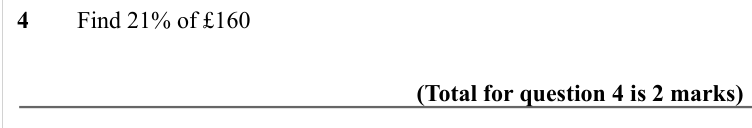

Text (lossy): 4        Find 21% of £160 / (Total for question 4 is 2 marks)

## Q5 (marks not printed)

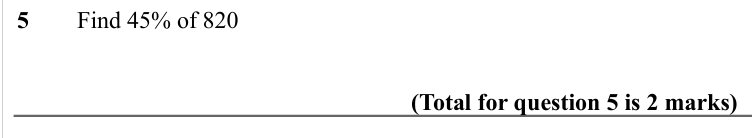

Text (lossy): 5        Find 45% of 820 / (Total for question 5 is 2 marks)

## Q6 (marks not printed)

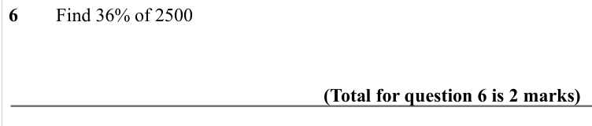

Text (lossy): 6        Find 36% of 2500 / (Total for question 6 is 2 marks)

## Q7 (marks not printed)

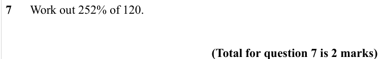

Text (lossy): 7      Work out 252% of 120.                    / (Total for question 7 is 2 marks)

## Q8 (marks not printed)

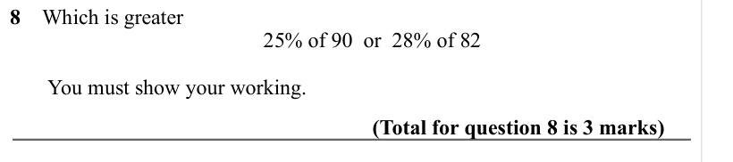

Text (lossy): 8    Which is greater / 25% of 90  or  28% of 82 /        You must show your working.  / (Total for question 8 is 3 marks)

## Q9 (marks not printed)

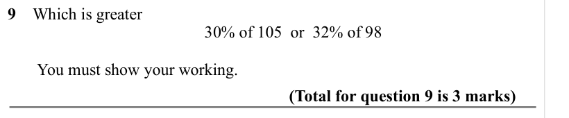

Text (lossy): 9    Which is greater / 30% of 105  or  32% of 98 /        You must show your working.  / (Total for question 9 is 3 marks)

## Q10 (marks not printed)

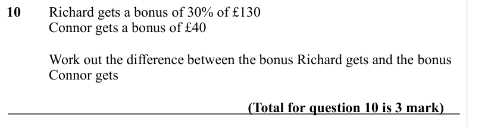

Text (lossy): 10     Richard gets a bonus of 30% of £130 / Connor gets a bonus of £40 /   / Work out the difference between the bonus Richard gets and the bonus  / Connor gets /                     / (Total for question 10 is 3 mark)

## Q11 (marks not printed)

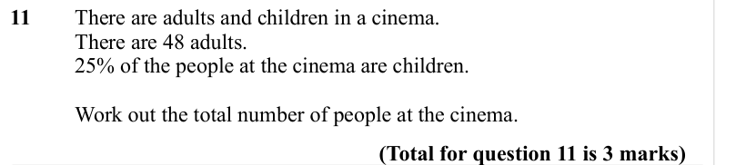

Text (lossy): 11  / There are adults and children in a cinema. /   / There are 48 adults. /   / 25% of the people at the cinema are children. /   / Work out the total number of people at the cinema. /                     / (Total for question 11 is 3 marks)

## Q12 (marks not printed)

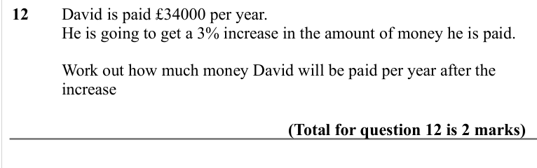

Text (lossy): 12   / David is paid £34000 per year. /   / He is going to get a 3% increase in the amount of money he is paid. /   / Work out how much money David will be paid per year after the  / increase / (Total for question 12 is 2 marks)

## Q13 (marks not printed)

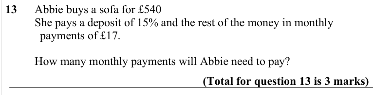

Text (lossy): 13      Abbie buys a sofa for £540 /           She pays a deposit of 15% and the rest of the money in monthly  / payments of £17.  /           How many monthly payments will Abbie need to pay? / (Total for question 13 is 3 marks)

## Q14 (marks not printed)

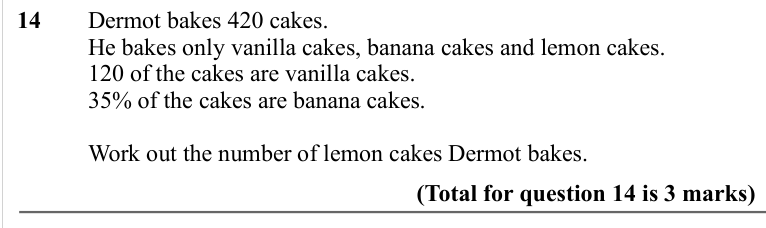

Text (lossy): 14  / Dermot bakes 420 cakes. /   / He bakes only vanilla cakes, banana cakes and lemon cakes. / 120 of the cakes are vanilla cakes. /   / 35% of the cakes are banana cakes. /   / Work out the number of lemon cakes Dermot bakes. /                     / (Total for question 14 is 3 marks)

## Q15 (marks not printed)

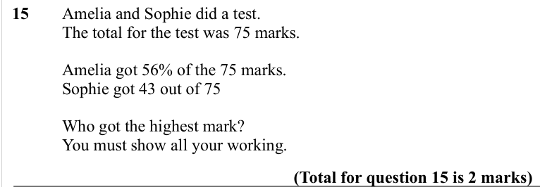

Text (lossy): 15     Amelia and Sophie did a test. / The total for the test was 75 marks. /   / Amelia got 56% of the 75 marks. / Sophie got 43 out of 75 / Who got the highest mark? / You must show all your working. / (Total for question 15 is 2 marks)

## Q16 (marks not printed)

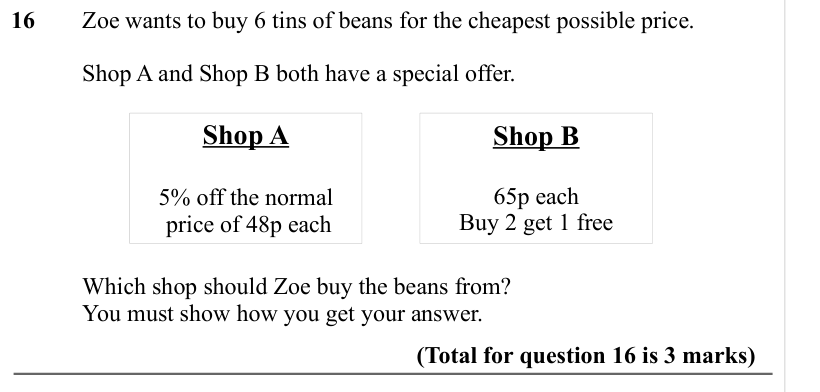

Text (lossy): 16 / Zoe wants to buy 6 tins of beans for the cheapest possible price.  / Shop A and Shop B both have a special offer.  / Shop A / Shop B / 65p each / Buy 2 get 1 free / 5% off the normal /  price of 48p each / Which shop should Zoe buy the beans from? /   / You must show how you get your answer. / (Total for question 16 is 3 marks)

## Q17 (marks not printed)

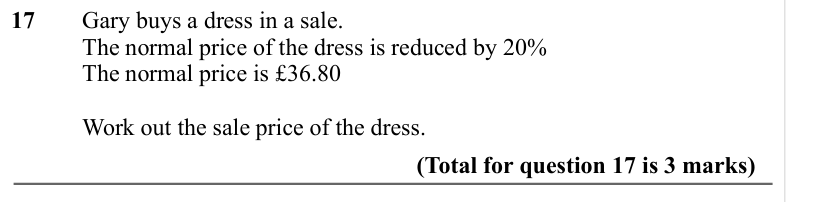

Text (lossy): 17 / Gary buys a dress in a sale. / The normal price of the dress is reduced by 20% / The normal price is £36.80 / Work out the sale price of the dress. / (Total for question 17 is 3 marks)

## Q18 (marks not printed)

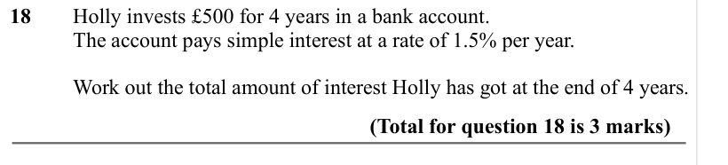

Text (lossy): 18 / Holly invests £500 for 4 years in a bank account. / The account pays simple interest at a rate of 1.5% per year. /   / Work out the total amount of interest Holly has got at the end of 4 years. / (Total for question 18 is 3 marks)

## Q19 (marks not printed)

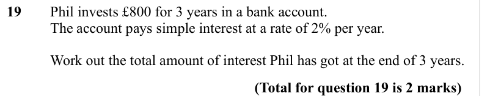

Text (lossy): 19 / Phil invests £800 for 3 years in a bank account. / The account pays simple interest at a rate of 2% per year. /   / Work out the total amount of interest Phil has got at the end of 3 years. / (Total for question 19 is 2 marks)

