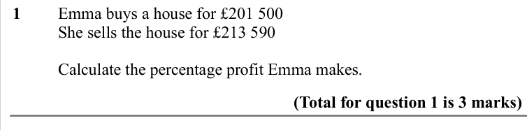
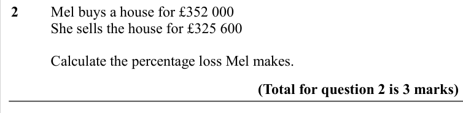
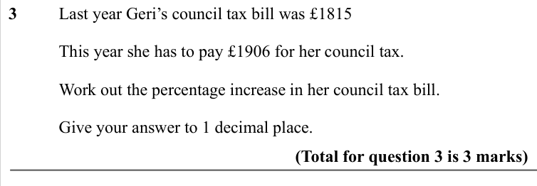
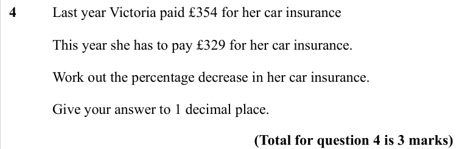
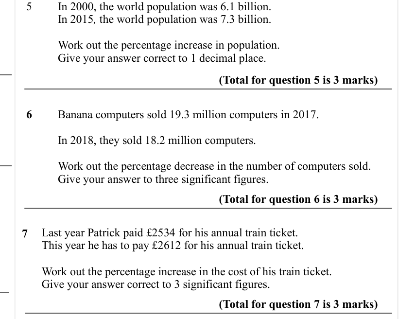

# Percentage Change — Exam Questions (IGCSE Maths · Edexcel · Grade 3)

Topic code `3.7` · slug `grade-3-3-7-percentage-change` · source sheet sha256 `3de7a7e642bd3b0c…`

## Q1 (marks not printed)

Text (lossy): 1  / Emma buys a house for £201 500 / She sells the house for £213 590 / Calculate the percentage profit Emma makes. / (Total for question 1 is 3 marks)

## Q2 (marks not printed)

Text (lossy): 2  / Mel buys a house for £352 000 / She sells the house for £325 600 / Calculate the percentage loss Mel makes. / (Total for question 2 is 3 marks)

## Q3 (marks not printed)

Text (lossy): 3  / Last year Geri’s council tax bill was £1815 /   / This year she has to pay £1906 for her council tax. /   / Work out the percentage increase in her council tax bill. / Give your answer to 1 decimal place. / (Total for question 3 is 3 marks)

## Q4 (marks not printed)

Text (lossy): 4  / Last year Victoria paid £354 for her car insurance /   / This year she has to pay £329 for her car insurance. /   / Work out the percentage decrease in her car insurance. / Give your answer to 1 decimal place. / (Total for question 4 is 3 marks)

