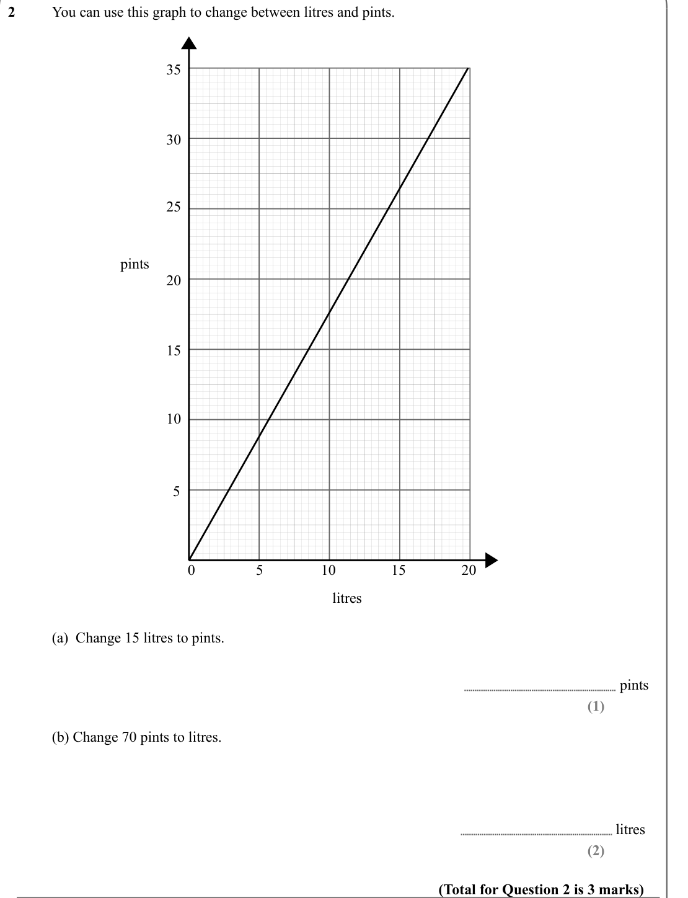
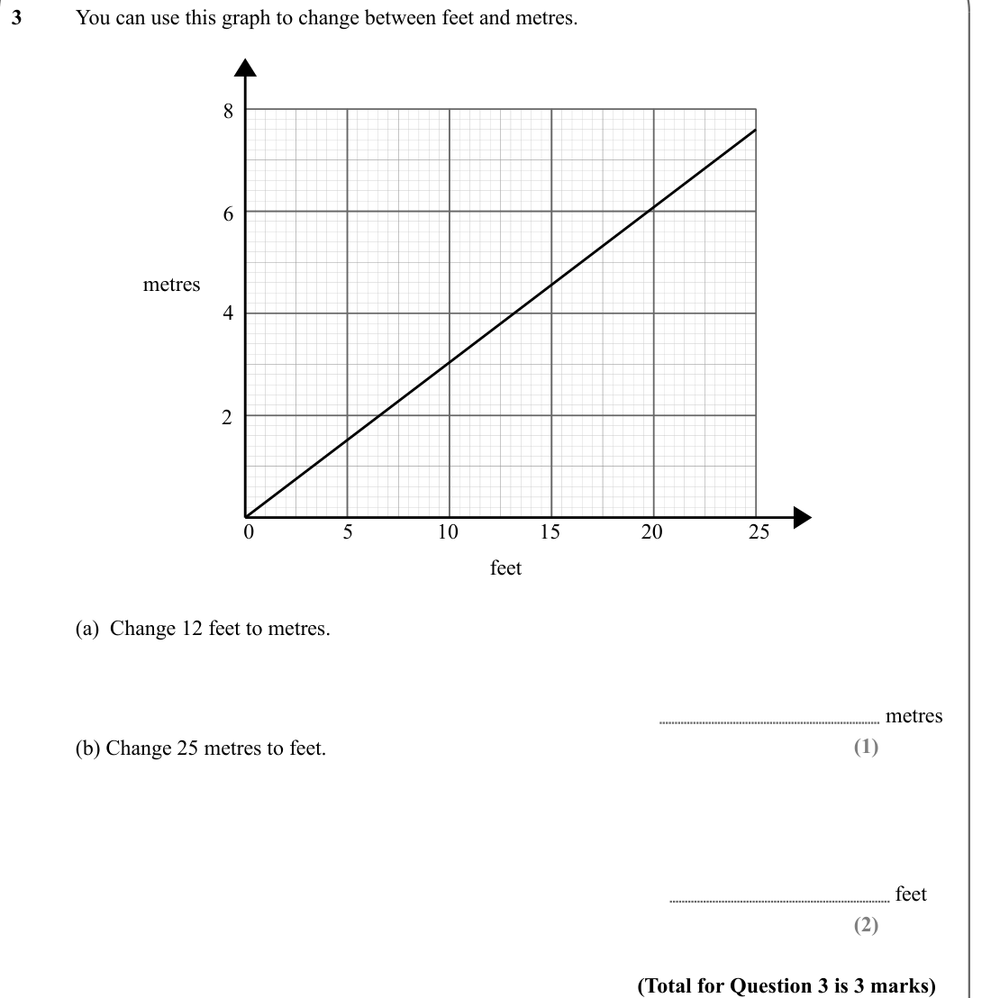
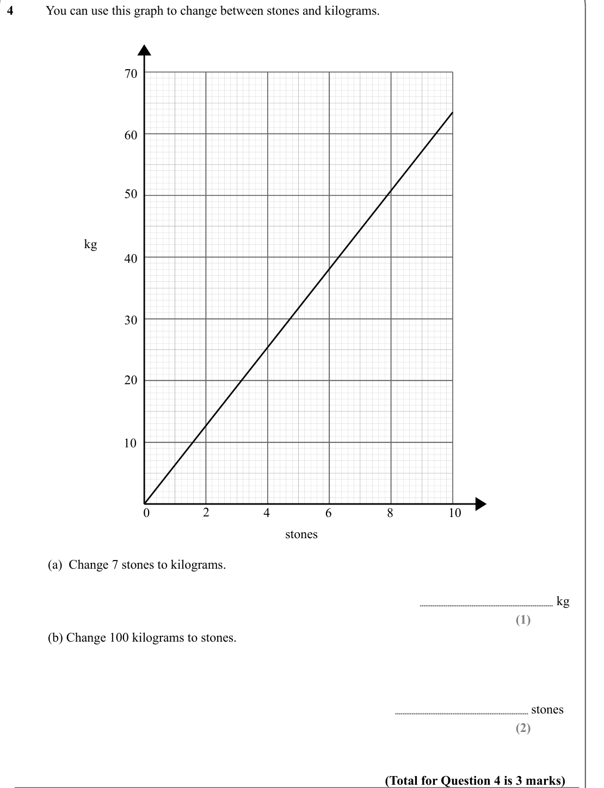
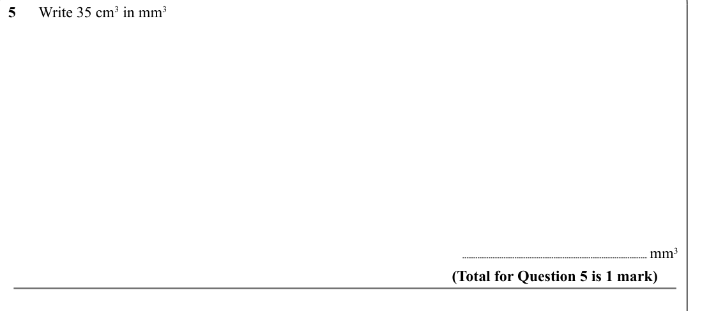
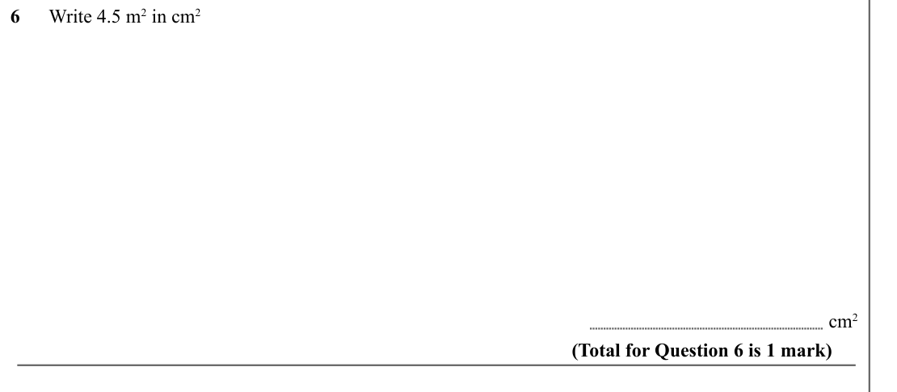
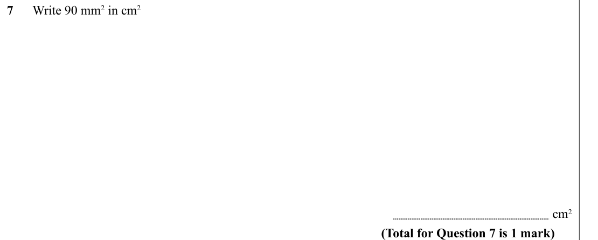
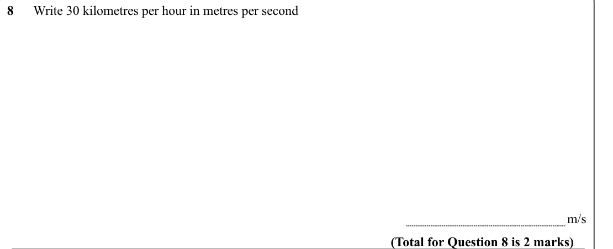
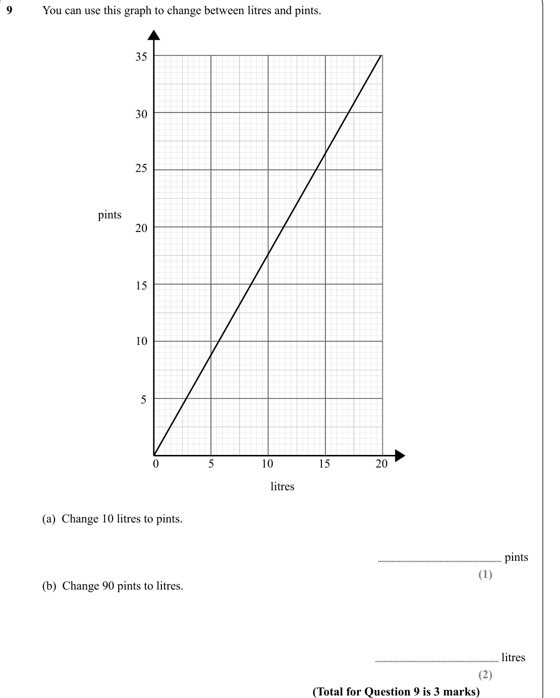

# Conversions and Units — Exam Questions (IGCSE Maths · Edexcel · Grade 3)

Topic code `3.9` · slug `grade-3-3-9-conversions-and-units` · source sheet sha256 `46964c24866e4ccb…`

## Q1 (marks not printed · parts a, b)

Text (lossy): 1    / You can use this graph to change between inches and centimetres.  / 28 / 24 / 20 / cm / 16 / 12 / 8 / 4 / 0 / 2 / 4 / 6 / 8 / 10 / inches / (a)  Change 3 inches to cm  / cm / (1) / (b) Change 50 cm to inches /   / inches / (2) / (Total for Question 1 is 3 marks)

## Q2 (marks not printed · parts a, b)

Text (lossy): 2     / You can use this graph to change between litres and pints.  / 35 / 30 / 25 / pints / 20 / 15 / 10 / 5 / 0 / 5 / 10 / 15 / 20 / litres / (a)  Change 15 litres to pints.  / pints / (1) / (b) Change 70 pints to litres.  /   / litres / (2) / (Total for Question 2 is 3 marks)

## Q3 (marks not printed · parts a, b)

Text (lossy): 3     / You can use this graph to change between feet and metres.  / 8 / 6 / metres / 4 / 2 / 0 / 5 / 10 / 15 / 20 / 25 / feet / (a)  Change 12 feet to metres.  / metres / (1) / (b) Change 25 metres to feet. /   / feet / (2) / (Total for Question 3 is 3 marks)

## Q4 (marks not printed · parts a, b)

Text (lossy): 4     / You can use this graph to change between stones and kilograms.  / 70 / 60 / 50 / kg / 40 / 30 / 20 / 10 / 0 / 2 / 4 / 6 / 8 / 10 / stones / (a)  Change 7 stones to kilograms.  / kg / (1) / (b) Change 100 kilograms to stones. /   / stones / (2) / (Total for Question 4 is 3 marks)

## Q5 (marks not printed)

Text (lossy): 5      Write 35 cm 3 in mm 3 /                     / mm 3 / (Total for Question 5 is 1 mark)

## Q6 (marks not printed)

Text (lossy): 6      Write 4.5 m 2 in cm 2 /                     / cm 2 / (Total for Question 6 is 1 mark)

## Q7 (marks not printed)

Text (lossy): 7      Write 90 mm 2 in cm 2 /                     / cm 2 / (Total for Question 7 is 1 mark)

## Q8 (marks not printed)

Text (lossy): 8      Write 30 kilometres per hour in metres per second /                     /  m/s / (Total for Question 8 is 2 marks)

## Q9 (marks not printed · parts a, b)

Text (lossy): 9    / You can use this graph to change between litres and pints.  / 35 / 30 / 25 / pints / 20 / 15 / 10 / 5 / 0 / 5 / 10 / 15 / 20 / litres / (a)  Change 10 litres to pints.  / pints / (1) / (b)  Change 90 pints to litres.  /   / litres / (2) / (Total for Question 9 is 3 marks)

