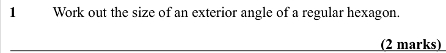
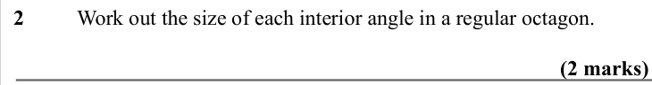
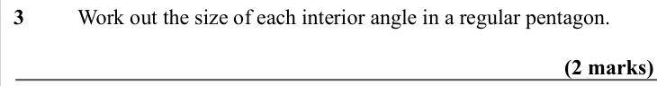
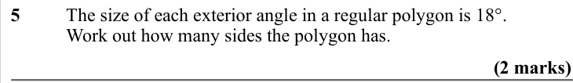
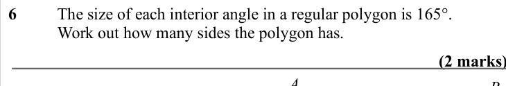
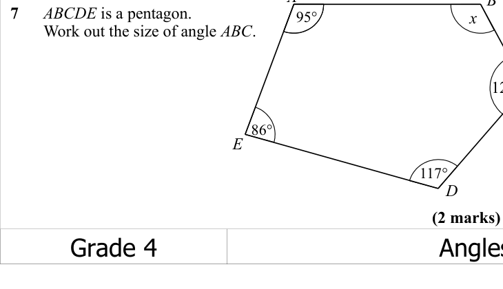
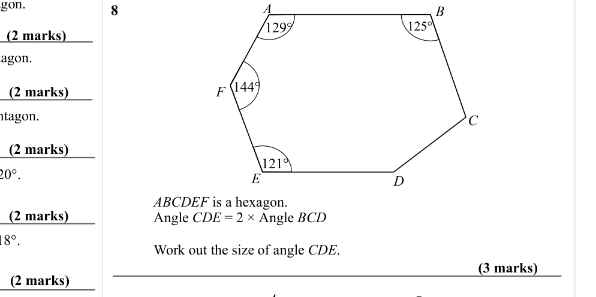

# Angles in Polygons — Exam Questions (IGCSE Maths · Edexcel · Grade 4)

Topic code `4.11` · slug `grade-4-4-11-angles-in-polygons` · source sheet sha256 `55452c9d5eac1311…`

## Q1 (marks not printed)

Text (lossy): 1  / Work out the size of an exterior angle of a regular hexagon.

## Q2 (marks not printed)

Text (lossy): 2  / Work out the size of each interior angle in a regular octagon.

## Q3 (marks not printed)

Text (lossy): 3  / Work out the size of each interior angle in a regular pentagon.

## Q4 (marks not printed)

Text (lossy): 4  / The size of each exterior angle in a regular polygon is 20°.  / Work out how many sides the polygon has.

## Q5 (marks not printed)

Text (lossy): 5  / The size of each exterior angle in a regular polygon is 18°.  / Work out how many sides the polygon has.

## Q6 (marks not printed)

Text (lossy): 6  / The size of each interior angle in a regular polygon is 165°.  / Work out how many sides the polygon has.  / A / B

## Q7 (marks not printed)

Text (lossy): 7      ABCDE is a pentagon.  /         Work out the size of angle ABC. / x / 95° /        / 86° / E / 117° / D

