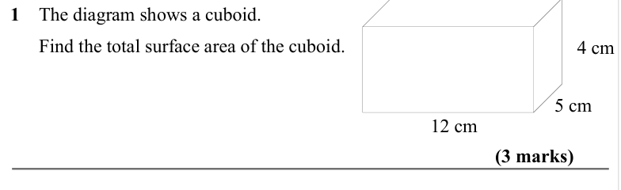
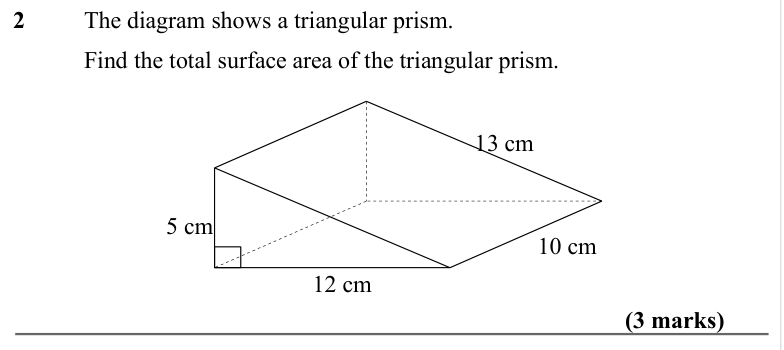
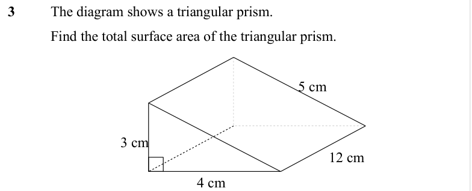
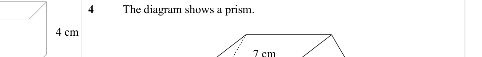
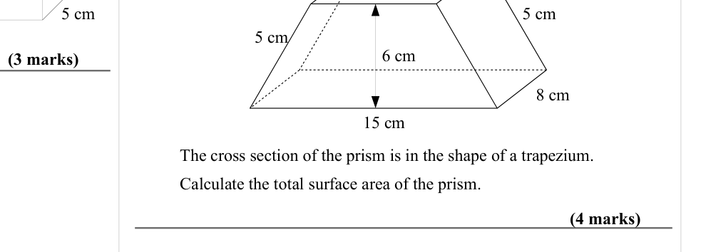
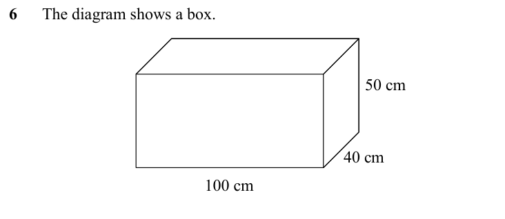
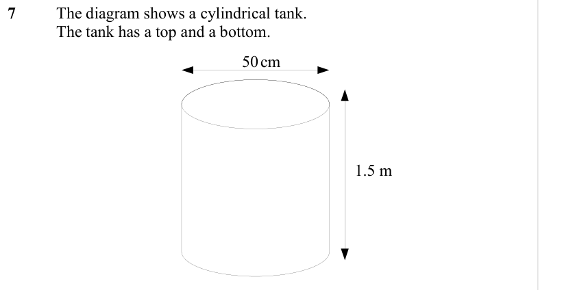

# Surface Area — Exam Questions (IGCSE Maths · Edexcel · Grade 4)

Topic code `4.12` · slug `grade-4-4-12-surface-area` · source sheet sha256 `b5f77fcbc8da7f1e…`

## Q1 (marks not printed)

Text (lossy): 1    The diagram shows a cuboid. /       Find the total surface area of the cuboid.  / 4 cm / 12 cm

## Q2 (marks not printed)

Text (lossy): 2   / The diagram shows a triangular prism. / Find the total surface area of the triangular prism.  / 13 cm / 10 cm / 5 cm / 12 cm

## Q3 (marks not printed)

Text (lossy): 3   / The diagram shows a triangular prism. / Find the total surface area of the triangular prism.  / 5 cm / 3 cm / 12 cm / 4 cm

## Q4 (marks not printed)

Text (lossy): 4     / The diagram shows a prism.   / 7 cm

## Q5 (7 marks)

Text (lossy): 5 cm / 5 cm / 5 cm / 6 cm / (3 marks) / 8 cm / 15 cm / The cross section of the prism is in the shape of a trapezium.  / Calculate the total surface area of the prism.      / (4 marks)

## Q6 (marks not printed)

Text (lossy): 6      The diagram shows a box.  / 50 cm / 40 cm /   / 100 cm

## Q7 (marks not printed)

Text (lossy): 7   / The diagram shows a cylindrical tank.  / The tank has a top and a bottom.  / 50 cm  /  1.5 m

