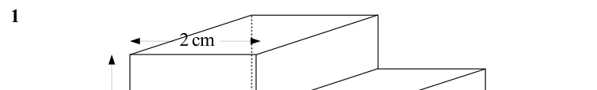
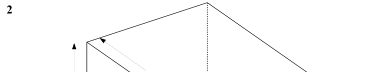
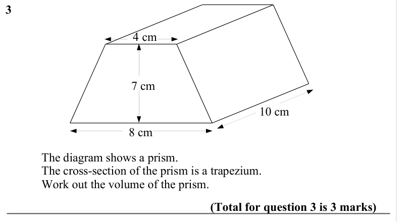
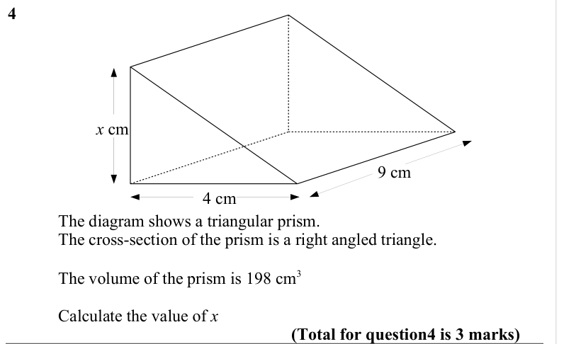
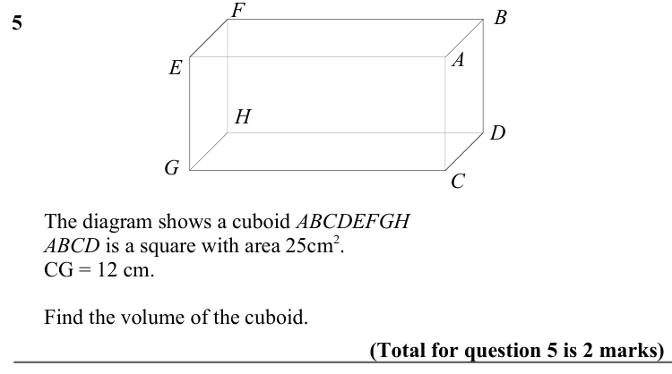
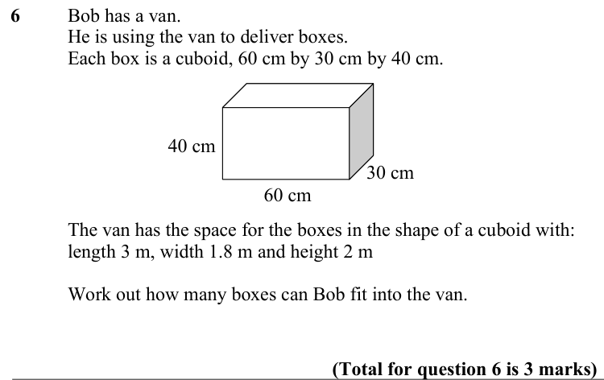
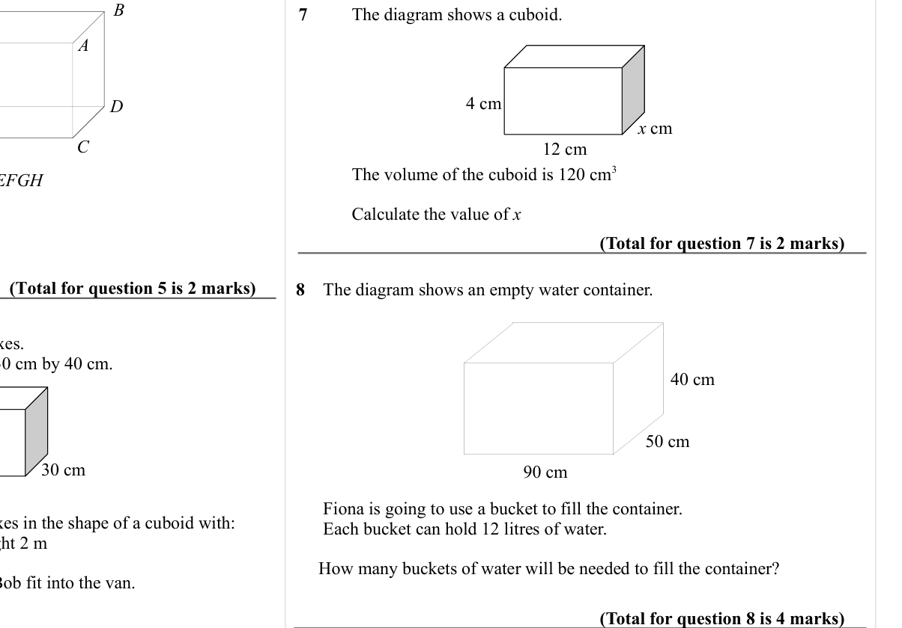

# Volume of a Prism — Exam Questions (IGCSE Maths · Edexcel · Grade 4)

Topic code `4.13` · slug `grade-4-4-13-volume-of-a-prism` · source sheet sha256 `dd92cd38a6e7e351…`

## Q1 (marks not printed)

Text (lossy): 1 / 2 cm

## Q2 (marks not printed)

Text (lossy): 2

## Q3 (marks not printed)

Text (lossy): 3     / 4 cm / 7 cm / 10 cm / 8 cm / The diagram shows a prism.  / The cross-section of the prism is a trapezium. / Work out the volume of the prism.  / (Total for question 3 is 3 marks)

## Q4 (marks not printed)

Text (lossy): 4 / x cm / 9 cm / 4 cm / The diagram shows a triangular prism.  / The cross-section of the prism is a right angled triangle. / The volume of the prism is 198 cm 3 / Calculate the value of x / (Total for question4 is 3 marks)

## Q5 (marks not printed)

Text (lossy): 5     / B / A / E / H / D / G / C /       The diagram shows a cuboid ABCDEFGH  /       ABCD is a square with area 25cm 2.             /       CG = 12 cm.  /       Find the volume of the cuboid.

## Q6 (marks not printed)

Text (lossy): 6 / Bob has a van.  / He is using the van to deliver boxes. / Each box is a cuboid, 60 cm by 30 cm by 40 cm.  / 40 cm / 30 cm / 60 cm / The van has the space for the boxes in the shape of a cuboid with: / length 3 m, width 1.8 m and height 2 m / Work out how many boxes can Bob fit into the van.  / (Total for question 6 is 3 marks)

## Q7 (marks not printed)

Text (lossy): 7 / The diagram shows a cuboid.  / 4 cm / x cm / 12 cm / The volume of the cuboid is 120 cm 3 / Calculate the value of x / (Total for question 7 is 2 marks) / (Total for question 5 is 2 marks) / 8    The diagram shows an empty water container.  / 40 cm / 50 cm / 90 cm /       Fiona is going to use a bucket to fill the container.  /       Each bucket can hold 12 litres of water.  /      How many bu

