# Cylinders — Exam Questions (IGCSE Maths · Edexcel · Grade 4)

Topic code `4.14` · slug `grade-4-4-14-cylinders` · source sheet sha256 `c05e8306836bc1dd…`

## Q1 (3 marks)

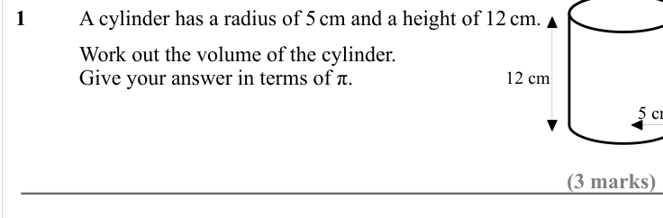

Text (lossy): 1     / A cylinder has a radius of 5 cm and a height of 12 cm.  /       / Work out the volume of the cylinder.  / Give your answer in terms of π. / 12 cm  /   / (3 marks)

## Q2 (3 marks)

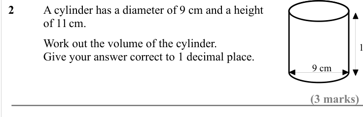

Text (lossy): 2     / A cylinder has a diameter of 9 cm and a height  / of 11 cm.  /       / Work out the volume of the cylinder.  / Give your answer correct to 1 decimal place. / 9 cm   / (3 marks)

## Q3 (3 marks)

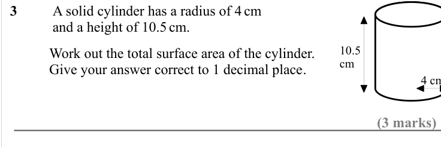

Text (lossy): 3     / A solid cylinder has a radius of 4 cm / and a height of 10.5 cm.  / 10.5  / cm   /       / Work out the total surface area of the cylinder.  / Give your answer correct to 1 decimal place. / (3 marks)

## Q4 (3 marks)

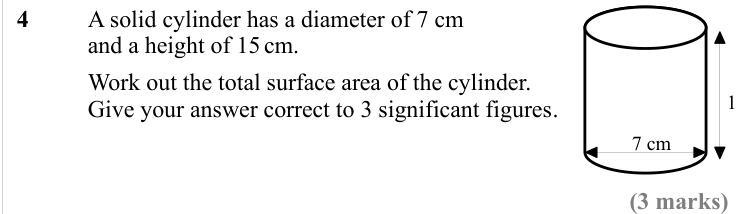

Text (lossy): 4    / A solid cylinder has a diameter of 7 cm / and a height of 15 cm.  /       / Work out the total surface area of the cylinder.  / Give your answer correct to 3 significant figures. / 7 cm   / (3 marks)

## Q5 (marks not printed)

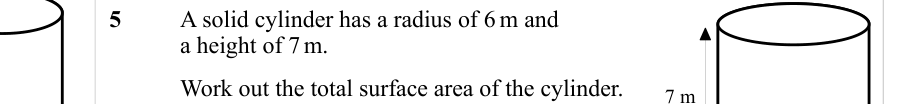

Text (lossy): 5     / A solid cylinder has a radius of 6 m and  / a height of 7 m.  /       / Work out the total surface area of the cylinder.  / Give your answer in terms of π. / 7 m

## Q6 (marks not printed)

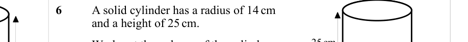

Text (lossy): 6     / A solid cylinder has a radius of 14 cm  / and a height of 25 cm.  / 25 cm   /       / Work out the volume of the cylinder.  / Give your answer correct to  / 3 significant figures.  / 14 cm

## Q7 (marks not printed)

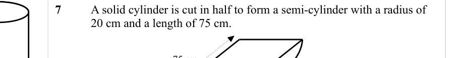

Text (lossy): 7     / A solid cylinder is cut in half to form a semi-cylinder with a radius of  / 20 cm and a length of 75 cm.  / 75 cm

## Q8 (4 marks)

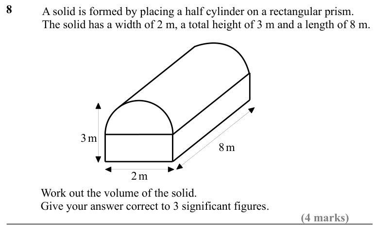

Text (lossy): 8     / A solid is formed by placing a half cylinder on a rectangular prism.  / The solid has a width of 2 m, a total height of 3 m and a length of 8 m. / 8 m   / 3 m   / 2 m   /       / Work out the volume of the solid.  / Give your answer correct to 3 significant figures. / (4 marks)

## Q9 (4 marks)

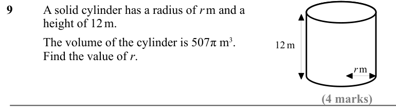

Text (lossy): 9     / A solid cylinder has a radius of r m and a / height of 12 m.  /       / The volume of the cylinder is 507π m 3. / Find the value of r.  / 12 m   / r m   / (4 marks)

## Q10 (4 marks)

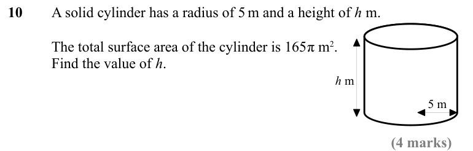

Text (lossy): 10     / A solid cylinder has a radius of 5 m and a height of h  m.  /       / The total surface area of the cylinder is 165π m 2. / Find the value of h.  / h m   / 5 m   / (4 marks)

## Q11 (marks not printed)

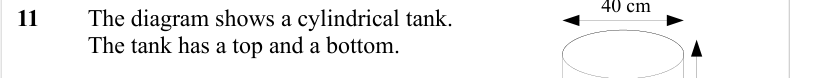

Text (lossy): 11   / The diagram shows a cylindrical tank.  / The tank has a top and a bottom.

## Q12 (4 marks · parts a, b)

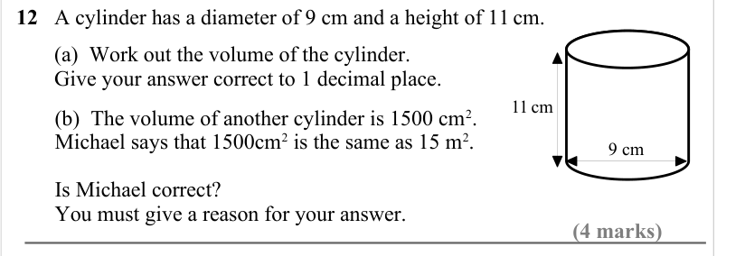

Text (lossy): 12   A cylinder has a diameter of 9 cm and a height of 11 cm.  /        (a)  Work out the volume of the cylinder.  /        Give your answer correct to 1 decimal place. / 11 cm   /         (b)  The volume of another cylinder is 1500 cm 2.  /         Michael says that 1500cm 2 is the same as 15 m 2.  / 9 cm /         Is Michael correct? /         You must give a reason for your answer. / (4 marks)

## Q13 (4 marks)

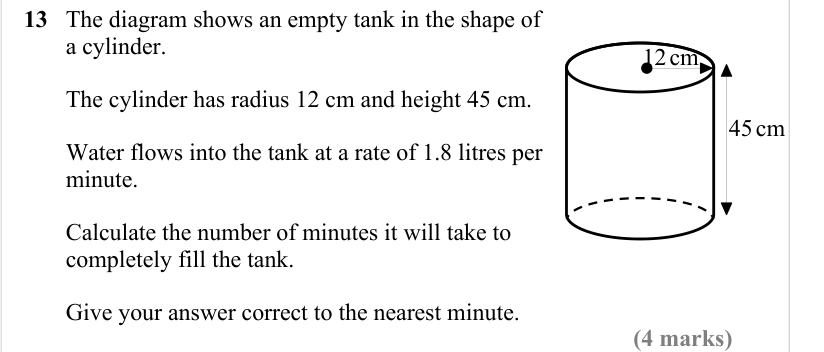

Text (lossy): 13   The diagram shows an empty tank in the shape of     /        a cylinder. / 12 cm   /        The cylinder has radius 12 cm and height 45 cm. / 45 cm   /        Water flows into the tank at a rate of 1.8 litres per     /        minute. /   /        Calculate the number of minutes it will take to          /        completely fill the tank. /        Give your answer correct to the nearest minute.

