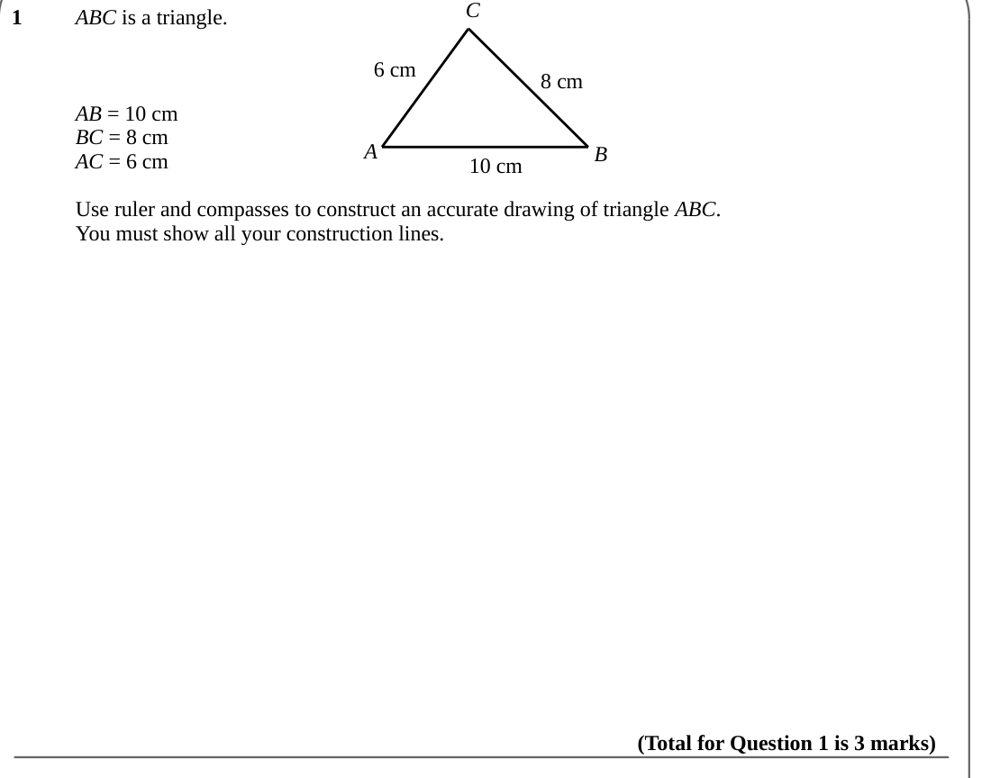
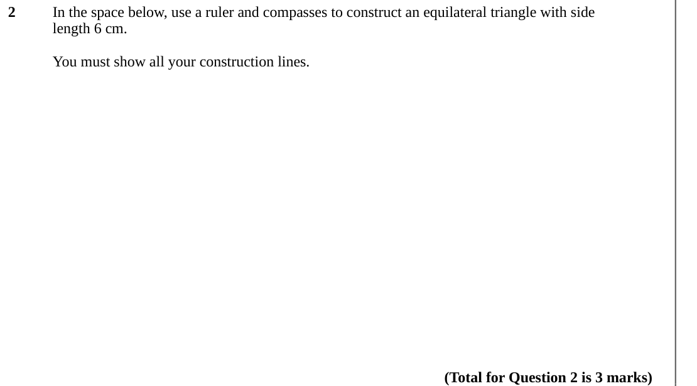
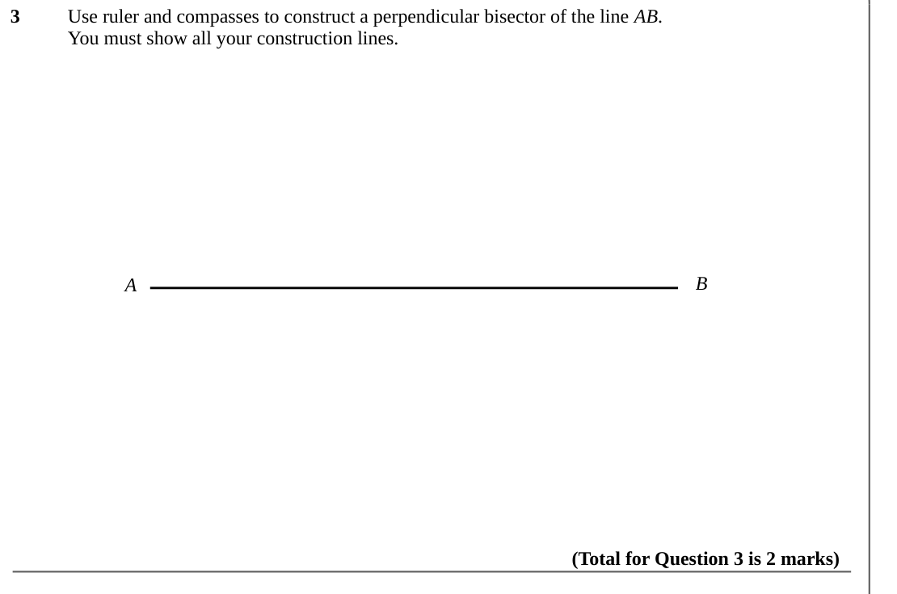
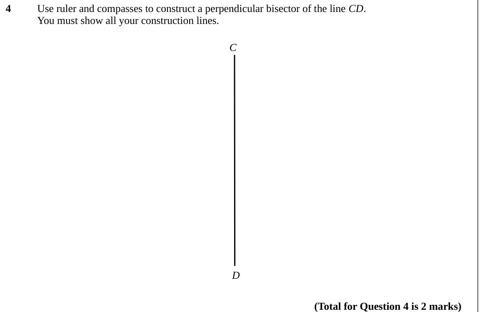
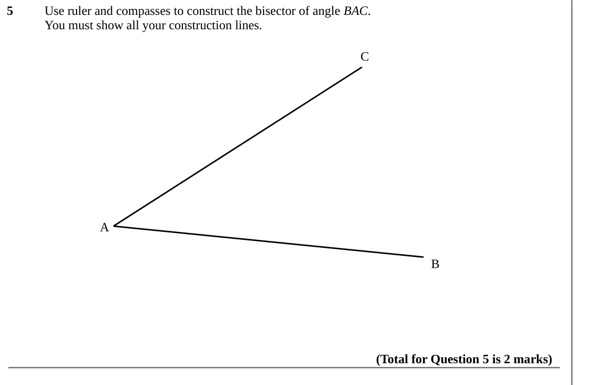
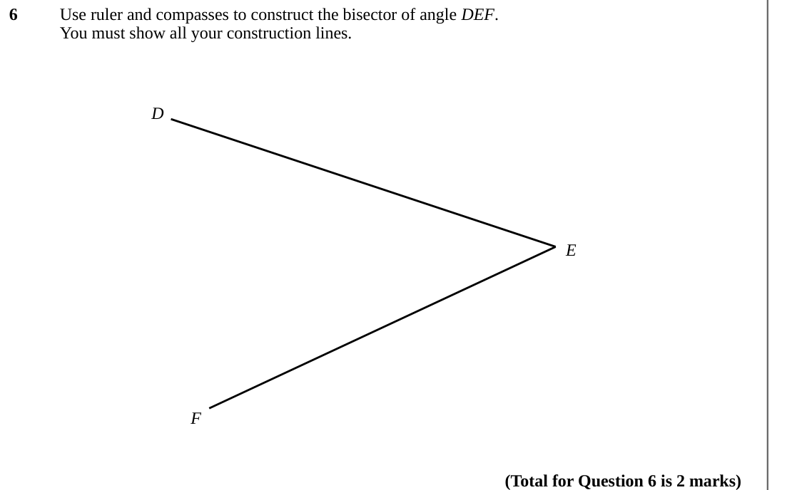

# Construction — Exam Questions (IGCSE Maths · Edexcel · Grade 4)

Topic code `4.15` · slug `grade-4-4-15-construction` · source sheet sha256 `bea6be7c366ef54a…`

## Q1 (marks not printed)

Text (lossy): 1 / ABC is a triangle.  / 8 cm / 6 cm / AB = 10 cm / BC = 8 cm / AC = 6 cm / A / B / 10 cm / Use ruler and compasses to construct an accurate drawing of triangle ABC.  / You must show all your construction lines.  / (Total for Question 1 is 3 marks)

## Q2 (marks not printed)

Text (lossy): 2 / In the space below, use a ruler and compasses to construct an equilateral triangle with side  / length 6 cm.   / You must show all your construction lines.  / (Total for Question 2 is 3 marks)

## Q3 (marks not printed)

Text (lossy): 3 / Use ruler and compasses to construct a perpendicular bisector of the line AB. /   / You must show all your construction lines. / A  / B  / (Total for Question 3 is 2 marks)

## Q4 (marks not printed)

Text (lossy): 4 / Use ruler and compasses to construct a perpendicular bisector of the line CD. /   / You must show all your construction lines. / C  / D / (Total for Question 4 is 2 marks)

## Q5 (marks not printed)

Text (lossy): 5 / Use ruler and compasses to construct the bisector of angle BAC. /   / You must show all your construction lines. / C / A  / B  / (Total for Question 5 is 2 marks)

## Q6 (marks not printed)

Text (lossy): 6 / Use ruler and compasses to construct the bisector of angle DEF. /   / You must show all your construction lines. / D / E  / F / (Total for Question 6 is 2 marks)

