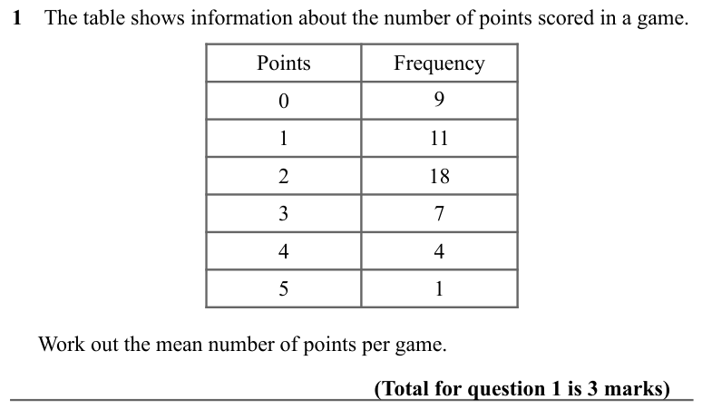
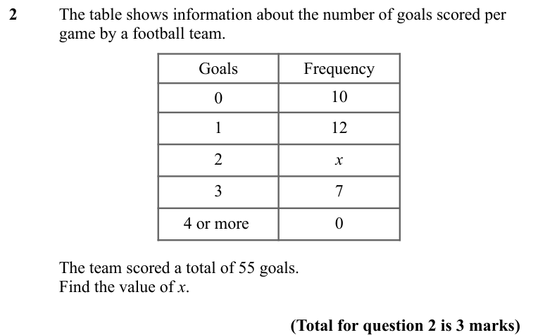
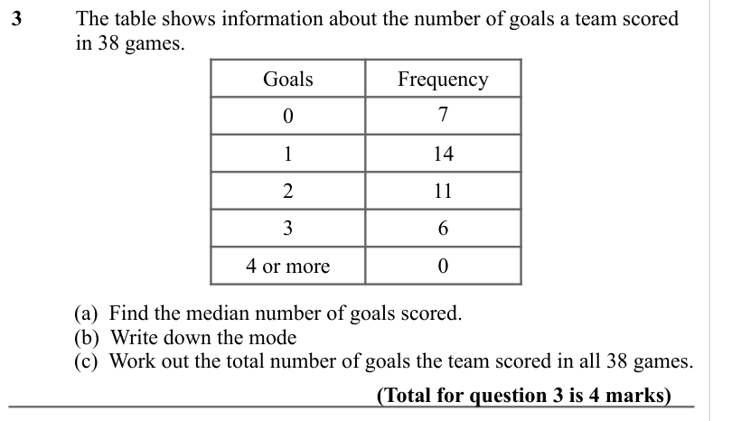
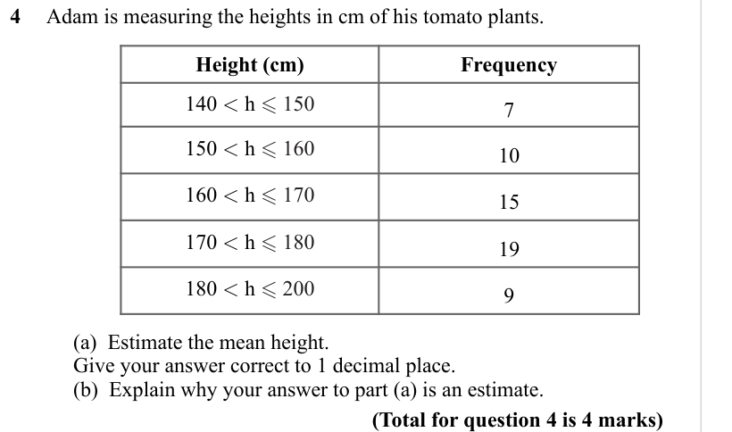
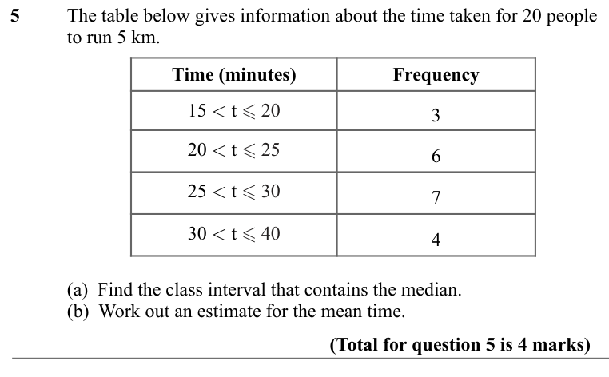
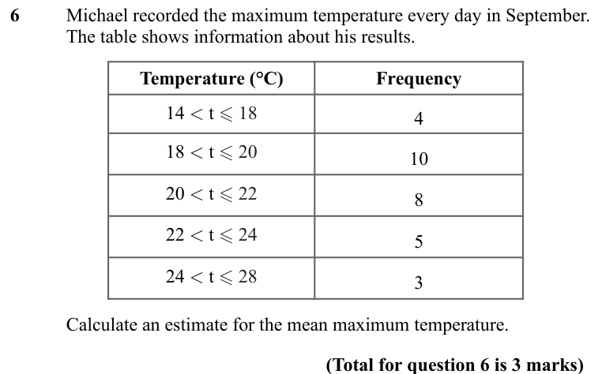
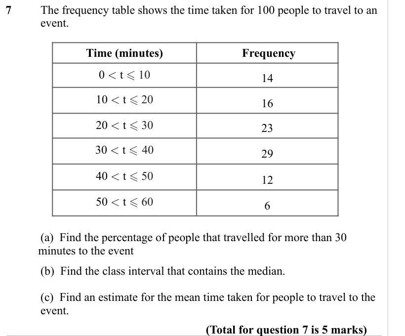
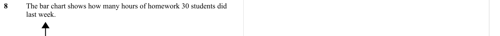

# Averages from Frequency Tables — Exam Questions (IGCSE Maths · Edexcel · Grade 4)

Topic code `4.17` · slug `grade-4-4-17-averages-from-frequency-tables` · source sheet sha256 `659faea411869684…`

## Q1 (marks not printed)

Text (lossy): 1    The table shows information about the number of points scored in a game.  / Points / Frequency / 0 / 9 / 1 / 11 / 2 / 18 / 3 / 7 / 4 / 4 / 5 / 1 /      Work out the mean number of points per game.  / (Total for question 1 is 3 marks)

## Q2 (marks not printed)

Text (lossy): 2     / The table shows information about the number of goals scored per  / game by a football team.  / Goals / Frequency / 0 / 10 / 1 / 12 / 2 / x / 3 / 7 / 4 or more  / 0 /       / The team scored a total of 55 goals.  / Find the value of x.   / (Total for question 2 is 3 marks)

## Q3 (marks not printed · parts a, b, c)

Text (lossy): 3    / The table shows information about the number of goals a team scored  / in 38 games.  / Goals / Frequency / 0 / 7 / 1 / 14 / 2 / 11 / 3 / 6 / 4 or more / 0 /       / (a)  Find the median number of goals scored.  / (b)  Write down the mode /       / (c)  Work out the total number of goals the team scored in all 38 games.  / (Total for question 3 is 4 marks)

## Q4 (marks not printed · parts a, b)

Text (lossy): 4     Adam is measuring the heights in cm of his tomato plants.   / Height (cm) / Frequency / 140 < h  150 / 7 / 150 < h  160 / 10 / 160 < h  170 / 15 / 170 < h  180 / 19 / 180 < h  200 / 9 /        / (a)  Estimate the mean height. / Give your answer correct to 1 decimal place.  / (b)  Explain why your answer to part (a) is an estimate.   / (Total for question 4 is 4 marks)

## Q5 (marks not printed · parts a, b)

Text (lossy): 5      / The table below gives information about the time taken for 20 people  / to run 5 km. / Time (minutes) / Frequency / 15 < t  20 / 3 / 20 < t  25 / 6 / 25 < t  30 / 7 / 30 < t  40 / 4 /    / (a)  Find the class interval that contains the median.  / (b)  Work out an estimate for the mean time. / (Total for question 5 is 4 marks)

## Q6 (marks not printed)

Text (lossy): 6 / Michael recorded the maximum temperature every day in September.  / The table shows information about his results.  / Temperature (°C) / Frequency / 14 < t  18 / 4 / 18 < t  20 / 10 / 20 < t  22 / 8 / 22 < t  24 / 5 / 24 < t  28 / 3 / Calculate an estimate for the mean maximum temperature.  / (Total for question 6 is 3 marks)

## Q7 (marks not printed · parts a, b, c)

Text (lossy): 7   / The frequency table shows the time taken for 100 people to travel to an  / event. / Time (minutes) /  Frequency / 0 < t  10 / 14 / 10 < t  20 / 16 / 20 < t  30 / 23 / 30 < t  40 / 29 / 40 < t  50 / 12 / 50 < t  60 / 6 /      / (a)  Find the percentage of people that travelled for more than 30  /            minutes to the event /      / (b)  Find the class interval that contains the med

## Q8 (marks not printed)

Text (lossy): 8    / The bar chart shows how many hours of homework 30 students did  / last week.

