# Probability — Exam Questions (IGCSE Maths · Edexcel · Grade 4)

Topic code `4.18` · slug `grade-4-4-18-probability` · source sheet sha256 `3e75b17b4496f934…`

## Q1 (2 marks)

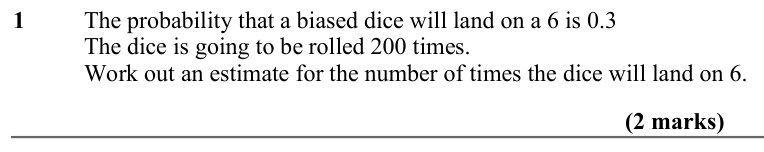

Text (lossy): 1     / The probability that a biased dice will land on a 6 is 0.3 / The dice is going to be rolled 200 times.  / Work out an estimate for the number of times the dice will land on 6.  / (2 marks)

## Q2 (2 marks)

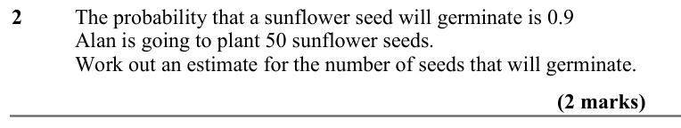

Text (lossy): 2     / The probability that a sunflower seed will germinate is 0.9  / Alan is going to plant 50 sunflower seeds. / Work out an estimate for the number of seeds that will germinate.  / (2 marks)

## Q3 (2 marks)

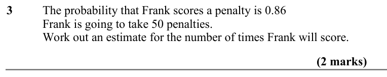

Text (lossy): 3     / The probability that Frank scores a penalty is 0.86  / Frank is going to take 50 penalties. / Work out an estimate for the number of times Frank will score.  / (2 marks)

## Q4 (2 marks)

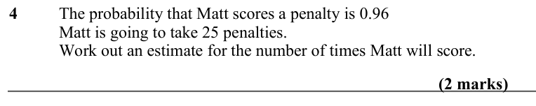

Text (lossy): 4     / The probability that Matt scores a penalty is 0.96 / Matt is going to take 25 penalties.  / Work out an estimate for the number of times Matt will score.  / (2 marks)

## Q5 (2 marks)

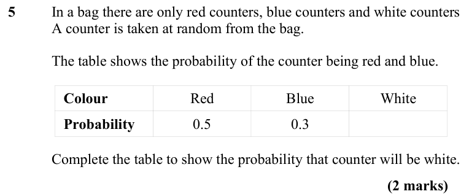

Text (lossy): 5     / In a bag there are only red counters, blue counters and white counters / A counter is taken at random from the bag. / The table shows the probability of the counter being red and blue. / Colour / Red / Blue / White / Probability / 0.5 / 0.3 / Complete the table to show the probability that counter will be white.  / (2 marks)

## Q6 (2 marks)

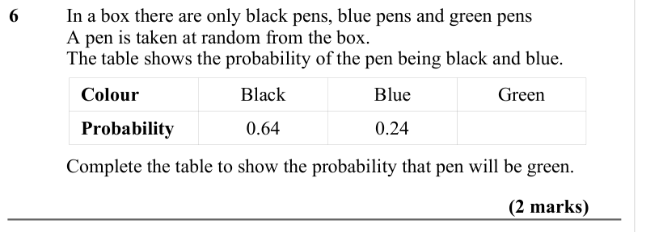

Text (lossy): 6     / In a box there are only black pens, blue pens and green pens / A pen is taken at random from the box. / The table shows the probability of the pen being black and blue. / Colour / Black / Blue / Green / Probability / 0.64 / 0.24 / Complete the table to show the probability that pen will be green.  / (2 marks)

## Q7 (2 marks)

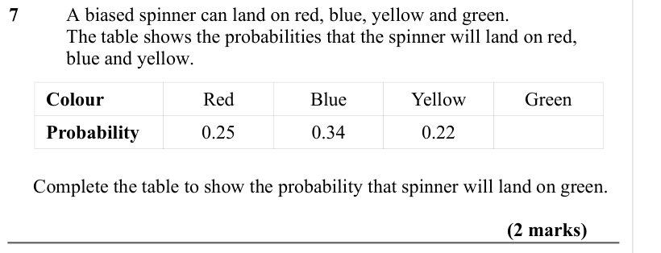

Text (lossy): 7     / A biased spinner can land on red, blue, yellow and green. / The table shows the probabilities that the spinner will land on red,  / blue and yellow. / Colour / Red / Blue / Yellow / Green / Probability / 0.25 / 0.34 / 0.22 /      Complete the table to show the probability that spinner will land on green. / (2 marks)

## Q8 (2 marks)

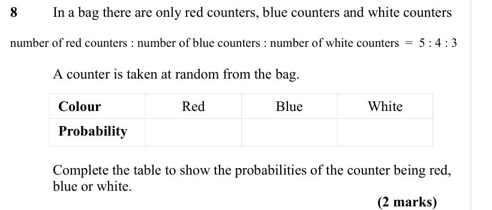

Text (lossy): 8     / In a bag there are only red counters, blue counters and white counters / number of red counters : number of blue counters : number of white counters  =  5 : 4 : 3 / A counter is taken at random from the bag. / Colour / Red / Blue / White / Probability / Complete the table to show the probabilities of the counter being red, / blue or white. / (2 marks)

## Q9 (2 marks)

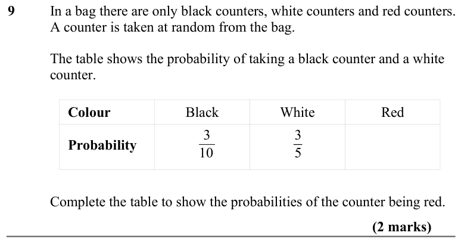

Text (lossy): 9     / In a bag there are only black counters, white counters and red counters. / A counter is taken at random from the bag. / The table shows the probability of taking a black counter and a white  / counter.  / Colour / Black / White / Red / Probability / 3 / 10 / 3 / 5 / Complete the table to show the probabilities of the counter being red. / (2 marks)

## Q10 (2 marks)

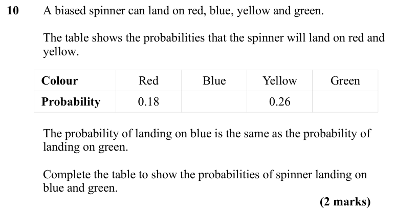

Text (lossy): 10     / A biased spinner can land on red, blue, yellow and green. /          / The table shows the probabilities that the spinner will land on red and  / yellow. / Colour / Red / Blue / Yellow / Green / Probability / 0.18 / 0.26 /      / The probability of landing on blue is the same as the probability of / landing on green.  /       / Complete the table to show the probabilities of spinner landi

## Q11 (marks not printed · parts a, b)

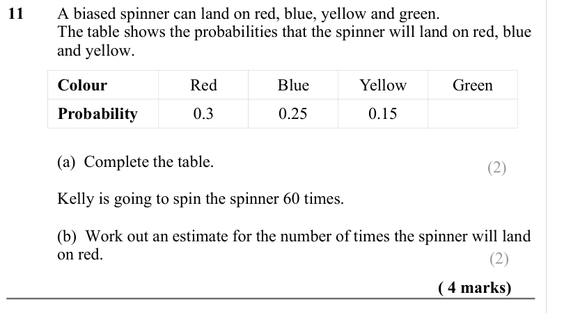

Text (lossy): 11     / A biased spinner can land on red, blue, yellow and green. / The table shows the probabilities that the spinner will land on red, blue  / and yellow. / Colour / Red / Blue / Yellow / Green / Probability / 0.3 / 0.25 / 0.15 / (a)  Complete the table. / (2) / Kelly is going to spin the spinner 60 times.  / (b)  Work out an estimate for the number of times the spinner will land  / on red.  / 

## Q12 (4 marks · parts a, b)

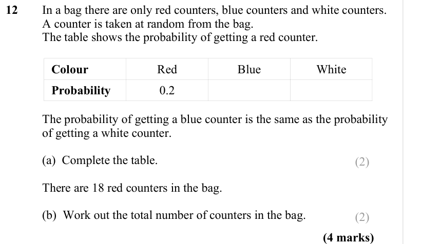

Text (lossy): 12     / In a bag there are only red counters, blue counters and white counters. / A counter is taken at random from the bag. / The table shows the probability of getting a red counter. / Colour / Red / Blue / White / Probability / 0.2 / The probability of getting a blue counter is the same as the probability  / of getting a white counter.  / (a)  Complete the table. / (2) / There are 18 red count

## Q13 (4 marks · parts a, b)

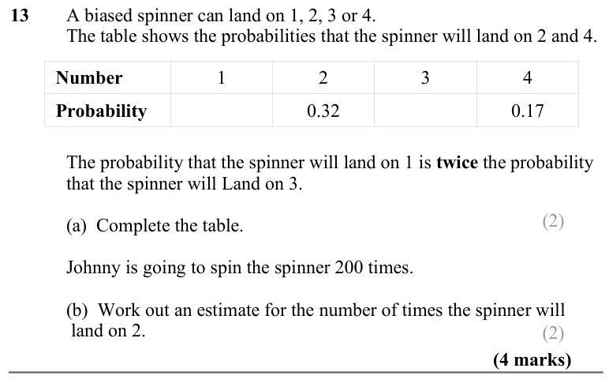

Text (lossy): 13     / A biased spinner can land on 1, 2, 3 or 4. / The table shows the probabilities that the spinner will land on 2 and 4.  / Number / 1 / 2 / 3 / 4 / Probability / 0.32 / 0.17 / The probability that the spinner will land on 1 is twice the probability  / that the spinner will Land on 3.  / (2) / (a)  Complete the table. / Johnny is going to spin the spinner 200 times.  / (b)  Work out an estim

## Q14 (3 marks)

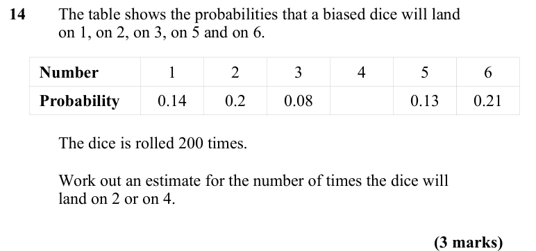

Text (lossy): 14    / The table shows the probabilities that a biased dice will land  / on 1, on 2, on 3, on 5 and on 6.  / Number / 1 / 2 / 3 / 4 / 5 / 6 / Probability / 0.14 / 0.2 / 0.08 / 0.13 / 0.21 / The dice is rolled 200 times.  / Work out an estimate for the number of times the dice will / land on 2 or on 4.  / (3 marks)

## Q15 (4 marks)

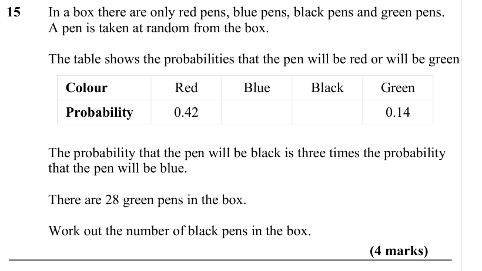

Text (lossy): 15     / In a box there are only red pens, blue pens, black pens and green pens. / A pen is taken at random from the box.  / The table shows the probabilities that the pen will be red or will be green   / Colour / Red / Blue / Black / Green / Probability / 0.42 / 0.14 / The probability that the pen will be black is three times the probability  / that the pen will be blue.  / There are 28 green pen

## Q16 (4 marks)

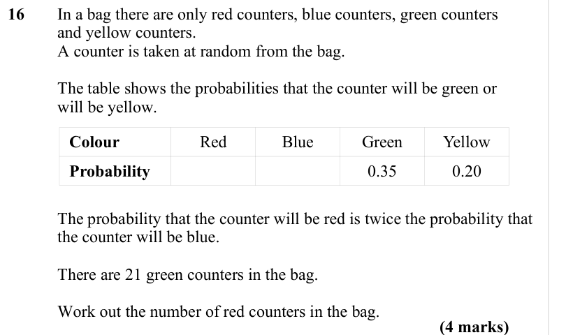

Text (lossy): 16     / In a bag there are only red counters, blue counters, green counters  / and yellow counters. / A counter is taken at random from the bag.  / The table shows the probabilities that the counter will be green or  / will be yellow.   / Colour / Red / Blue / Green / Yellow / Probability / 0.35 / 0.20 / The probability that the counter will be red is twice the probability that / the counter will

