# Indices — Exam Questions (IGCSE Maths · Edexcel · Grade 4)

Topic code `4.2` · slug `grade-4-4-2-indices` · source sheet sha256 `c3e34140a069d1b3…`

## Q1 (3 marks · parts a, b, c)

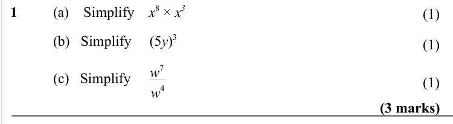

Text (lossy): 1 / (a)    Simplify    x 8 × x 3 / (1) /         / (b)   Simplify    (5 y)3 / (1) /        /  (c)   Simplify / w 7 / (1) / w 4 / (3 marks)

## Q2 (3 marks · parts a, b, c)

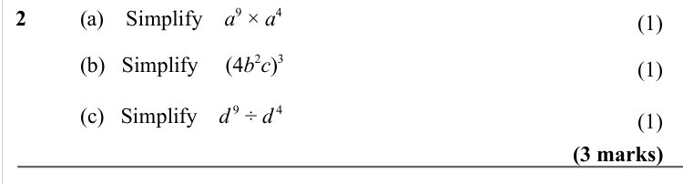

Text (lossy): 2 / (a)    Simplify    a 9 × a 4 / (1) /         / (b)   Simplify    (4 b 2 c)3 / (1) /        /  (c)   Simplify    d 9 ÷ d 4 / (1) / (3 marks)

## Q3 (3 marks · parts a, b)

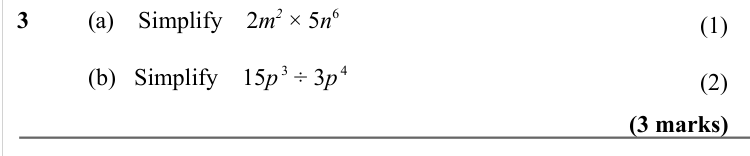

Text (lossy): 3 / (a)    Simplify    2 m 2 × 5 n 6 / (1) /        /  (b)   Simplify    15 p 3 ÷ 3 p 4 / (2) / (3 marks)

## Q4 (3 marks · parts a, b)

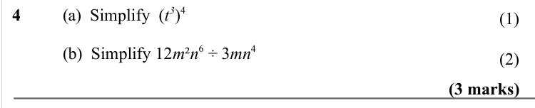

Text (lossy): 4 / (a)  Simplify  (t 3)4  / (1) / (b)  Simplify 12 m ² n 6 ÷ 3 mn 4 / (2) / (3 marks)

## Q5 (2 marks)

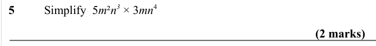

Text (lossy): 5 / Simplify  5 m ² n 3 × 3 mn 4 / (2 marks)

## Q6 (2 marks · parts a, b)

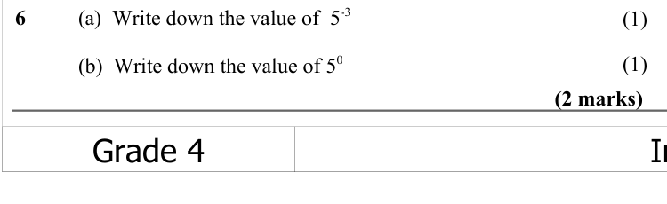

Text (lossy): 6 / (a)  Write down the value of  5-3 / (1) / (1) / (b)  Write down the value of 5 0 / (2 marks)

## Q7 (1 marks)

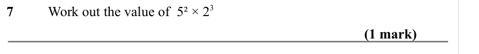

Text (lossy): 7 / Work out the value of  5² × 2 3 / (1 mark)

## Q8 (1 marks)

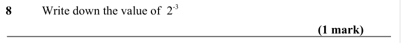

Text (lossy): 8 / Write down the value of  2-3 / (1 mark)

## Q9 (2 marks · parts a, b)

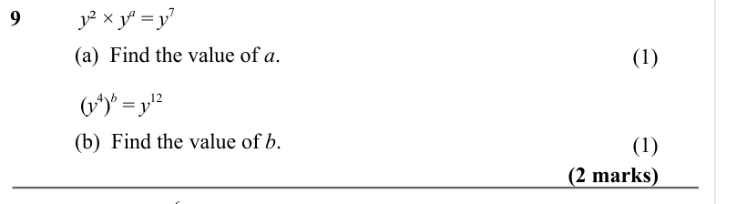

Text (lossy): 9    /  y ² × y a = y 7 / (a)  Find the value of a.   / (1) /    /  (y 4)b = y 12 / (b)  Find the value of b.   / (1) / (2 marks) / x 6

## Q10 (3 marks · parts b)

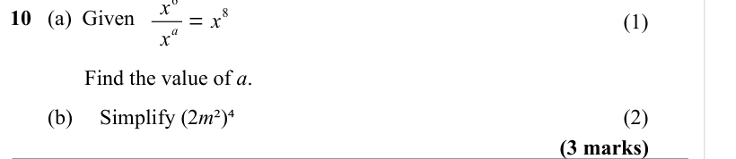

Text (lossy): 8 / 10   (a)  Given / a = x / (1) / x /   Find the value of a.   /        (b)     Simplify (2 m ²)⁴ / (2) / (3 marks)

## Q11 (4 marks · parts a, b, c)

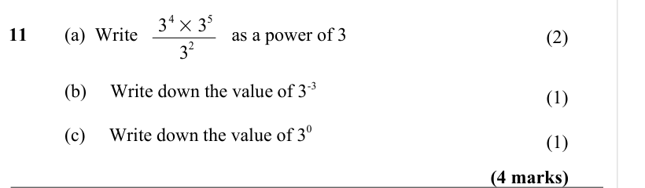

Text (lossy): 11   / (a)  Write  / as a power of 3 / (2) / 3 4 × 3 5 / 2 / 3 / (b)     Write down the value of 3-3 / (1) / (c)     Write down the value of 3 0 / (1) / (4 marks)

## Q12 (2 marks)

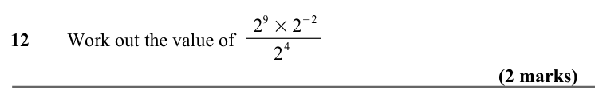

Text (lossy): 12   / Work out the value of 2 9 × 2−2 / 4 / 2 / (2 marks)

## Q13 (1 marks)

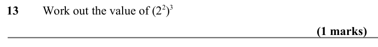

Text (lossy): 13   / Work out the value of (2 2)3 / (1 marks)

## Q14 (6 marks · parts a, b, c)

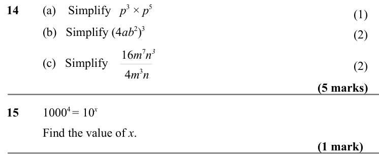

Text (lossy): 14 / (a)    Simplify   p 3 × p 5 / (1) / (b)   Simplify (4 ab 2)3 / (2) /        / (c)   Simplify / (2) / 16 m 7 n 3 / 4 m 3 n / (5 marks) / 15 / 1000 4 = 10 x / Find the value of x.   / (1 mark)

