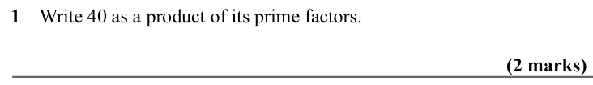
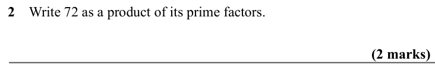
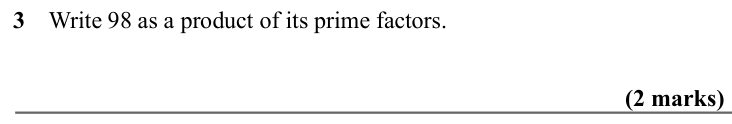
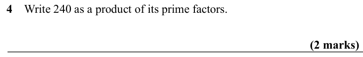
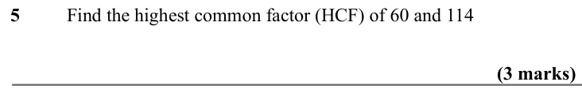
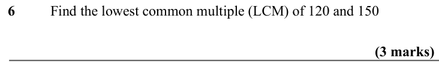
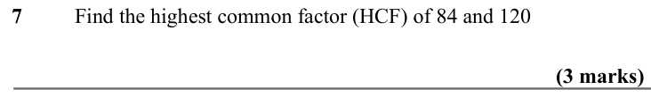
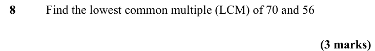
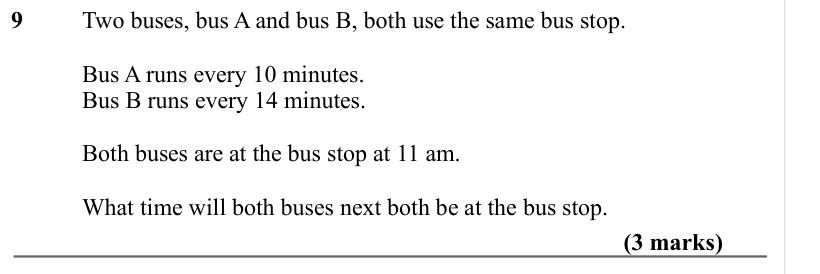
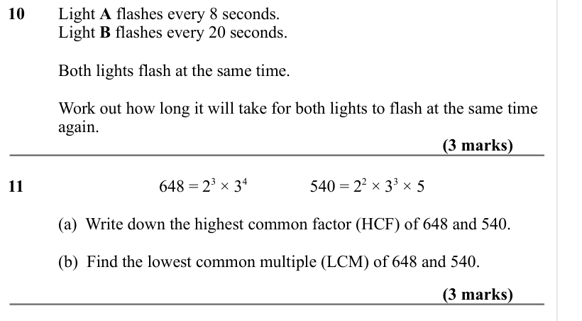

# Prime Factors, HCF and LCM — Exam Questions (IGCSE Maths · Edexcel · Grade 4)

Topic code `4.3` · slug `grade-4-4-3-prime-factors-hcf-and-lcm` · source sheet sha256 `94d14ebb84120bde…`

## Q1 (2 marks)

Text (lossy): 1    Write 40 as a product of its prime factors.  /              / (2 marks)

## Q2 (2 marks)

Text (lossy): 2    Write 72 as a product of its prime factors.  /              / (2 marks)

## Q3 (2 marks)

Text (lossy): 3    Write 98 as a product of its prime factors.  /              / (2 marks)

## Q4 (2 marks)

Text (lossy): 4    Write 240 as a product of its prime factors.  /              / (2 marks)

## Q5 (3 marks)

Text (lossy): 5 / Find the highest common factor (HCF) of 60 and 114 /              / (3 marks)

## Q6 (3 marks)

Text (lossy): 6 / Find the lowest common multiple (LCM) of 120 and 150 /              / (3 marks)

## Q7 (3 marks)

Text (lossy): 7 / Find the highest common factor (HCF) of 84 and 120 /              / (3 marks)

## Q8 (3 marks)

Text (lossy): 8 / Find the lowest common multiple (LCM) of 70 and 56 /              / (3 marks)

## Q9 (3 marks)

Text (lossy): 9     / Two buses, bus A and bus B, both use the same bus stop.  / Bus A runs every 10 minutes.  / Bus B runs every 14 minutes.  / Both buses are at the bus stop at 11 am.  / What time will both buses next both be at the bus stop.  / (3 marks)

## Q10 (6 marks · parts a, b)

Text (lossy): 10     / Light A flashes every 8 seconds.  / Light B flashes every 20 seconds.  / Both lights flash at the same time. / Work out how long it will take for both lights to flash at the same time  / again.  / (3 marks) / 11 / 648 = 2 3 × 3 4 / 540 = 2 2 × 3 3 × 5 / (a)  Write down the highest common factor (HCF) of 648 and 540.  / (b)  Find the lowest common multiple (LCM) of 648 and 540.  /         

