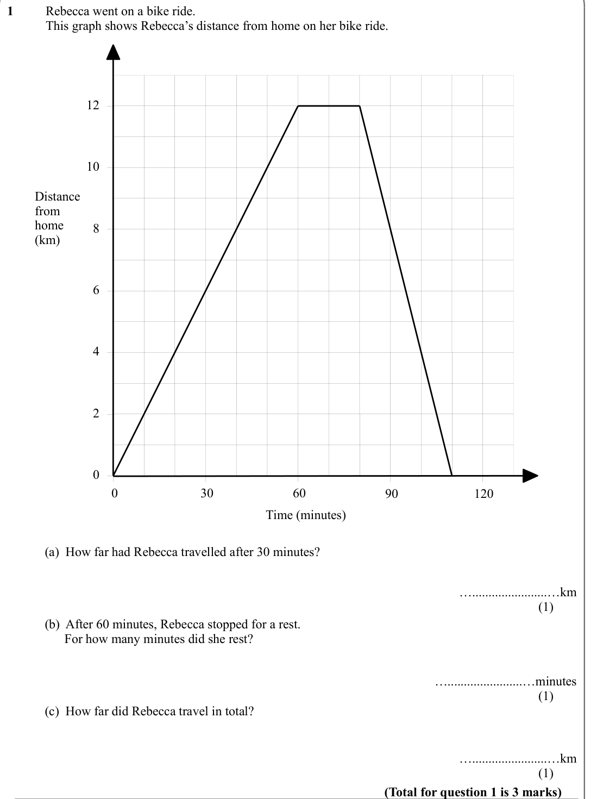
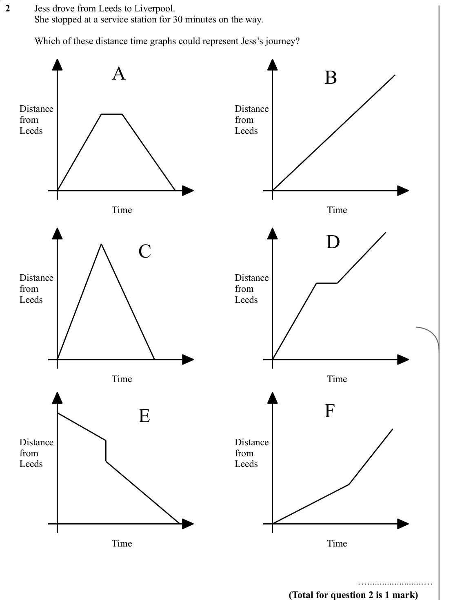
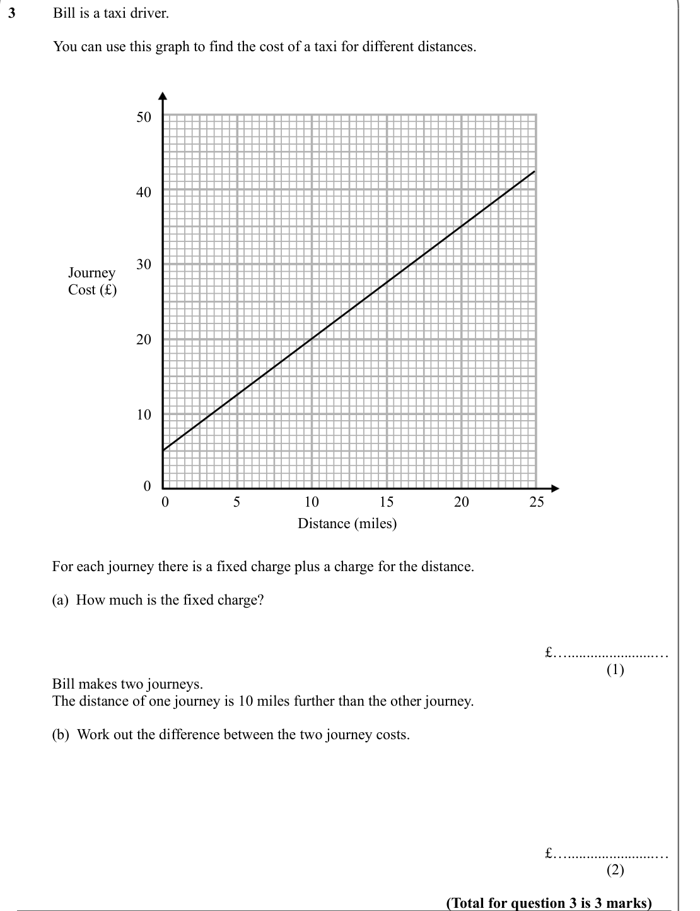
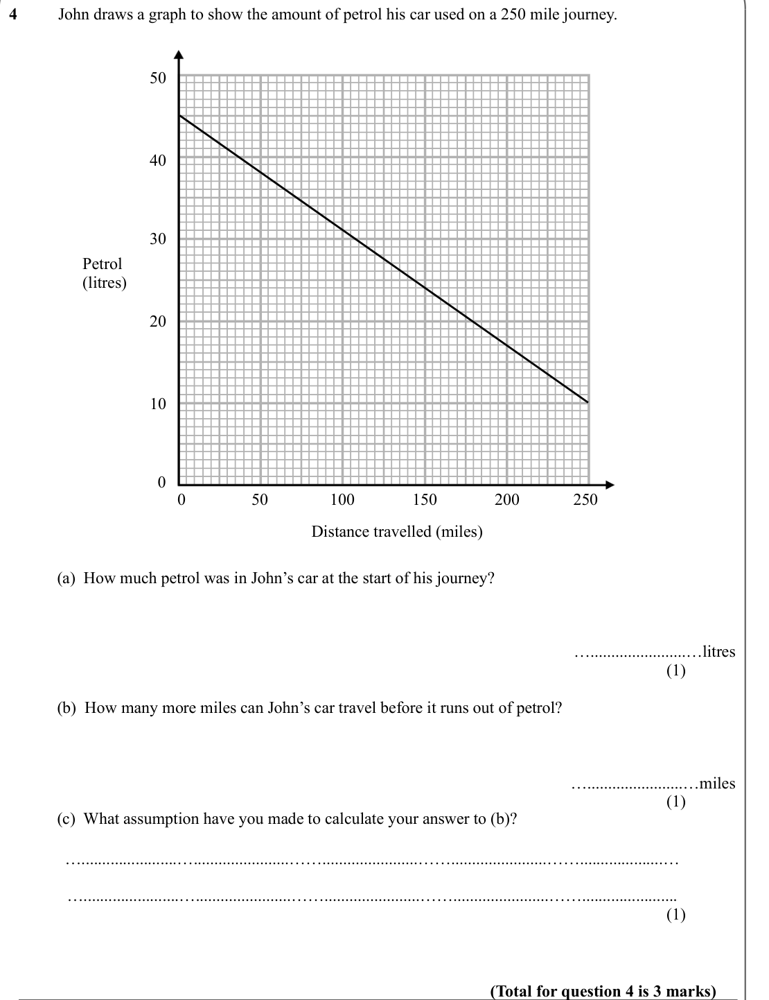
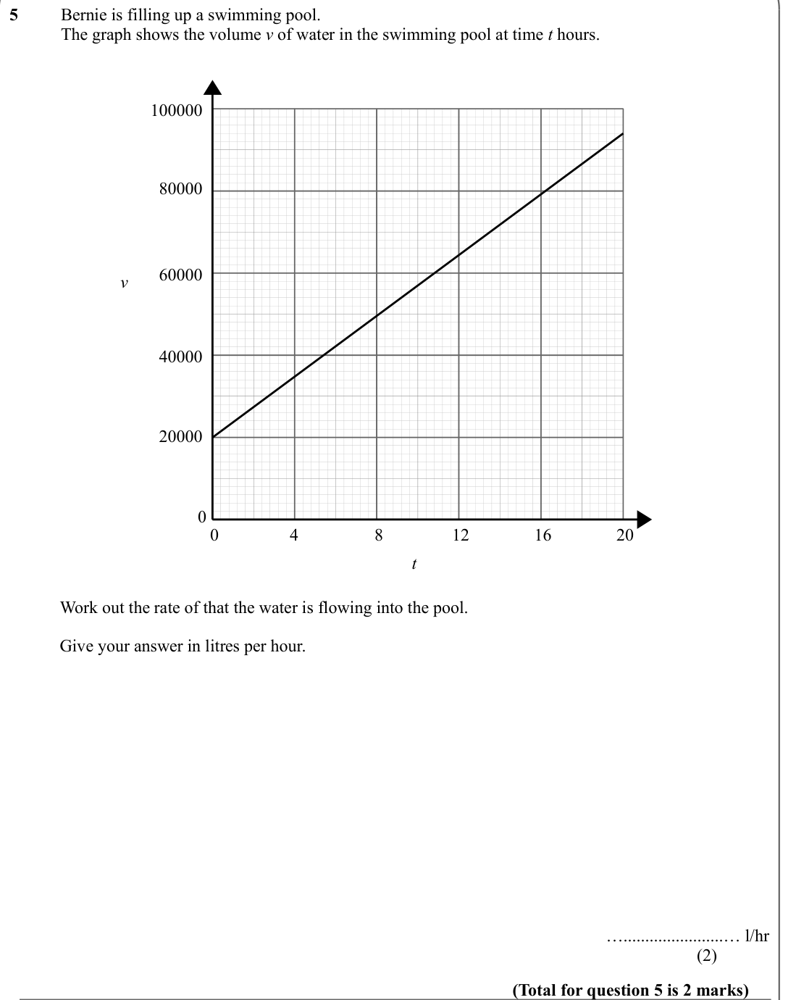
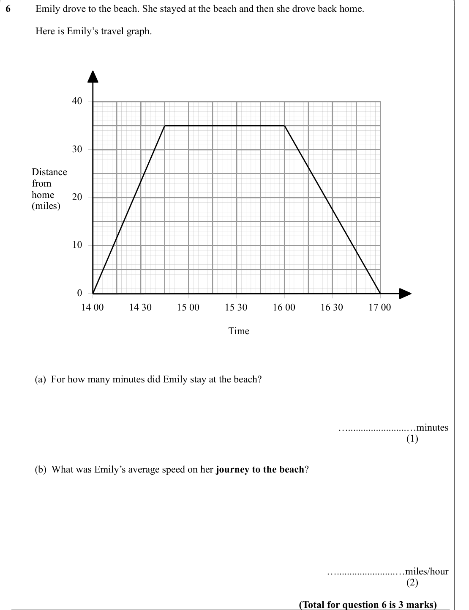
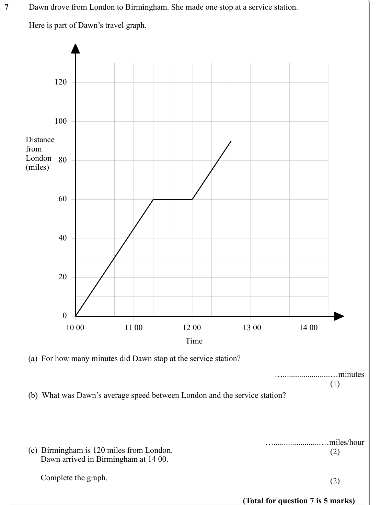

# Real Life and Distance Time Graphs — Exam Questions (IGCSE Maths · Edexcel · Grade 4)

Topic code `4.4` · slug `grade-4-4-4-real-life-and-distance-time-graphs` · source sheet sha256 `3881e14797b88861…`

## Q1 (marks not printed · parts a, b, c)

Text (lossy): 1     / Rebecca went on a bike ride.  / This graph shows Rebecca’s distance from home on her bike ride.  / 12 / 10 / Distance  / from  / home  / (km) / 8 / 6 / 4 / 2 / 0 / 30 / 60 / 90 / 120 / 0 / Time (minutes) / (a)  How far had Rebecca travelled after 30 minutes? / ….......................…km / (1) / (b)  After 60 minutes, Rebecca stopped for a rest.  /       For how many minutes did she rest? 

## Q2 (marks not printed)

Text (lossy): 2     / Jess drove from Leeds to Liverpool.  / She stopped at a service station for 30 minutes on the way. / Which of these distance time graphs could represent Jess’s journey? / A / B / Distance  / from  / Leeds / Distance  / from  / Leeds / Time  / Time  / D / C / Distance  / from  / Leeds / Distance  / from  / Leeds / Time  / Time  / E / F / Distance  / from  / Leeds / Distance  / from  / Leeds

## Q3 (marks not printed · parts a, b)

Text (lossy): 3     / Bill is a taxi driver.  / You can use this graph to find the cost of a taxi for different distances.  / 50 / 40 / 30 / Journey  / Cost (£) / 20 / 10 / 0 / 0 / 5 / 10 / 15 / 20 / 25 / Distance (miles) / For each journey there is a fixed charge plus a charge for the distance.  / (a)  How much is the fixed charge? / £….......................… / (1)             / Bill makes two journeys.  / Th

## Q4 (marks not printed · parts a, b, c)

Text (lossy): 4     / John draws a graph to show the amount of petrol his car used on a 250 mile journey.  / 50 / 40 / 30 / Petrol / (litres) / 20 / 10 / 0 / 0 / 50 / 100 / 150 / 200 / 250 / Distance travelled (miles) / (a)  How much petrol was in John’s car at the start of his journey? / ….......................…litres / (1)             / (b)  How many more miles can John’s car travel before it runs out of pet

## Q5 (marks not printed)

Text (lossy): 5     / Bernie is filling up a swimming pool.  / The graph shows the volume v of water in the swimming pool at time t hours.  / 100000 / 80000 / 60000 / v / 40000 / 20000 / 0 / 0 / 4 / 8 / 12 / 16 / 20 / t / Work out the rate of that the water is flowing into the pool. /   / Give your answer in litres per hour.  / ….......................… l/hr / (2)             / (Total for question 5 is 2 marks)

## Q6 (marks not printed · parts a, b)

Text (lossy): 6     / Emily drove to the beach. She stayed at the beach and then she drove back home.  / Here is Emily’s travel graph.  / 40 / 30 / Distance  / from  / home  / (miles) / 20 / 10 / 14 00 / 14 30 / 15 00 / 15 30 / 16 00 / 16 30 / 17 00 / 0 / Time / (a)  For how many minutes did Emily stay at the beach? / ….......................…minutes / (1)             / (b)  What was Emily’s average speed on he

## Q7 (marks not printed · parts a, b, c)

Text (lossy): 7     / Dawn drove from London to Birmingham. She made one stop at a service station.  / Here is part of Dawn’s travel graph.  / 120 / 100 / Distance  / from  / London  / (miles) / 80 / 60 / 40 / 20 / 10 00 / 11 00 / 12 00 / 13 00 / 14 00 / 0 / Time / (a)  For how many minutes did Dawn stop at the service station? / ….......................…minutes / (1)             / (b)  What was Dawn’s average 

