# Inequalities — Exam Questions (IGCSE Maths · Edexcel · Grade 4)

Topic code `4.5` · slug `grade-4-4-5-inequalities` · source sheet sha256 `239347a5f8d3cce4…`

## Q1 (marks not printed)

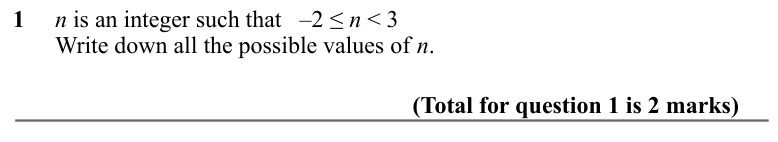

Text (lossy): 1     n is an integer such that   –2 ≤ n < 3 /        Write down all the possible values of n. / (Total for question 1 is 2 marks)

## Q2 (marks not printed · parts a, b, c)

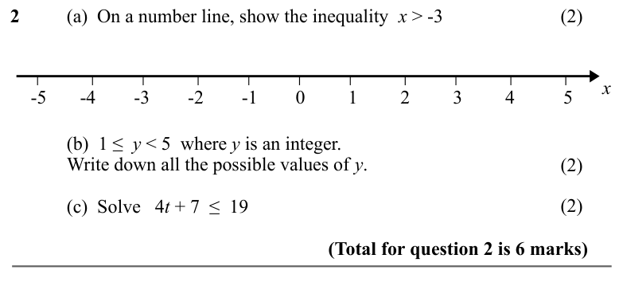

Text (lossy): 2     / (a)  On a number line, show the inequality  x > -3 / x / -5       -4        -3        -2        -1        0         1         2         3         4          5 / (b)  1 ≤  y < 5  where y is an integer.  / Write down all the possible values of y.  / (c)  Solve   4 t + 7  ≤  19 / (Total for question 2 is 6 marks)

## Q3 (marks not printed)

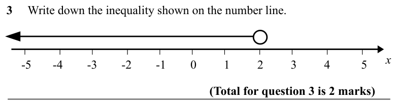

Text (lossy): 3     Write down the inequality shown on the number line. / -5       -4        -3        -2        -1        0         1         2         3         4          5 / x / (Total for question 3 is 2 marks)

## Q4 (marks not printed · parts a, c)

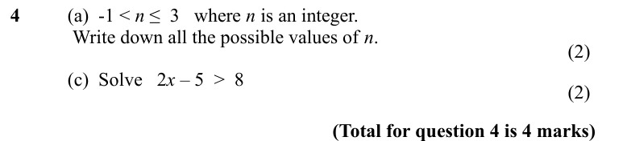

Text (lossy): 4      / (a)  -1 < n ≤  3   where n is an integer.  /  Write down all the possible values of n.  / (c)  Solve   2 x – 5  >  8 / (Total for question 4 is 4 marks)

## Q5 (marks not printed · parts a, b)

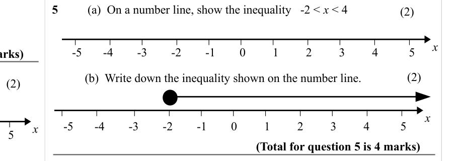

Text (lossy): 5      / (a)  On a number line, show the inequality   -2 < x < 4 / (2) / x / -5       -4        -3        -2        -1        0         1         2         3         4          5 / (2) / (b)  Write down the inequality shown on the number line. / (2) / x / -5       -4        -3        -2        -1        0         1         2         3         4          5 / (Total for question 5 is 4 marks)

## Q6 (marks not printed · parts a, b, c)

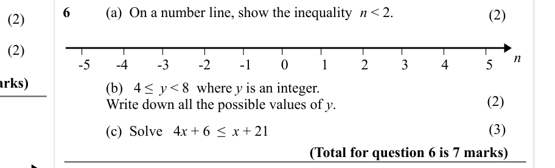

Text (lossy): 6     / (a)  On a number line, show the inequality  n < 2. / (2) / (2) / (2) / n / -5       -4        -3        -2        -1        0         1         2         3         4          5 / (b)   4 ≤  y < 8  where y is an integer.  / Write down all the possible values of y.  / (2) / (3) / (c)  Solve   4 x + 6  ≤  x + 21  / (Total for question 6 is 7 marks)

## Q7 (marks not printed)

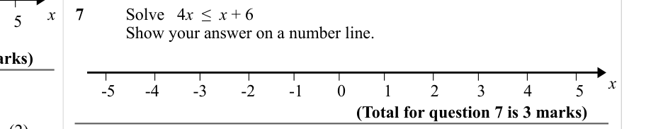

Text (lossy): 7 / Solve   4 x  ≤  x + 6  / Show your answer on a number line.  / x / -5       -4        -3        -2        -1        0         1         2         3         4          5 / (Total for question 7 is 3 marks) / (2)

## Q8 (marks not printed)

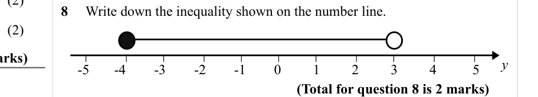

Text (lossy): 8     Write down the inequality shown on the number line. / (2) / y / -5       -4        -3        -2        -1        0         1         2         3         4          5 / (Total for question 8 is 2 marks)

## Q9 (marks not printed · parts a, b, c)

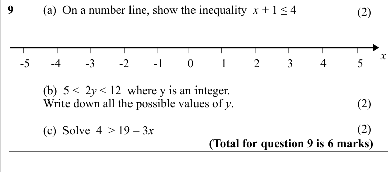

Text (lossy): 9     / (a)  On a number line, show the inequality  x + 1 ≤ 4 / x / -5       -4        -3        -2        -1        0         1         2         3         4          5 / (b)  5 <  2 y < 12  where y is an integer.  / Write down all the possible values of y.  / (c)  Solve  4  > 19 – 3 x  / (Total for question 9 is 6 marks)

## Q10 (marks not printed)

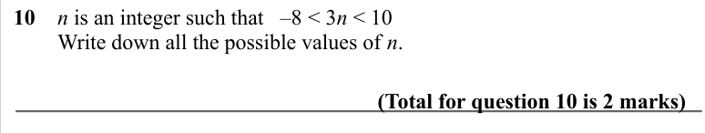

Text (lossy): 10    n is an integer such that   –8 < 3 n < 10 /         Write down all the possible values of n. / (Total for question 10 is 2 marks)

## Q11 (marks not printed)

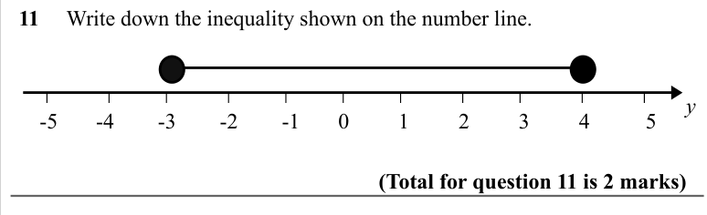

Text (lossy): 11     Write down the inequality shown on the number line. / y / -5       -4        -3        -2        -1       0         1         2         3         4          5 / (Total for question 11 is 2 marks)

## Q12 (marks not printed · parts b)

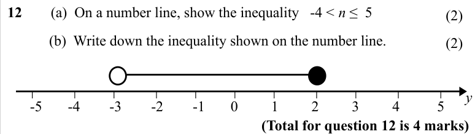

Text (lossy): 12     (a)  On a number line, show the inequality   -4 < n ≤  5 / (b)  Write down the inequality shown on the number line. / -5       -4        -3        -2        -1       0         1         2         3         4          5 / (Total for question 12 is 4 marks)

## Q13 (marks not printed)

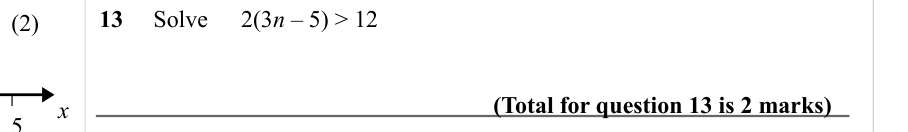

Text (lossy): 13     Solve  / 2(3 n – 5) > 12 / (2) / (Total for question 13 is 2 marks)

## Q14 (marks not printed)

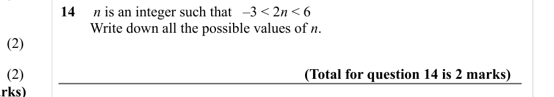

Text (lossy): 14     n is an integer such that   –3 < 2 n < 6 /         Write down all the possible values of n. / (2) / (Total for question 14 is 2 marks) / (2)

## Q15 (marks not printed)

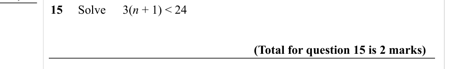

Text (lossy): 15     Solve  / 3(n + 1) < 24 / (Total for question 15 is 2 marks)

## Q16 (marks not printed)

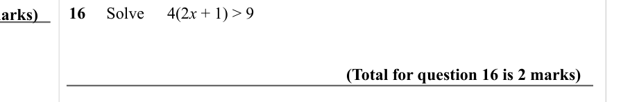

Text (lossy): 16     Solve / 4(2 x + 1) > 9 / (Total for question 16 is 2 marks)

## Q17 (marks not printed · parts b, c)

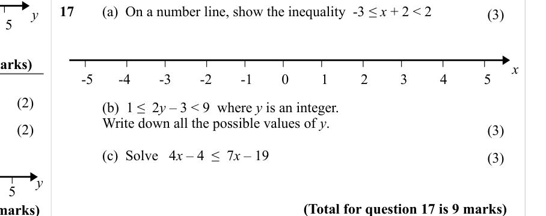

Text (lossy): 17     (a)  On a number line, show the inequality  -3 ≤ x + 2 < 2 / (3) / x / -5       -4        -3        -2        -1        0         1         2         3         4          5 / (2) / (b)  1 ≤  2 y – 3 < 9  where y is an integer.  / Write down all the possible values of y.  / (2) / (3) / (c)  Solve   4 x – 4  ≤  7 x – 19   / (3) / y / (Total for question 17 is 9 marks)

