# Forming and Solving Equations — Exam Questions (IGCSE Maths · Edexcel · Grade 4)

Topic code `4.6` · slug `grade-4-4-6-forming-and-solving-equations` · source sheet sha256 `13080283bab381f6…`

## Q1 (marks not printed · parts a, b)

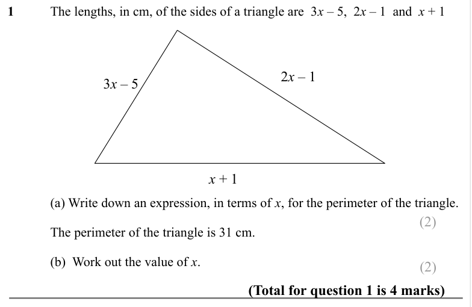

Text (lossy): 1  / The lengths, in cm, of the sides of a triangle are  3 x – 5,  2 x – 1  and  x + 1 / 2 x – 1  / 3 x – 5  / x + 1  / (a) Write down an expression, in terms of x, for the perimeter of the triangle.  /            (2)  /         / The perimeter of the triangle is 31 cm.  / (b)  Work out the value of x.   /            (2)         / (Total for question 1 is 4 marks)

## Q2 (marks not printed · parts a, b)

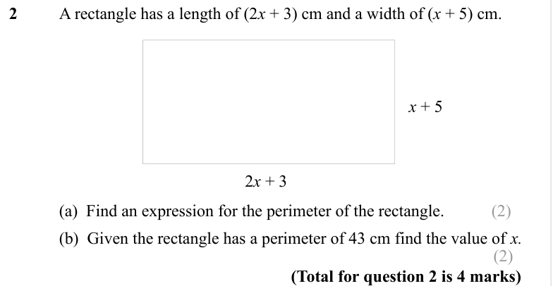

Text (lossy): 2      / A rectangle has a length of (2 x + 3) cm and a width of (x + 5) cm.   / x + 5 / 2 x + 3 /        / (a)  Find an expression for the perimeter of the rectangle.  /            (2)         /        / (b)  Given the rectangle has a perimeter of 43 cm find the value of x. /            (2)         / (Total for question 2 is 4 marks)

## Q3 (marks not printed)

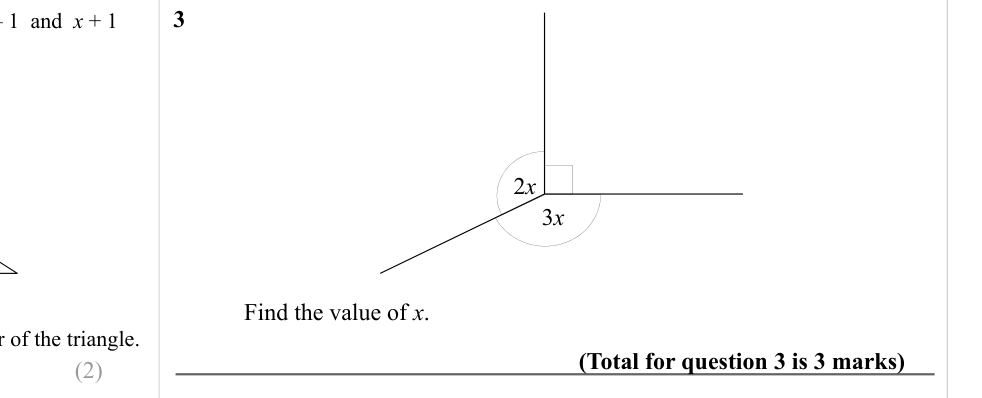

Text (lossy): 3  / 3 x / 2 x / Find the value of x.  / (Total for question 3 is 3 marks)

## Q4 (marks not printed)

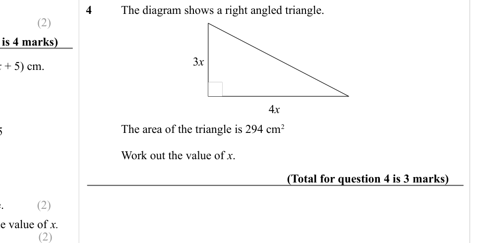

Text (lossy): 4  / The diagram shows a right angled triangle.  / 3 x / 4 x / The area of the triangle is 294 cm 2 / Work out the value of x.  / (Total for question 4 is 3 marks) /            (2)

## Q5 (marks not printed)

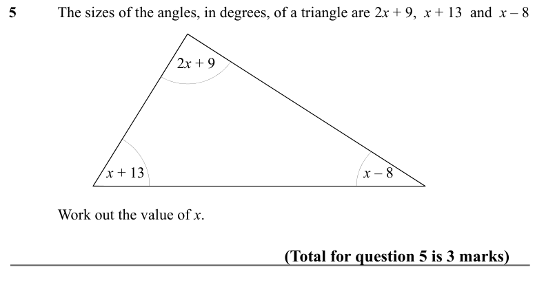

Text (lossy): 5  / The sizes of the angles, in degrees, of a triangle are 2 x + 9,  x + 13  and  x – 8 / 2 x + 9 / x + 13 / x – 8  / Work out the value of x.  / (Total for question 5 is 3 marks)

## Q6 (marks not printed)

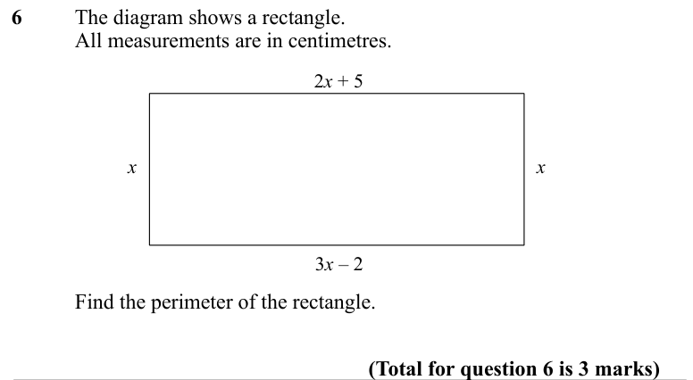

Text (lossy): 6  / The diagram shows a rectangle.  / All measurements are in centimetres.  / 2 x + 5  / x / x / 3 x – 2  / Find the perimeter of the rectangle.  / (Total for question 6 is 3 marks)

## Q7 (marks not printed)

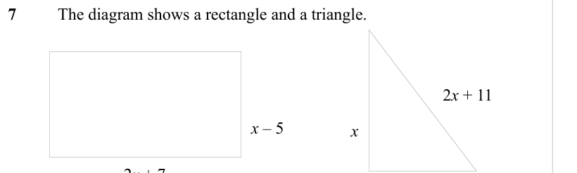

Text (lossy): 7  / The diagram shows a rectangle and a triangle.    / 2 x + 11 / x – 5 / x  / 2 x + 7

## Q8 (marks not printed)

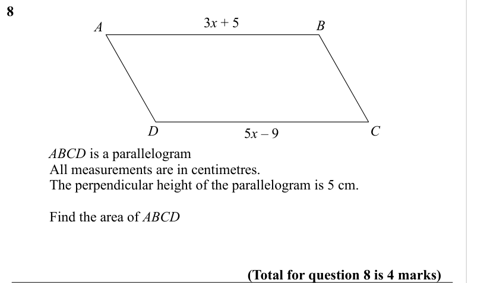

Text (lossy): 8 / 3 x + 5 / A / B / C / D / 5 x – 9  / ABCD is a parallelogram    /             All measurements are in centimetres. /             The perpendicular height of the parallelogram is 5 cm. /             Find the area of ABCD / (Total for question 8 is 4 marks)

## Q9 (marks not printed)

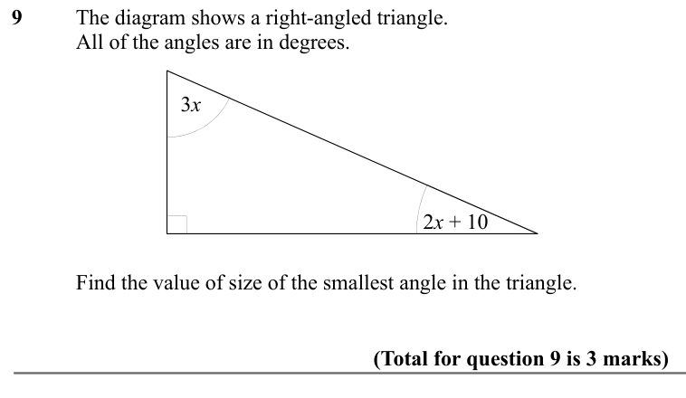

Text (lossy): 9 / The diagram shows a right-angled triangle.   / All of the angles are in degrees.    / 3 x / 2 x + 10 / Find the value of size of the smallest angle in the triangle.  / (Total for question 9 is 3 marks)

## Q10 (marks not printed)

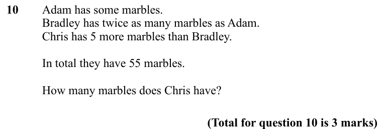

Text (lossy): 10    / Adam has some marbles.  /         / Bradley has twice as many marbles as Adam.  /         / Chris has 5 more marbles than Bradley.  /         / In total they have 55 marbles. /        / How many marbles does Chris have? / (Total for question 10 is 3 marks)

## Q11 (marks not printed)

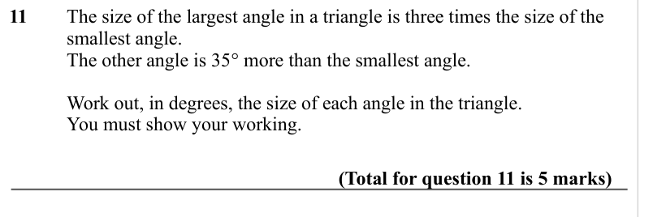

Text (lossy): 11  / The size of the largest angle in a triangle is three times the size of the  / smallest angle.  / The other angle is 35° more than the smallest angle.  / Work out, in degrees, the size of each angle in the triangle.  / You must show your working.  / (Total for question 11 is 5 marks)

## Q12 (marks not printed)

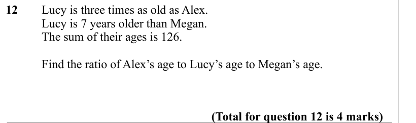

Text (lossy): 12  / Lucy is three times as old as Alex.  / Lucy is 7 years older than Megan.  / The sum of their ages is 126. / Find the ratio of Alex’s age to Lucy’s age to Megan’s age.  /   / (Total for question 12 is 4 marks)

