# Expanding and Factorising — Exam Questions (IGCSE Maths · Edexcel · Grade 4)

Topic code `4.8` · slug `grade-4-4-8-expanding-and-factorising` · source sheet sha256 `4aca400e5149dec3…`

## Q1 (2 marks · parts a, b)

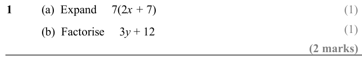

Text (lossy): 1 / (a)  Expand     7(2 x + 7) / (b)  Factorise     3 y + 12 / (2 marks)

## Q2 (4 marks · parts a, b)

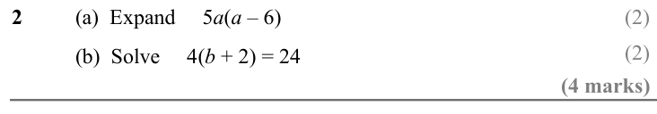

Text (lossy): 2 / (a)  Expand     5 a(a – 6) / (b)  Solve     4(b + 2) = 24 / (4 marks)

## Q3 (4 marks · parts a, b)

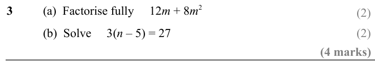

Text (lossy): 3 / (a)  Factorise fully     12 m + 8 m 2 / (b)  Solve     3(n – 5) = 27 / (4 marks)

## Q4 (2 marks · parts a, b)

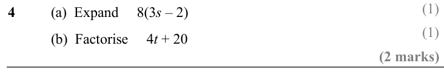

Text (lossy): 4 / (a)  Expand     8(3 s – 2) / (b)  Factorise     4 t + 20 / (2 marks)

## Q5 (4 marks · parts a, b)

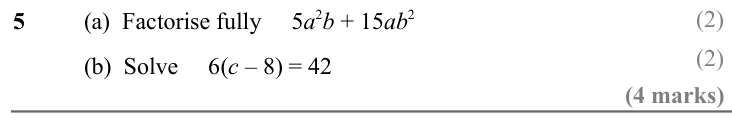

Text (lossy): 5 / (a)  Factorise fully     5 a 2 b + 15 ab 2 / (b)  Solve     6(c – 8) = 42 / (4 marks)

## Q6 (2 marks · parts a, b)

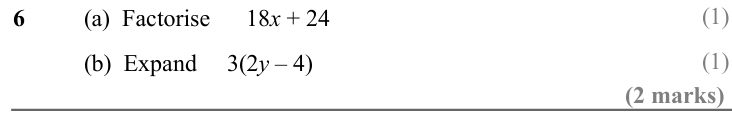

Text (lossy): 6 / (a)  Factorise      18 x + 24 / (b)  Expand     3(2 y – 4) / (2 marks)

## Q7 (2 marks · parts a, b)

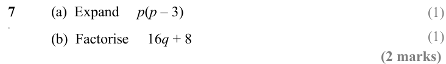

Text (lossy): 7 / (a)  Expand     p(p – 3) / . / (b)  Factorise     16 q + 8 / (2 marks)

## Q8 (4 marks · parts a, b)

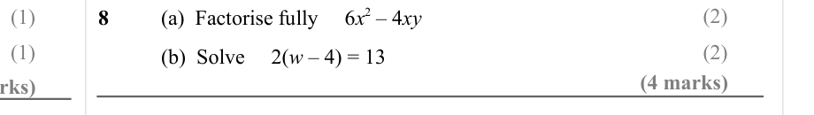

Text (lossy): (2) / (1) / 8 / (a)  Factorise fully     6 x 2 – 4 xy / (1) / (2) / (b)  Solve     2(w – 4) = 13 / (4 marks)

## Q9 (2 marks · parts a, b)

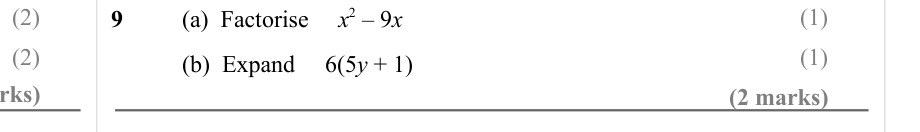

Text (lossy): (2) / (1) / 9 / (a)  Factorise     x 2 – 9 x / (2) / (1) / (b)  Expand     6(5 y + 1) / (2 marks)

## Q10 (2 marks · parts a, b)

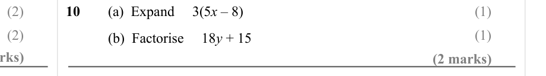

Text (lossy): (2) / 10 / (a)  Expand     3(5 x – 8) / (1) / (1) / (2) / (b)  Factorise     18 y + 15 / (2 marks)

## Q11 (3 marks · parts a, b)

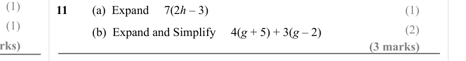

Text (lossy): 11 / (a)  Expand     7(2 h – 3) / (1) / (1) / (2) / (b)  Expand and Simplify     4(g + 5) + 3(g – 2) / (3 marks)

## Q12 (4 marks · parts a, b)

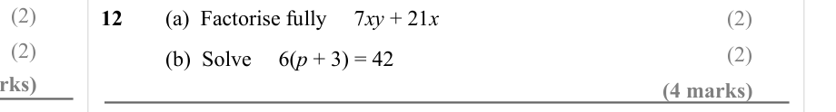

Text (lossy): (2) / 12 / (a)  Factorise fully     7 xy + 21 x / (2) / (2) / (2) / (b)  Solve     6(p + 3) = 42 / (4 marks)

## Q13 (2 marks · parts a, b)

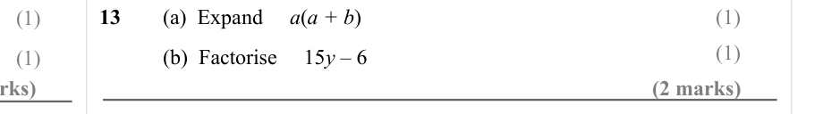

Text (lossy): 13 / (a)  Expand     a(a + b) / (1) / (1) / (1) / (b)  Factorise     15 y – 6 / (1) / (2 marks)

## Q14 (4 marks · parts a, b)

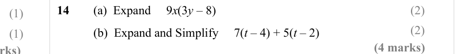

Text (lossy): 14 / (a)  Expand     9 x(3 y – 8) / (2) / (1) / (2) / (b)  Expand and Simplify     7(t – 4) + 5(t – 2) / (1) / (4 marks)

## Q15 (4 marks · parts a, b)

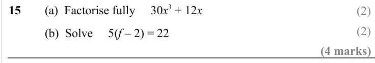

Text (lossy): 15 / (a)  Factorise fully     30 x 3 + 12 x / (b)  Solve     5(f – 2) = 22 / (4 marks)

## Q16 (2 marks · parts a, b)

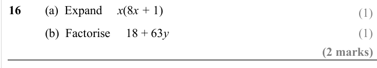

Text (lossy): 16 / (a)  Expand     x(8 x + 1) / (b)  Factorise     18 + 63 y / (2 marks)

## Q17 (4 marks · parts a, b)

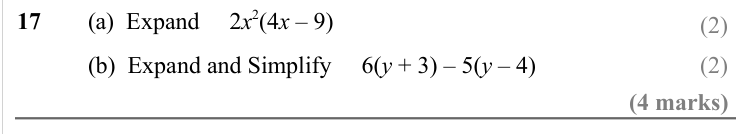

Text (lossy): 17 / (a)  Expand     2 x 2(4 x – 9) / (b)  Expand and Simplify     6(y + 3) – 5(y – 4) / (4 marks)

## Q18 (4 marks · parts a, b)

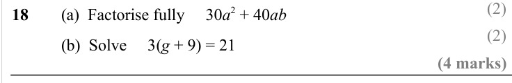

Text (lossy): 18 / (a)  Factorise fully     30 a 2 + 40 ab / (b)  Solve     3(g + 9) = 21 / (4 marks)

## Q19 (2 marks · parts a, b)

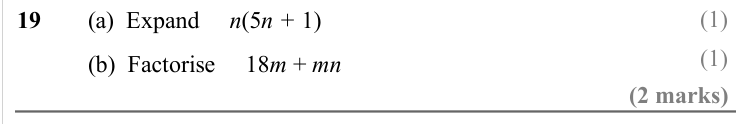

Text (lossy): 19 / (a)  Expand     n(5 n + 1) / (b)  Factorise     18 m + mn / (2 marks)

## Q20 (4 marks · parts a, b)

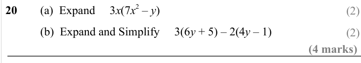

Text (lossy): 20 / (a)  Expand     3 x(7 x 2 – y) / (b)  Expand and Simplify     3(6 y + 5) – 2(4 y – 1) / (4 marks)

## Q21 (4 marks · parts a, b)

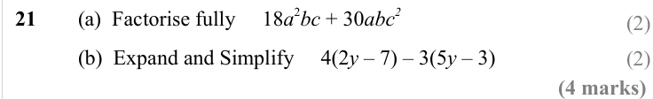

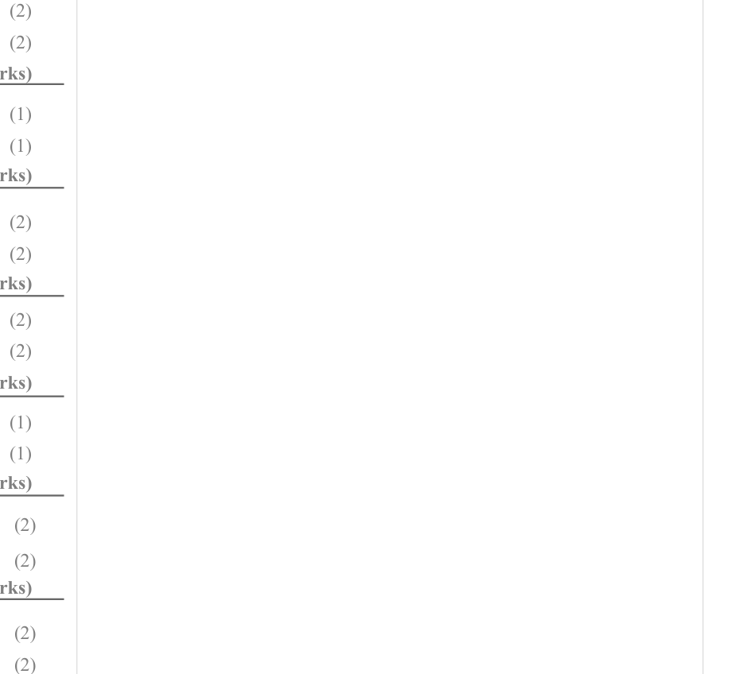

Text (lossy): 21 / (a)  Factorise fully     18 a 2 bc + 30 abc 2 / (b)  Expand and Simplify     4(2 y – 7) – 3(5 y – 3) / (4 marks)

