# Pythagoras — Exam Questions (IGCSE Maths · Edexcel · Grade 4)

Topic code `4.9` · slug `grade-4-4-9-pythagoras` · source sheet sha256 `f6b4e320820cec2a…`

## Q1 (marks not printed)

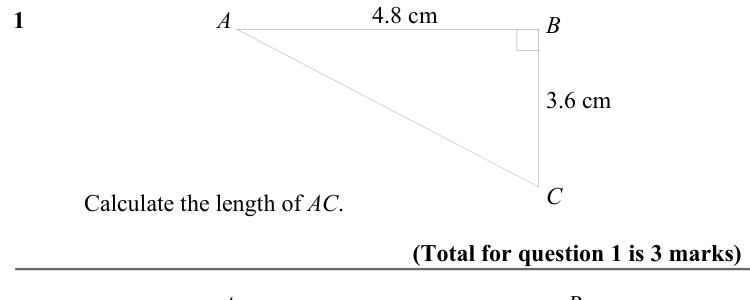

Text (lossy): 1     / A / B / 3.6 cm / C / Calculate the length of AC. / (Total for question 1 is 3 marks) / A / B

## Q2 (marks not printed)

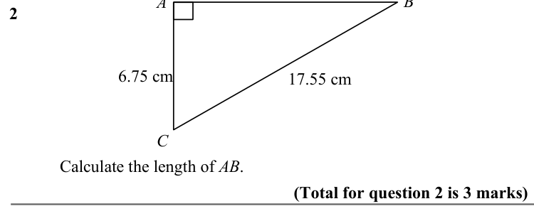

Text (lossy): 2     / 6.75 cm / 17.55 cm / C / Calculate the length of AB. / (Total for question 2 is 3 marks)

## Q3 (marks not printed)

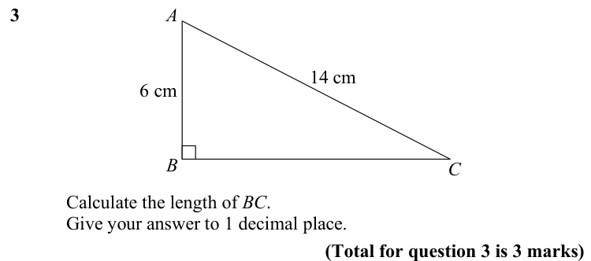

Text (lossy): 3     / A / 14 cm / 6 cm / B / C / Calculate the length of BC. / Give your answer to 1 decimal place.  / (Total for question 3 is 3 marks)

## Q4 (marks not printed)

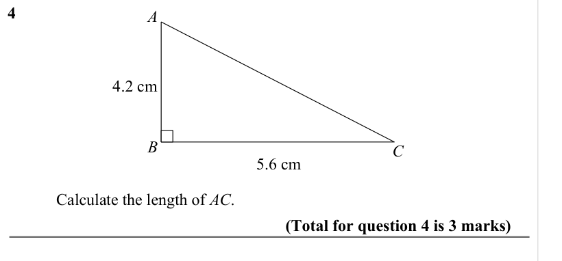

Text (lossy): 4     / A / 4.2 cm / B / C / 5.6 cm / Calculate the length of AC. / (Total for question 4 is 3 marks) / Calculate the length of the AD.  / Give your answer to 3 significant figures.

## Q5 (marks not printed)

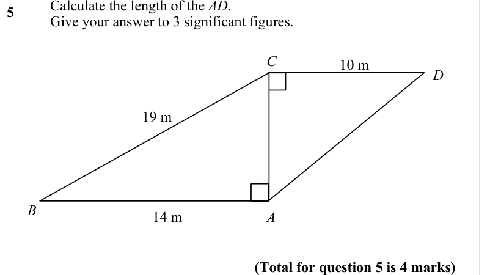

Text (lossy): 5     / B / C / 10 m / D / 19 m / B / 14 m / A / (Total for question 5 is 4 marks)

## Q6 (marks not printed)

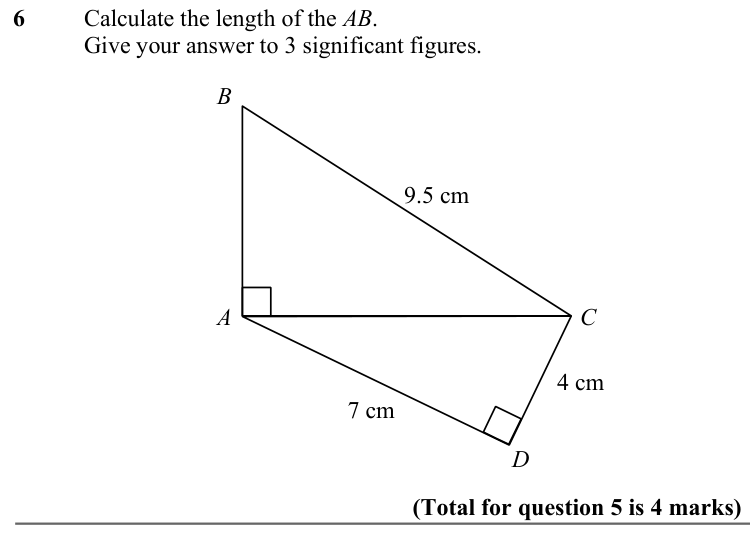

Text (lossy): 6 / Calculate the length of the AB.  / Give your answer to 3 significant figures.  /   /       / B / 9.5 cm / A / C / 4 cm / 7 cm / D / (Total for question 5 is 4 marks)

## Q7 (marks not printed)

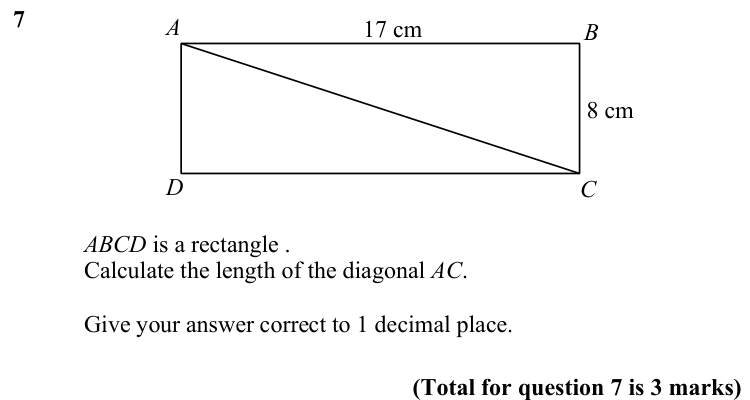

Text (lossy): 7     / 17 cm / A / B / 8 cm / C / D / ABCD is a rectangle . / Calculate the length of the diagonal AC.  / Give your answer correct to 1 decimal place.  / (Total for question 7 is 3 marks)

## Q8 (marks not printed)

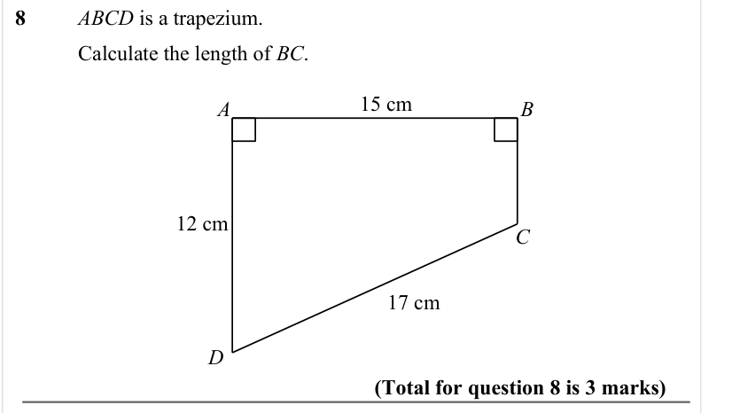

Text (lossy): 8 / ABCD is a trapezium.  / Calculate the length of BC. /   /       / 15 cm / A / B / 12 cm / C / 17 cm / D / (Total for question 8 is 3 marks)

## Q9 (marks not printed)

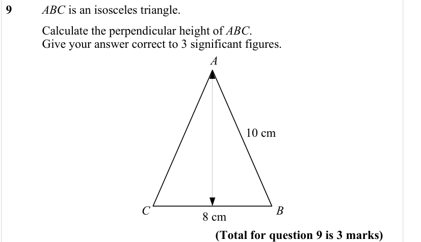

Text (lossy): 9     / ABC is an isosceles triangle.  / Calculate the perpendicular height of ABC. / Give your answer correct to 3 significant figures. /   /       / A / 10 cm / B / C / 8 cm / (Total for question 9 is 3 marks)

## Q10 (marks not printed)

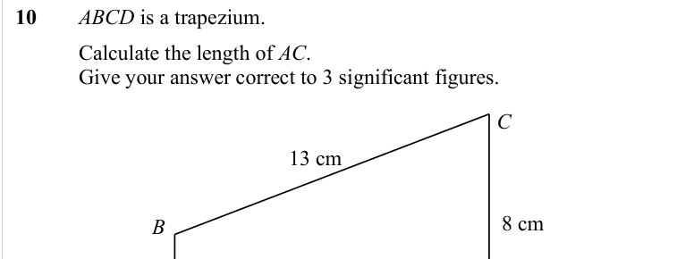

Text (lossy): 10 / ABCD is a trapezium.  / Calculate the length of AC. / Give your answer correct to 3 significant figures. /   /       / C / 13 cm / 8 cm / B

## Q11 (marks not printed)

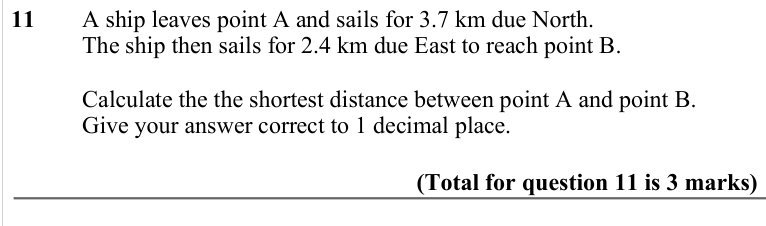

Text (lossy): 11 / A ship leaves point A and sails for 3.7 km due North.  / The ship then sails for 2.4 km due East to reach point B.   / Calculate the the shortest distance between point A and point B.  / Give your answer correct to 1 decimal place.  / (Total for question 11 is 3 marks)

## Q12 (marks not printed)

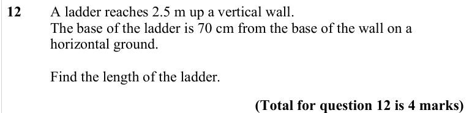

Text (lossy): 12 / A ladder reaches 2.5 m up a vertical wall.  / The base of the ladder is 70 cm from the base of the wall on a  / horizontal ground.  / Find the length of the ladder.  / (Total for question 12 is 4 marks)

## Q13 (marks not printed)

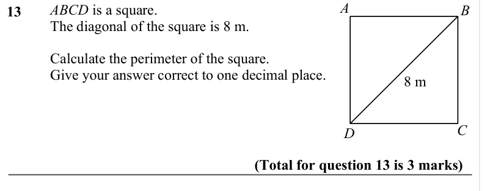

Text (lossy): ABCD is a square. / The diagonal of the square is 8 m.  / 13     / Calculate the perimeter of the square.  / Give your answer correct to one decimal place.  /   /       / 8 m / C / D / (Total for question 13 is 3 marks)

## Q14 (marks not printed)

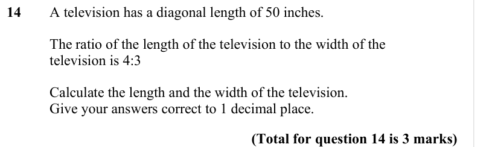

Text (lossy): 14 / A television has a diagonal length of 50 inches.  / The ratio of the length of the television to the width of the  / television is 4:3 / Calculate the length and the width of the television.  / Give your answers correct to 1 decimal place.  / (Total for question 14 is 3 marks)

