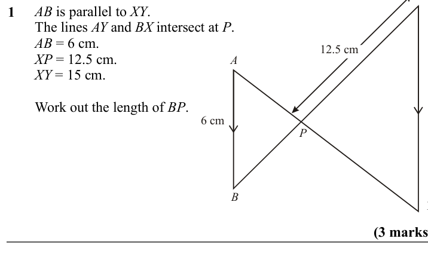
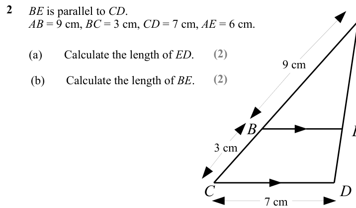
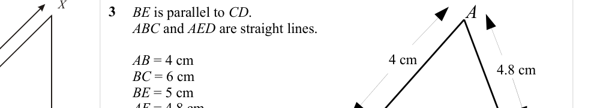
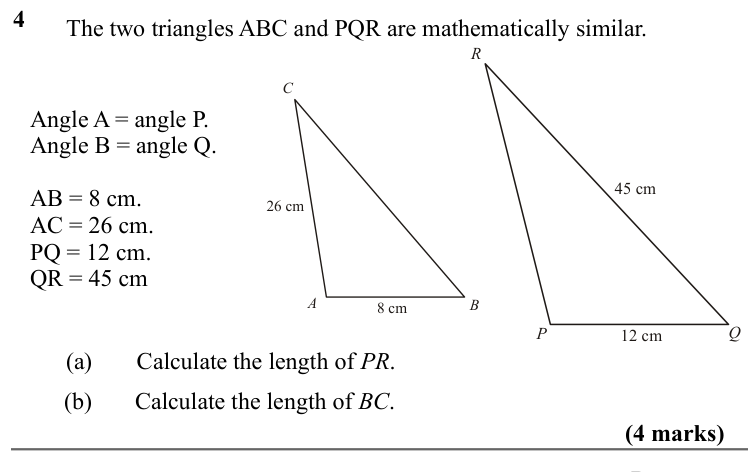
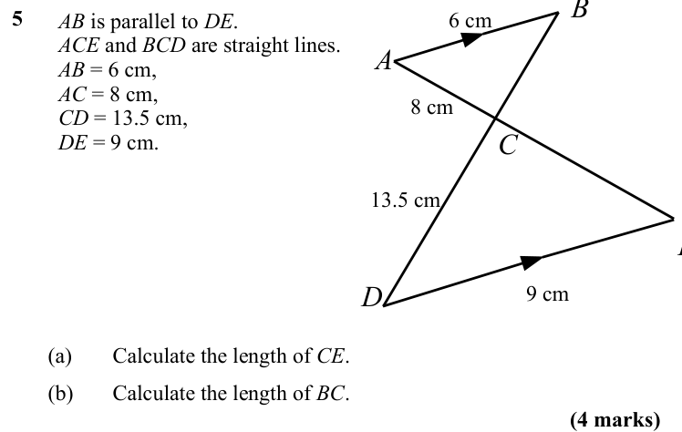
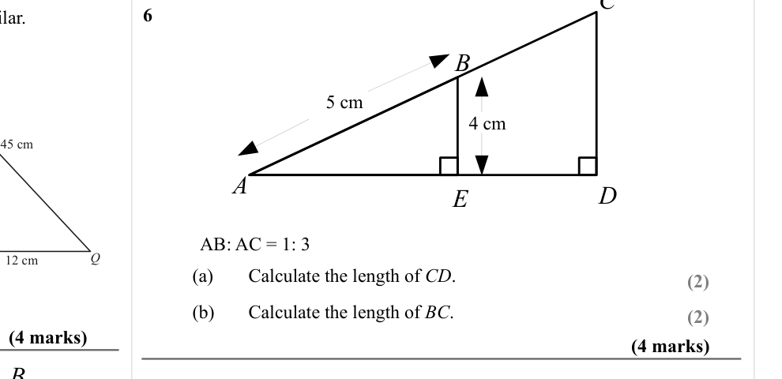
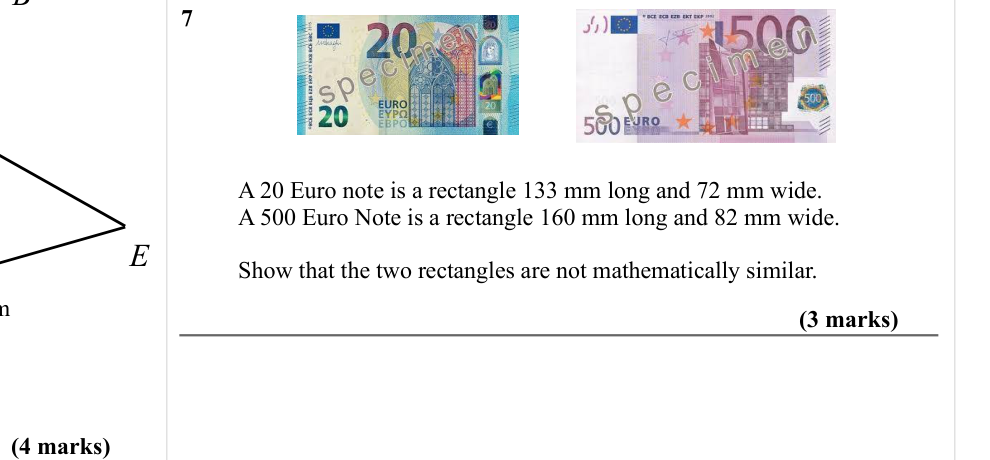

# Similar Shapes (Lengths) — Exam Questions (IGCSE Maths · Edexcel · Grade 5)

Topic code `5.10` · slug `grade-5-5-10-similar-shapes-lengths` · source sheet sha256 `0f6e18770830b5cb…`

## Q1 (marks not printed)

Text (lossy): AB is parallel to XY. / The lines AY and BX intersect at P. / AB = 6 cm. / XP = 12.5 cm. / XY = 15 cm. / 1 / 12.5 cm / A / Work out the length of BP. / 6 cm / P / B

## Q2 (marks not printed · parts a, b)

Text (lossy): 2 / BE is parallel to CD. / AB = 9 cm, BC = 3 cm, CD = 7 cm, AE = 6 cm. / (2) / (a) / Calculate the length of ED. / 9 cm / (2) / (b) / Calculate the length of BE. / B / 3 cm / C / D / 7 cm

## Q3 (marks not printed)

Text (lossy): 3 / BE is parallel to CD. / ABC and AED are straight lines. / 4 cm / 4.8 cm / AB = 4 cm / BC = 6 cm / BE = 5 cm / AE = 4.8 cm.

## Q4 (4 marks · parts a, b)

Text (lossy): 4 / The two triangles ABC and PQR are mathematically similar. / R / C / Angle A = angle P. / Angle B = angle Q. / 45 cm / AB = 8 cm. / AC = 26 cm. / PQ = 12 cm. / QR = 45 cm / 26 cm / A / B / 8 cm / P / Q / 12 cm / (a) / Calculate the length of PR. / (b) / Calculate the length of BC. / (4 marks) / B

## Q5 (4 marks · parts a, b)

Text (lossy): 5 / 6 cm / AB is parallel to DE. / ACE and BCD are straight lines. / AB = 6 cm, / AC = 8 cm, / CD = 13.5 cm, / DE = 9 cm. / A / 8 cm / C / 13.5 cm / D / 9 cm / (a) / Calculate the length of CE. / (b) / Calculate the length of BC. / (4 marks)

## Q6 (8 marks · parts a, b)

Text (lossy): 6 / B / 5 cm / 4 cm / A / D / E / AB: AC = 1: 3 / (a) / Calculate the length of CD. / (2) / (b) / Calculate the length of BC. / (2) / (4 marks) / (4 marks)

## Q7 (7 marks)

Text (lossy): 7 / A 20 Euro note is a rectangle 133 mm long and 72 mm wide. / A 500 Euro Note is a rectangle 160 mm long and 82 mm wide. / E / Show that the two rectangles are not mathematically similar. / (3 marks) / (4 marks)

