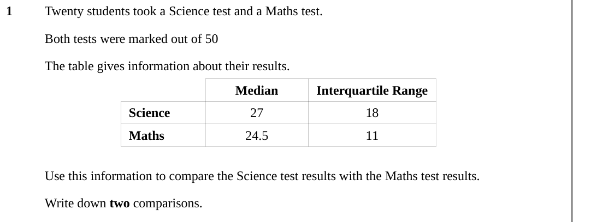
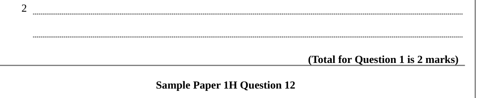
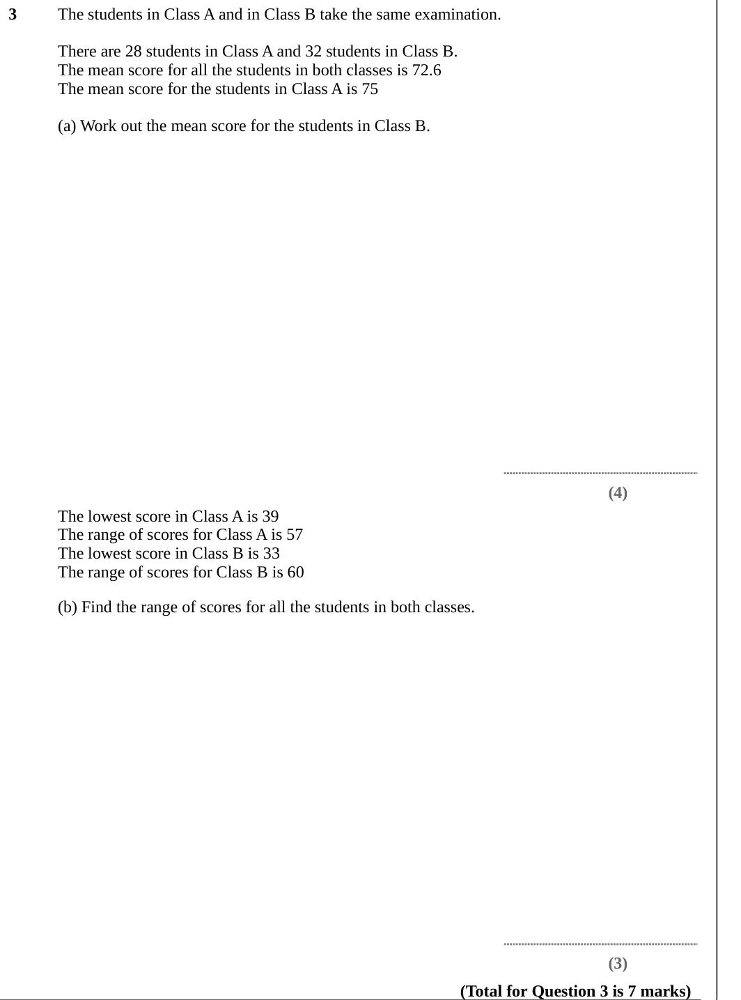

# Data — Exam Questions (IGCSE Maths · Edexcel · Grade 5)

Topic code `5.12` · slug `grade-5-5-12-data` · source sheet sha256 `669349ebb1a46bba…`

## Q1 (marks not printed)

Text (lossy): 1 / Twenty students took a Science test and a Maths test. / Both tests were marked out of 50 / The table gives information about their results. / Median / Interquartile Range / Science / 27 / 18 / Maths / 24.5 / 11 / Use this information to compare the Science test results with the Maths test results. / Write down two comparisons.

## Q2 (marks not printed)

Text (lossy): 2 / (Total for Question 1 is 2 marks) / Sample Paper 1H Question 12

## Q3 (marks not printed · parts a, b)

Text (lossy): 3 / The students in Class A and in Class B take the same examination. / There are 28 students in Class A and 32 students in Class B. / The mean score for all the students in both classes is 72.6 / The mean score for the students in Class A is 75 / (a) Work out the mean score for the students in Class B. / (4) / The lowest score in Class A is 39 / The range of scores for Class A is 57 / The lowest 

