# Speed and Density — Exam Questions (IGCSE Maths · Edexcel · Grade 5)

Topic code `5.3` · slug `grade-5-5-3-speed-and-density` · source sheet sha256 `b8ca927ae0d81909…`

## Q1 (marks not printed)

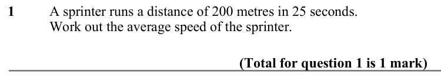

Text (lossy): 1 / A sprinter runs a distance of 200 metres in 25 seconds. /   / Work out the average speed of the sprinter. / (Total for question 1 is 1 mark)

## Q2 (marks not printed)

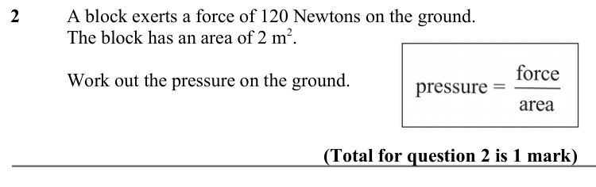

Text (lossy): 2 / A block exerts a force of 120 Newtons on the ground.  /   / The block has an area of 2 m 2.  / Work out the pressure on the ground. / (Total for question 2 is 1 mark)

## Q3 (marks not printed)

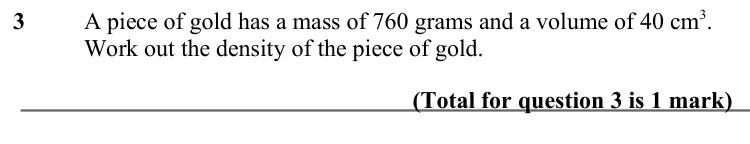

Text (lossy): 3 / A piece of gold has a mass of 760 grams and a volume of 40 cm 3.  /   / Work out the density of the piece of gold.  / (Total for question 3 is 1 mark)

## Q4 (marks not printed)

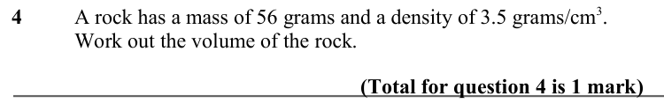

Text (lossy): 4 / A rock has a mass of 56 grams and a density of 3.5 grams/cm 3.  /   / Work out the volume of the rock.  / (Total for question 4 is 1 mark)

## Q5 (marks not printed)

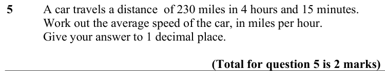

Text (lossy): 5 / A car travels a distance  of 230 miles in 4 hours and 15 minutes.  /   / Work out the average speed of the car, in miles per hour. / Give your answer to 1 decimal place.  / (Total for question 5 is 2 marks)

## Q6 (marks not printed)

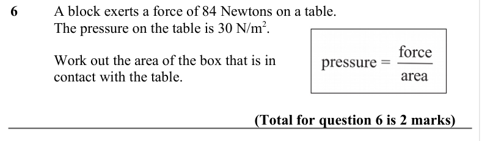

Text (lossy): 6 / A block exerts a force of 84 Newtons on a table.  /   / The pressure on the table is 30 N/m 2. / Work out the area of the box that is in  / contact with the table.  / (Total for question 6 is 2 marks)

## Q7 (marks not printed)

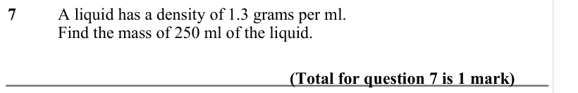

Text (lossy): 7 / A liquid has a density of 1.3 grams per ml.   /   / Find the mass of 250 ml of the liquid.  / (Total for question 7 is 1 mark)

## Q8 (marks not printed)

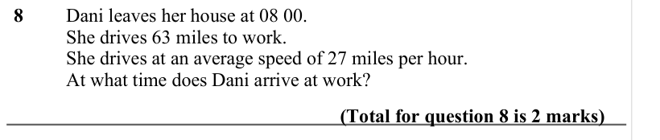

Text (lossy): 8 / Dani leaves her house at 08 00. / She drives 63 miles to work. / She drives at an average speed of 27 miles per hour. / At what time does Dani arrive at work? / (Total for question 8 is 2 marks)

## Q9 (marks not printed · parts a, b)

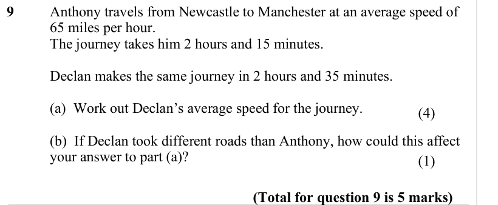

Text (lossy): 9 / Anthony travels from Newcastle to Manchester at an average speed of  / 65 miles per hour.  / The journey takes him 2 hours and 15 minutes.  / Declan makes the same journey in 2 hours and 35 minutes.  / (a)  Work out Declan’s average speed for the journey. / (4) /   / (b)  If Declan took different roads than Anthony, how could this affect  / your answer to part (a)? / (1) /   / (Total for quest

## Q10 (marks not printed)

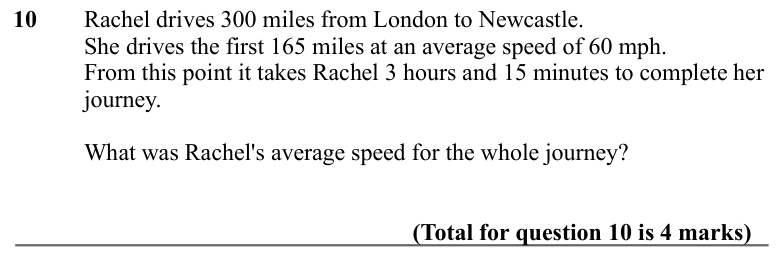

Text (lossy): 10   / Rachel drives 300 miles from London to Newcastle.  /        / She drives the first 165 miles at an average speed of 60 mph.  /        / From this point it takes Rachel 3 hours and 15 minutes to complete her  / journey.  /        /        / What was Rachel's average speed for the whole journey? /        / (Total for question 10 is 4 marks)

## Q11 (marks not printed · parts a, b)

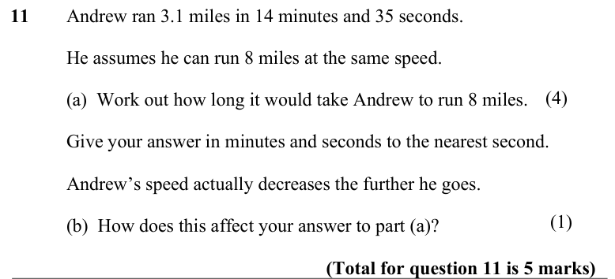

Text (lossy): 11 / Andrew ran 3.1 miles in 14 minutes and 35 seconds.  / He assumes he can run 8 miles at the same speed.  / (4) /   / (a)  Work out how long it would take Andrew to run 8 miles.  / Give your answer in minutes and seconds to the nearest second.  / Andrew’s speed actually decreases the further he goes.  / (1) / (b)  How does this affect your answer to part (a)? / (Total for question 11 is 5 marks

## Q12 (marks not printed)

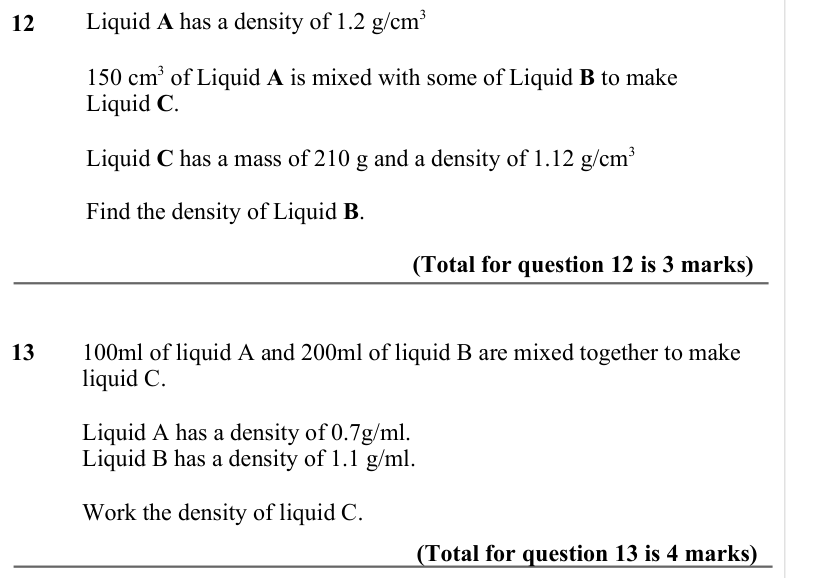

Text (lossy): 12     /        / Liquid A has a density of 1.2 g/cm 3 /           / 150 cm 3 of Liquid A is mixed with some of Liquid B to make / Liquid C.  /        / Liquid C has a mass of 210 g and a density of 1.12 g/cm 3 /        / Find the density of Liquid B. / (Total for question 12 is 3 marks) / 13 / 100ml of liquid A and 200ml of liquid B are mixed together to make  / liquid C.  /          Liquid A has

