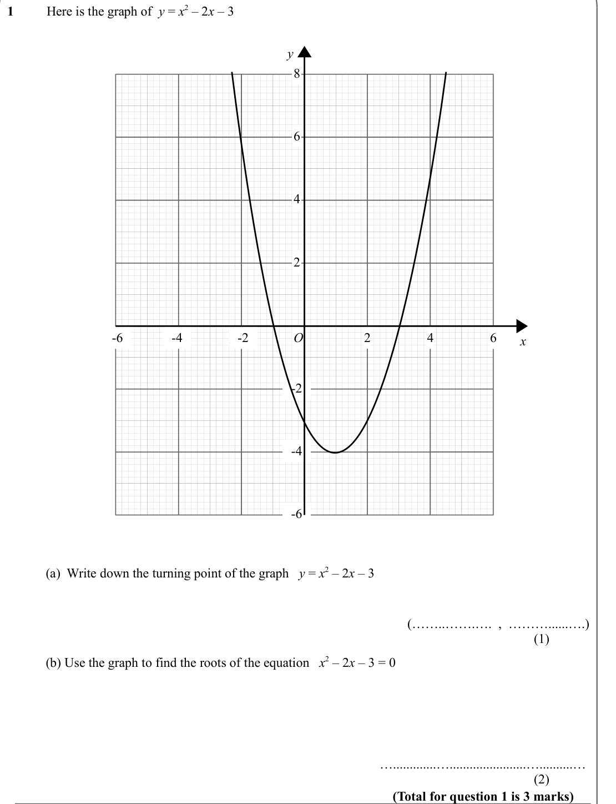
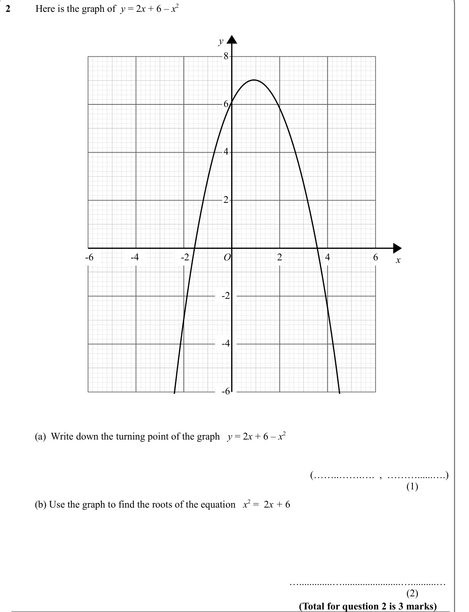
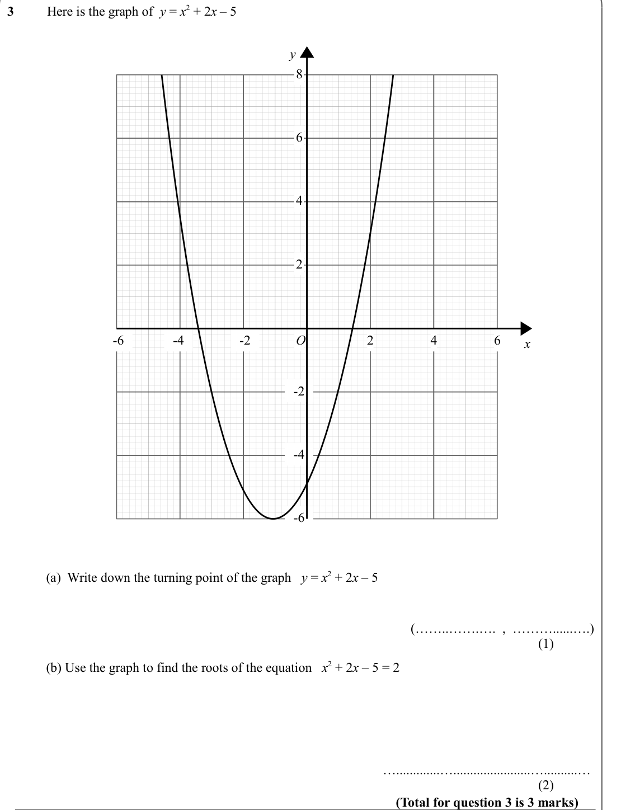
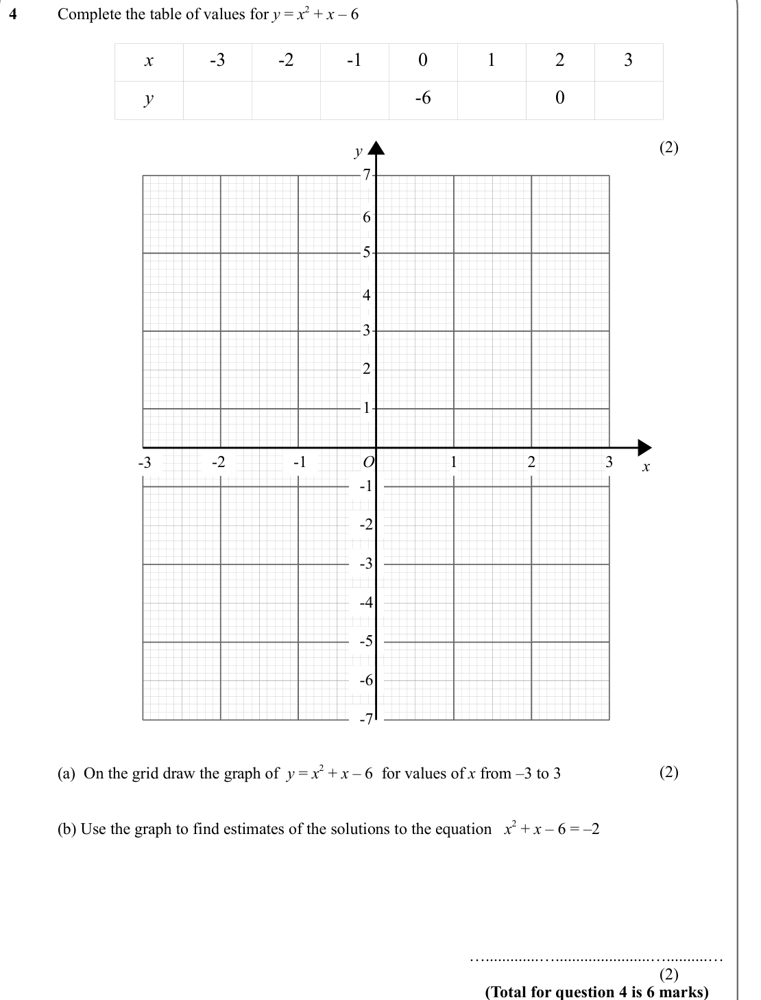
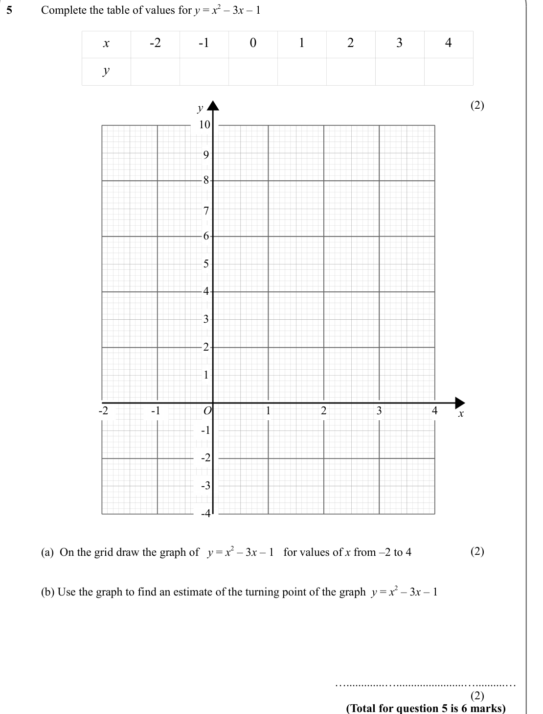
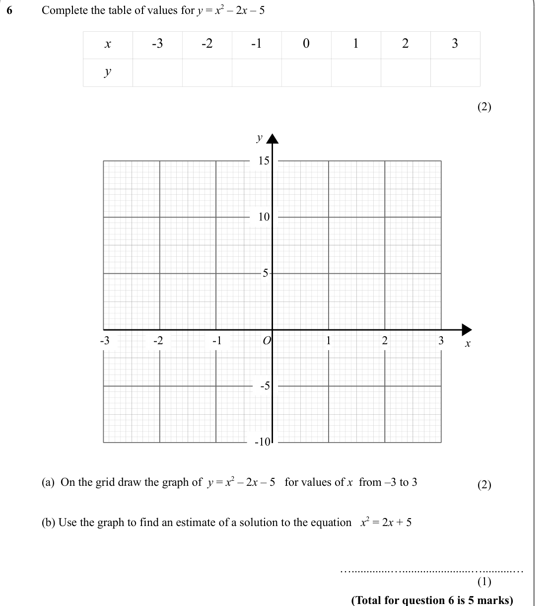
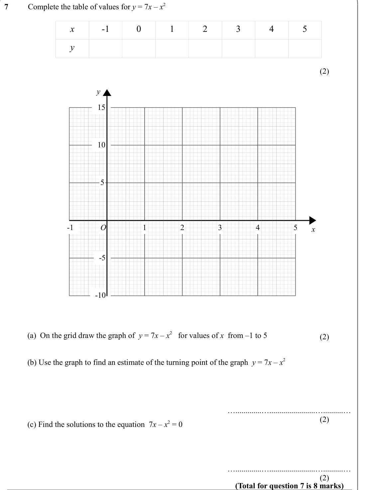

# Drawing Quadratic Graphs — Exam Questions (IGCSE Maths · Edexcel · Grade 5)

Topic code `5.7` · slug `grade-5-5-7-drawing-quadratic-graphs` · source sheet sha256 `26ac0fb43731debb…`

## Q1 (marks not printed · parts a, b)

Text (lossy): 1    / Here is the graph of  y = x 2 – 2 x – 3   / y / 8 / 6 / 4 / 2 / O / 4 / 6 / -2 / -4 / -6 / 2 / x / -2 / -4 / -6 / (a)  Write down the turning point of the graph   y = x 2 – 2 x – 3 /   / (……..…….….  ,  ………......….) / (1)             / (b) Use the graph to find the roots of the equation   x 2 – 2 x – 3 = 0 / ….............….......................…..........…  / (2)             / (Total for q

## Q2 (marks not printed · parts a, b)

Text (lossy): 2    / Here is the graph of  y = 2 x + 6 – x 2  / y / 8 / 6 / 4 / 2 / O / 4 / 6 / -2 / -4 / -6 / 2 / x / -2 / -4 / -6 / (a)  Write down the turning point of the graph   y = 2 x + 6 – x 2  /   / (……..…….….  ,  ………......….) / (1)             / (b) Use the graph to find the roots of the equation   x 2 =  2 x + 6 / ….............….......................…..........…  / (2)             / (Total for ques

## Q3 (marks not printed · parts a, b)

Text (lossy): 3    / Here is the graph of  y = x 2 + 2 x – 5  / y / 8 / 6 / 4 / 2 / O / 4 / 6 / -2 / -4 / -6 / 2 / x / -2 / -4 / -6 / (a)  Write down the turning point of the graph   y = x 2 + 2 x – 5 /   / (……..…….….  ,  ………......….) / (1)             / (b) Use the graph to find the roots of the equation   x 2 + 2 x – 5 = 2 / ….............….......................…..........…  / (2)             / (Total for qu

## Q4 (marks not printed · parts a, b)

Text (lossy): 4    / Complete the table of values for y = x 2 + x – 6  / x / -3 / -2 / -1 / 0 / 1 / 2 / 3 / y / -6 / 0 / (2)             / y / 7 / 6 / 5 / 4 / 3 / 2 / 1 / O / 2 / 3 / -1 / -2 / -3 / 1 / x / -1 / -2 / -3 / -4 / -5 / -6 / -7 / (2)             / (a)  On the grid draw the graph of  y = x 2 + x – 6  for values of x from –3 to 3 / (b) Use the graph to find estimates of the solutions to the equation   

## Q5 (marks not printed · parts a, b)

Text (lossy): 5    / Complete the table of values for y = x 2 – 3 x – 1  / x / -2 / -1 / 0 / 1 / 2 / 3 / 4 / y / (2)             / y / 10 / 9 / 8 / 7 / 6 / 5 / 4 / 3 / 2 / 1 / O / 3 / 4 / -1 / -2 / 1 / 2 / x / -1 / -2 / -3 / -4 / (2)             / (a)  On the grid draw the graph of   y = x 2 – 3 x – 1   for values of x from –2 to 4 / (b) Use the graph to find an estimate of the turning point of the graph  y = x

## Q6 (marks not printed · parts a, b)

Text (lossy): 6    / Complete the table of values for y = x 2 – 2 x – 5   / x / -3 / -2 / -1 / 0 / 1 / 2 / 3 / y / (2)             / y / 15 / 10 / 5 / O / 2 / 3 / -1 / -2 / -3 / x / 1 / -5 / -10 / (a)  On the grid draw the graph of  y = x 2 – 2 x – 5   for values of x  from –3 to 3 / (2)             / (b) Use the graph to find an estimate of a solution to the equation   x 2 = 2 x + 5 / ….............…..........

## Q7 (marks not printed · parts a, b, c)

Text (lossy): 7    / Complete the table of values for y = 7 x – x 2  / x / -1 / 0 / 1 / 2 / 3 / 4 / 5 / y / (2)             / y / 15 / 10 / 5 / O / 2 / 3 / -1 / x / 1 / 4 / 5 / -5 / -10 / (a)  On the grid draw the graph of  y = 7 x – x 2   for values of x  from –1 to 5 / (2)             / (b) Use the graph to find an estimate of the turning point of the graph  y = 7 x – x 2 / ….............…....................

