# Simultaneous Equations — Exam Questions (IGCSE Maths · Edexcel · Grade 5)

Topic code `5.8` · slug `grade-5-5-8-simultaneous-equations` · source sheet sha256 `34bdee46947d360f…`

## Q1 (3 marks)

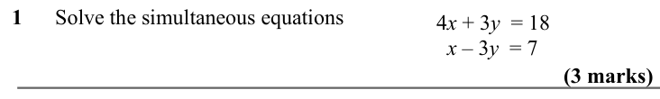

Text (lossy): 1      Solve the simultaneous equations /  4 x + 3 y  = 18  /   x – 3 y  = 7  /   / (3 marks)

## Q2 (3 marks)

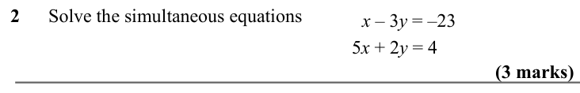

Text (lossy): 2      Solve the simultaneous equations /   x – 3 y = –23  /  5 x + 2 y = 4  / (3 marks)

## Q3 (3 marks)

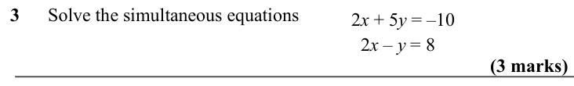

Text (lossy): 3      Solve the simultaneous equations / 2 x + 5 y = –10  /   /   2 x – y = 8  / (3 marks)

## Q4 (3 marks)

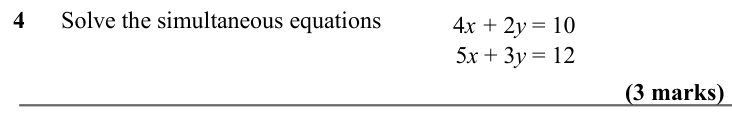

Text (lossy): 4      Solve the simultaneous equations /   4 x + 2 y = 10 /  5 x + 3 y = 12  / (3 marks)

## Q5 (3 marks)

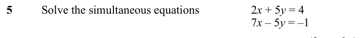

Text (lossy): 5 / Solve the simultaneous equations / 2 x + 5 y = 4  / 7 x – 5 y = –1  / (3 marks)

## Q6 (3 marks)

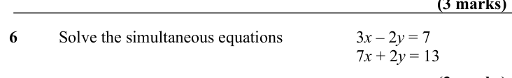

Text (lossy): 6 / Solve the simultaneous equations / 3 x – 2 y = 7  / 7 x + 2 y = 13  / (3 marks)

## Q7 (3 marks)

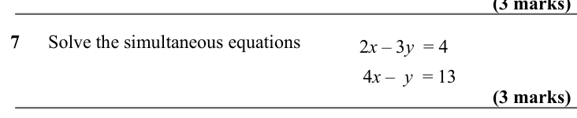

Text (lossy): 7      Solve the simultaneous equations /   2 x – 3 y  = 4  /     4 x –  y  = 13  / (3 marks)

## Q8 (3 marks)

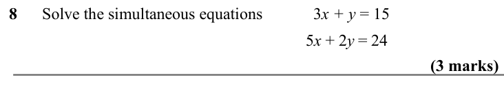

Text (lossy): 8      Solve the simultaneous equations / 3 x + y = 15  / 5 x + 2 y = 24  / (3 marks)

## Q9 (3 marks)

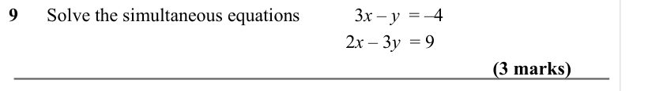

Text (lossy): 9      Solve the simultaneous equations /   3 x – y  = –4 /   /    2 x – 3 y  = 9  / (3 marks)

## Q10 (3 marks)

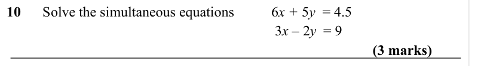

Text (lossy): 10      Solve the simultaneous equations /   6 x + 5 y  = 4.5 /   /    3 x – 2 y  = 9  / (3 marks)

## Q11 (3 marks)

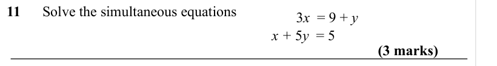

Text (lossy): 11      Solve the simultaneous equations /    3 x  = 9 + y  /   x + 5 y  = 5 / (3 marks)

## Q12 (3 marks)

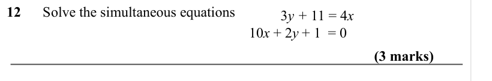

Text (lossy): 12      Solve the simultaneous equations / 3 y + 11 = 4 x /   /    10 x + 2 y + 1  = 0  / (3 marks)

## Q13 (3 marks)

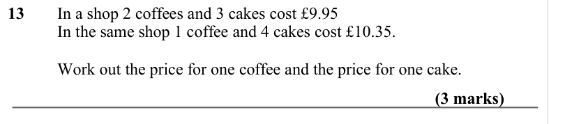

Text (lossy): 13 / In a shop 2 coffees and 3 cakes cost £9.95 / In the same shop 1 coffee and 4 cakes cost £10.35. / Work out the price for one coffee and the price for one cake. / (3 marks)

## Q14 (3 marks)

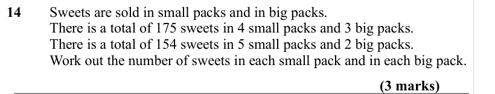

Text (lossy): 14 / Sweets are sold in small packs and in big packs. / There is a total of 175 sweets in 4 small packs and 3 big packs. / There is a total of 154 sweets in 5 small packs and 2 big packs. / Work out the number of sweets in each small pack and in each big pack. / (3 marks)

