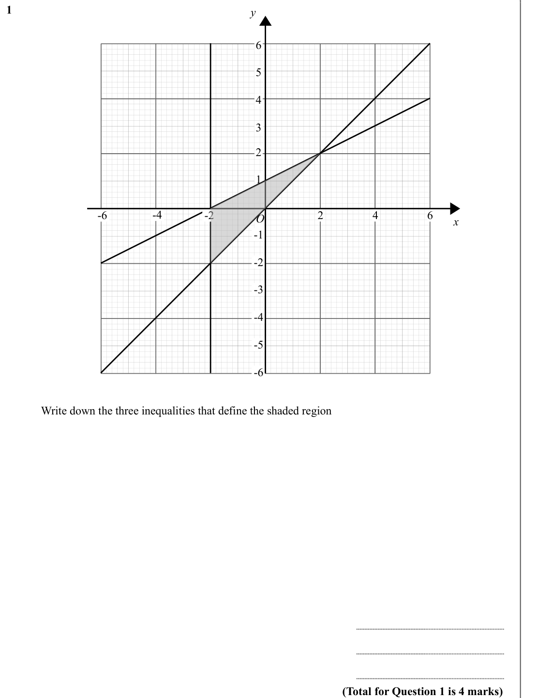
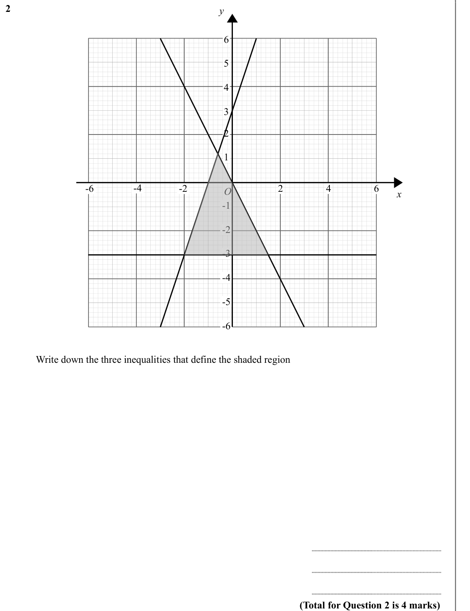
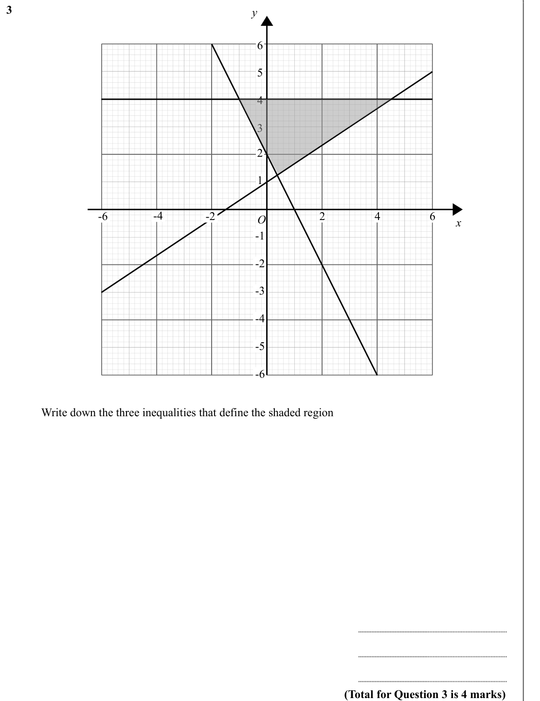
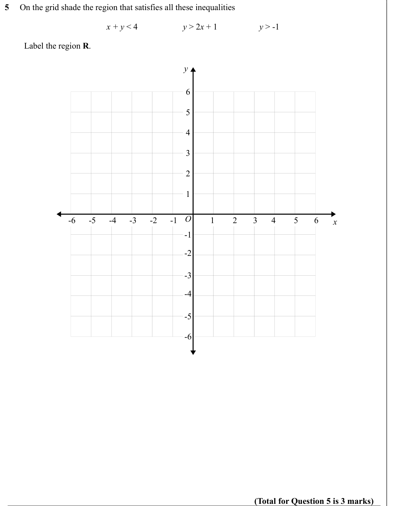
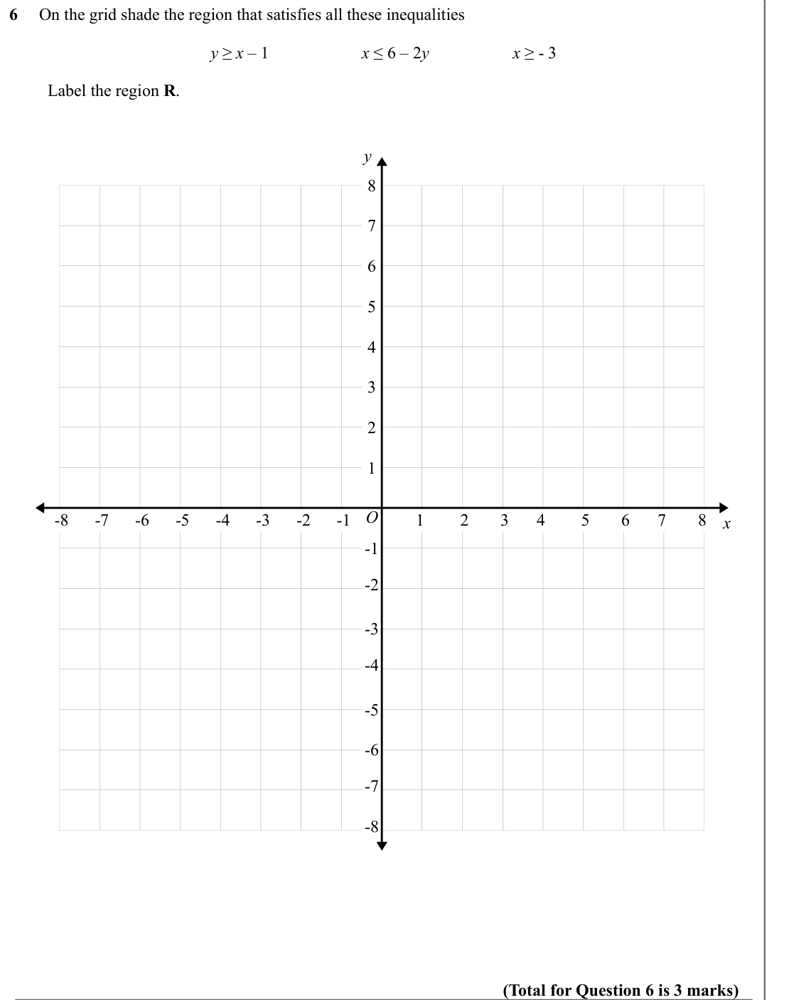
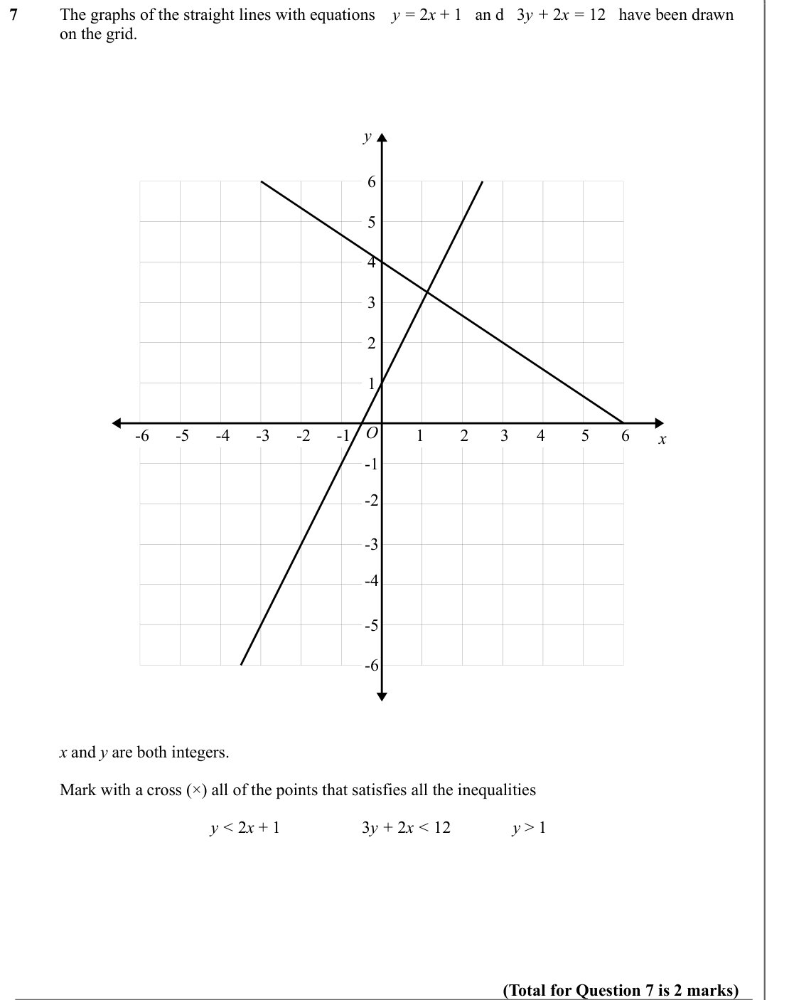

# Inequalities on Graphs — Exam Questions (IGCSE Maths · Edexcel · Grade 5)

Topic code `5.9` · slug `grade-5-5-9-inequalities-on-graphs` · source sheet sha256 `231cd350adea333c…`

## Q1 (marks not printed)

Text (lossy): 1    / y / 6 / 5 / 4 / 3 / 2 / 1 / -4 / -6 / 2 / -2 / 4 / 6 / O / x / -1 / -2 / -3 / -4 / -5 / -6 / Write down the three inequalities that define the shaded region / (Total for Question 1 is 4 marks)

## Q2 (marks not printed)

Text (lossy): 2    / y / 6 / 5 / 4 / 3 / 2 / 1 / -4 / -6 / 2 / -2 / 4 / 6 / O / x / -1 / -2 / -3 / -4 / -5 / -6 / Write down the three inequalities that define the shaded region / (Total for Question 2 is 4 marks)

## Q3 (marks not printed)

Text (lossy): 3    / y / 6 / 5 / 4 / 3 / 2 / 1 / -4 / -6 / 2 / -2 / 4 / 6 / O / x / -1 / -2 / -3 / -4 / -5 / -6 / Write down the three inequalities that define the shaded region / (Total for Question 3 is 4 marks)

## Q4 (marks not printed)

Text (lossy): 4     On the grid shade the region that satisfies all these inequalities / x < 3 / y > -2  / y ≤ 2 x – 1  /          Label the region R.  / y / 6 / 5 / 4 / 3 / 2 / 1 / O / -1 / 1 / 2 / 3 / 4 / 5 / 6 / -2 / -3 / -4 / -5 / -6 / x / -1 / -2 / -3 / -4 / -5 / -6 / (Total for Question 4 is 3 marks)

## Q5 (marks not printed)

Text (lossy): 5     On the grid shade the region that satisfies all these inequalities / x + y < 4 / y > 2 x + 1  / y > -1  /          Label the region R.  / y / 6 / 5 / 4 / 3 / 2 / 1 / O / -1 / 1 / 2 / 3 / 4 / 5 / 6 / -2 / -3 / -4 / -5 / -6 / x / -1 / -2 / -3 / -4 / -5 / -6 / (Total for Question 5 is 3 marks)

## Q6 (marks not printed)

Text (lossy): 6     On the grid shade the region that satisfies all these inequalities / y ≥ x – 1  / x ≤ 6 – 2 y    / x ≥ - 3 /          Label the region R.  / y / 8 / 7 / 6 / 5 / 4 / 3 / 2 / 1 / O / -1 / 1 / 2 / 3 / 4 / 5 / 6 / 7 / 8 / -2 / -3 / -4 / -5 / -6 / -7 / -8 / x / -1 / -2 / -3 / -4 / -5 / -6 / -7 / -8 / (Total for Question 6 is 3 marks)

## Q7 (marks not printed)

Text (lossy): 7      / The graphs of the straight lines with equations    y = 2 x + 1   an d   3 y + 2 x = 12   have been drawn  / on the grid.  / y / 6 / 5 / 4 / 3 / 2 / 1 / O / -1 / 1 / 2 / 3 / 4 / 5 / 6 / -2 / -3 / -4 / -5 / -6 / x / -1 / -2 / -3 / -4 / -5 / -6 /       / x and y are both integers. / Mark with a cross (×) all of the points that satisfies all the inequalities / y < 2 x + 1 / 3 y + 2 x < 12 / y

