# Recurring Decimals to Fractions — Exam Questions (IGCSE Maths · Edexcel · Grade 6)

Topic code `6.1` · slug `grade-6-6-1-recurring-decimals-to-fractions` · source sheet sha256 `33e42b114a2dcc98…`

## Q1 (marks not printed)

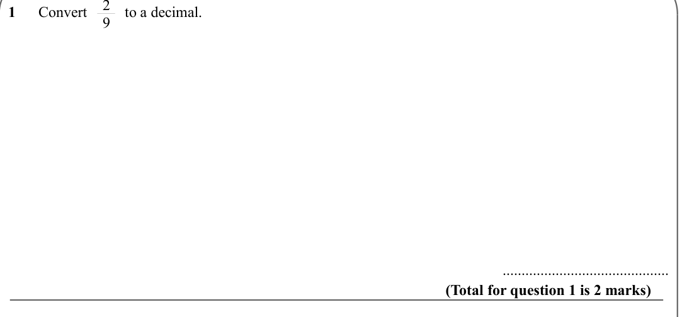

Text (lossy): 1      Convert          to a decimal.    /              /        ............................................ / (Total for question 1 is 2 marks) / 4 / 11

## Q2 (marks not printed)

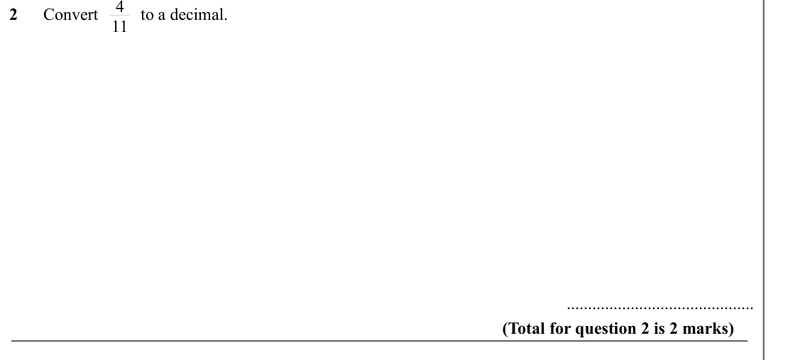

Text (lossy): 2      Convert          to a decimal.    /              /        ............................................ / (Total for question 2 is 2 marks) / 5 / 6

## Q3 (marks not printed)

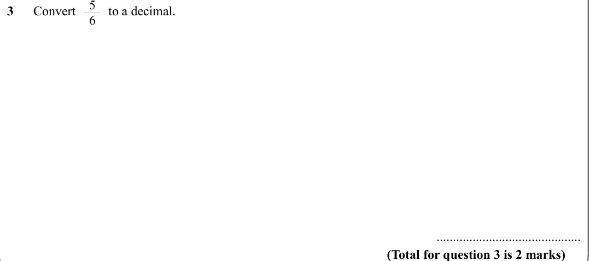

Text (lossy): 3      Convert          to a decimal.    /              /        ............................................ / (Total for question 3 is 2 marks)

## Q4 (marks not printed)

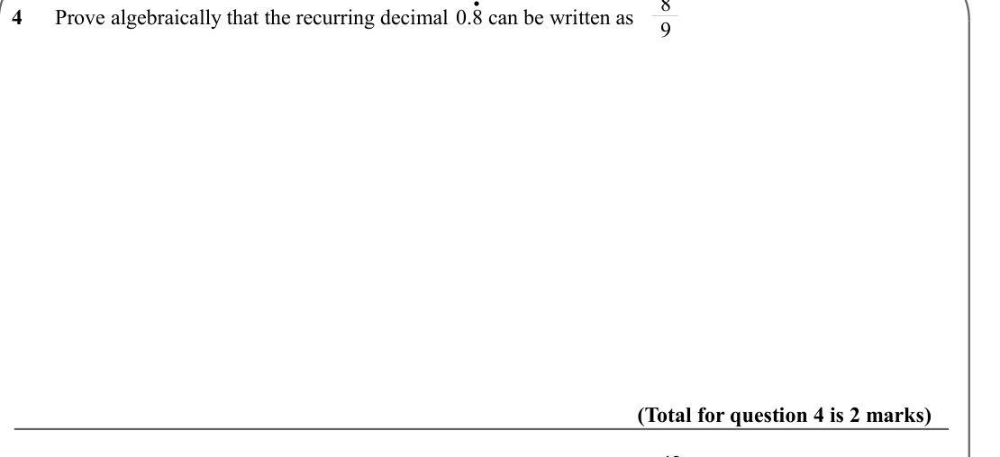

Text (lossy): 4      Prove algebraically that the recurring decimal  0.8 can be written as   /              / (Total for question 4 is 2 marks) /  . / 43 / 90

## Q5 (marks not printed)

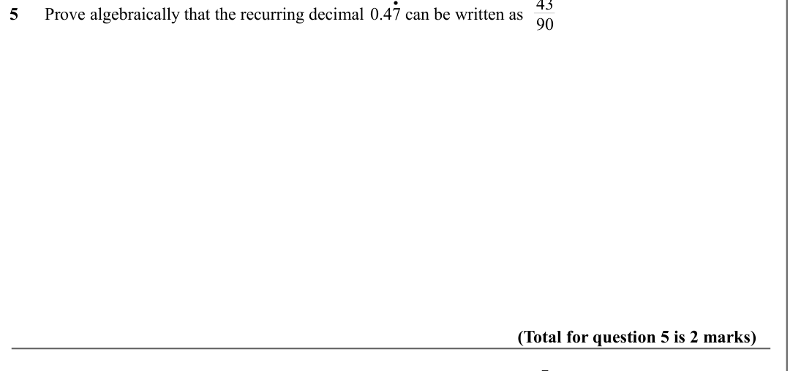

Text (lossy): 5      Prove algebraically that the recurring decimal  0.47 can be written as   /              / (Total for question 5 is 2 marks) / 7 / 30 /  .

## Q6 (marks not printed)

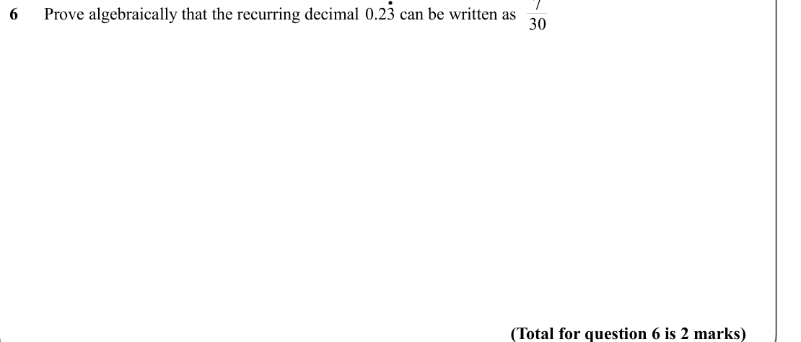

Text (lossy): 6      Prove algebraically that the recurring decimal  0.23 can be written as   /              / (Total for question 6 is 2 marks)

## Q7 (marks not printed)

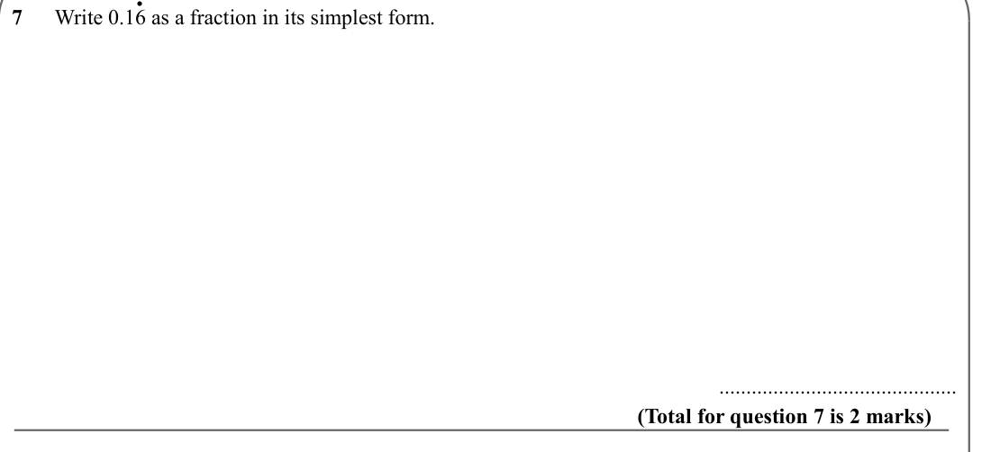

Text (lossy): 7      Write 0.16 as a fraction in its simplest form. /              /        ............................................ / (Total for question 7 is 2 marks) /  .

## Q8 (marks not printed)

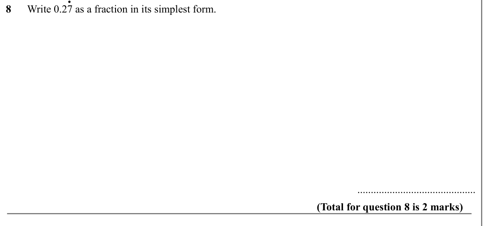

Text (lossy): 8      Write 0.27 as a fraction in its simplest form. /              /        ............................................ / (Total for question 8 is 2 marks) /  .

## Q9 (marks not printed)

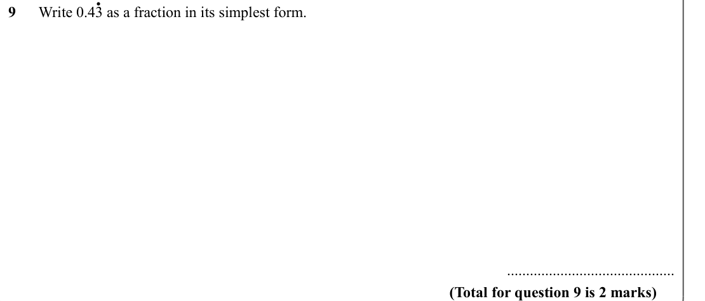

Text (lossy): 9      Write 0.43 as a fraction in its simplest form. /              /        ............................................ / (Total for question 9 is 2 marks)

## Q10 (marks not printed)

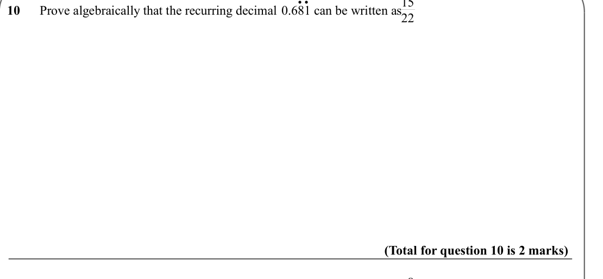

Text (lossy): 10      Prove algebraically that the recurring decimal  0.681 can be written as   /              / (Total for question 10 is 2 marks) / 8 / 37 /  . .

## Q11 (marks not printed)

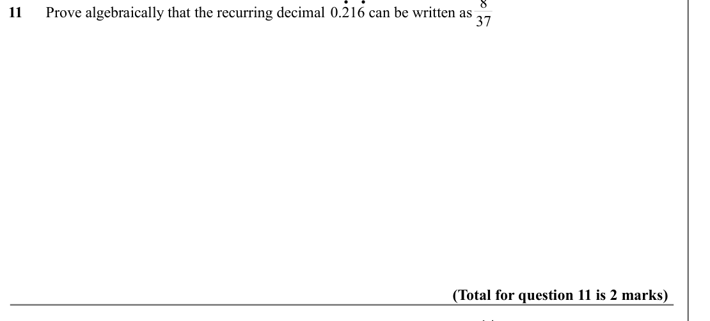

Text (lossy): 11      Prove algebraically that the recurring decimal  0.216 can be written as   /              / (Total for question 11 is 2 marks) / 14 / 111 /  . .

## Q12 (marks not printed)

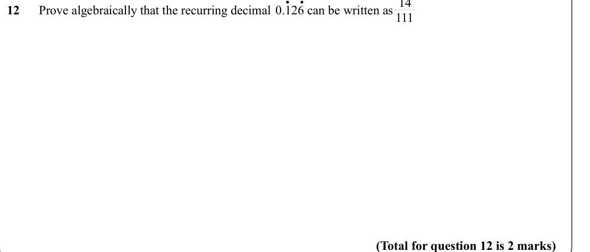

Text (lossy): 12      Prove algebraically that the recurring decimal  0.126 can be written as   /              / (Total for question 12 is 2 marks)

## Q13 (marks not printed)

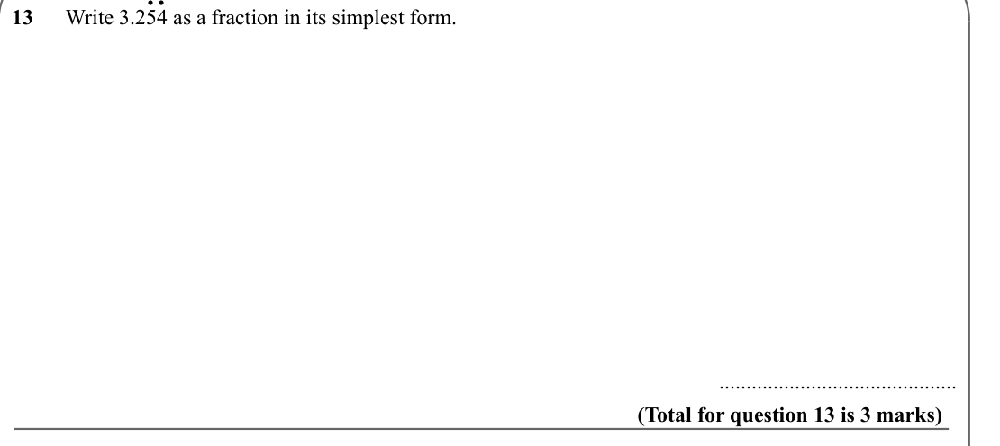

Text (lossy): 13      Write 3.254 as a fraction in its simplest form. /              /        ............................................ / (Total for question 13 is 3 marks) /  ..

## Q14 (marks not printed)

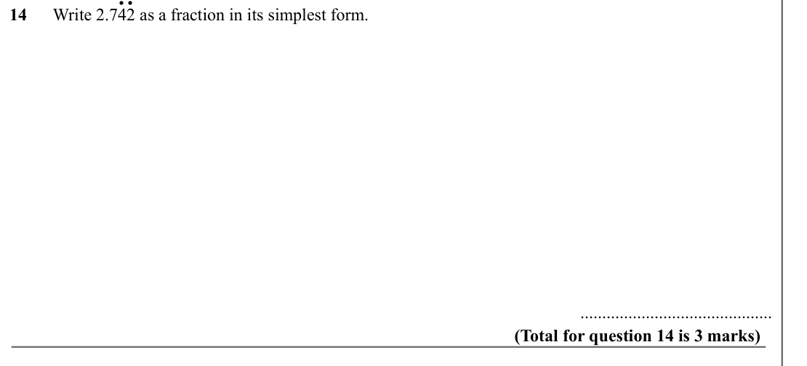

Text (lossy): 14      Write 2.742 as a fraction in its simplest form. /              /        ............................................ / (Total for question 14 is 3 marks) /  . .

## Q15 (marks not printed)

Text (lossy): 15      Write 3.594 as a fraction in its simplest form. /              /        ............................................ / (Total for question 15 is 3 marks)

## Q16 (marks not printed)

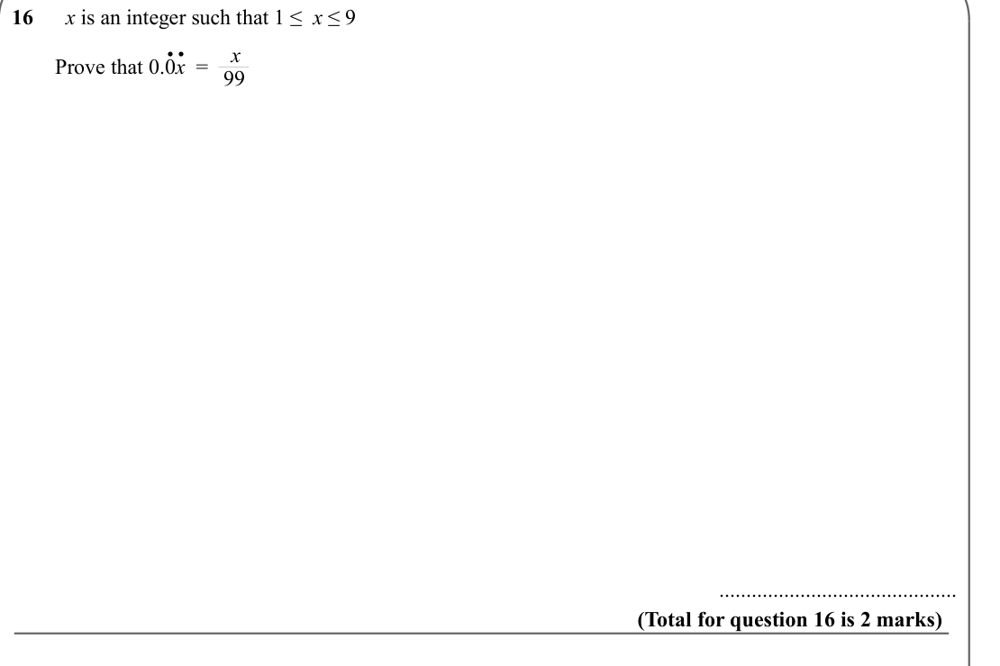

Text (lossy): 16      x is an integer such that 1 ≤  x ≤ 9 / x / 99 /  .. /         Prove that 0.0 x  =  /              /        ............................................ / (Total for question 16 is 2 marks) / .. / .

## Q17 (marks not printed)

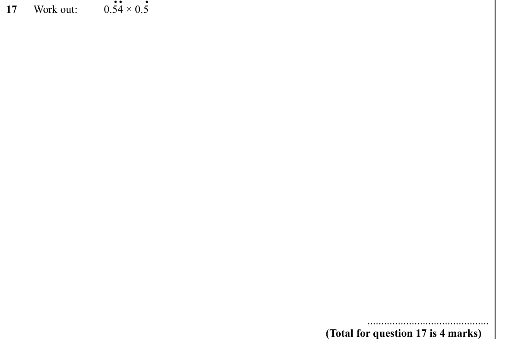

Text (lossy): 17      Work out:  / 0.54 × 0.5 /              /        ............................................ / (Total for question 17 is 4 marks)

## Q18 (marks not printed)

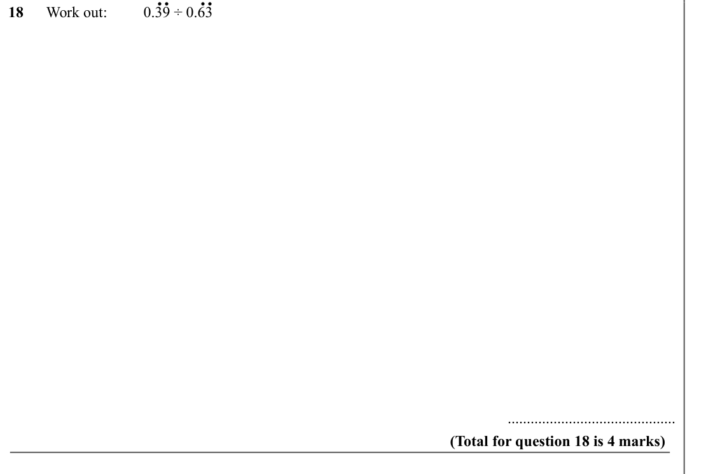

Text (lossy): 18      Work out:  / 0.39 ÷ 0.63 /              /        ............................................ / (Total for question 18 is 4 marks) / . / . .

## Q19 (marks not printed)

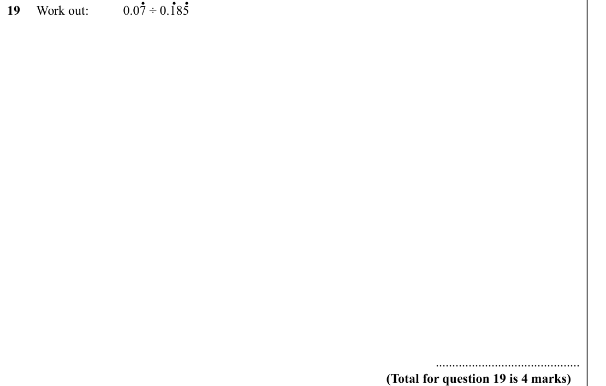

Text (lossy): 19     Work out:  / 0.07 ÷ 0.185 /              /        ............................................ / (Total for question 19 is 4 marks)

