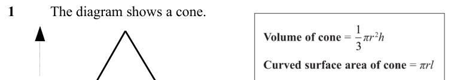
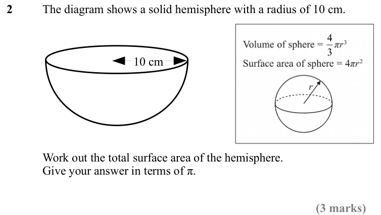
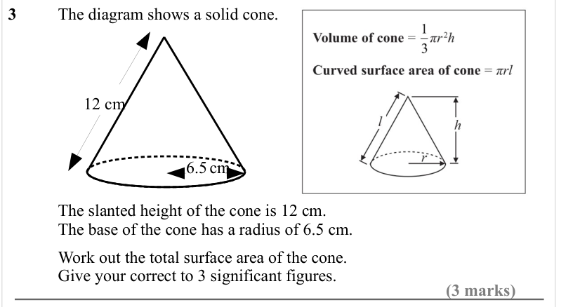
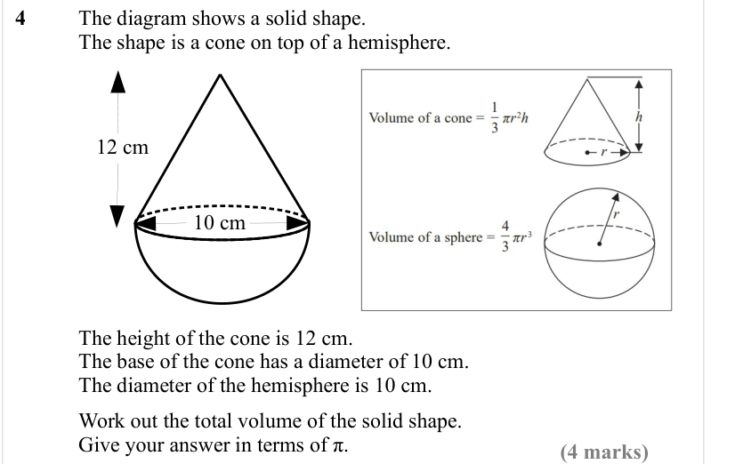
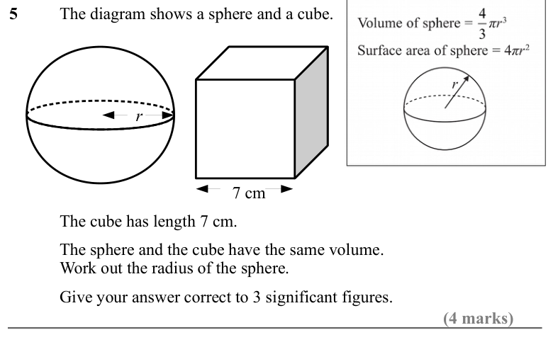
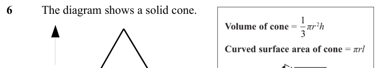
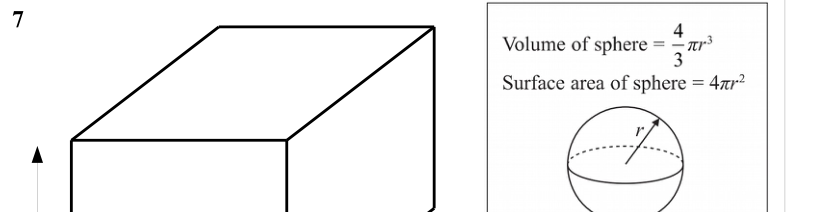

# Spheres and Cones — Exam Questions (IGCSE Maths · Edexcel · Grade 6)

Topic code `6.10` · slug `grade-6-6-10-spheres-and-cones` · source sheet sha256 `e1006ad5f5b65f0b…`

## Q1 (marks not printed)

Text (lossy): 1 / The diagram shows a cone.

## Q2 (3 marks)

Text (lossy): 2 / The diagram shows a solid hemisphere with a radius of 10 cm.  / 10 cm / Work out the total surface area of the hemisphere.  / Give your answer in terms of π.  / (3 marks)

## Q3 (3 marks)

Text (lossy): 3 / The diagram shows a solid cone. / 12 cm / 6.5 cm / The slanted height of the cone is 12 cm.  / The base of the cone has a radius of 6.5 cm.  / Work out the total surface area of the cone.   / Give your correct to 3 significant figures.  / (3 marks)

## Q4 (4 marks)

Text (lossy): 4 / The diagram shows a solid shape. / The shape is a cone on top of a hemisphere. / 12 cm / 10 cm / The height of the cone is 12 cm.  / The base of the cone has a diameter of 10 cm.  / The diameter of the hemisphere is 10 cm.  / Work out the total volume of the solid shape.  / Give your answer in terms of π.  / (4 marks)

## Q5 (4 marks)

Text (lossy): 5 / The diagram shows a sphere and a cube.  / r / 7 cm / The cube has length 7 cm. / The sphere and the cube have the same volume.  / Work out the radius of the sphere.  / Give your answer correct to 3 significant figures.  / (4 marks)

## Q6 (marks not printed)

Text (lossy): 6 / The diagram shows a solid cone.

## Q7 (marks not printed)

Text (lossy): 7

