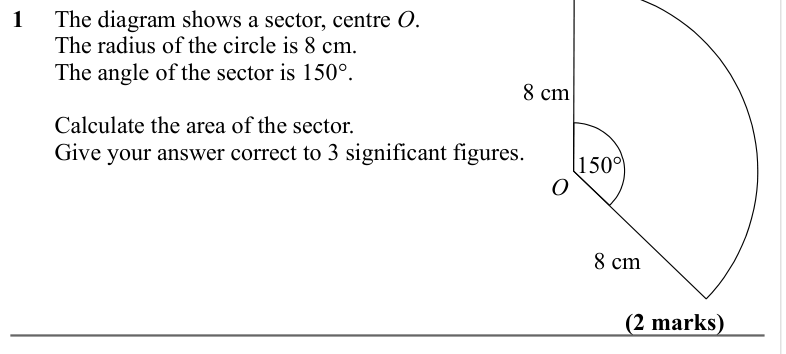
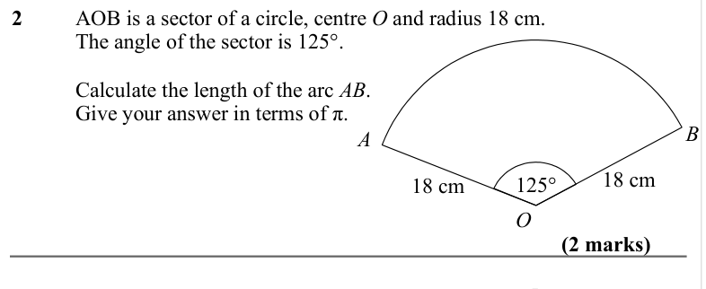
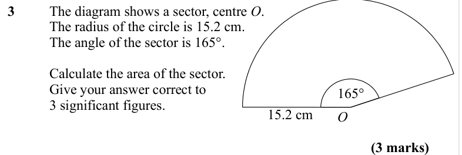
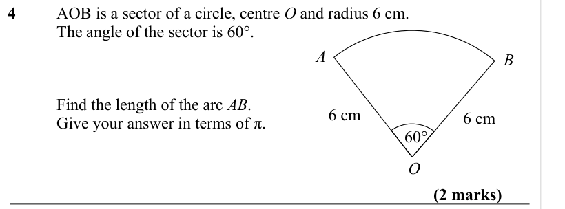
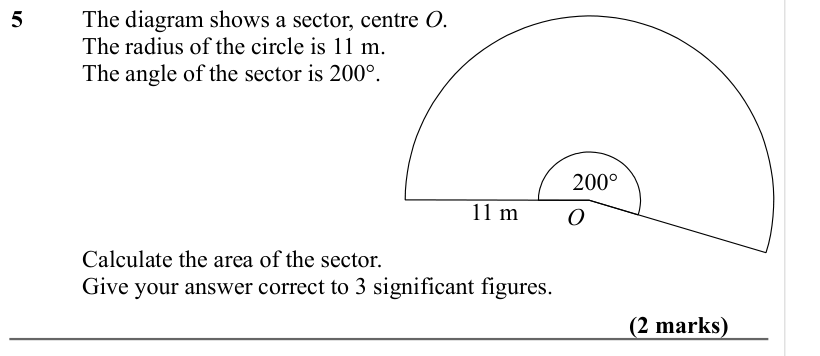
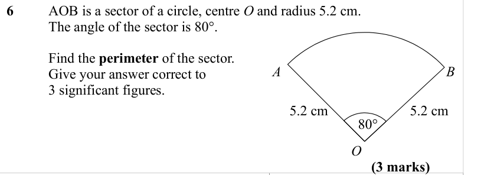
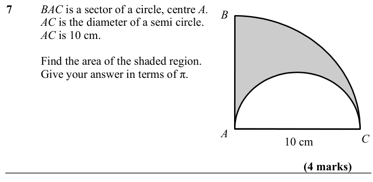
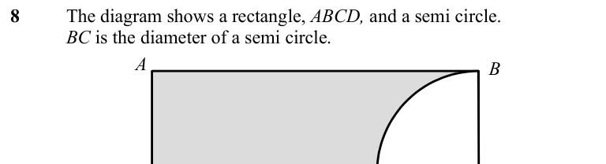
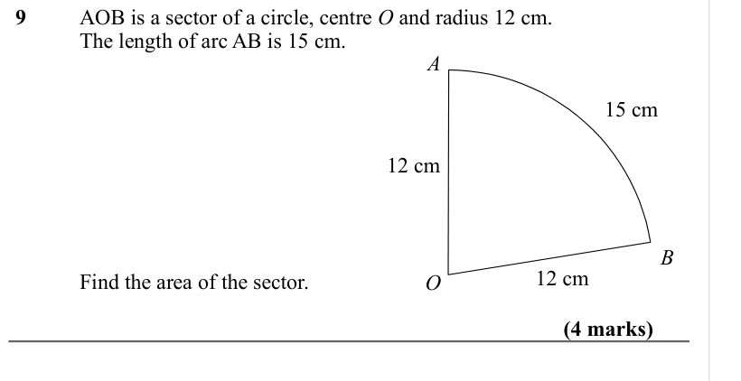
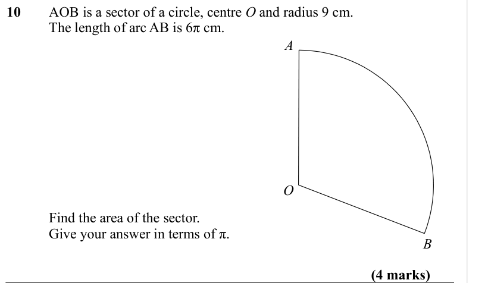

# Sector Areas and Arc Lengths — Exam Questions (IGCSE Maths · Edexcel · Grade 6)

Topic code `6.11` · slug `grade-6-6-11-sector-areas-and-arc-lengths` · source sheet sha256 `f772e244446a31ab…`

## Q1 (2 marks)

Text (lossy): 1     The diagram shows a sector, centre O.  /        The radius of the circle is 8 cm.  /        The angle of the sector is 150°. / 8 cm /        Calculate the area of the sector. /        Give your answer correct to 3 significant figures.   / 150° / O / 8 cm / (2 marks)

## Q2 (2 marks)

Text (lossy): 2 / AOB is a sector of a circle, centre O and radius 18 cm.   / The angle of the sector is 125°. / Calculate the length of the arc AB. / Give your answer in terms of π. / A / B / 18 cm / 18 cm / 125° / O / (2 marks)

## Q3 (3 marks)

Text (lossy): 3 / The diagram shows a sector, centre O.  / The radius of the circle is 15.2 cm.  / The angle of the sector is 165°. / Calculate the area of the sector. / Give your answer correct to  / 3 significant figures.   / 165° / 15.2 cm / O / (3 marks)

## Q4 (2 marks)

Text (lossy): 4 / AOB is a sector of a circle, centre O and radius 6 cm.   / The angle of the sector is 60°. / A / B / Find the length of the arc AB.   / Give your answer in terms of π.  / 6 cm / 6 cm / 60° / O / (2 marks)

## Q5 (2 marks)

Text (lossy): 5 / The diagram shows a sector, centre O.  / The radius of the circle is 11 m.  / The angle of the sector is 200°. / 200° / 11 m / O / Calculate the area of the sector. / Give your answer correct to 3 significant figures.   / (2 marks)

## Q6 (3 marks)

Text (lossy): 6 / AOB is a sector of a circle, centre O and radius 5.2 cm.   / The angle of the sector is 80°. / Find the perimeter of the sector.  / Give your answer correct to  / 3 significant figures.  / A / B / 5.2 cm / 5.2 cm / 80° / O / (3 marks)

## Q7 (4 marks)

Text (lossy): 7 / BAC is a sector of a circle, centre A. / AC is the diameter of a semi circle. / AC is 10 cm.  / B / Find the area of the shaded region. / Give your answer in terms of π. / A / C / 10 cm / (4 marks)

## Q8 (marks not printed)

Text (lossy): 8 / The diagram shows a rectangle, ABCD, and a semi circle. / BC is the diameter of a semi circle. / A / B

## Q9 (4 marks)

Text (lossy): 9 / AOB is a sector of a circle, centre O and radius 12 cm.   / The length of arc AB is 15 cm. / A / 15 cm / 12 cm / B / 12 cm / Find the area of the sector. / O / (4 marks)

## Q10 (4 marks)

Text (lossy): 10 / AOB is a sector of a circle, centre O and radius 9 cm.   / The length of arc AB is 6π cm. / A / O / Find the area of the sector. / Give your answer in terms of π. / B / (4 marks)

