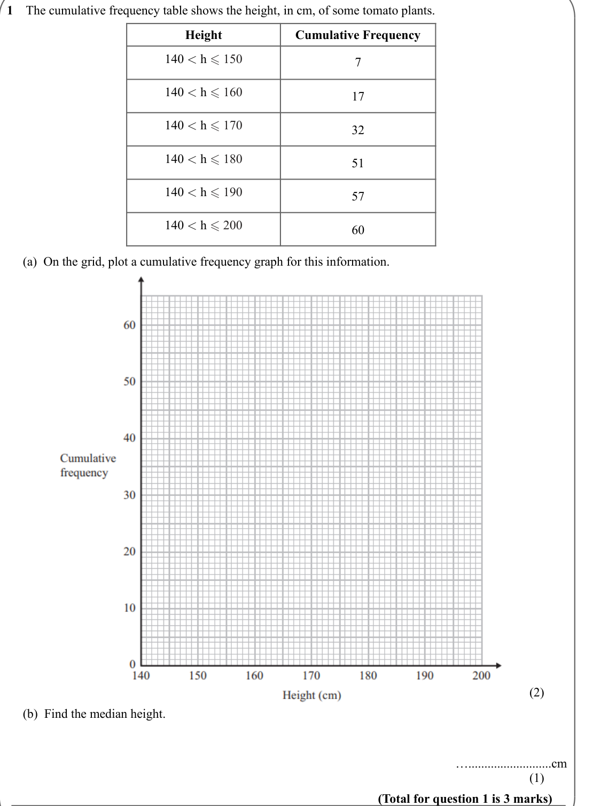
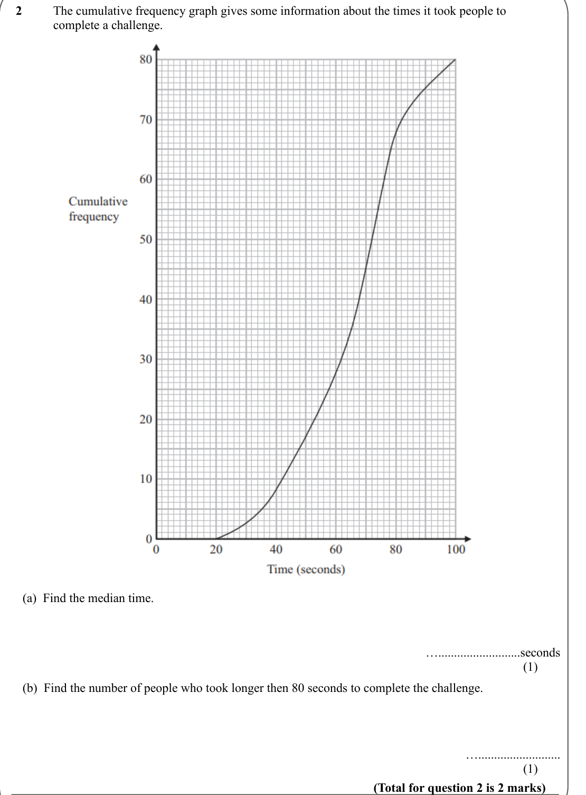
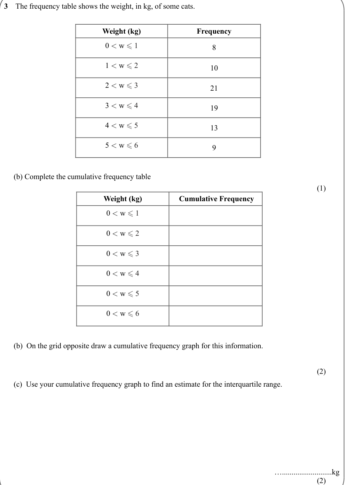
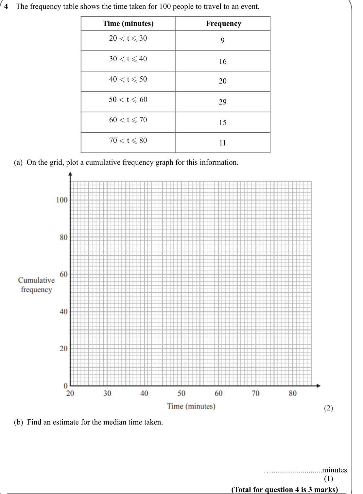
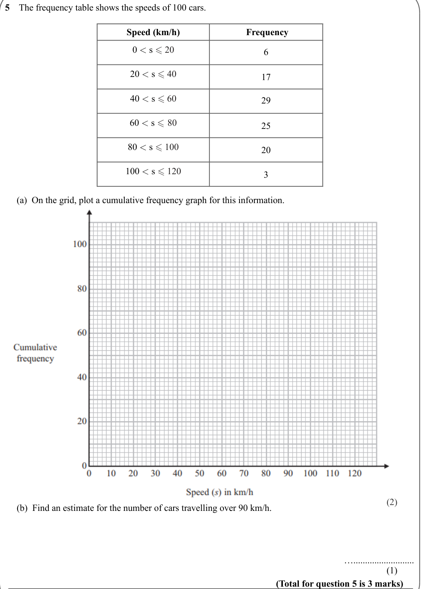
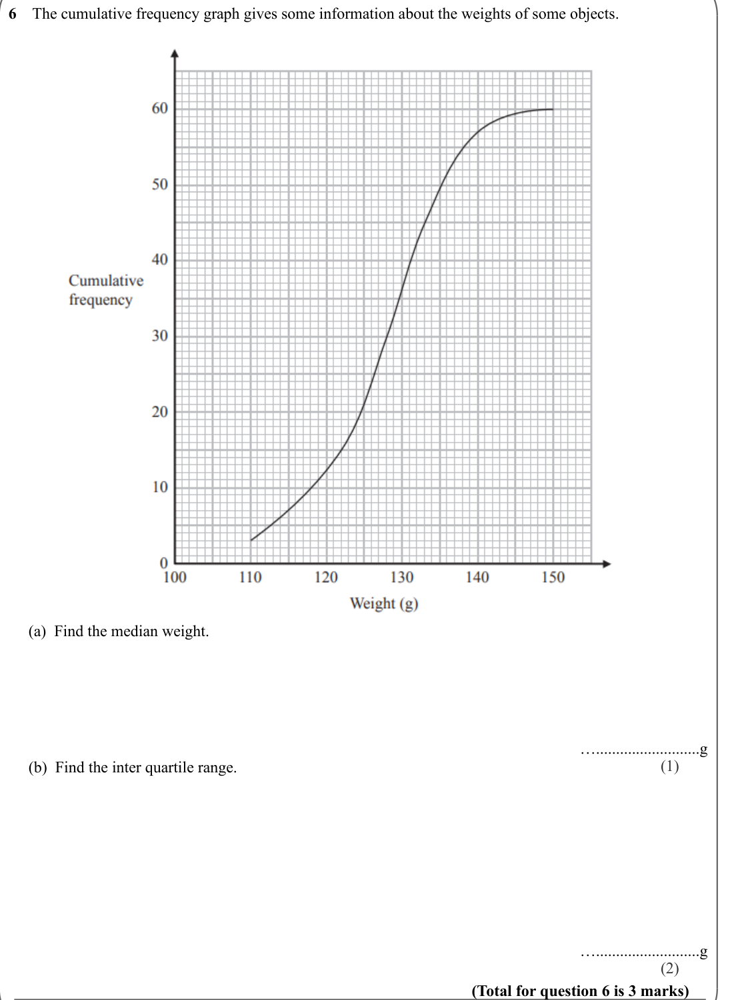

# Cumulative Frequency — Exam Questions (IGCSE Maths · Edexcel · Grade 6)

Topic code `6.15` · slug `grade-6-6-15-cumulative-frequency` · source sheet sha256 `ef45445c330dc810…`

## Q1 (marks not printed · parts a, b)

Text (lossy): 1    The cumulative frequency table shows the height, in cm, of some tomato plants. / Height / Cumulative Frequency / 140 < h  150 / 7 / 140 < h  160 / 17 / 140 < h  170 / 32 / 140 < h  180 / 51 / 140 < h  190 / 57 / 140 < h  200 / 60 /      (a)  On the grid, plot a cumulative frequency graph for this information.  / (2) /      (b)  Find the median height.  / …..........................cm / 

## Q2 (marks not printed · parts a, b)

Text (lossy): 2     / The cumulative frequency graph gives some information about the times it took people to  / complete a challenge. /      (a)  Find the median time.  / …..........................seconds / (1) /      (b)  Find the number of people who took longer then 80 seconds to complete the challenge.  / ….......................... / (1) / (Total for question 2 is 2 marks)

## Q3 (marks not printed · parts b, b, c)

Text (lossy): 3    The frequency table shows the weight, in kg, of some cats. / Weight (kg) / Frequency / 0 < w  1 / 8 / 1 < w  2 / 10 / 2 < w  3 / 21 / 3 < w  4 / 19 / 4 < w  5 / 13 / 5 < w  6 / 9 /      (b) Complete the cumulative frequency table / (1) / Weight (kg) /  Cumulative Frequency / 0 < w  1 / 0 < w  2 / 0 < w  3 / 0 < w  4 / 0 < w  5 / 0 < w  6 /      (b)  On the grid opposite draw a cum

## Q4 (marks not printed · parts a, b)

Text (lossy): 4    The frequency table shows the time taken for 100 people to travel to an event. / Time (minutes) /  Frequency / 20 < t  30 / 9 / 30 < t  40 / 16 / 40 < t  50 / 20 / 50 < t  60 / 29 / 60 < t  70 / 15 / 70 < t  80 / 11 /      (a)  On the grid, plot a cumulative frequency graph for this information.  / (2) /      (b)  Find an estimate for the median time taken.  / ….........................

## Q5 (marks not printed · parts a, b)

Text (lossy): 5    The frequency table shows the speeds of 100 cars. / Speed (km/h) /  Frequency / 0 < s  20 / 6 / 20 < s  40 / 17 / 40 < s  60 / 29 / 60 < s  80 / 25 / 80 < s  100 / 20 / 100 < s  120 / 3 /      (a)  On the grid, plot a cumulative frequency graph for this information.  / (2) /      (b)  Find an estimate for the number of cars travelling over 90 km/h.  / ….......................... / (1) /

## Q6 (marks not printed · parts a, b)

Text (lossy): 6    The cumulative frequency graph gives some information about the weights of some objects. /      (a)  Find the median weight.  / …..........................g / (1) /      (b)  Find the inter quartile range. / …..........................g / (2) / (Total for question 6 is 3 marks)

