# Fractional and Negative Indices — Exam Questions (IGCSE Maths · Edexcel · Grade 6)

Topic code `6.2` · slug `grade-6-6-2-fractional-and-negative-indices` · source sheet sha256 `693c47197c51c64a…`

## Q1 (1 marks)

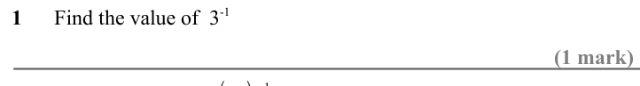

Text (lossy): 1      Find the value of  3-1 / (1 mark) / ( / 4 / 5) / −1

## Q2 (1 marks)

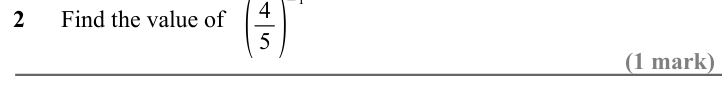

Text (lossy): 2      Find the value of / (1 mark)

## Q3 (1 marks)

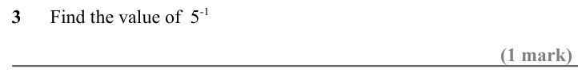

Text (lossy): 3      Find the value of  5-1 / (1 mark)

## Q4 (1 marks)

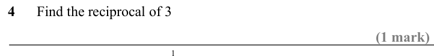

Text (lossy): 4      Find the reciprocal of 3 / (1 mark) / 1 / 2

## Q5 (1 marks)

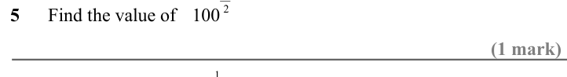

Text (lossy): 5      Find the value of / 100 / (1 mark) / 1 / 2

## Q6 (1 marks)

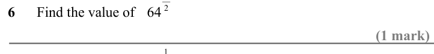

Text (lossy): 6      Find the value of / 64 / (1 mark) / 1

## Q7 (1 marks)

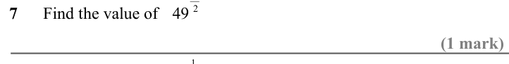

Text (lossy): 2 / 7      Find the value of / 49 / (1 mark) / 1 / 2

## Q8 (1 marks)

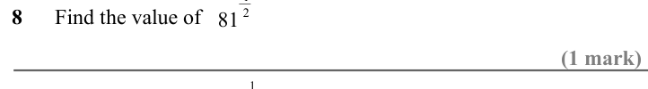

Text (lossy): 8      Find the value of 81 / (1 mark) / −1

## Q9 (1 marks)

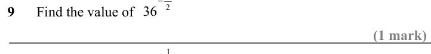

Text (lossy): 2 / 9      Find the value of 36 / (1 mark) / 1 / 3

## Q10 (1 marks)

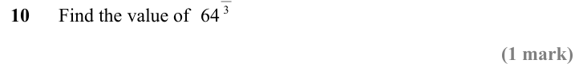

Text (lossy): 10      Find the value of 64 / (1 mark)

## Q11 (1 marks)

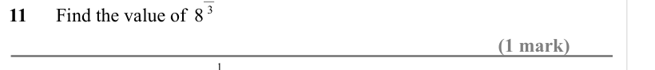

Text (lossy): 11      Find the value of 8 / (1 mark) / 1 / 3

## Q12 (1 marks)

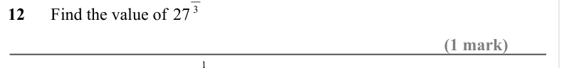

Text (lossy): 12      Find the value of 27 / (1 mark) / 1 / 3

## Q13 (1 marks)

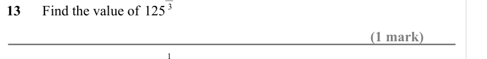

Text (lossy): 13      Find the value of 125 / (1 mark) / −1

## Q14 (1 marks)

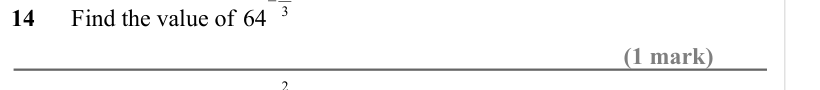

Text (lossy): 3 / 14      Find the value of 64 / (1 mark) / −2

## Q15 (2 marks)

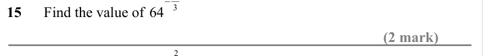

Text (lossy): 3 / 15      Find the value of 64 / (2 mark) / 2 / 3

## Q16 (2 marks)

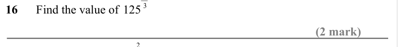

Text (lossy): 16      Find the value of 125 / (2 mark) / −2

## Q17 (2 marks)

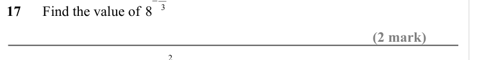

Text (lossy): 3 / 17      Find the value of 8 / (2 mark) / −2

## Q18 (2 marks)

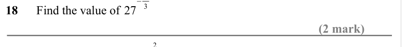

Text (lossy): 3 / 18      Find the value of 27 / (2 mark) / 2 / 3

## Q19 (2 marks)

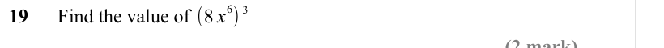

Text (lossy): 6) / 19      Find the value of (8 x / (2 mark)

## Q20 (2 marks)

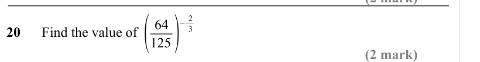

Text (lossy): 20      Find the value of ( / 64 / 125) / −2 / 3 / (2 mark)

## Q21 (2 marks)

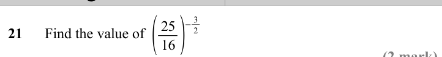

Text (lossy): 21      Find the value of ( / 25 / 16) / −3 / 2 / (2 mark)

## Q22 (2 marks)

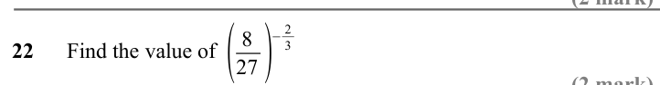

Text (lossy): 22      Find the value of ( / 8 / 27) / −2 / 3 / (2 mark)

## Q23 (2 marks)

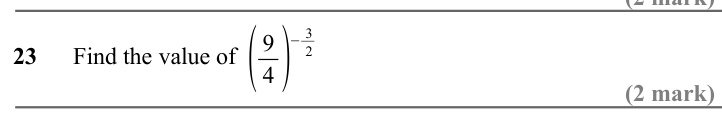

Text (lossy): 23      Find the value of ( / 9 / 4) / −3 / 2 / (2 mark)

## Q24 (2 marks)

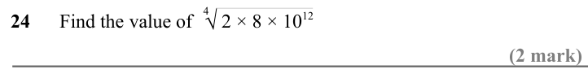

Text (lossy): 24      Find the value of      2 × 8 × 10 12  / √ / 4 / (2 mark)

## Q25 (2 marks)

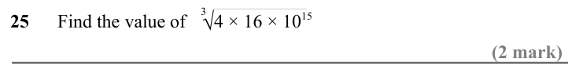

Text (lossy): 25      Find the value of      4 × 16 × 10 15  / √ / 3 / (2 mark)

## Q26 (2 marks)

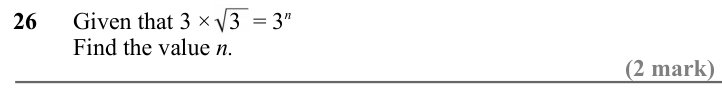

Text (lossy): 26      Given that 3 ×   3  = 3 n /           Find the value n. / (2 mark)

## Q27 (2 marks)

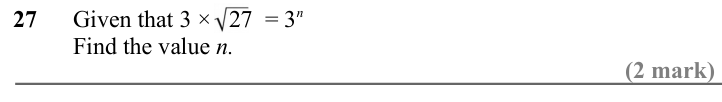

Text (lossy): 27      Given that 3 ×   27  = 3 n /           Find the value n. / (2 mark)

## Q28 (3 marks)

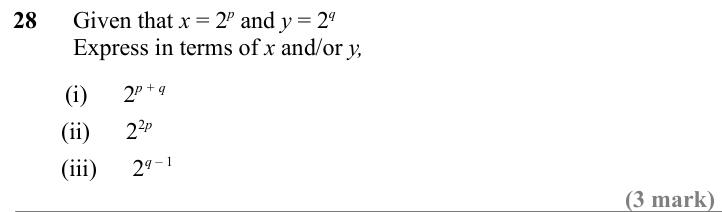

Text (lossy): 28      Given that x = 2 p and y = 2 q  /           Express in terms of x and/or y, /         (i)      2 p + q /         (ii)      2 2 p  /         (iii)      2 q – 1 / (3 mark)

## Q29 (2 marks)

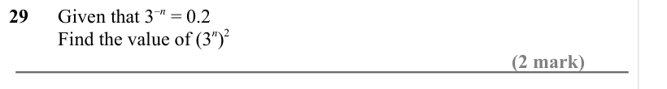

Text (lossy): 29      Given that 3–n = 0.2 /           Find the value of (3 n)2 / (2 mark)

## Q30 (2 marks)

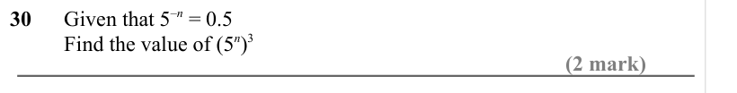

Text (lossy): 30      Given that 5–n = 0.5 /           Find the value of (5 n)3 / (2 mark)

## Q31 (2 marks)

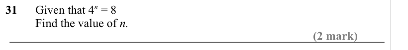

Text (lossy): 31      Given that 4 n = 8 /           Find the value of n. / (2 mark)

## Q32 (2 marks)

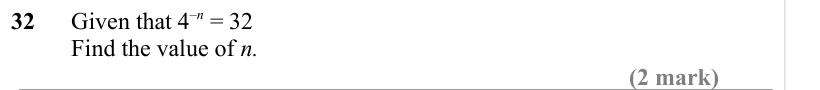

Text (lossy): 32      Given that 4–n = 32 /           Find the value of n. / (2 mark)

