# Direct and Inverse Proportion — Exam Questions (IGCSE Maths · Edexcel · Grade 6)

Topic code `6.3` · slug `grade-6-6-3-direct-and-inverse-proportion` · source sheet sha256 `91235f4b29df8083…`

## Q1 (marks not printed)

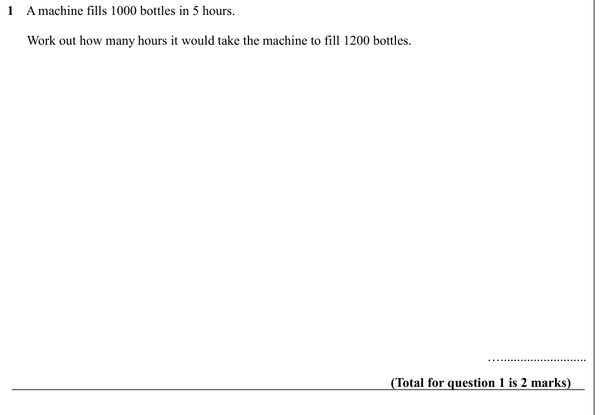

Text (lossy): 1    A machine fills 1000 bottles in 5 hours.  /       Work out how many hours it would take the machine to fill 1200 bottles.  /          / ….......................... / (Total for question 1 is 2 marks)

## Q2 (marks not printed)

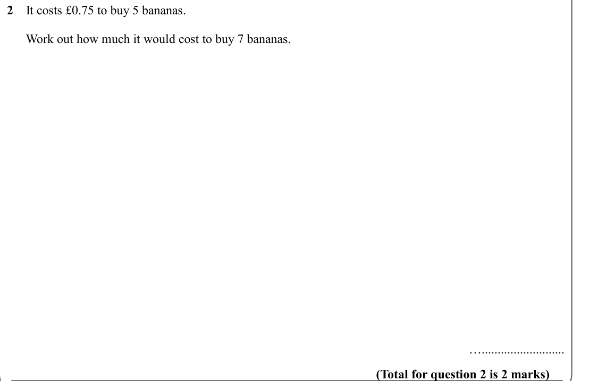

Text (lossy): 2    It costs £0.75 to buy 5 bananas.  /       Work out how much it would cost to buy 7 bananas.  /        /  ….......................... / (Total for question 2 is 2 marks)

## Q3 (marks not printed)

Text (lossy): 3    3 tins of beans and 4 tins of tomatoes costs £2.73.

## Q4 (marks not printed)

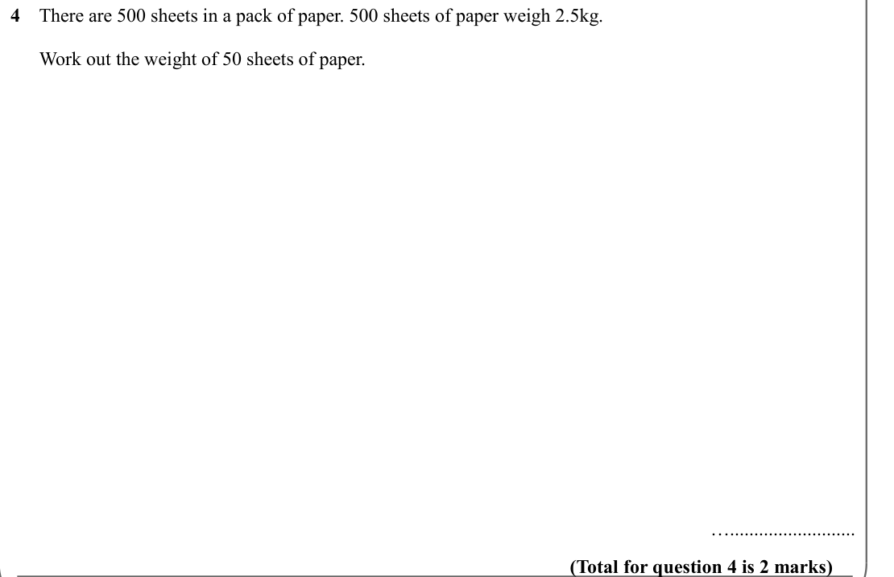

Text (lossy): 4    There are 500 sheets in a pack of paper. 500 sheets of paper weigh 2.5kg.  /       Work out the weight of 50 sheets of paper. /        /  ….......................... / (Total for question 4 is 2 marks)

## Q5 (marks not printed)

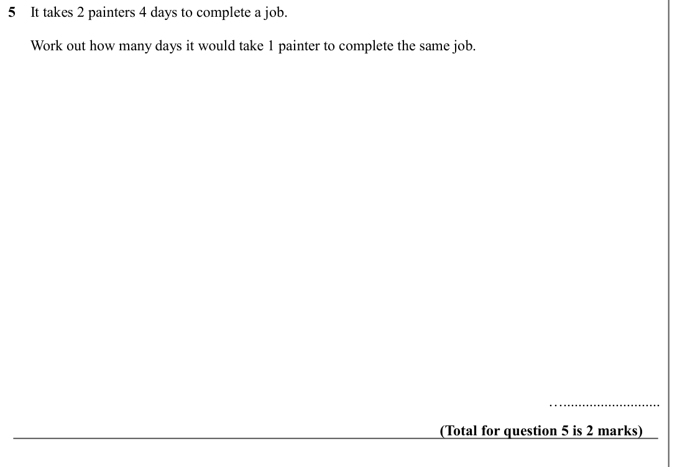

Text (lossy): 5    It takes 2 painters 4 days to complete a job.  /       Work out how many days it would take 1 painter to complete the same job.  /          / ….......................... / (Total for question 5 is 2 marks)

## Q6 (marks not printed)

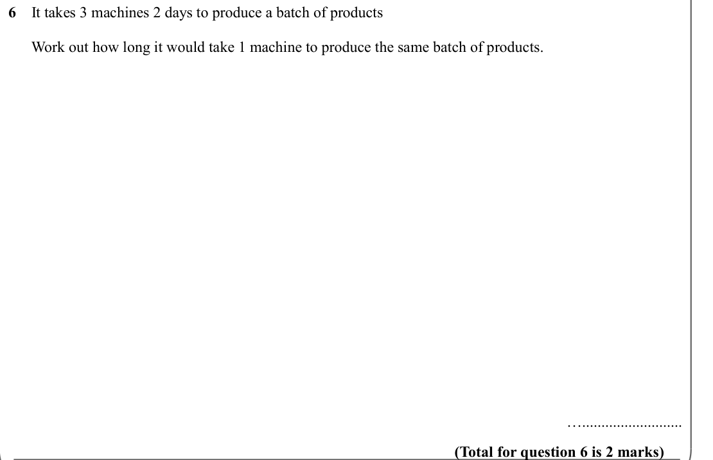

Text (lossy): 6    It takes 3 machines 2 days to produce a batch of products /       Work out how long it would take 1 machine to produce the same batch of products. /        /  ….......................... / (Total for question 6 is 2 marks)

## Q7 (marks not printed)

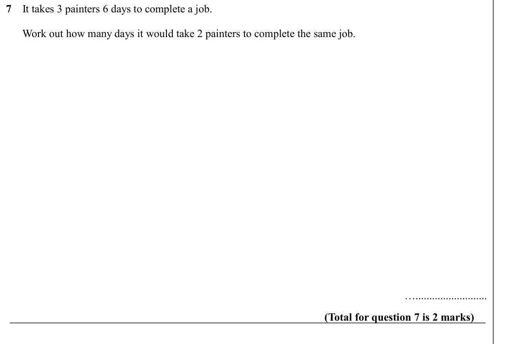

Text (lossy): 7    It takes 3 painters 6 days to complete a job.  /       Work out how many days it would take 2 painters to complete the same job.  /          / ….......................... / (Total for question 7 is 2 marks)

## Q8 (marks not printed)

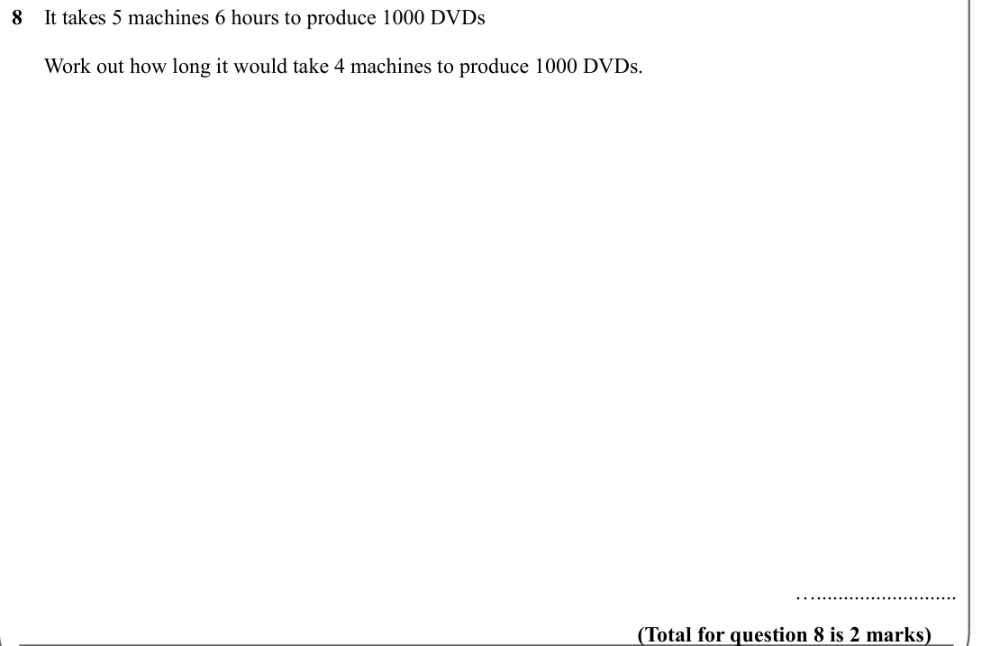

Text (lossy): 8    It takes 5 machines 6 hours to produce 1000 DVDs /       Work out how long it would take 4 machines to produce 1000 DVDs. /        /  ….......................... / (Total for question 8 is 2 marks)

## Q9 (marks not printed)

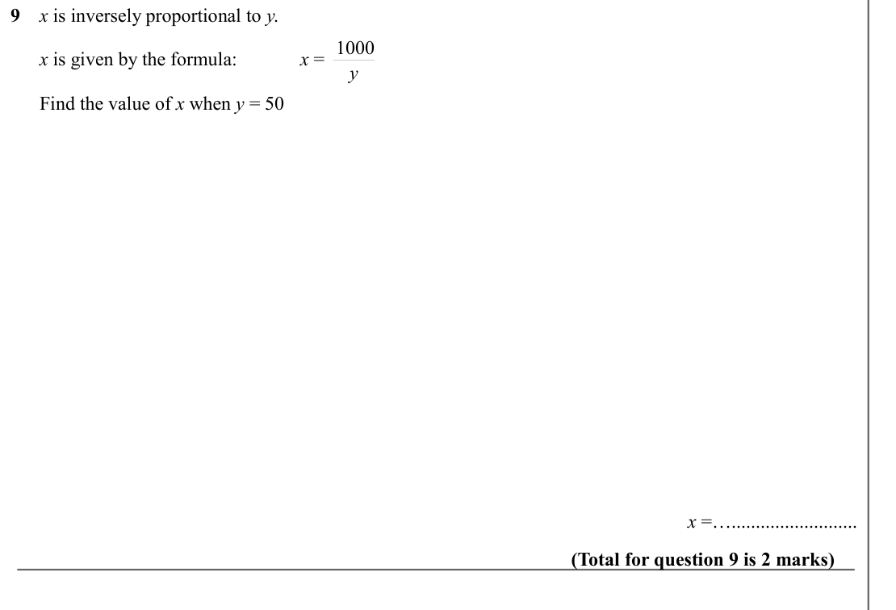

Text (lossy): 9    x is inversely proportional to y.  /       x = 1000 /       x is given by the formula: / y /       Find the value of x when y = 50 /   /        /        /  x =….......................... / (Total for question 9 is 2 marks)

## Q10 (marks not printed)

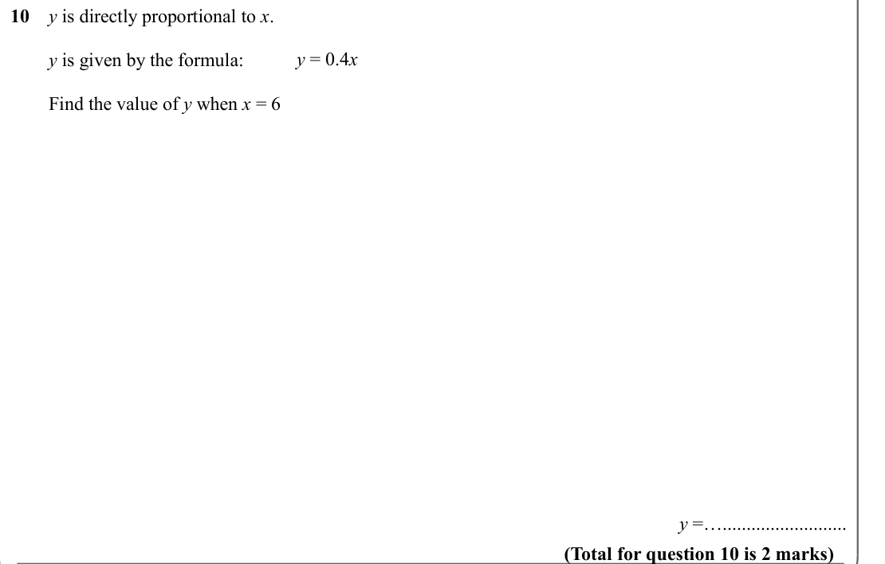

Text (lossy): 10    y is directly proportional to x.  /       y = 0.4 x /         y is given by the formula: /         Find the value of y when x = 6 /   /        /        / y =….......................... / (Total for question 10 is 2 marks)

## Q11 (marks not printed)

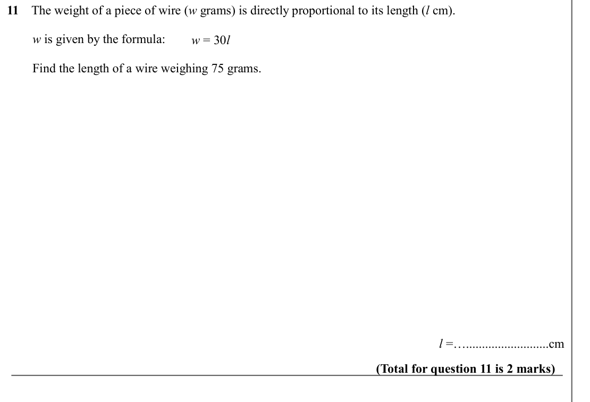

Text (lossy): 11    The weight of a piece of wire (w grams) is directly proportional to its length (l cm). /         w is given by the formula: /       w = 30 l /         Find the length of a wire weighing 75 grams.  /   /        /        /  l =…..........................cm / (Total for question 11 is 2 marks)

## Q12 (marks not printed)

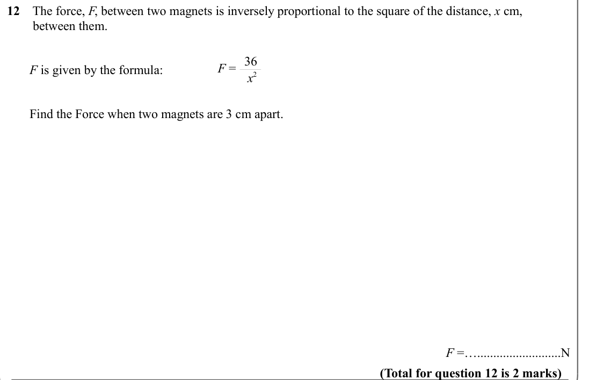

Text (lossy): 12    The force, F, between two magnets is inversely proportional to the square of the distance, x cm,                /         between them. /       F = 36 /        F is given by the formula:      / x 2 /        Find the Force when two magnets are 3 cm apart.  / F =…..........................N / (Total for question 12 is 2 marks)

## Q13 (marks not printed)

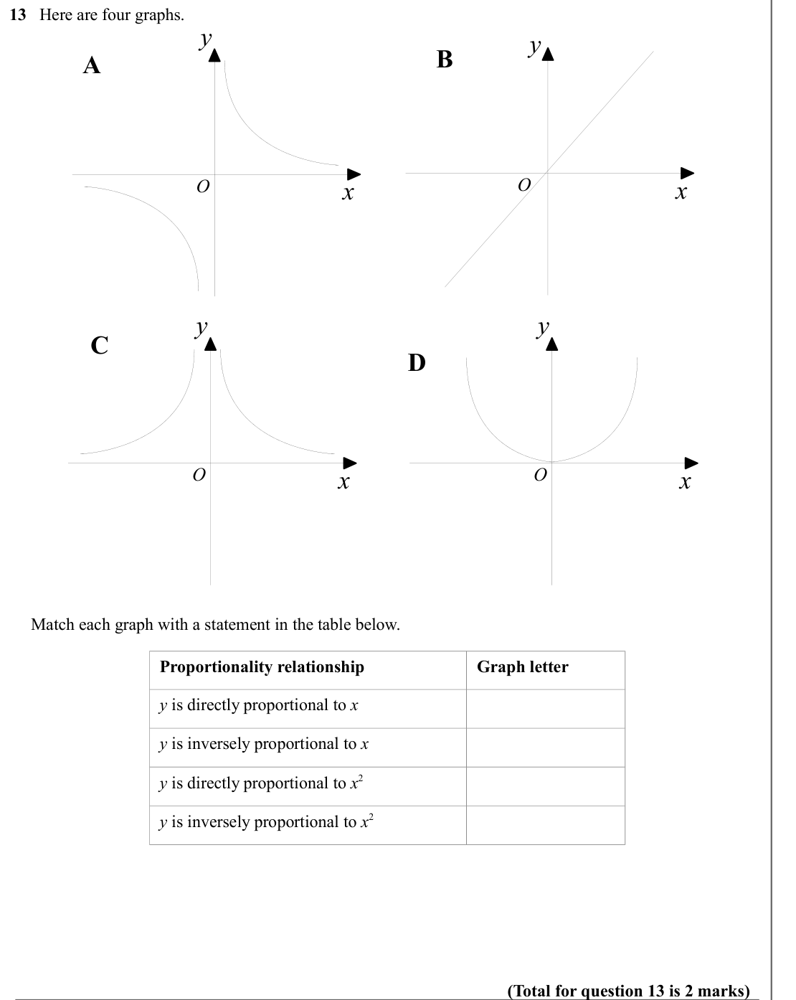

Text (lossy): 13   Here are four graphs.       / y / y / B / A / x / O / x / O / y / y / C / D / x / O / x / O /      Match each graph with a statement in the table below.  / Proportionality relationship / Graph letter / y is directly proportional to x / y is inversely proportional to x / y is directly proportional to x 2 / y is inversely proportional to x 2 / (Total for question 13 is 2 marks)

