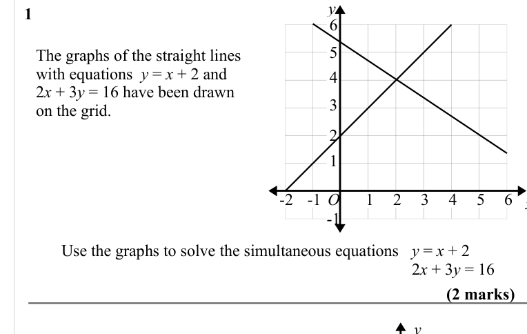
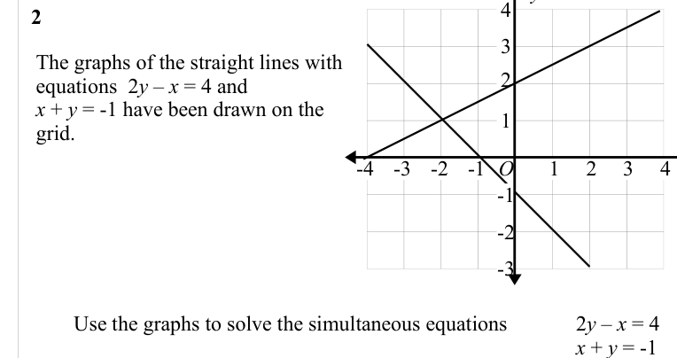
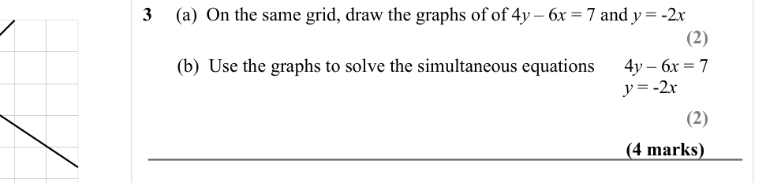
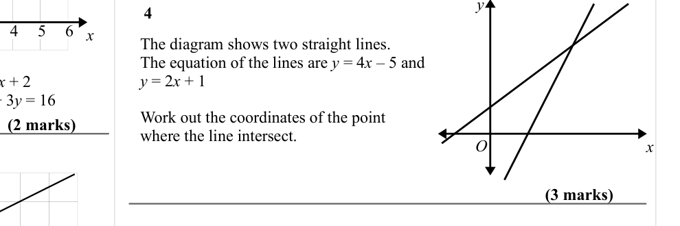
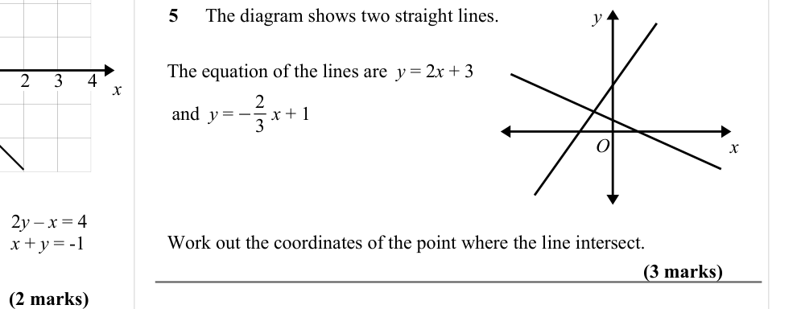

# Solving Simultaneous Equations Graphically — Exam Questions (IGCSE Maths · Edexcel · Grade 6)

Topic code `6.6` · slug `grade-6-6-6-solving-simultaneous-equations-graphically` · source sheet sha256 `8b11c87d55930c3f…`

## Q1 (marks not printed)

Text (lossy): 1    / 6 / 5 / The graphs of the straight lines  / with equations  y = x + 2 and / 2 x + 3 y = 16 have been drawn  / on the grid.  / 4 / 3 / 2 / 1 / 1 / 4 / -1 / -2 / 6 / O / -1 / 2 / 3 / 5 /     / Use the graphs to solve the simultaneous equations   y = x + 2 /   2 x + 3 y = 16  / y / 4

## Q2 (marks not printed)

Text (lossy): 2    / 3 / The graphs of the straight lines with  / equations  2 y – x = 4 and  / x + y = -1 have been drawn on the  / grid.  / 2 / 1 / 2 / -1 / -4 / 4 / -2 / -3 / O / 1 / 3 / -1 / -2 / -3 /     / Use the graphs to solve the simultaneous equations  / 2 y – x = 4 / x + y = -1

## Q3 (4 marks · parts b)

Text (lossy): 3     (a)  On the same grid, draw the graphs of of 4 y – 6 x = 7 and y = -2 x  / (2) / (b)  Use the graphs to solve the simultaneous equations  / 4 y – 6 x = 7 / y = -2 x  / (2) / (4 marks) / y

## Q4 (5 marks)

Text (lossy): 4    / x / The diagram shows two straight lines.  / The equation of the lines are y = 4 x – 5 and  / y = 2 x + 1 / Work out the coordinates of the point  / where the line intersect. / (2 marks) / O / x / (3 marks)

## Q5 (5 marks)

Text (lossy): 5    / The diagram shows two straight lines.  / y / The equation of the lines are  y = 2 x + 3 / x / −2 /  and  y =        x + 1 / 3 / O / x / Work out the coordinates of the point where the line intersect.  / (3 marks) / (2 marks)

