# Gradient of a Line — Exam Questions (IGCSE Maths · Edexcel · Grade 6)

Topic code `6.7` · slug `grade-6-6-7-gradient-of-a-line` · source sheet sha256 `594b134c9724f627…`

## Q1 (marks not printed)

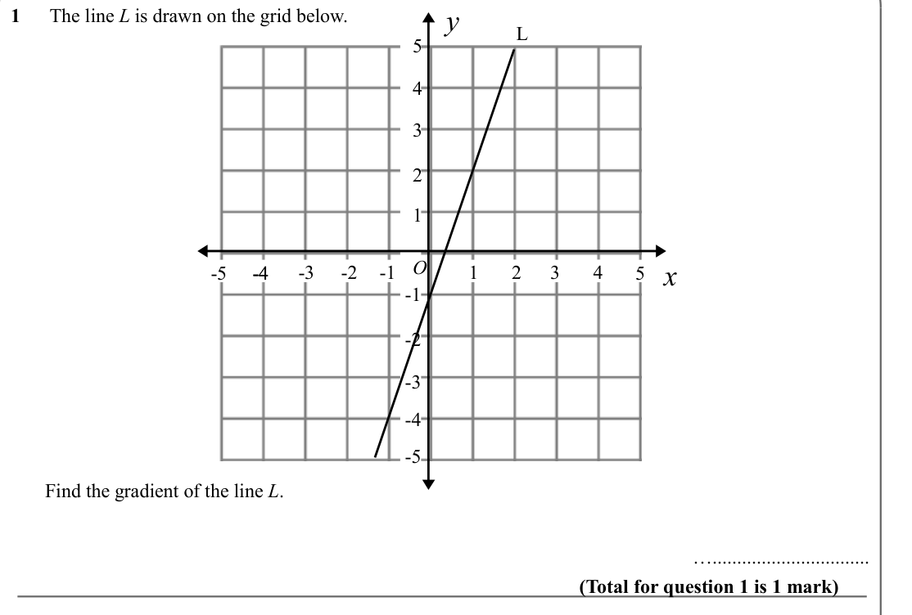

Text (lossy): y / 1      The line L is drawn on the grid below. / L / 5 / 4 / 3 / 2 / 1 / O / -4 / 4 / 3 / 2 / 1 / -1 / -2 / -3 / x / -4 / -5 / 5 / -1 / -2 / -3 / -4 / -5 /        Find the gradient of the line L. / …................................ / (Total for question 1 is 1 mark)

## Q2 (marks not printed)

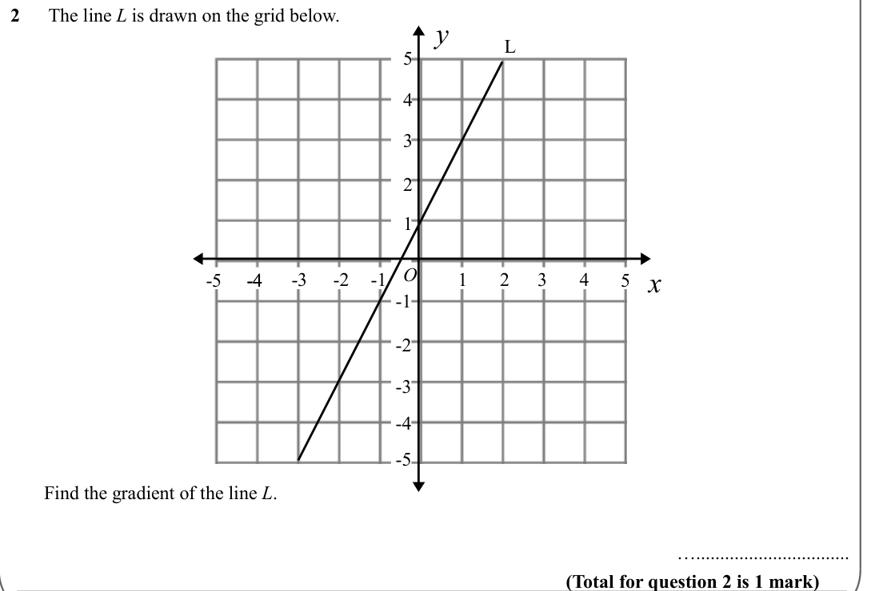

Text (lossy): 2      The line L is drawn on the grid below. / y / L / 5 / 4 / 3 / 2 / 1 / O / -4 / 4 / 3 / 2 / 1 / -1 / -2 / -3 / x / -4 / -5 / 5 / -1 / -2 / -3 / -4 / -5 /        Find the gradient of the line L. / …................................ / (Total for question 2 is 1 mark)

## Q3 (marks not printed)

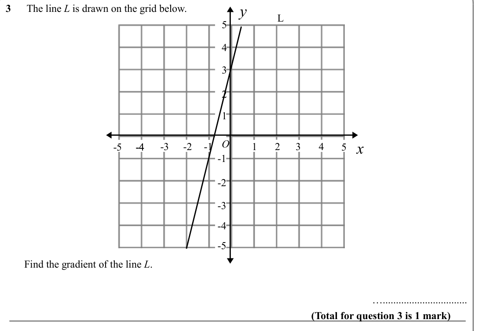

Text (lossy): y / 3      The line L is drawn on the grid below. / L / 5 / 4 / 3 / 2 / 1 / O / -4 / 4 / 3 / 2 / 1 / -1 / -2 / -3 / x / -4 / -5 / 5 / -1 / -2 / -3 / -4 / -5 /        Find the gradient of the line L. / …................................ / (Total for question 3 is 1 mark)

## Q4 (marks not printed)

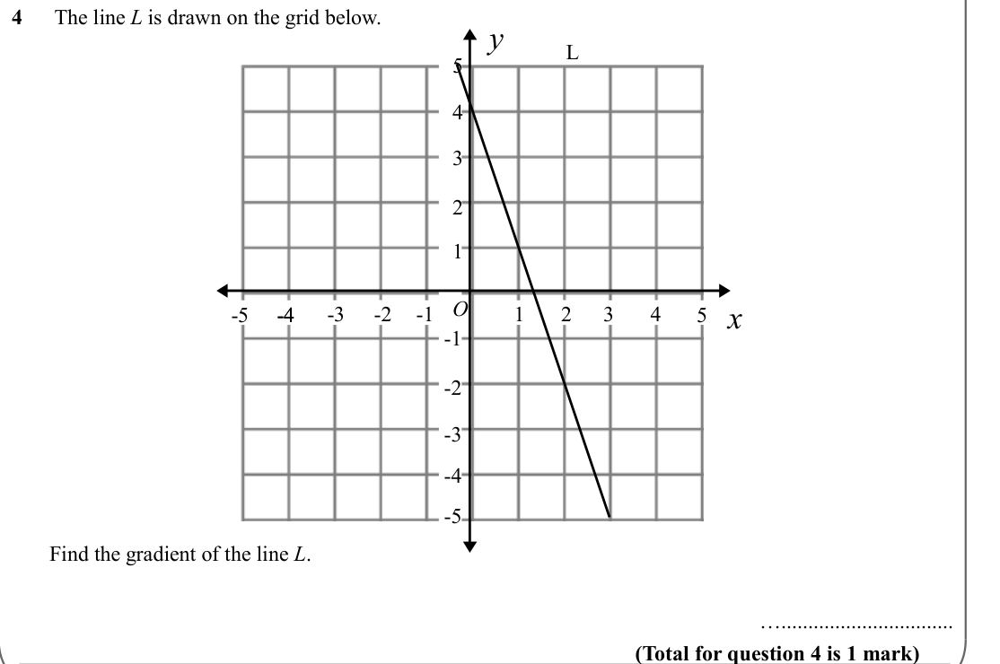

Text (lossy): 4      The line L is drawn on the grid below. / y / L / 5 / 4 / 3 / 2 / 1 / O / -4 / 4 / 3 / 2 / 1 / -1 / -2 / -3 / x / -4 / -5 / 5 / -1 / -2 / -3 / -4 / -5 /        Find the gradient of the line L. / …................................ / (Total for question 4 is 1 mark)

## Q5 (marks not printed)

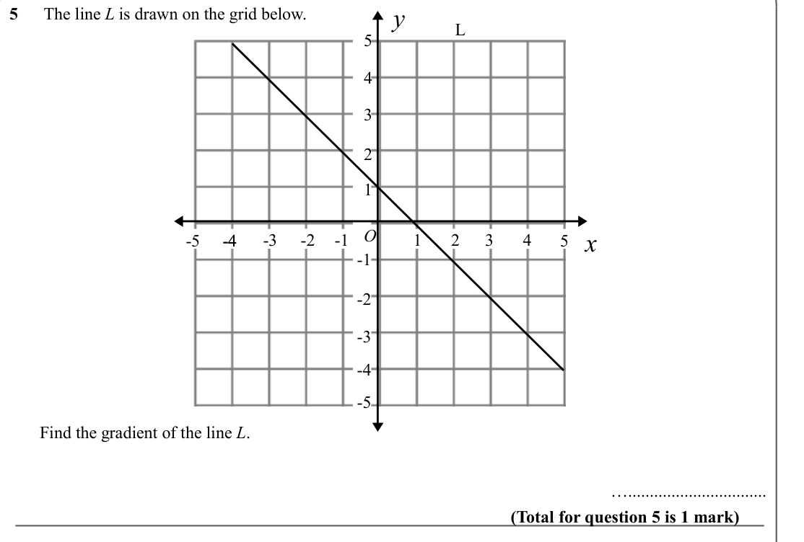

Text (lossy): y / 5      The line L is drawn on the grid below. / L / 5 / 4 / 3 / 2 / 1 / O / -4 / 4 / 3 / 2 / 1 / -1 / -2 / -3 / x / -4 / -5 / 5 / -1 / -2 / -3 / -4 / -5 /        Find the gradient of the line L. / …................................ / (Total for question 5 is 1 mark)

## Q6 (marks not printed)

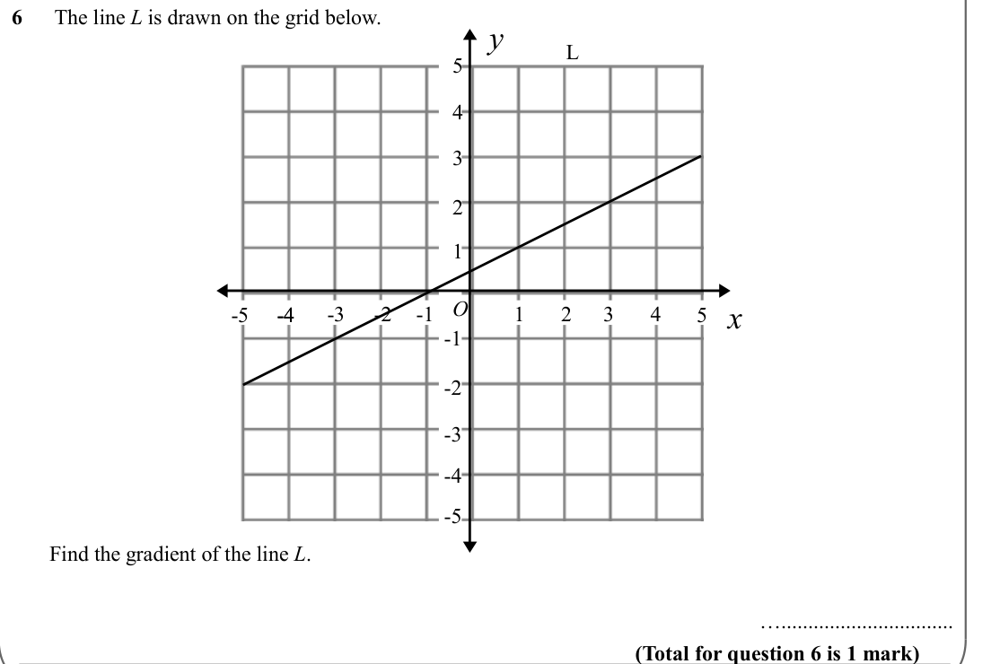

Text (lossy): 6      The line L is drawn on the grid below. / y / L / 5 / 4 / 3 / 2 / 1 / O / -4 / 4 / 3 / 2 / 1 / -1 / -2 / -3 / x / -4 / -5 / 5 / -1 / -2 / -3 / -4 / -5 /        Find the gradient of the line L. / …................................ / (Total for question 6 is 1 mark)

## Q7 (marks not printed)

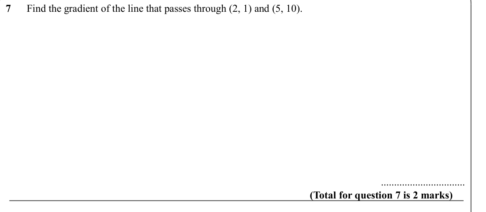

Text (lossy): 7      Find the gradient of the line that passes through (2, 1) and (5, 10). / ................................ / (Total for question 7 is 2 marks)

## Q8 (marks not printed)

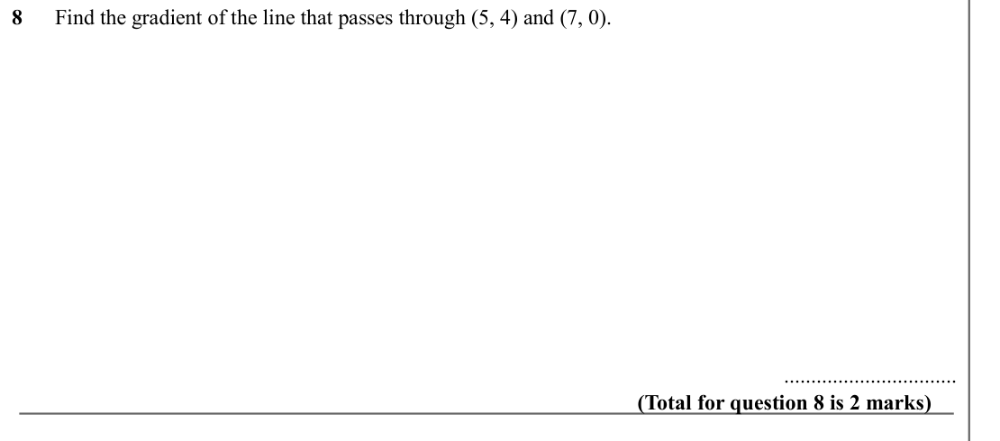

Text (lossy): 8      Find the gradient of the line that passes through (5, 4) and (7, 0).  / ................................ / (Total for question 8 is 2 marks)

## Q9 (marks not printed)

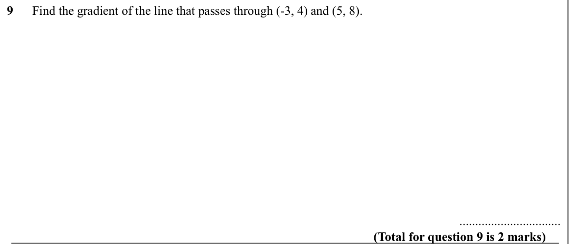

Text (lossy): 9      Find the gradient of the line that passes through (-3, 4) and (5, 8). / ................................ / (Total for question 9 is 2 marks)

## Q10 (marks not printed)

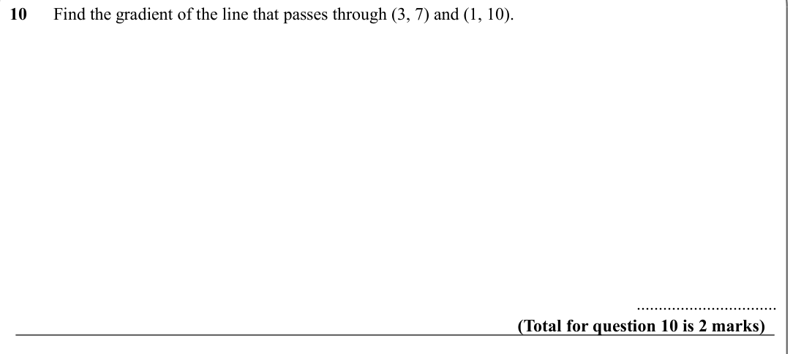

Text (lossy): 10      Find the gradient of the line that passes through (3, 7) and (1, 10). / ................................ / (Total for question 10 is 2 marks)

## Q11 (marks not printed)

Text (lossy): 11      Find the gradient of the line that passes through (1, -1) and (-3, -9).  / ................................ / (Total for question 11 is 2 marks)

## Q12 (marks not printed)

Text (lossy): 12      Find the gradient of the line that passes through (8, 1) and (3, -3). / ................................ / (Total for question 12 is 2 marks)

## Q13 (marks not printed)

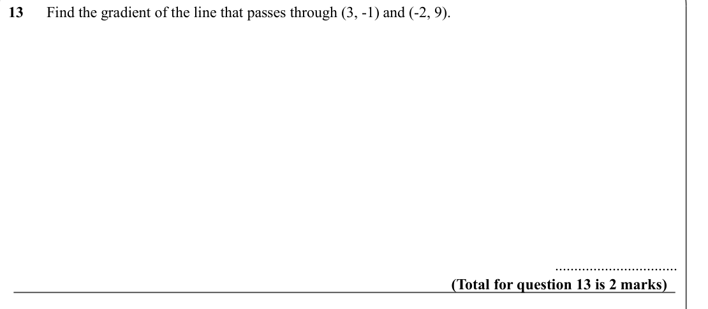

Text (lossy): 13      Find the gradient of the line that passes through (3, -1) and (-2, 9). / ................................ / (Total for question 13 is 2 marks)

## Q14 (marks not printed)

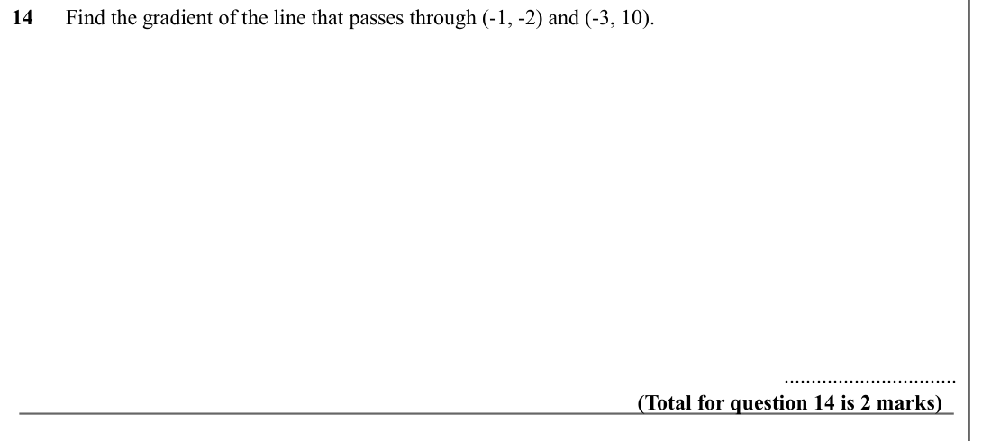

Text (lossy): 14      Find the gradient of the line that passes through (-1, -2) and (-3, 10).  / ................................ / (Total for question 14 is 2 marks)

## Q15 (marks not printed)

Text (lossy): 15      Find the gradient of the line that passes through (-3, 4) and (-5, 7). / ................................ / (Total for question 15 is 2 marks)

## Q16 (marks not printed)

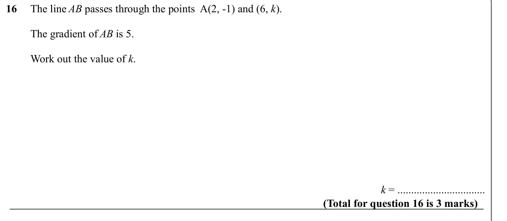

Text (lossy): 16     The line AB passes through the points  A(2, -1) and (6, k). /          The gradient of AB is 5.  /          Work out the value of k. / k = ................................ / (Total for question 16 is 3 marks)

## Q17 (marks not printed)

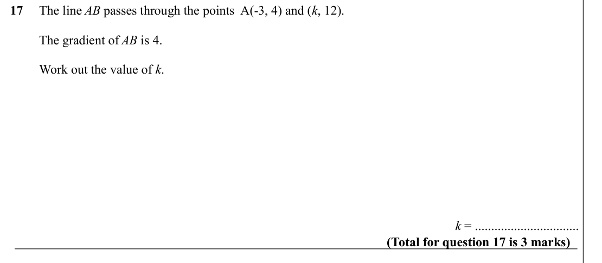

Text (lossy): 17     The line AB passes through the points  A(-3, 4) and (k, 12). /          The gradient of AB is 4.  /          Work out the value of k. / k = ................................ / (Total for question 17 is 3 marks)

## Q18 (marks not printed)

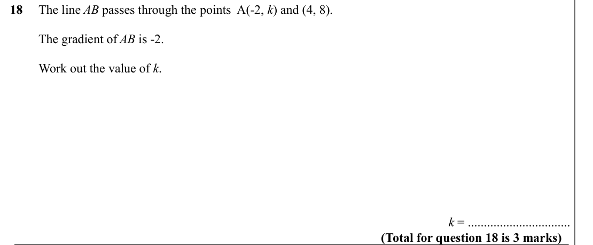

Text (lossy): 18     The line AB passes through the points  A(-2, k) and (4, 8). /          The gradient of AB is -2.  /          Work out the value of k. / k = ................................ / (Total for question 18 is 3 marks)

