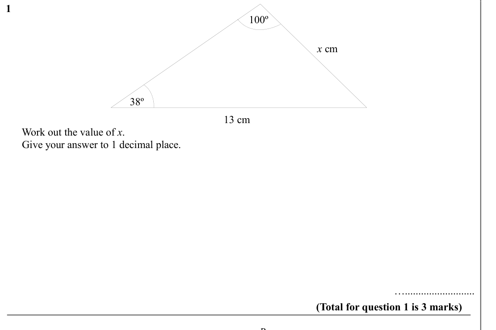
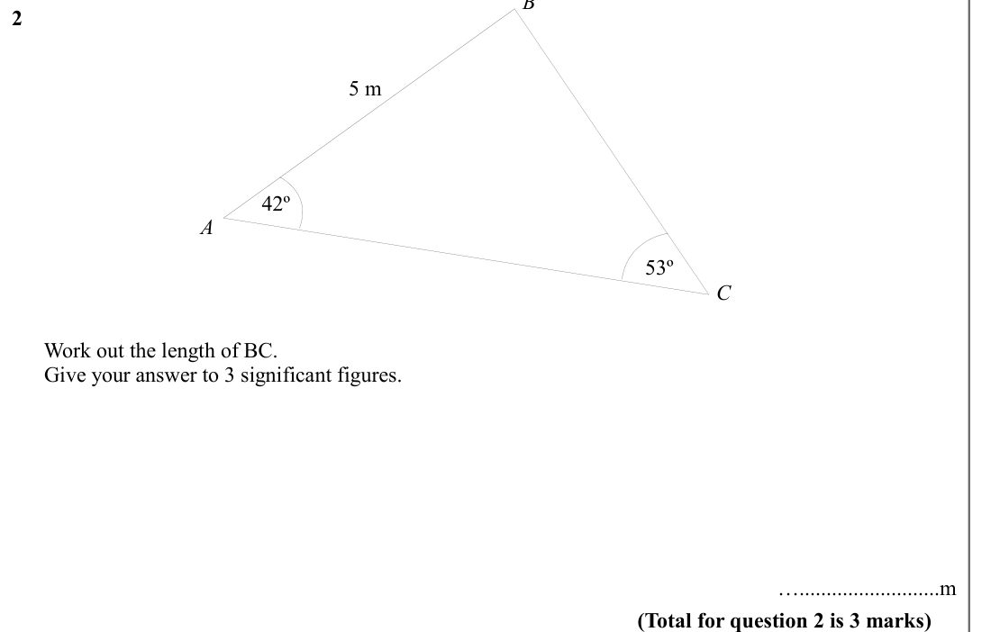
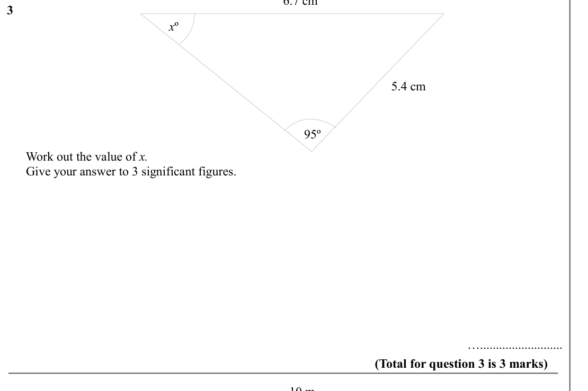
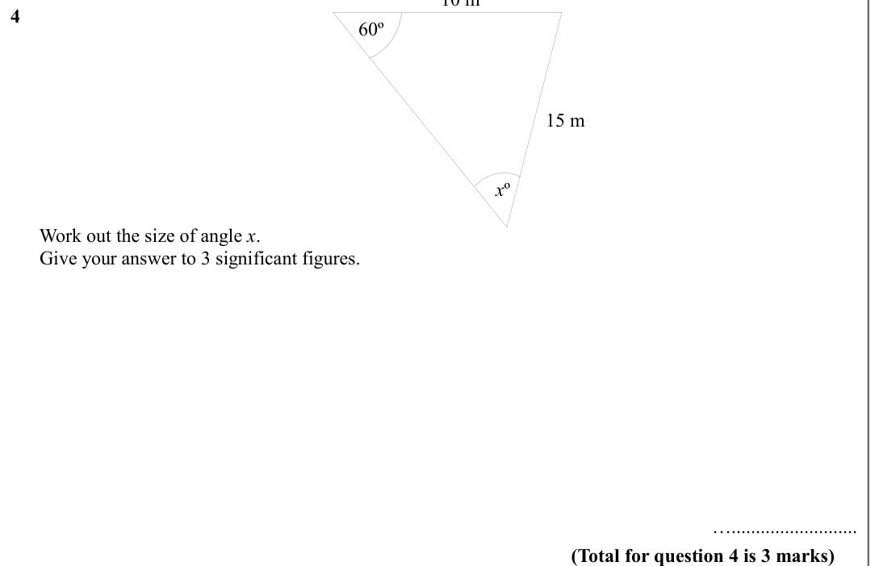
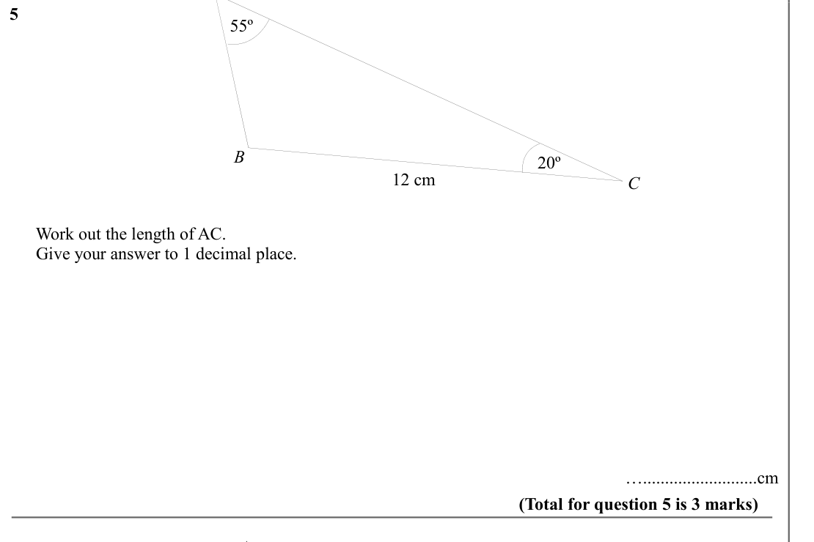
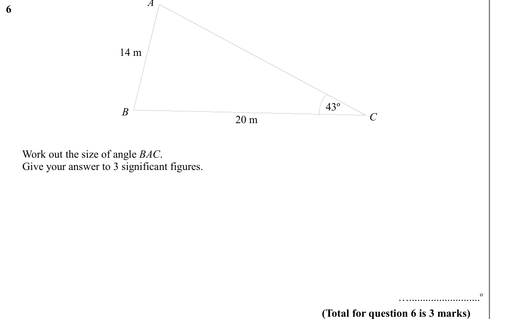
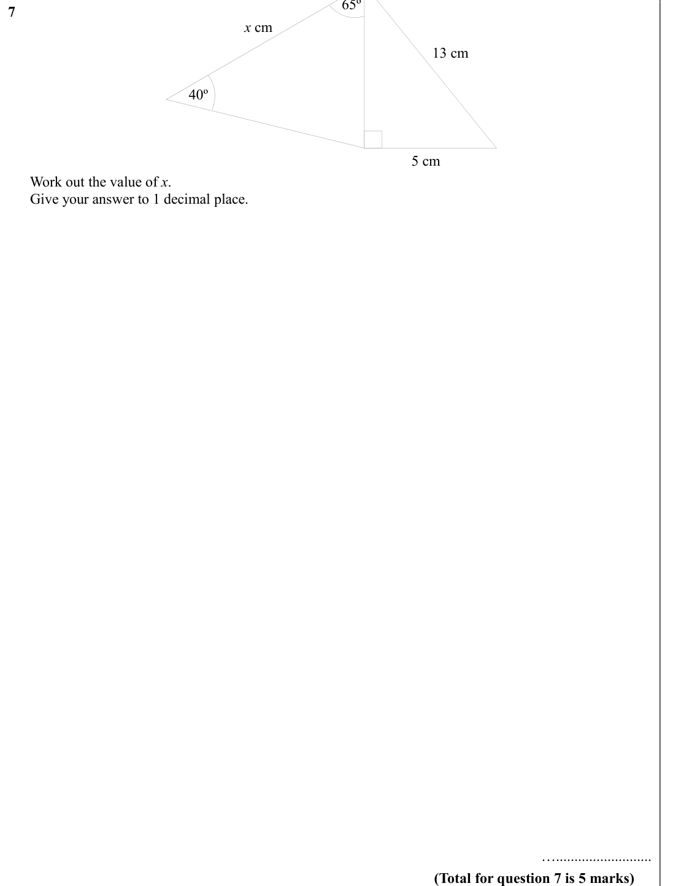
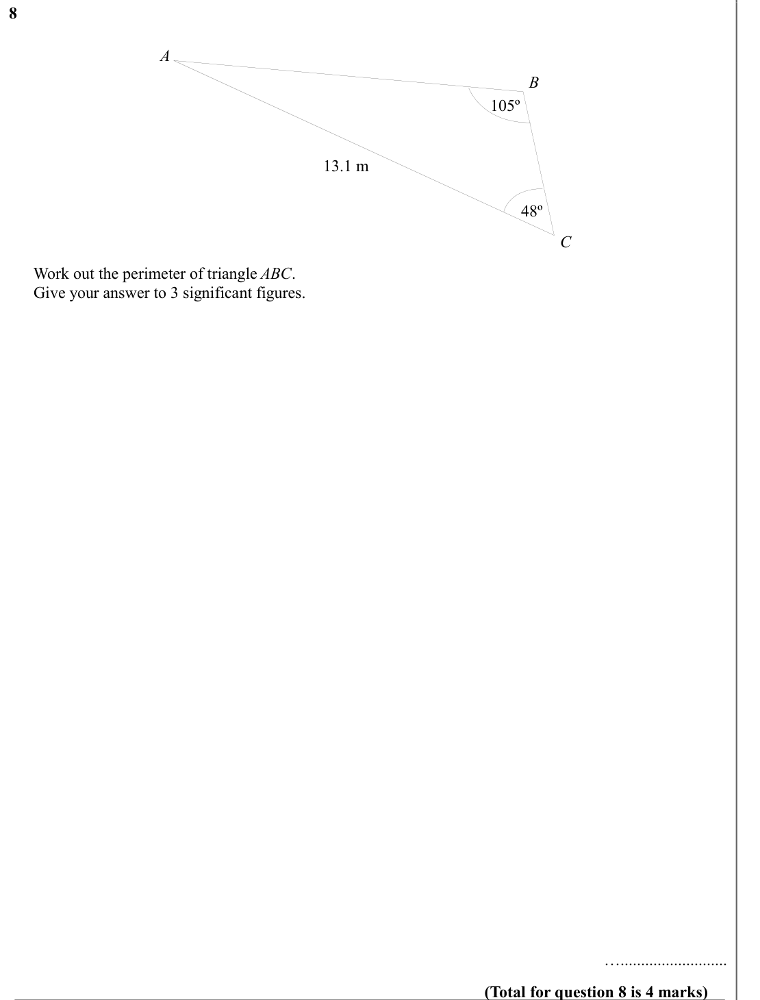
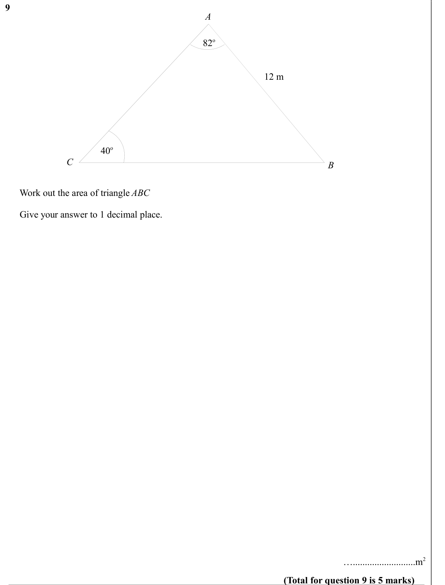
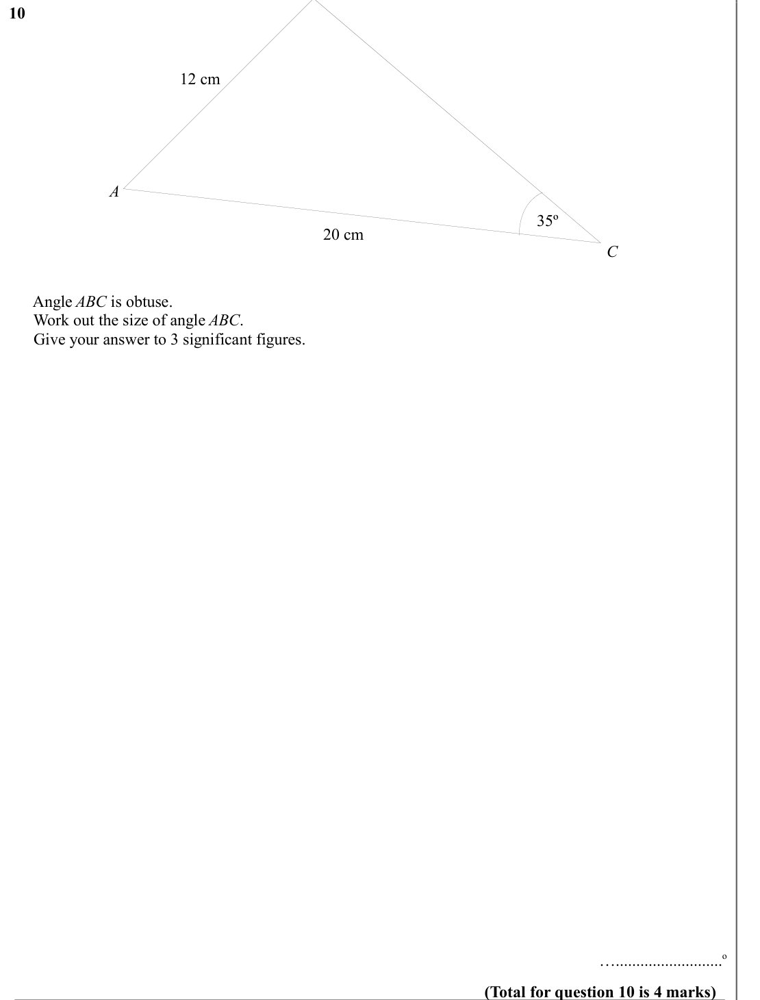

# The Sine Rule — Exam Questions (IGCSE Maths · Edexcel · Grade 7)

Topic code `7.10` · slug `grade-7-7-10-the-sine-rule` · source sheet sha256 `cf0e0f7c2a707847…`

## Q1 (marks not printed)

Text (lossy): 1     / 100º / x cm / 38º / 13 cm /       Work out the value of x. /       Give your answer to 1 decimal place.      / ….......................... / (Total for question 1 is 3 marks) / B

## Q2 (marks not printed)

Text (lossy): 2     / 5 m / 42º / A / C / 53º /       Work out the length of BC. /       Give your answer to 3 significant figures.      / …..........................m / (Total for question 2 is 3 marks)

## Q3 (marks not printed)

Text (lossy): 3     / x º / 5.4 cm / 95º /       Work out the value of x. /       Give your answer to 3 significant figures.      / ….......................... / (Total for question 3 is 3 marks) / 10 m

## Q4 (marks not printed)

Text (lossy): 4     / 60º / 15 m / x º /       Work out the size of angle x. /       Give your answer to 3 significant figures.            / ….......................... / (Total for question 4 is 3 marks)

## Q5 (marks not printed)

Text (lossy): 5     / 55º / B / 20º / 12 cm / C /       Work out the length of AC. /       Give your answer to 1 decimal place.      / …..........................cm / (Total for question 5 is 3 marks) / A

## Q6 (marks not printed)

Text (lossy): 6     / 14 m / 43º / 20 m / C / B /       Work out the size of angle BAC. /       Give your answer to 3 significant figures.  /            / …..........................o / (Total for question 6 is 3 marks)

## Q7 (marks not printed)

Text (lossy): 7     / x cm / 13 cm / 40º / 5 cm /       Work out the value of x. /       Give your answer to 1 decimal place.      / ….......................... / (Total for question 7 is 5 marks)

## Q8 (marks not printed)

Text (lossy): 8     / A / B / 105º / 13.1 m / 48º / C /       Work out the perimeter of triangle ABC.  /       Give your answer to 3 significant figures. / ….......................... / (Total for question 8 is 4 marks)

## Q9 (marks not printed)

Text (lossy): 9     / A / 82 o / 12 m / 40 o / B / C /       Work out the area of triangle ABC /        /       Give your answer to 1 decimal place. /      / …..........................m 2 / (Total for question 9 is 5 marks)

## Q10 (marks not printed)

Text (lossy): 10     / 12 cm / A / 35º / 20 cm / C /       Angle ABC is obtuse.  /       Work out the size of angle ABC. /       Give your answer to 3 significant figures.  /      / …..........................o / (Total for question 10 is 4 marks)

