# The Cosine Rule — Exam Questions (IGCSE Maths · Edexcel · Grade 7)

Topic code `7.11` · slug `grade-7-7-11-the-cosine-rule` · source sheet sha256 `2ea63a0b2945ebf3…`

## Q1 (marks not printed)

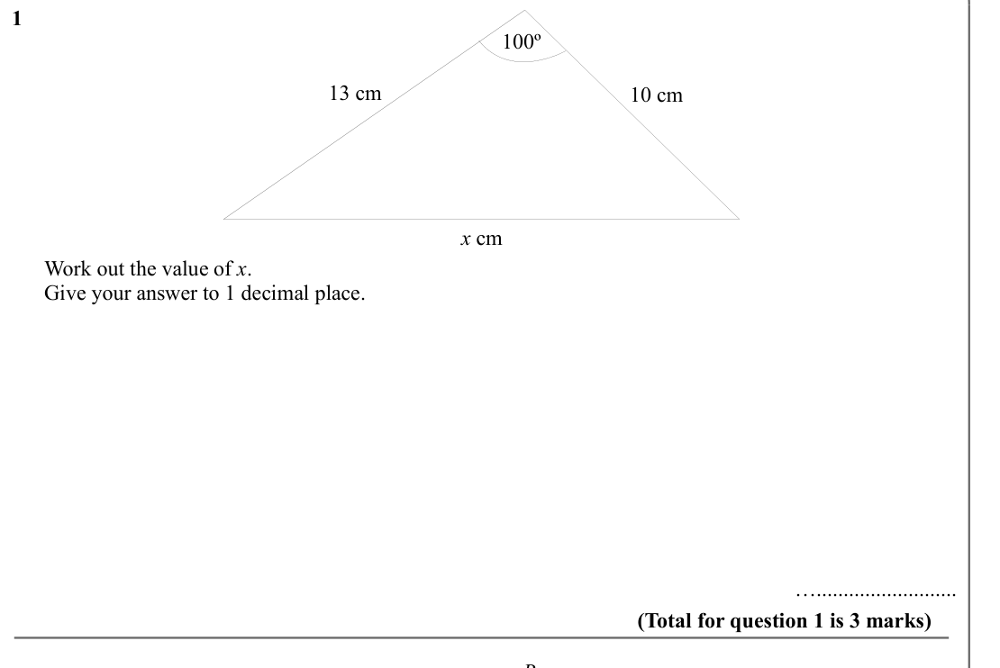

Text (lossy): 1     / 100º / 13 cm / 10 cm / x cm /       Work out the value of x. /       Give your answer to 1 decimal place.      / ….......................... / (Total for question 1 is 3 marks) / B

## Q2 (marks not printed)

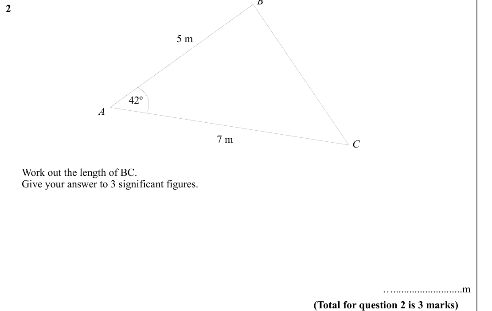

Text (lossy): 2     / 5 m / 42º / A / 7 m / C /       Work out the length of BC. /       Give your answer to 3 significant figures.      / …..........................m / (Total for question 2 is 3 marks)

## Q3 (marks not printed)

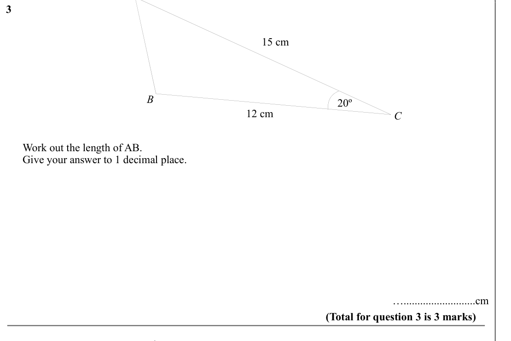

Text (lossy): 3     / 15 cm / B / 20º / 12 cm / C /       Work out the length of AB. /       Give your answer to 1 decimal place.      / …..........................cm / (Total for question 3 is 3 marks) / A

## Q4 (marks not printed)

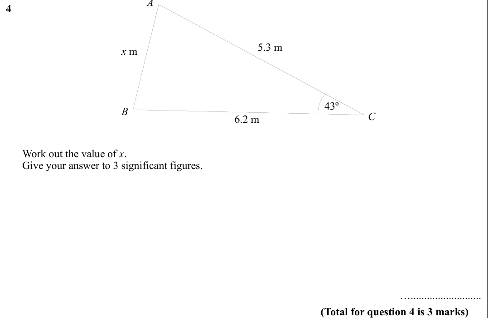

Text (lossy): 4     / 5.3 m / x m / 43º / 6.2 m / C / B /       Work out the value of x. /       Give your answer to 3 significant figures.  /            / ….......................... / (Total for question 4 is 3 marks)

## Q5 (marks not printed)

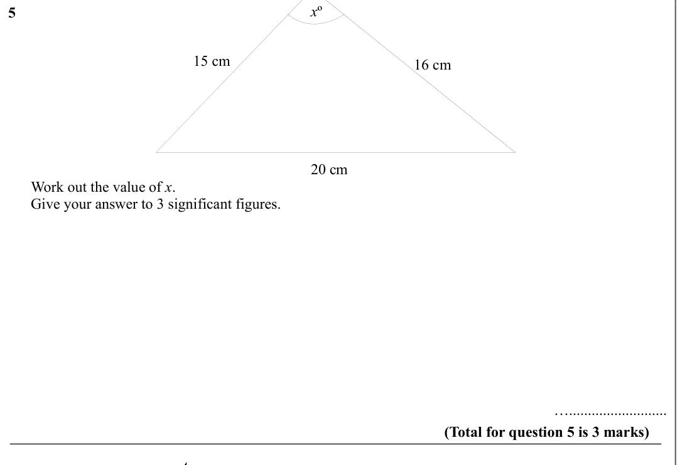

Text (lossy): x º / 5     / 16 cm / 15 cm / 20 cm /       Work out the value of x. /       Give your answer to 3 significant figures.      / ….......................... / (Total for question 5 is 3 marks) / A

## Q6 (marks not printed)

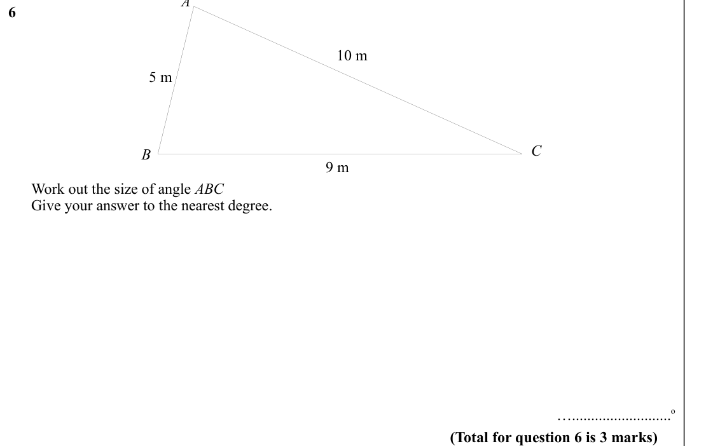

Text (lossy): 6    / 10 m / 5 m / B / C / 9 m /       Work out the size of angle ABC /       Give your answer to the nearest degree. /            / …..........................o / (Total for question 6 is 3 marks)

## Q7 (marks not printed)

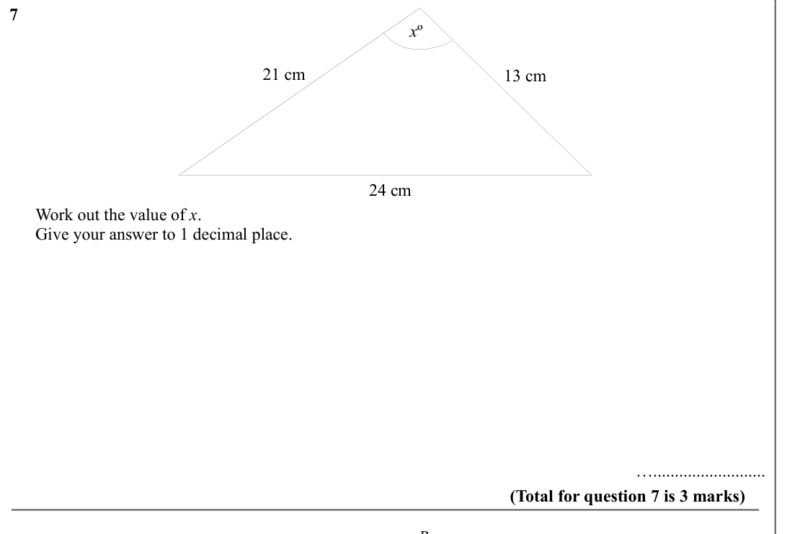

Text (lossy): 7     / x º / 21 cm / 13 cm / 24 cm /       Work out the value of x. /       Give your answer to 1 decimal place.      / ….......................... / (Total for question 7 is 3 marks) / B

## Q8 (marks not printed)

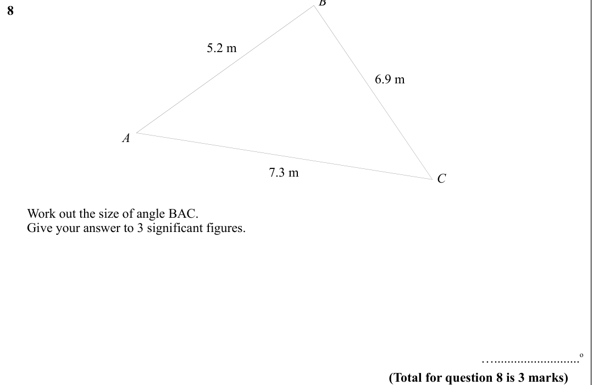

Text (lossy): 8     / 5.2 m / 6.9 m / A / 7.3 m / C /       Work out the size of angle BAC. /       Give your answer to 3 significant figures.      / …..........................o / (Total for question 8 is 3 marks)

## Q9 (marks not printed)

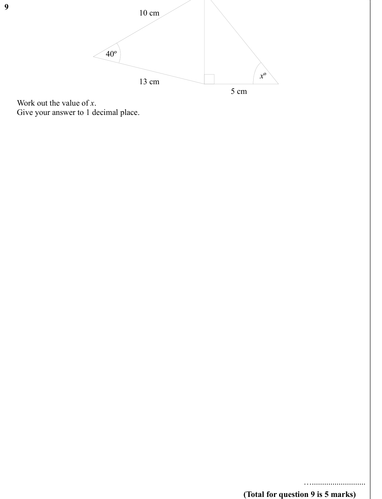

Text (lossy): 9     / 10 cm / 40º / x º / 13 cm / 5 cm /       Work out the value of x. /       Give your answer to 1 decimal place.      / ….......................... / (Total for question 9 is 5 marks)

## Q10 (marks not printed)

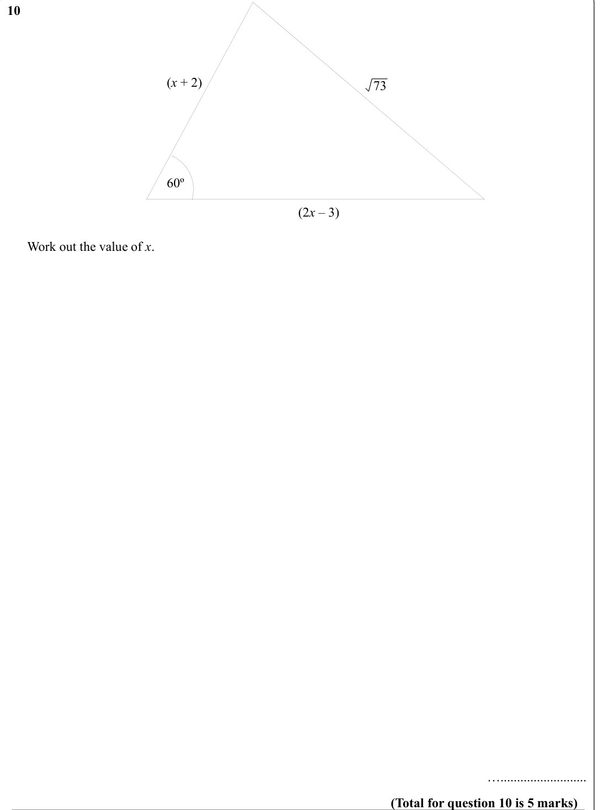

Text (lossy): 10     / (x + 2) / 73 / 60º / (2 x – 3)   /       Work out the value of x. /      / ….......................... / (Total for question 10 is 5 marks)

## Q11 (marks not printed)

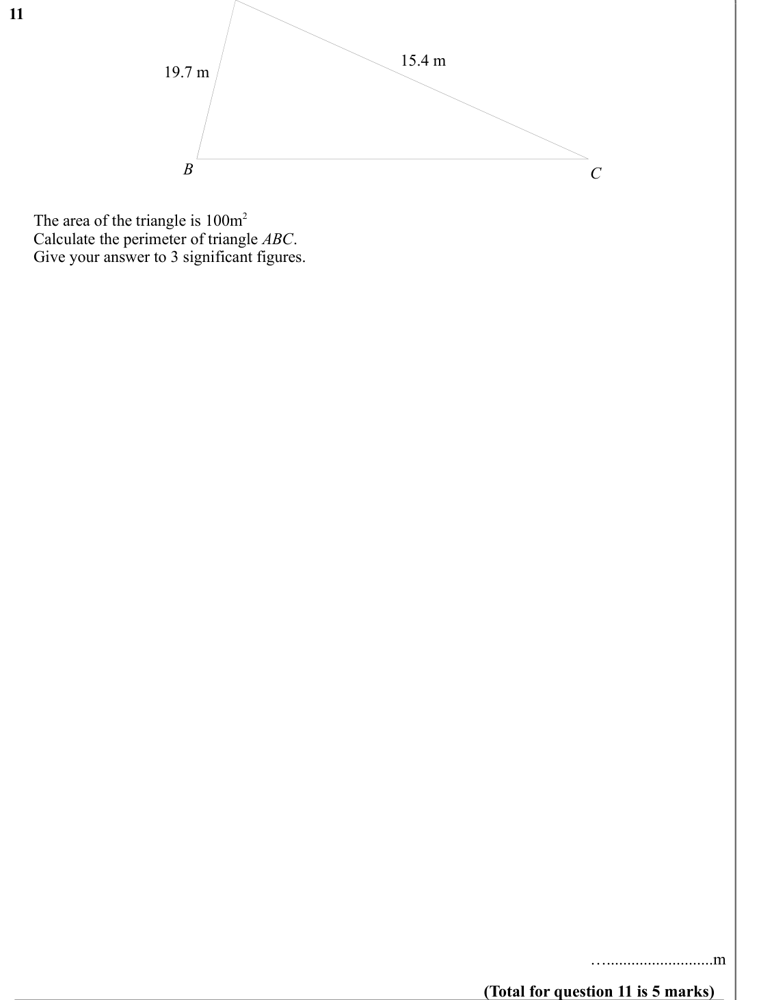

Text (lossy): 11     / 15.4 m / 19.7 m / B / C /       The area of the triangle is 100m 2 /       Calculate the perimeter of triangle ABC. /       Give your answer to 3 significant figures.  /            / …..........................m / (Total for question 11 is 5 marks)

