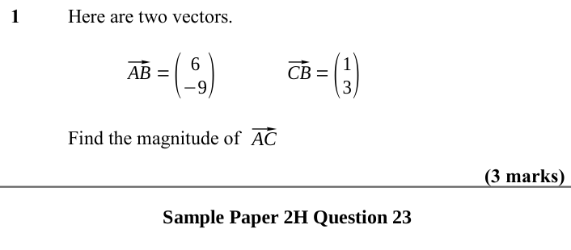
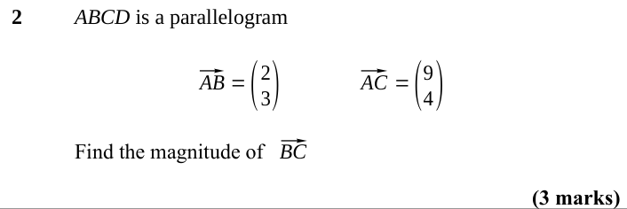
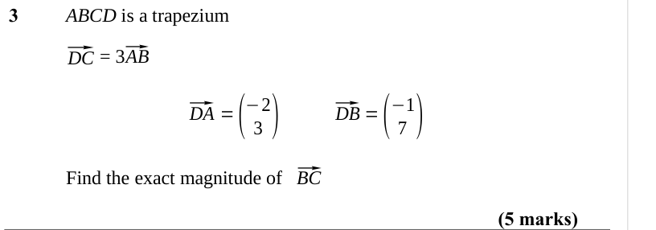

# The Magnitude of a Vector — Exam Questions (IGCSE Maths · Edexcel · Grade 7)

Topic code `7.13` · slug `grade-7-7-13-the-magnitude-of-a-vector` · source sheet sha256 `5b7bc244fd26540c…`

## Q1 (3 marks)

Text (lossy): 1 / Here are two vectors. / ⃗ / AB =( / 6 / −9) / ⃗ / CB =( / 1 / 3) / ⃗ / AC / Find the magnitude of / (3 marks) / Sample Paper 2H Question 23

## Q2 (3 marks)

Text (lossy): 2 / ABCD is a parallelogram / ⃗ / AB =( / 2 / 3) / ⃗ / AC =( / 9 / 4) / ⃗ / BC / Find the magnitude of / (3 marks)

## Q3 (5 marks)

Text (lossy): 3 / ABCD is a trapezium / ⃗ / DC / ⃗ / AB /        = 3 / ⃗ / DA =( / 3 ) / ⃗ / DB =( / 7 ) / −2 / −1 / ⃗ / BC / Find the exact magnitude of / (5 marks)

