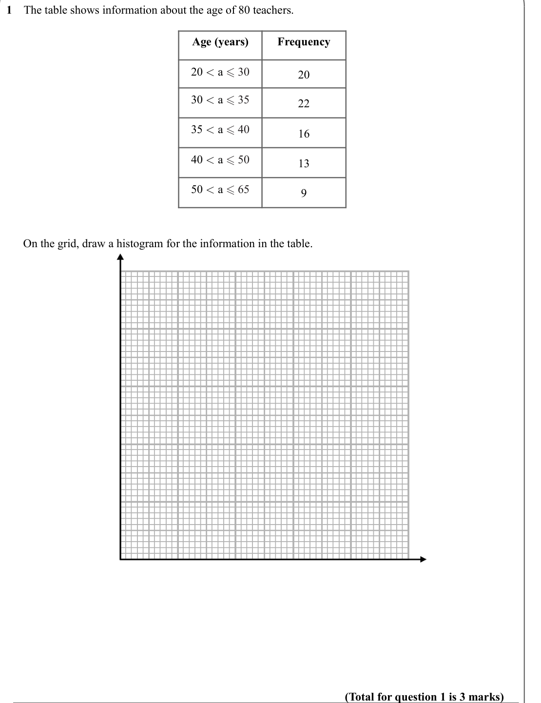
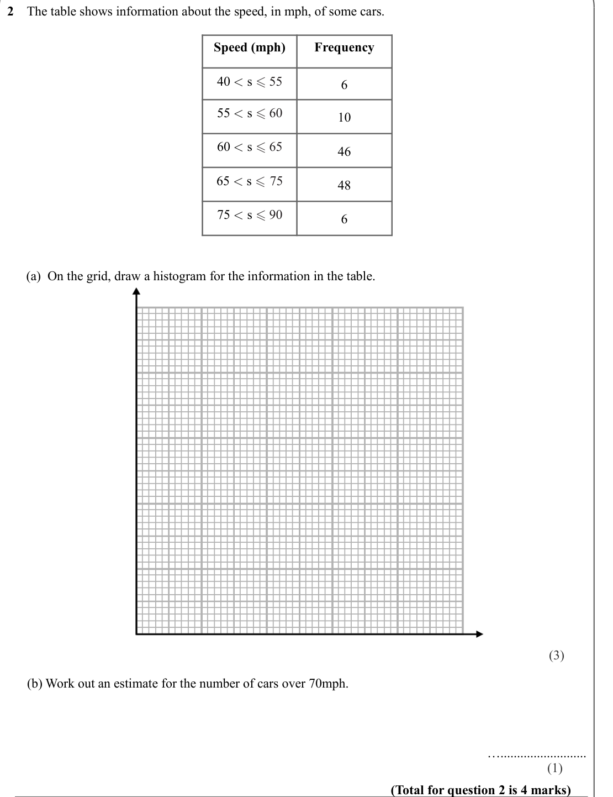
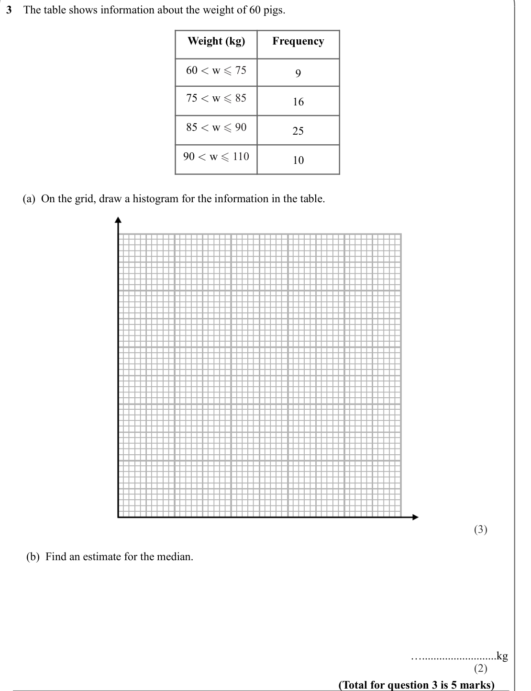
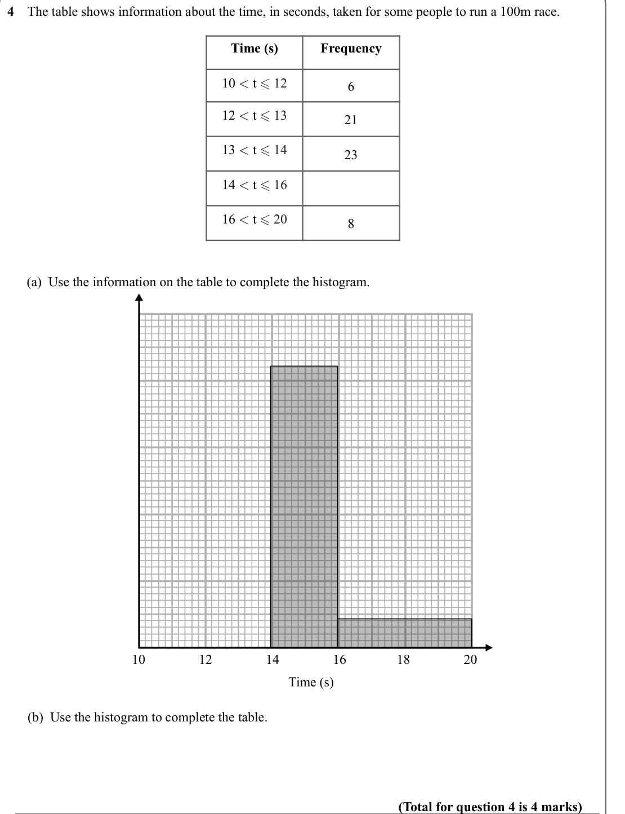
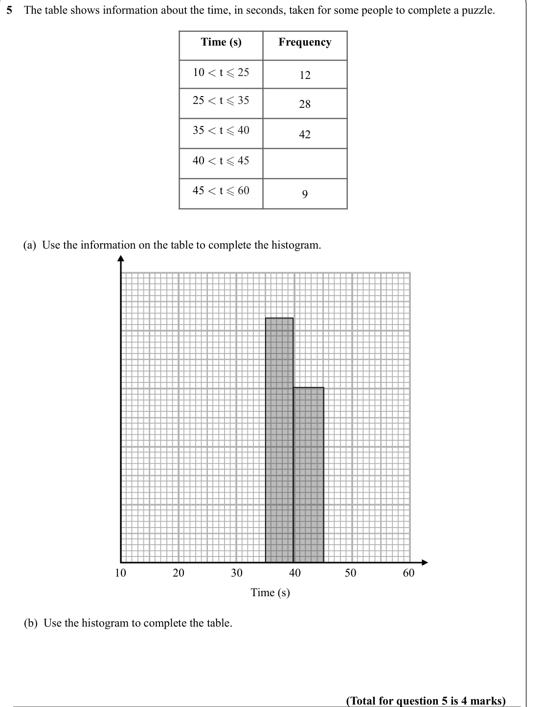
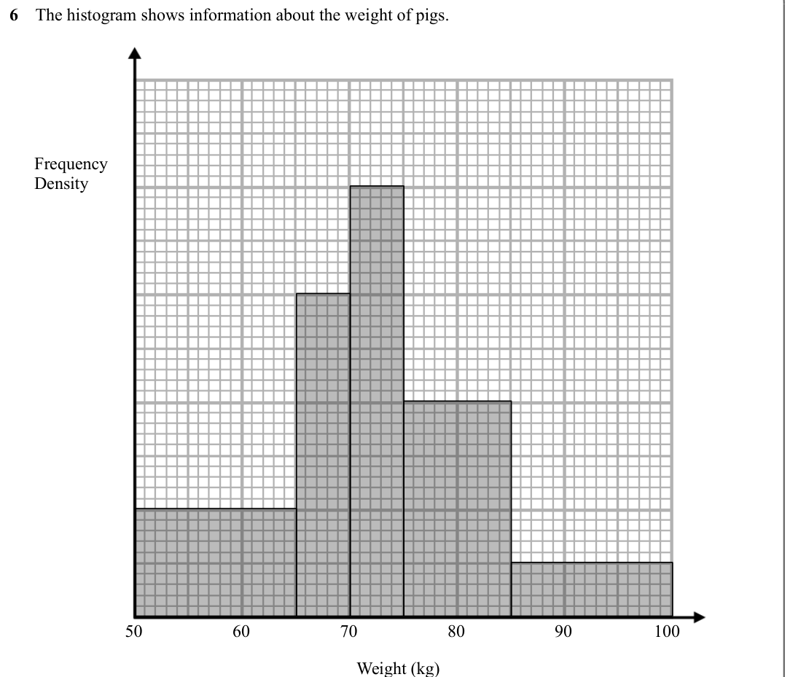
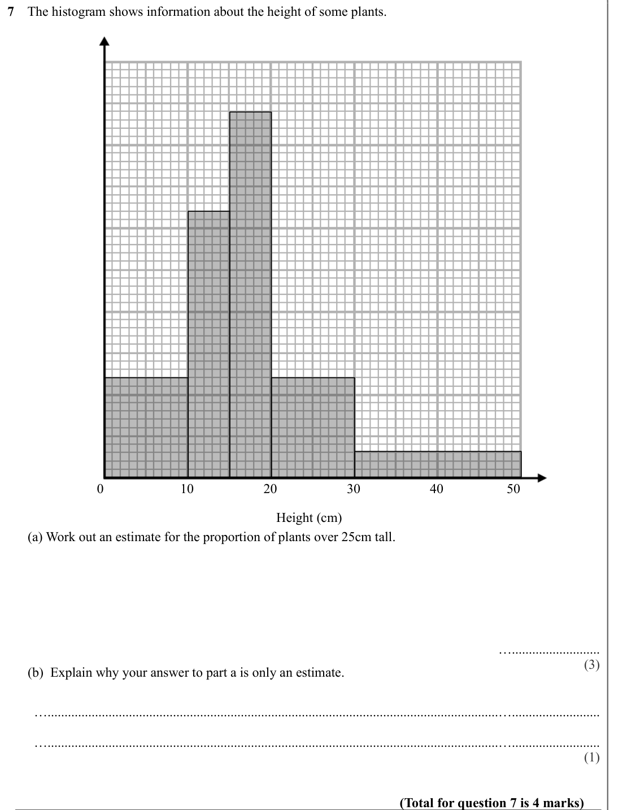

# Histograms — Exam Questions (IGCSE Maths · Edexcel · Grade 7)

Topic code `7.14` · slug `grade-7-7-14-histograms` · source sheet sha256 `bf215616e2bf67be…`

## Q1 (marks not printed)

Text (lossy): 1    The table shows information about the age of 80 teachers.  / Age (years) / Frequency / 20 < a  30 / 20 / 30 < a  35 / 22 / 35 < a  40 / 16 / 40 < a  50 / 13 / 50 < a  65 / 9 /       On the grid, draw a histogram for the information in the table.  / (Total for question 1 is 3 marks)

## Q2 (marks not printed · parts a, b)

Text (lossy): 2    The table shows information about the speed, in mph, of some cars. / Speed (mph) / Frequency / 40 < s  55 / 6 / 55 < s  60 / 10 / 60 < s  65 / 46 / 65 < s  75 / 48 / 75 < s  90 / 6 /       (a)  On the grid, draw a histogram for the information in the table.  / (3) /       (b) Work out an estimate for the number of cars over 70mph.  / ….......................... / (1) / (Total for questio

## Q3 (marks not printed · parts a, b)

Text (lossy): 3    The table shows information about the weight of 60 pigs.  / Weight (kg) / Frequency / 60 < w  75 / 9 / 75 < w  85 / 16 / 85 < w  90 / 25 / 90 < w  110 / 10 /       (a)  On the grid, draw a histogram for the information in the table.  / (3) /         /        (b)  Find an estimate for the median. / …..........................kg / (2) / (Total for question 3 is 5 marks)

## Q4 (marks not printed · parts a, b)

Text (lossy): 4    The table shows information about the time, in seconds, taken for some people to run a 100m race. / Time (s) / Frequency / 10 < t  12 / 6 / 12 < t  13 / 21 / 13 < t  14 / 23 / 14 < t  16 / 16 < t  20 / 8 /       (a)  Use the information on the table to complete the histogram.  / 10 / 12 / 14 / 16 / 18 / 20 / Time (s) /       (b)  Use the histogram to complete the table.  / (Total for que

## Q5 (marks not printed · parts a, b)

Text (lossy): 5    The table shows information about the time, in seconds, taken for some people to complete a puzzle. / Time (s) / Frequency / 10 < t  25 / 12 / 25 < t  35 / 28 / 35 < t  40 / 42 / 40 < t  45 / 45 < t  60 / 9 /       (a)  Use the information on the table to complete the histogram.  / 10 / 20 / 30 / 40 / 50 / 60 / Time (s) /       (b)  Use the histogram to complete the table.  / (Total for 

## Q6 (marks not printed)

Text (lossy): 6    The histogram shows information about the weight of pigs.  / Frequency / Density / 50 / 60 / 70 / 80 / 90 / 100 / Weight (kg)

## Q7 (marks not printed · parts a, b)

Text (lossy): 7    The histogram shows information about the height of some plants.  / 0 / 10 / 20 / 30 / 40 / 50 / Height (cm) /       (a) Work out an estimate for the proportion of plants over 25cm tall.  / ….......................... / (3) /       (b)  Explain why your answer to part a is only an estimate.  / …...................................................................................................

