# Bounds — Exam Questions (IGCSE Maths · Edexcel · Grade 7)

Topic code `7.2` · slug `grade-7-7-2-bounds` · source sheet sha256 `60ea247ac0975c1b…`

## Q1 (marks not printed · parts b, a)

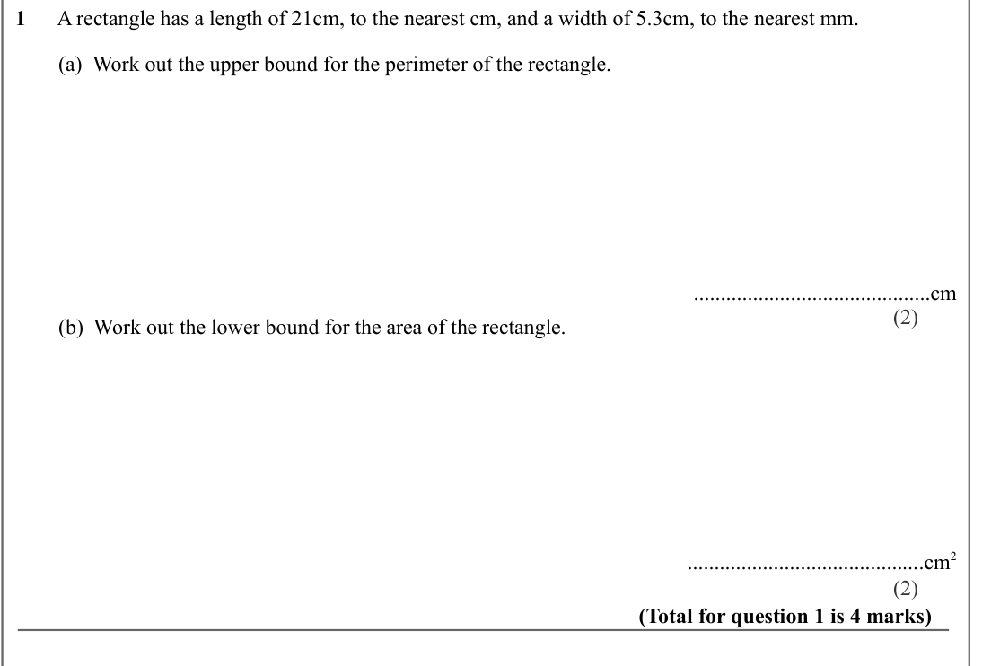

Text (lossy): 1       /        ............................................cm / (2) /         (b)  Work out the lower bound for the area of the rectangle. /        ............................................cm 2 / (2) / (Total for question 1 is 4 marks) /     /         A circle has a radius of 5cm, to the nearest cm.  /         /         (a)  Work out the lower bound for the circumference of the circle.

## Q2 (marks not printed · parts b)

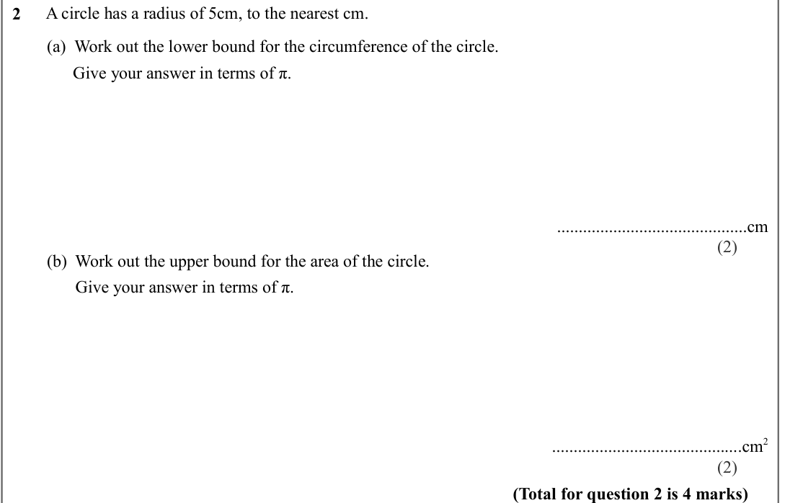

Text (lossy): 2       /                Give your answer in terms of π. /        ............................................cm / (2) /         (b)  Work out the upper bound for the area of the circle. /                Give your answer in terms of π. /        ............................................cm 2 / (2) / (Total for question 2 is 4 marks)

## Q3 (marks not printed · parts a, b, a)

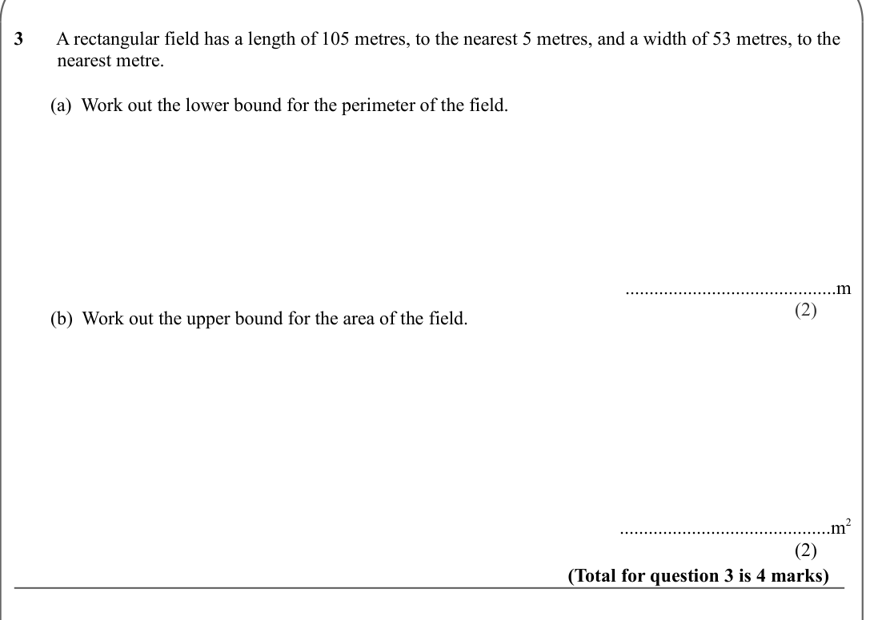

Text (lossy): 3       A rectangular field has a length of 105 metres, to the nearest 5 metres, and a width of 53 metres, to the    /          nearest metre.  /         /         (a)  Work out the lower bound for the perimeter of the field. /        ............................................m / (2) /         (b)  Work out the upper bound for the area of the field. /        .....................................

## Q4 (marks not printed · parts b)

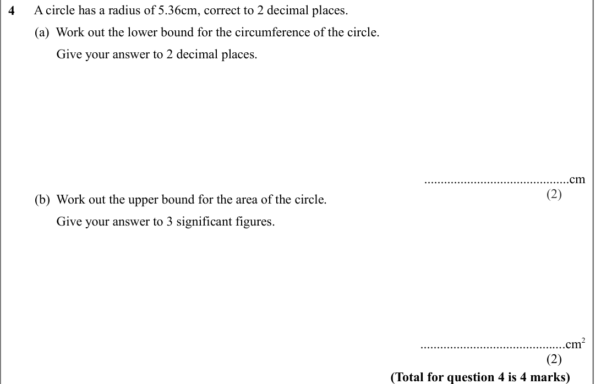

Text (lossy): 4       /                Give your answer to 2 decimal places. /        ............................................cm / (2) /         (b)  Work out the upper bound for the area of the circle. /                Give your answer to 3 significant figures. /        ............................................cm 2 / (2) / (Total for question 4 is 4 marks)

## Q5 (marks not printed)

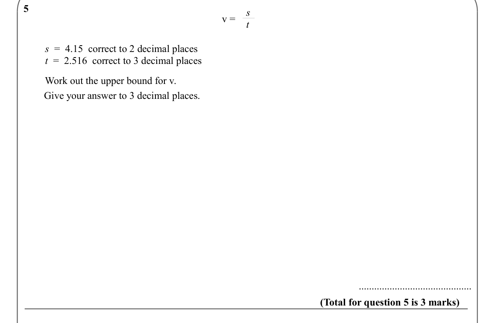

Text (lossy): 5       / v =  s / t /     /         s  =  4.15  correct to 2 decimal places /         t  =  2.516  correct to 3 decimal places /     /         Work out the upper bound for v.  /                Give your answer to 3 decimal places. /              /              /        ............................................ / (Total for question 5 is 3 marks)

## Q6 (marks not printed)

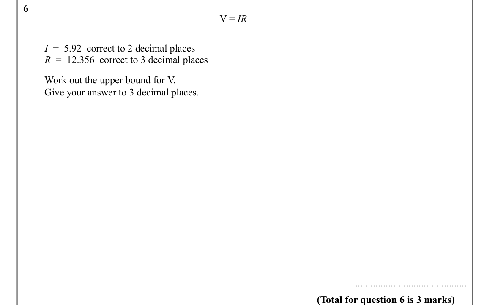

Text (lossy): 6       / V = IR /     /         I  =  5.92  correct to 2 decimal places /         R  =  12.356  correct to 3 decimal places /     /         Work out the upper bound for V.  /                Give your answer to 3 decimal places. /              /              /        ............................................ / (Total for question 6 is 3 marks)

## Q7 (marks not printed)

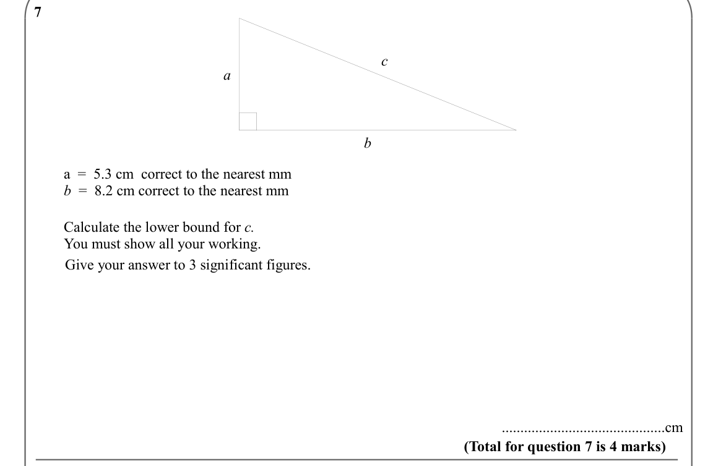

Text (lossy): 7       / c / a / b /     /         a  =  5.3 cm  correct to the nearest mm /         b  =  8.2 cm correct to the nearest mm            /     /         Calculate the lower bound for c. /         You must show all your working.  /                Give your answer to 3 significant figures. /              /        ............................................cm / (Total for question 7 is 4 marks)

## Q8 (marks not printed)

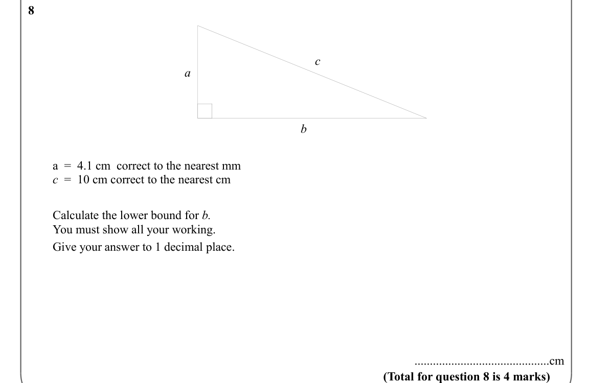

Text (lossy): 8       / c / a / b /     /         a  =  4.1 cm  correct to the nearest mm /         c  =  10 cm correct to the nearest cm            /     /         Calculate the lower bound for b. /         You must show all your working.  /                Give your answer to 1 decimal place. /              /        ............................................cm / (Total for question 8 is 4 marks)

## Q9 (marks not printed)

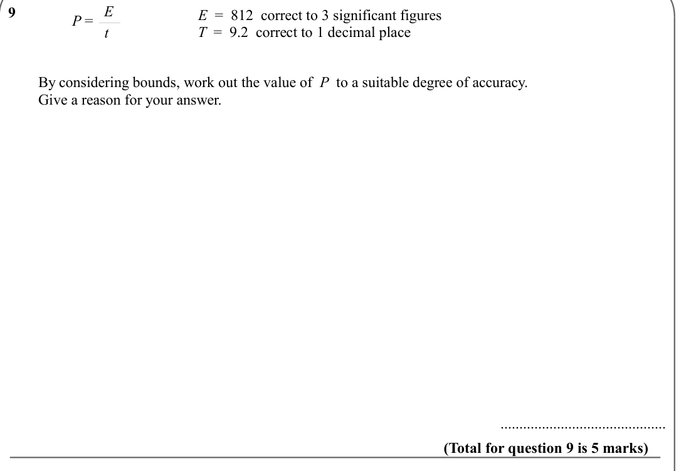

Text (lossy): P =  E / 9       / t /     /         By considering bounds, work out the value of  P  to a suitable degree of accuracy. /         Give a reason for your answer. /              /              /        ............................................ / (Total for question 9 is 5 marks) /     /         g  =  12.7  correct to 3 significant figures /         h  =  9.294  correct to 3 decimal places

## Q10 (marks not printed)

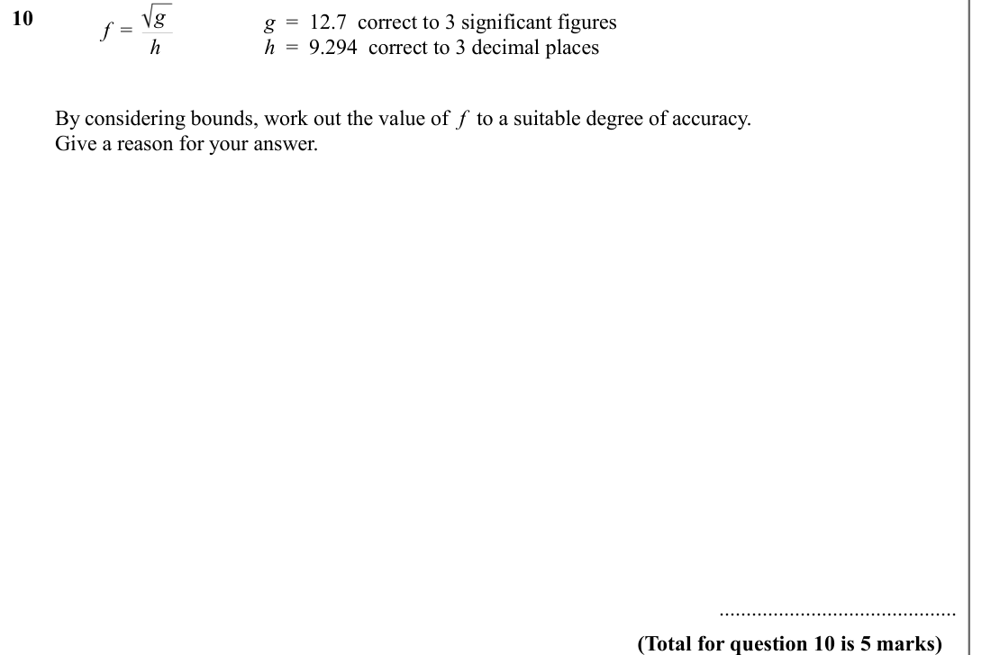

Text (lossy): f  =  g / 10       / h /     /         By considering bounds, work out the value of  f  to a suitable degree of accuracy. /         Give a reason for your answer. /              /              /        ............................................ / (Total for question 10 is 5 marks)

## Q11 (marks not printed)

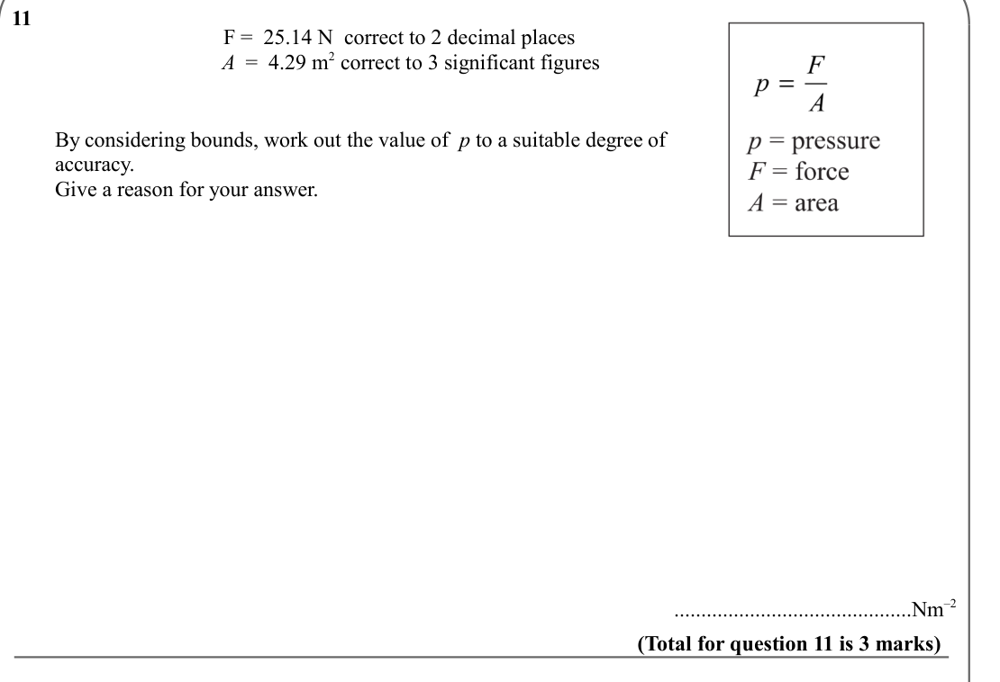

Text (lossy): 11       /     /         By considering bounds, work out the value of  p to a suitable degree of           /         accuracy. /         Give a reason for your answer. /              /              /        ............................................Nm–2 / (Total for question 11 is 3 marks)

## Q12 (marks not printed)

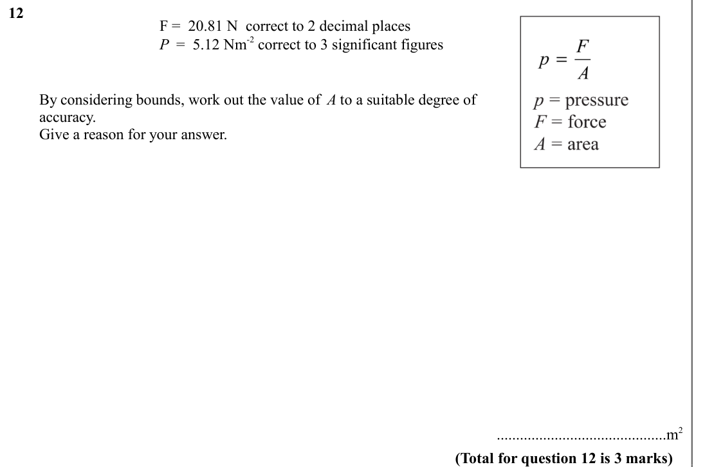

Text (lossy): 12       /     /         By considering bounds, work out the value of  A to a suitable degree of           /         accuracy. /         Give a reason for your answer. /              /              /        ............................................m 2 / (Total for question 12 is 3 marks)

## Q13 (marks not printed)

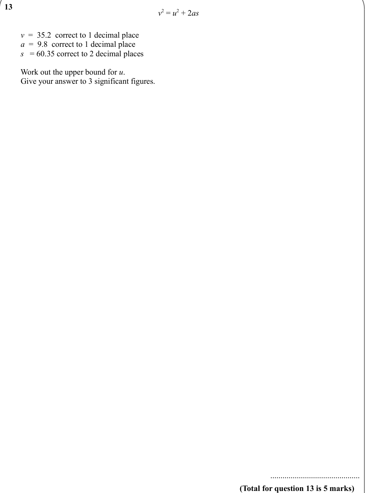

Text (lossy): 13       / v 2 = u 2 + 2 as  /     /         v  =  35.2  correct to 1 decimal place /         a  =  9.8  correct to 1 decimal place /         s   = 60.35 correct to 2 decimal places /     /         Work out the upper bound for u. /         Give your answer to 3 significant figures.  /              /              /        ............................................ / (Total for question 13 is 5 ma

