# Factorising Harder Quadratics — Exam Questions (IGCSE Maths · Edexcel · Grade 7)

Topic code `7.5` · slug `grade-7-7-5-factorising-harder-quadratics` · source sheet sha256 `a13381d3d7a88361…`

## Q1 (marks not printed)

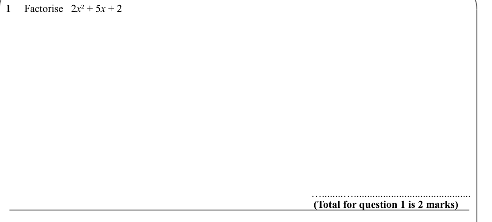

Text (lossy): 1     Factorise   2 x ² + 5 x + 2 / (Total for question 1 is 2 marks) / …........…............................................

## Q2 (marks not printed)

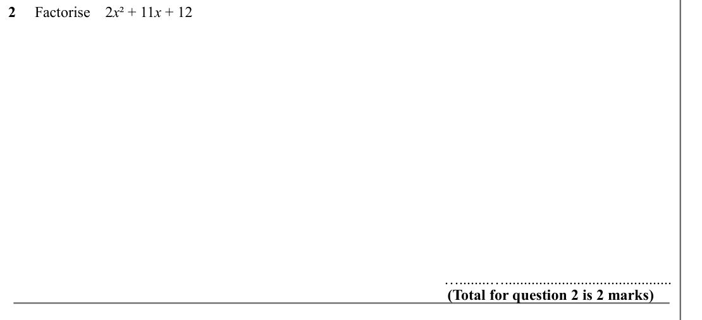

Text (lossy): 2     Factorise    2 x ² + 11 x + 12 /    / (Total for question 2 is 2 marks) / …........…............................................

## Q3 (marks not printed)

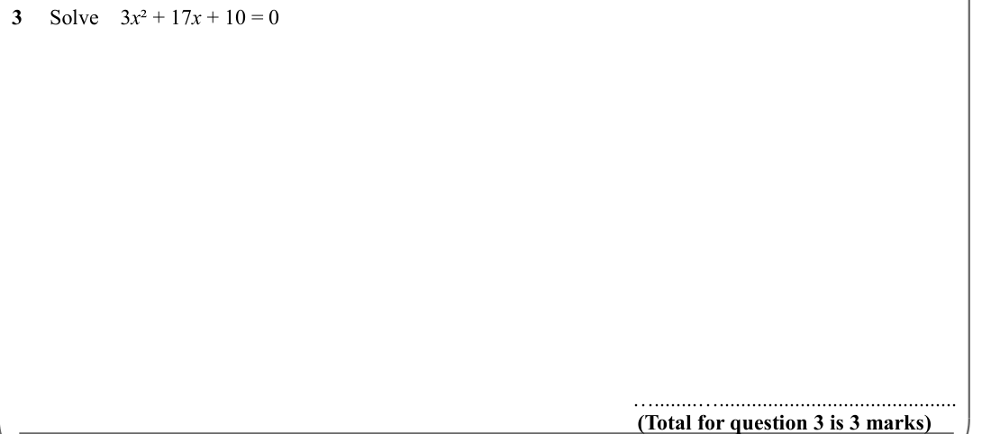

Text (lossy): 3     Solve    3 x ² + 17 x + 10 = 0 / (Total for question 3 is 3 marks) / …........…............................................

## Q4 (marks not printed)

Text (lossy): 4     Factorise   2 x ² – x – 1 / (Total for question 4 is 2 marks) / …........…............................................

## Q5 (marks not printed)

Text (lossy): 5     Factorise   3 x ² – 11 x + 6 /    / (Total for question 5 is 2 marks) / …........…............................................

## Q6 (marks not printed)

Text (lossy): 6     Solve    4 x ² – 19 x – 5 = 0 / (Total for question 6 is 3 marks) / …........…............................................

## Q7 (marks not printed)

Text (lossy): 7     Factorise   2 x ² + 3 x – 9 / (Total for question 7 is 2 marks) / …........…............................................

## Q8 (marks not printed)

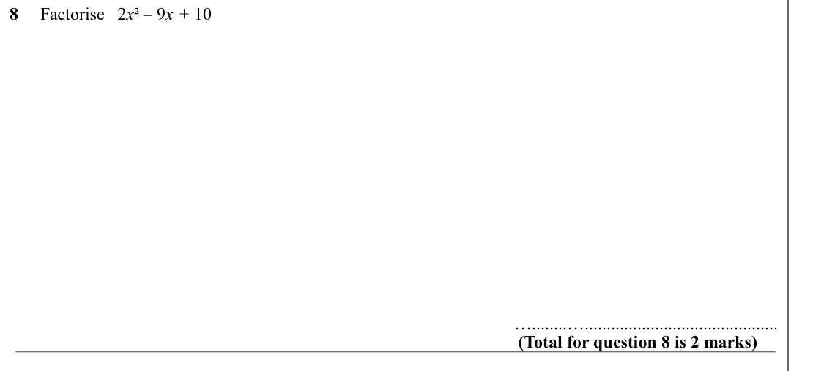

Text (lossy): 8     Factorise   2 x ² – 9 x + 10 /    / (Total for question 8 is 2 marks) / …........…............................................

## Q9 (marks not printed)

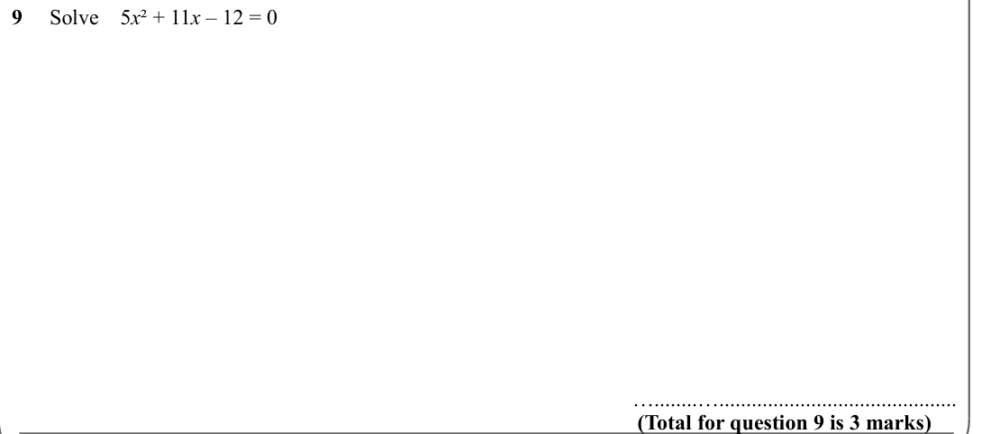

Text (lossy): 9     Solve    5 x ² + 11 x – 12 = 0 / (Total for question 9 is 3 marks) / …........…............................................

## Q10 (marks not printed)

Text (lossy): 10     Factorise   3 x ² + 16 x + 21 / (Total for question 10 is 2 marks) / …........…............................................

## Q11 (marks not printed)

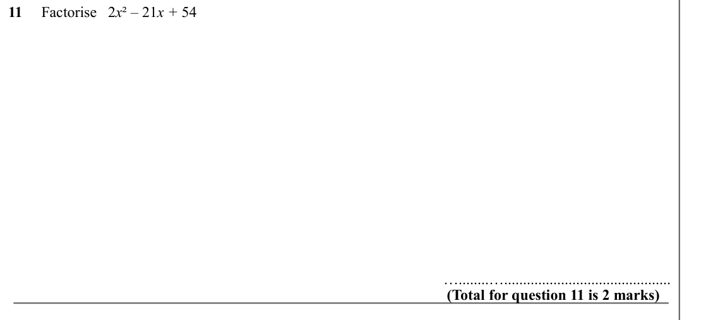

Text (lossy): 11     Factorise   2 x ² – 21 x + 54 /    / (Total for question 11 is 2 marks) / …........…............................................

## Q12 (marks not printed)

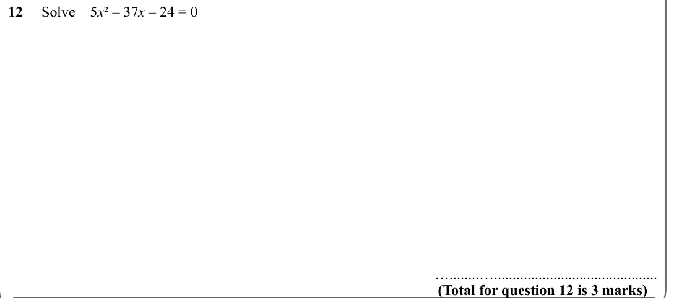

Text (lossy): 12     Solve    5 x ² – 37 x – 24 = 0 / (Total for question 12 is 3 marks) / …........…............................................

## Q13 (marks not printed)

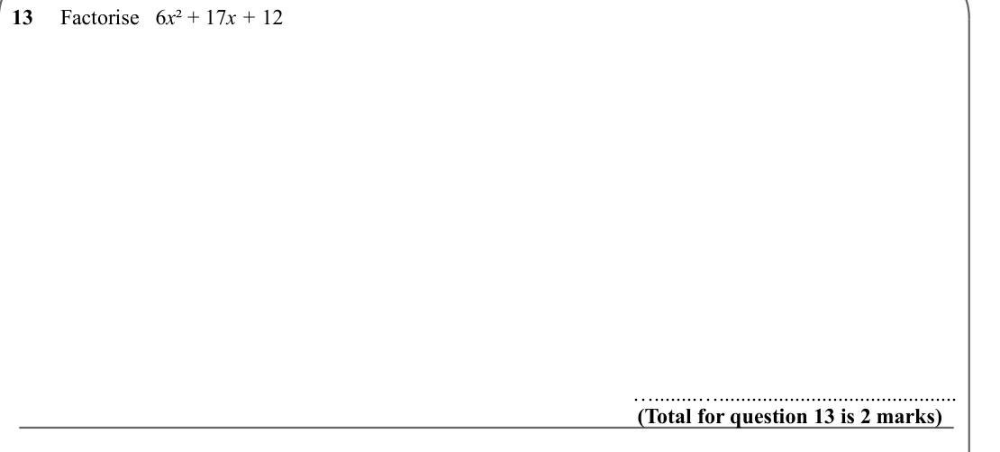

Text (lossy): 13     Factorise   6 x ² + 17 x + 12 / (Total for question 13 is 2 marks) / …........…............................................

## Q14 (marks not printed)

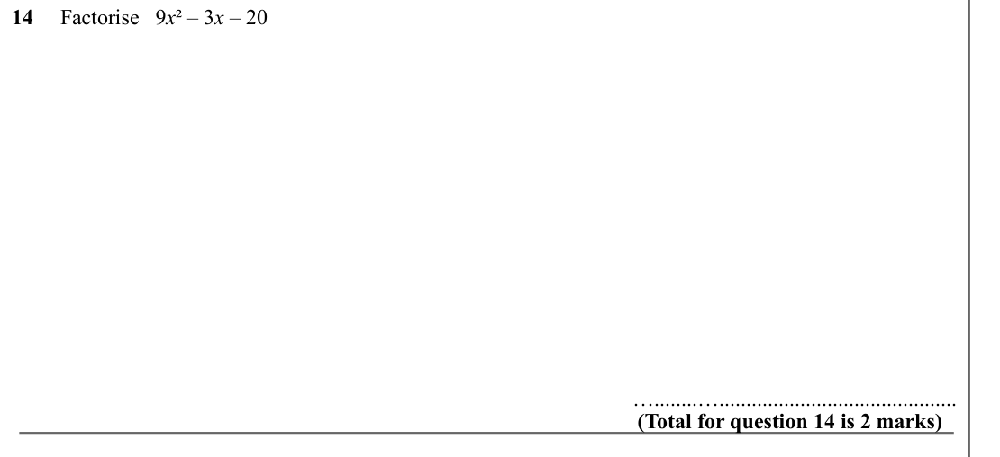

Text (lossy): 14     Factorise   9 x ² – 3 x – 20 /    / (Total for question 14 is 2 marks) / …........…............................................

## Q15 (marks not printed)

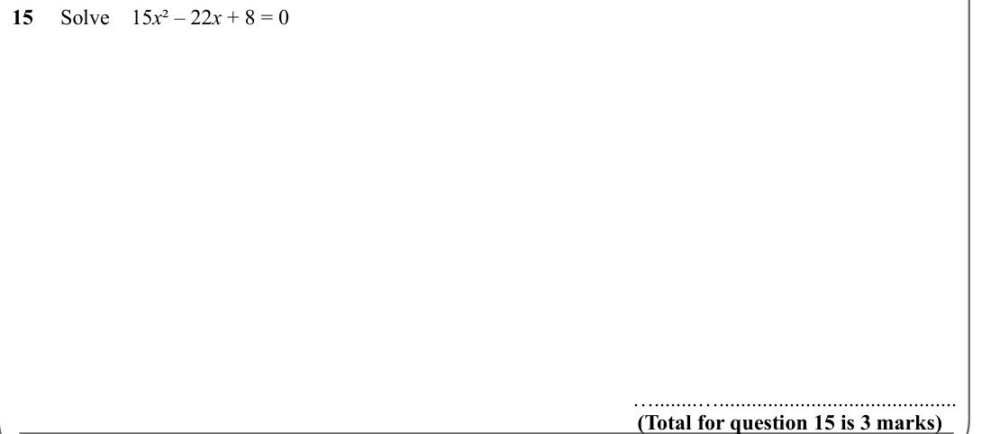

Text (lossy): 15     Solve    15 x ² – 22 x + 8 = 0 / (Total for question 15 is 3 marks) / …........…............................................

## Q16 (marks not printed)

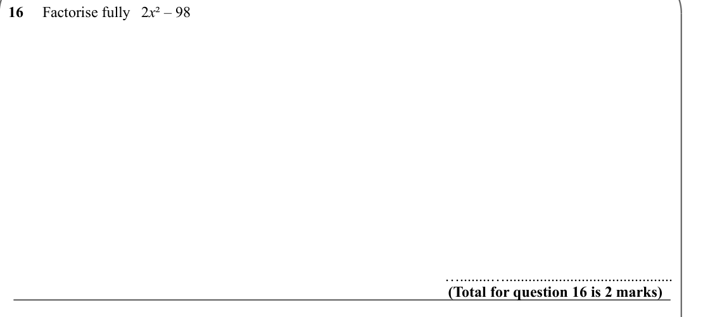

Text (lossy): 16     Factorise fully   2 x ² – 98 / (Total for question 16 is 2 marks) / …........…............................................

## Q17 (marks not printed)

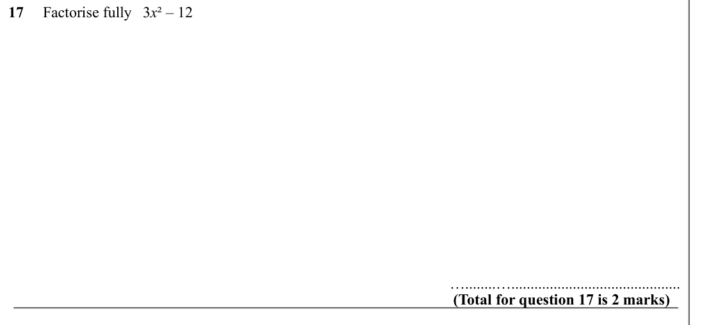

Text (lossy): 17     Factorise fully   3 x ² – 12 /    / (Total for question 17 is 2 marks) / …........…............................................

## Q18 (marks not printed)

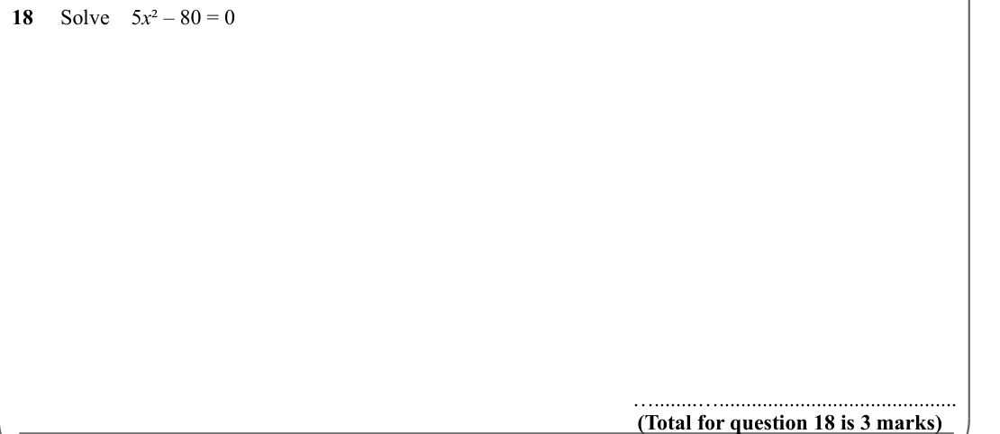

Text (lossy): 18     Solve    5 x ² – 80 = 0 / (Total for question 18 is 3 marks) / …........…............................................

## Q19 (marks not printed)

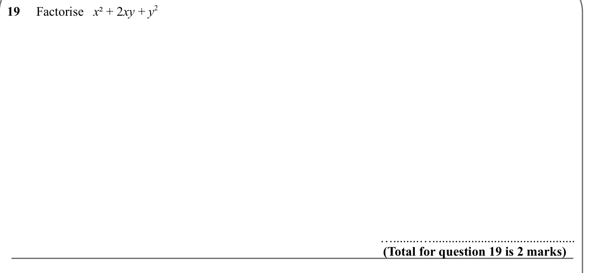

Text (lossy): 19     Factorise   x ² + 2 xy + y 2 / (Total for question 19 is 2 marks) / …........…............................................

## Q20 (marks not printed)

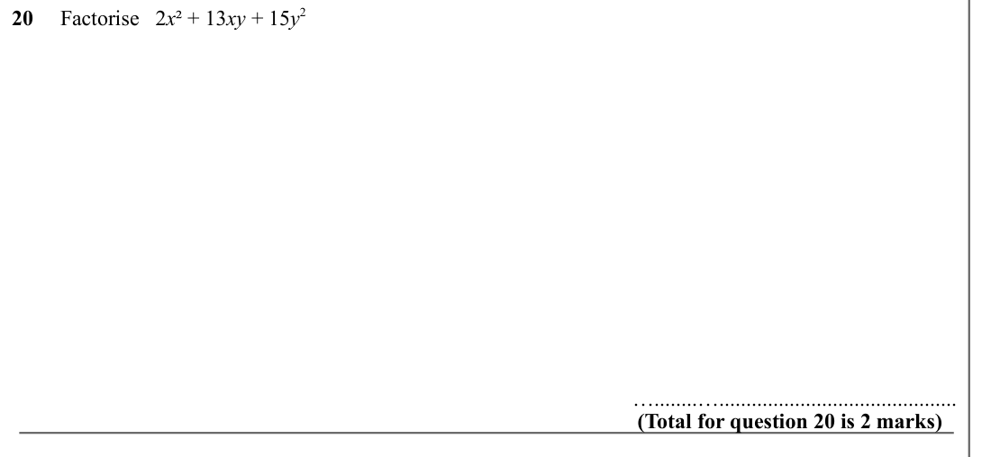

Text (lossy): 20     Factorise   2 x ² + 13 xy + 15 y 2 /    / (Total for question 20 is 2 marks) / …........…............................................

## Q21 (marks not printed)

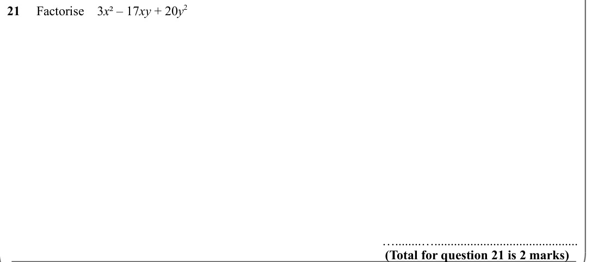

Text (lossy): 21     Factorise    3 x ² – 17 xy + 20 y 2 / (Total for question 21 is 2 marks) / …........…............................................

