# Algebraic Fractions — Exam Questions (IGCSE Maths · Edexcel · Grade 7)

Topic code `7.6` · slug `grade-7-7-6-algebraic-fractions` · source sheet sha256 `4b1830f41b6bc7b6…`

## Q1 (2 marks)

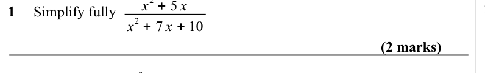

Text (lossy): 1     Simplify fully                      /        / 2 + 7 x + 10 / (2 marks) / 2 −x −12 / x / x

## Q2 (2 marks)

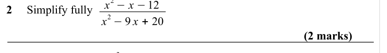

Text (lossy): 2     Simplify fully                      /        / 2 −9 x + 20 / (2 marks) / 2 + 9 x / x / 3 x

## Q3 (2 marks)

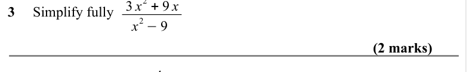

Text (lossy): 3     Simplify fully                      /        / 2 −9 / (2 marks) / x + 4 / x

## Q4 (2 marks)

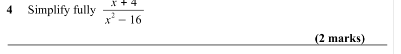

Text (lossy): 4     Simplify fully                      /        / 2 −16 / (2 marks) / 2 + 11 x −4 / x

## Q5 (3 marks)

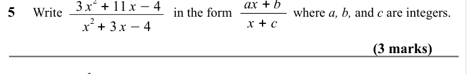

Text (lossy): 5     Write                               in the form                 where a, b, and c are integers.   /        / 2 + 3 x −4 / x + c / (3 marks) / 2 + 7 x −18 / 2 x / x + a / b x + c / x

## Q6 (3 marks)

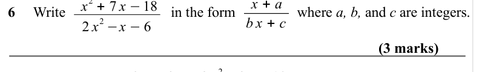

Text (lossy): 6     Write                             in the form                 where a, b, and c are integers.   /        / 2 −x −6 / (3 marks) / 2 + 9 x + 10 / x / 3 x + 6 / x −4 / ÷ 2 x

## Q7 (3 marks)

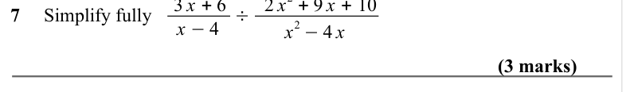

Text (lossy): 7     Simplify fully                                                  /        / 2 −4 x / (3 marks) / 2 −4 x + 3 / 2 x / 2 x −2

## Q8 (3 marks)

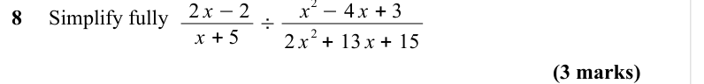

Text (lossy): 8     Simplify fully                                                  /        / 2 + 13 x + 15 / (3 marks)

## Q9 (4 marks)

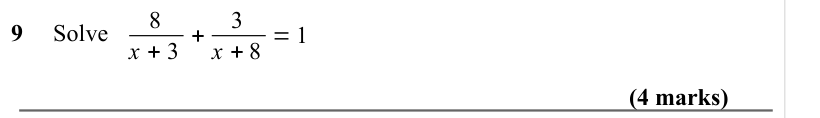

Text (lossy): 9     Solve      8 / x + 3 + / 3 / x + 8 = 1 / (4 marks)

## Q10 (4 marks)

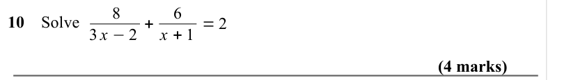

Text (lossy): 10    Solve      8 / 3 x −2 + / 6 / x + 1 = 2 / (4 marks)

## Q11 (4 marks)

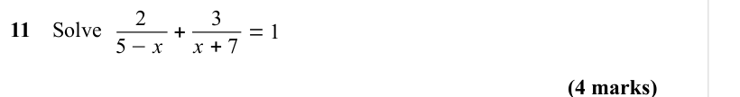

Text (lossy): 11    Solve      2 / 5 −x + / 3 / x + 7 = 1 / (4 marks)

## Q12 (4 marks)

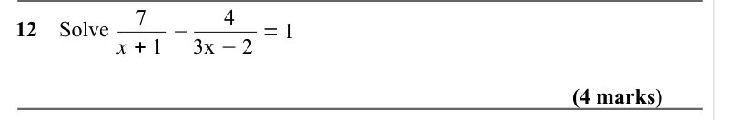

Text (lossy): 12    Solve      7 / x + 1 − / 4 / 3x −2 = 1 / (4 marks)

## Q13 (4 marks)

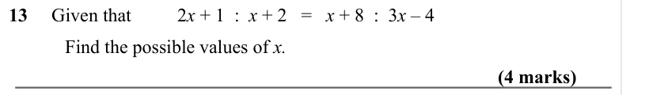

Text (lossy): 13     Given that  / 2 x + 1  :  x + 2   =   x + 8  :  3 x – 4  / Find the possible values of x.    / (4 marks)

## Q14 (4 marks)

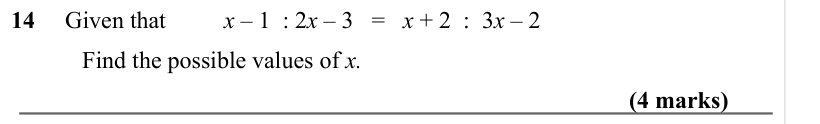

Text (lossy): 14     Given that  / x – 1  : 2 x – 3   =   x + 2  :  3 x – 2   / Find the possible values of x.    / (4 marks)

## Q15 (4 marks)

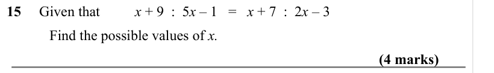

Text (lossy): 15     Given that  / x + 9  :  5 x – 1   =   x + 7  :  2 x – 3   / Find the possible values of x.    / (4 marks)

## Q16 (4 marks)

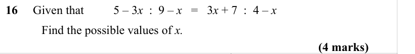

Text (lossy): 16     Given that  / 5 – 3 x  :  9 – x   =   3 x + 7  :  4 – x   / Find the possible values of x.    / (4 marks)

