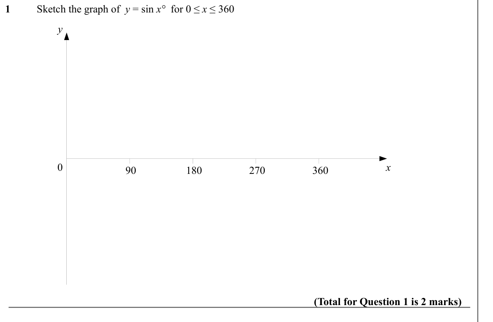
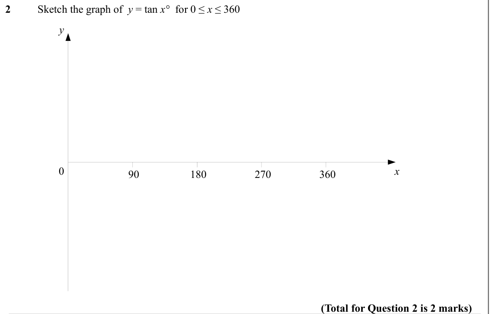
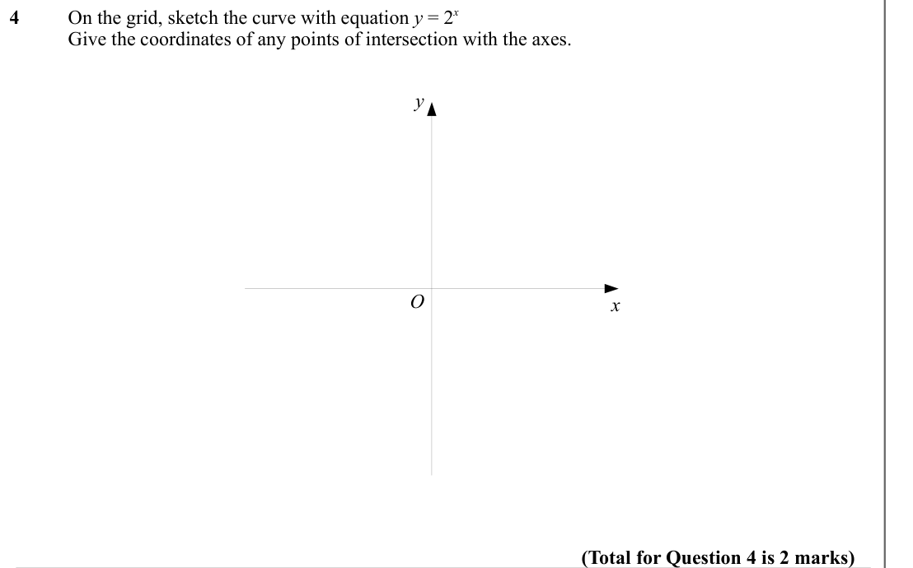
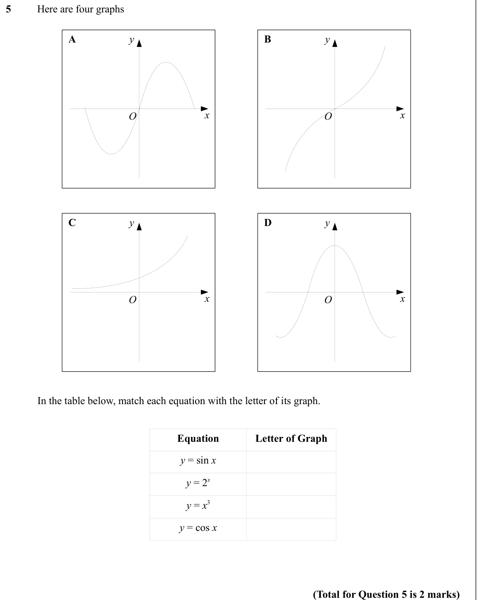
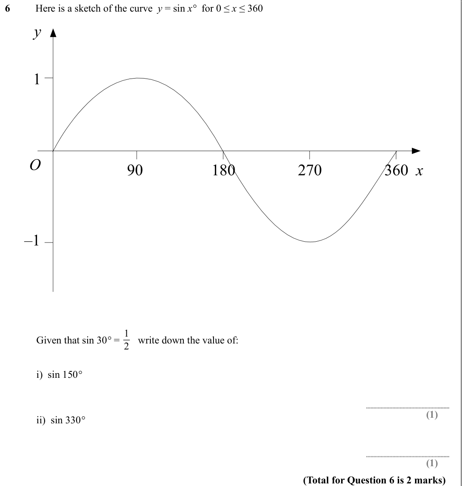
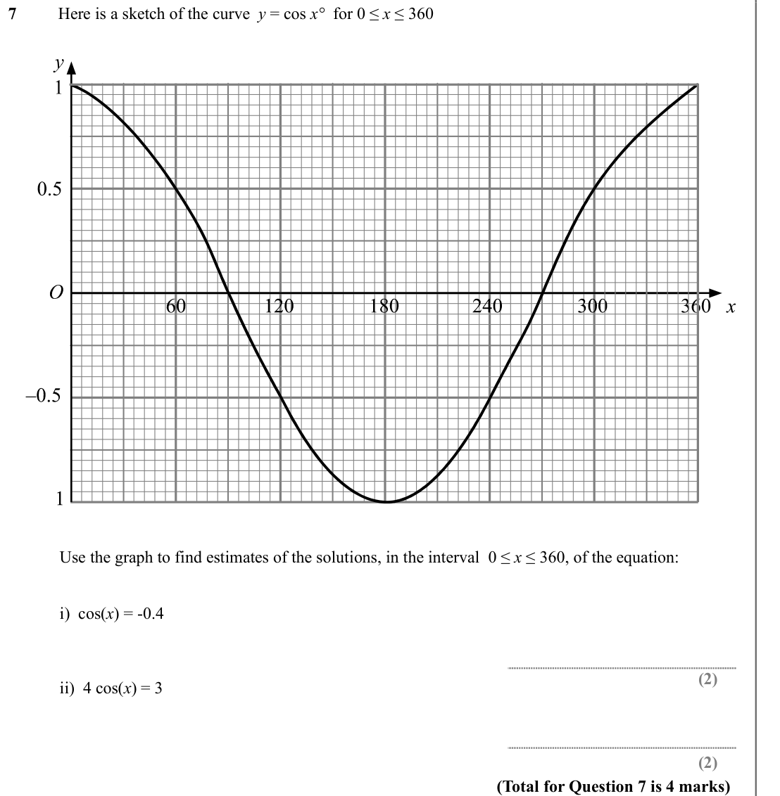
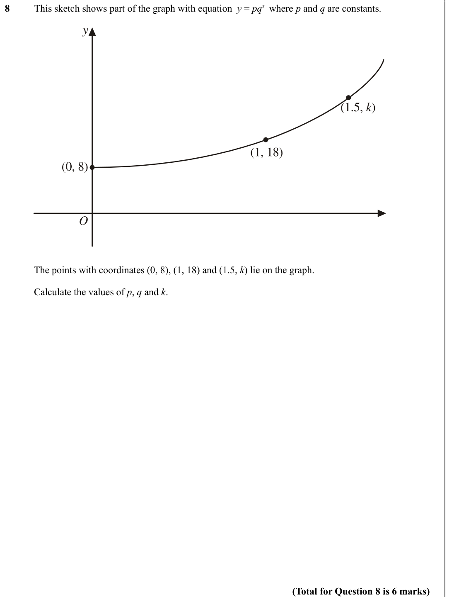
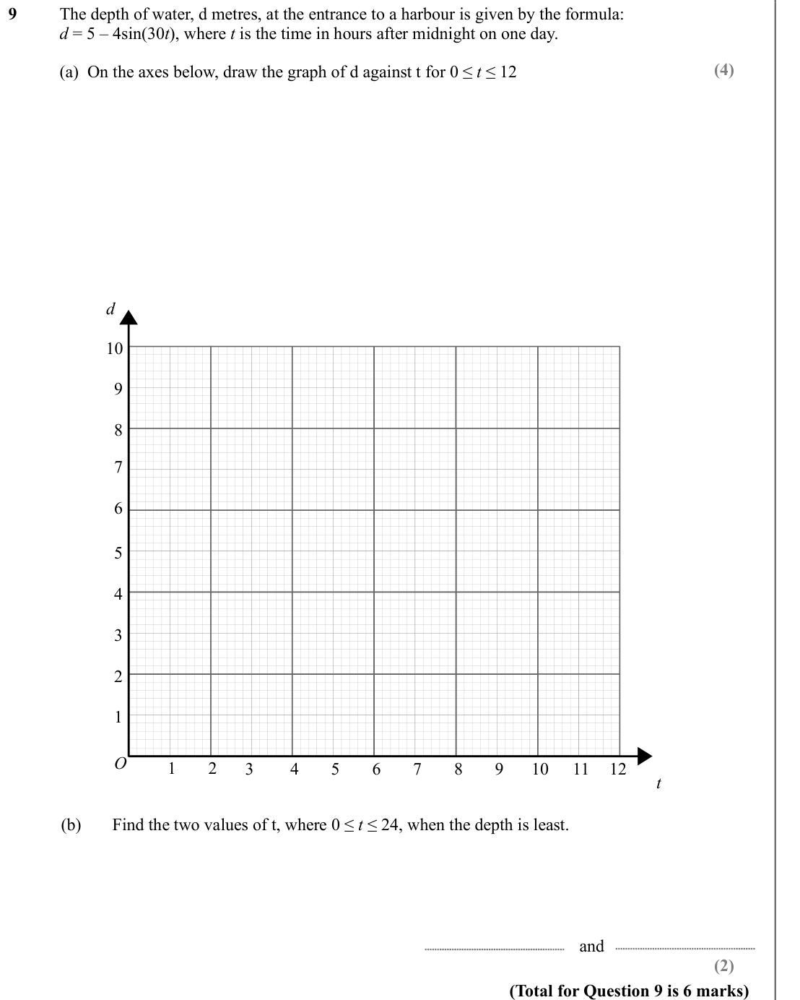

# Trigonometric and Exponential Graphs — Exam Questions (IGCSE Maths · Edexcel · Grade 7)

Topic code `7.8` · slug `grade-7-7-8-trigonometric-and-exponential-graphs` · source sheet sha256 `17dc85226f3af42b…`

## Q1 (marks not printed)

Text (lossy): 1 / Sketch the graph of  y = sin x°  for 0 ≤ x ≤ 360 / y / 0 / 90 / 180 / 270 / 360 / x / (Total for Question 1 is 2 marks)

## Q2 (marks not printed)

Text (lossy): 2 / Sketch the graph of  y = tan x°  for 0 ≤ x ≤ 360 / y / 0 / 90 / 180 / 270 / 360 / x / (Total for Question 2 is 2 marks)

## Q3 (marks not printed)

Text (lossy): 3 / Sketch the graph of  y = cos x°  for 0 ≤ x ≤ 360 / y / 0 / 90 / 180 / 270 / 360 / x / (Total for Question 3 is 2 marks)

## Q4 (marks not printed)

Text (lossy): 4 / On the grid, sketch the curve with equation y = 2 x / Give the coordinates of any points of intersection with the axes. / y / O / x / (Total for Question 4 is 2 marks)

## Q5 (marks not printed)

Text (lossy): 5 / Here are four graphs / y / A / y / B / O / x / x / O / y / C / y / D / O / x / x / O / In the table below, match each equation with the letter of its graph. / Equation / Letter of Graph / y = sin x / y = 2 x / y = x 3 / y = cos x / (Total for Question 5 is 2 marks)

## Q6 (marks not printed)

Text (lossy): 6 / Here is a sketch of the curve  y = sin x°  for 0 ≤ x ≤ 360 / 1 / 2 / Given that sin 30° =     write down the value of: / i)  sin 150° / (1) / ii)  sin 330° / (1) / (Total for Question 6 is 2 marks)

## Q7 (marks not printed)

Text (lossy): 7 / Here is a sketch of the curve  y = cos x°  for 0 ≤ x ≤ 360 / Use the graph to find estimates of the solutions, in the interval  0 ≤ x ≤ 360, of the equation: / i)  cos(x) = -0.4 / ii)  4 cos(x) = 3 / (2) / (2) / (Total for Question 7 is 4 marks)

## Q8 (marks not printed)

Text (lossy): 8 / This sketch shows part of the graph with equation  y = pq x where p and q are constants. / The points with coordinates (0, 8), (1, 18) and (1.5, k) lie on the graph. / Calculate the values of p, q and k. / (Total for Question 8 is 6 marks)

## Q9 (marks not printed · parts a, b)

Text (lossy): 9 / The depth of water, d metres, at the entrance to a harbour is given by the formula: / d = 5 – 4sin(30 t), where t is the time in hours after midnight on one day. / (4) / (a)  On the axes below, draw the graph of d against t for 0 ≤ t ≤ 12 / d / 10 / 9 / 8 / 7 / 6 / 5 / 4 / 3 / 2 / 1 / O / 1 / 3 / 4 / 5 / 6 / 7 / 8 / 9 / 10 / 11 / 12 / 2 / t / (b) / Find the two values of t, where 0 ≤ t ≤ 24, w

