# Finding the Area of Any Triangle — Exam Questions (IGCSE Maths · Edexcel · Grade 7)

Topic code `7.9` · slug `grade-7-7-9-finding-the-area-of-any-triangle` · source sheet sha256 `80535d4fa28af548…`

## Q1 (2 marks)

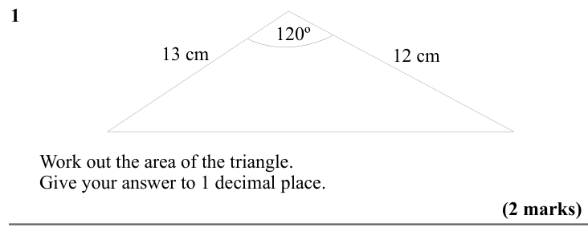

Text (lossy): 1     / 120º / 12 cm / 13 cm /       Work out the area of the triangle. /       Give your answer to 1 decimal place.    / (2 marks)

## Q2 (2 marks)

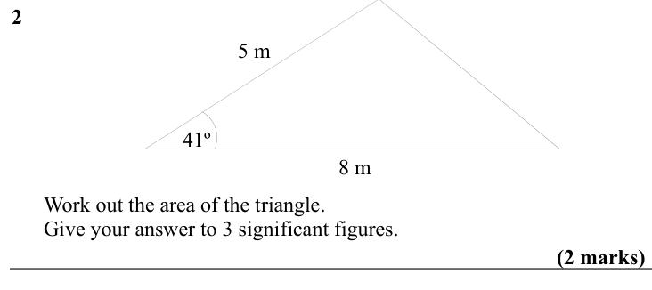

Text (lossy): 2     / 5 m / 41º / 8 m /       Work out the area of the triangle. /       Give your answer to 3 significant figures.      / (2 marks)

## Q3 (2 marks)

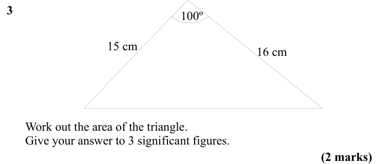

Text (lossy): 3     / 100º / 16 cm / 15 cm /       Work out the area of the triangle. /       Give your answer to 3 significant figures.     / (2 marks)

## Q4 (2 marks)

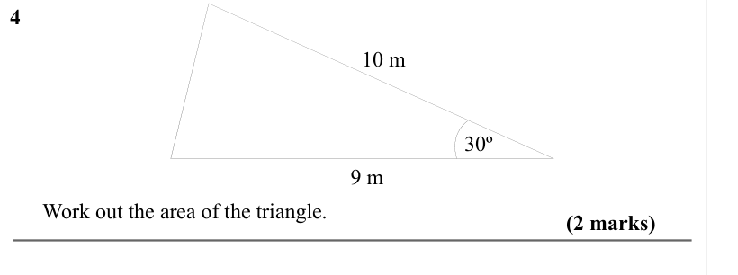

Text (lossy): 4     / 10 m / 30º / 9 m /       Work out the area of the triangle. /            / (2 marks)

## Q5 (3 marks)

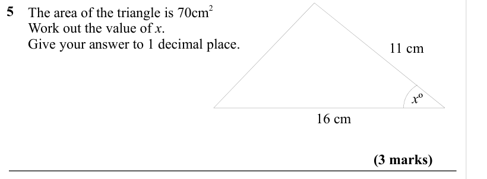

Text (lossy): 5     /       The area of the triangle is 70cm 2 /       Work out the value of x. /       Give your answer to 1 decimal place.      / 11 cm / x º / 16 cm / (3 marks)

## Q6 (3 marks)

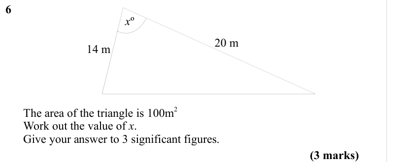

Text (lossy): 6     / x º / 20 m / 14 m /       The area of the triangle is 100m 2 /       Work out the value of x. /       Give your answer to 3 significant figures.  / (3 marks)

## Q7 (4 marks)

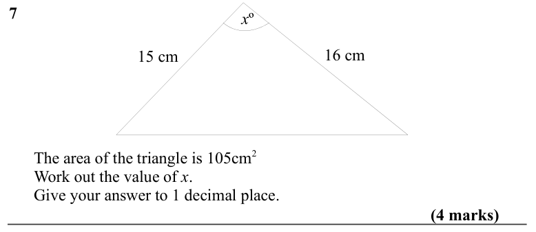

Text (lossy): 7     / x º / 16 cm / 15 cm /       The area of the triangle is 105cm 2 /       Work out the value of x. /       Give your answer to 1 decimal place.      / (4 marks)

## Q8 (marks not printed)

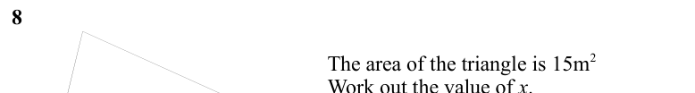

Text (lossy): 8    /       The area of the triangle is 15m 2 /       Work out the value of x. /       Give your answer to 3 significant figures.

## Q9 (4 marks)

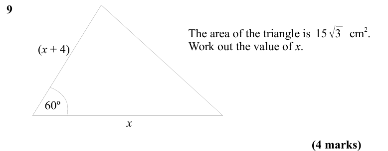

Text (lossy): 9     / 15√3 /       The area of the triangle is             cm 2.  /       Work out the value of x. / (x + 4)  / 60º / x  / (4 marks)

## Q10 (4 marks)

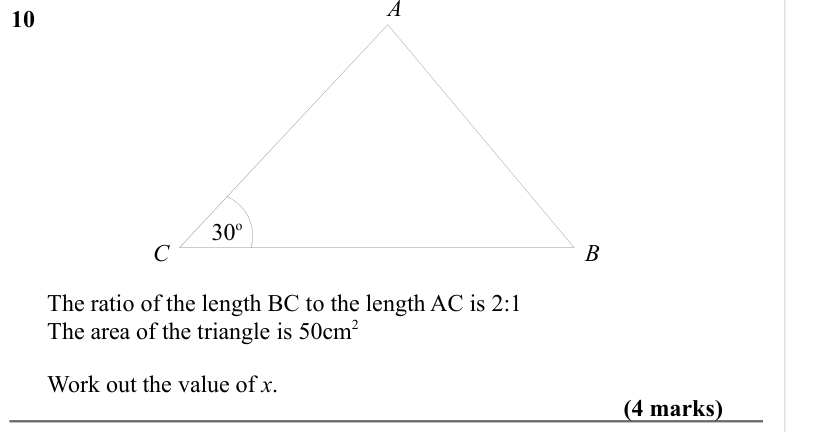

Text (lossy): 10     / 30 o / B / C /       The ratio of the length BC to the length AC is 2:1 /       The area of the triangle is 50cm 2 /   /       Work out the value of x. /      / (4 marks)

## Q11 (5 marks)

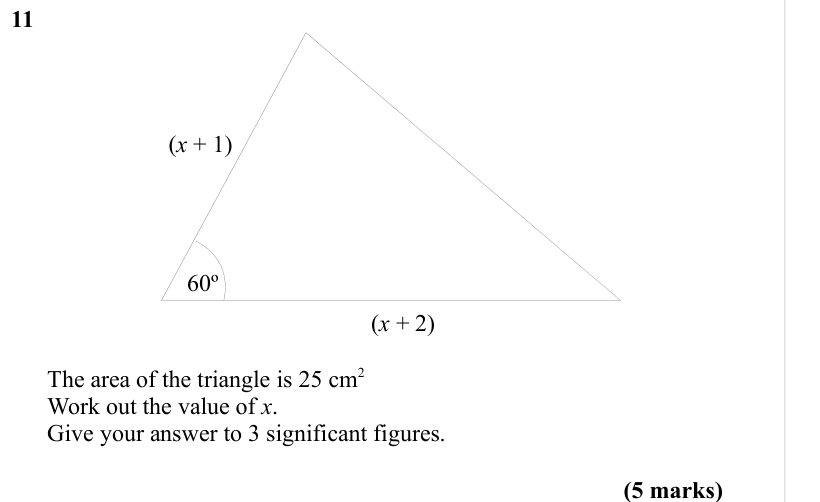

Text (lossy): 11     / (x + 1) / 60º / (x + 2)  /       The area of the triangle is 25 cm 2 /       Work out the value of x. /       Give your answer to 3 significant figures.  / (5 marks)

