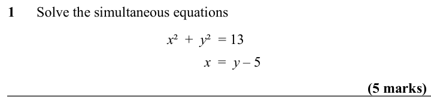
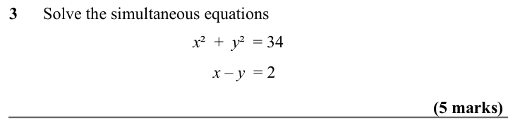
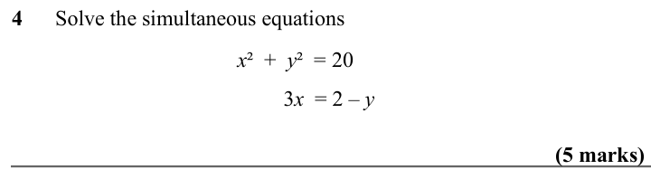
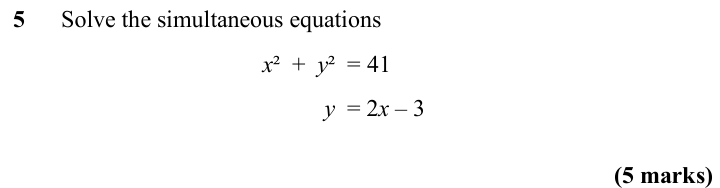
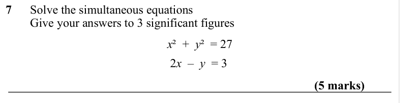
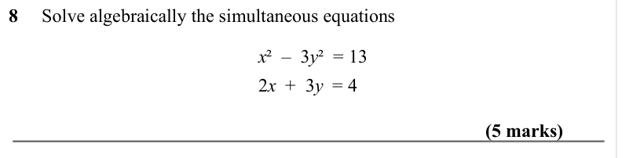
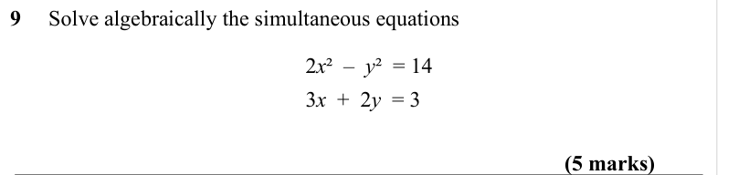

# Quadratic Simultaneous Equations — Exam Questions (IGCSE Maths · Edexcel · Grade 8-9)

Topic code `8.1` · slug `grade-8-9-8-1-quadratic-simultaneous-equations` · source sheet sha256 `3131379c23c0d063…`

## Q1 (5 marks)

Text (lossy): 1      Solve the simultaneous equations / x ²  +  y ²  = 13 /   / x  =  y – 5  / (5 marks)

## Q2 (5 marks)

Text (lossy): 2      Solve the simultaneous equations / x ²  +  y ²  = 17 /   / y  =  x – 3 / (5 marks)

## Q3 (5 marks)

Text (lossy): 3      Solve the simultaneous equations / x ²  +  y ²  = 34 /   / x – y  = 2 / (5 marks)

## Q4 (5 marks)

Text (lossy): 4      Solve the simultaneous equations / x ²  +  y ²  = 20 /   / 3 x  = 2 – y / (5 marks)

## Q5 (5 marks)

Text (lossy): 5      Solve the simultaneous equations / x ²  +  y ²  = 41 /   / y  = 2 x – 3 / (5 marks)

## Q6 (5 marks)

Text (lossy): 6      Solve the simultaneous equations /         Give your answers to 3 significant figures / x ²  +  y ²  = 20 /  2 x + y  = 3 / (5 marks)

## Q7 (5 marks)

Text (lossy): 7      Solve the simultaneous equations /         Give your answers to 3 significant figures / x ²  +  y ²  = 27 /  2 x  –  y  = 3  / (5 marks)

## Q8 (5 marks)

Text (lossy): 8     Solve algebraically the simultaneous equations / x ²  –  3 y ²  = 13 /  2 x  +  3 y  = 4 / (5 marks)

## Q9 (5 marks)

Text (lossy): 9     Solve algebraically the simultaneous equations / 2 x ²  –  y ²  = 14 /  3 x  +  2 y  = 3 / (5 marks)

