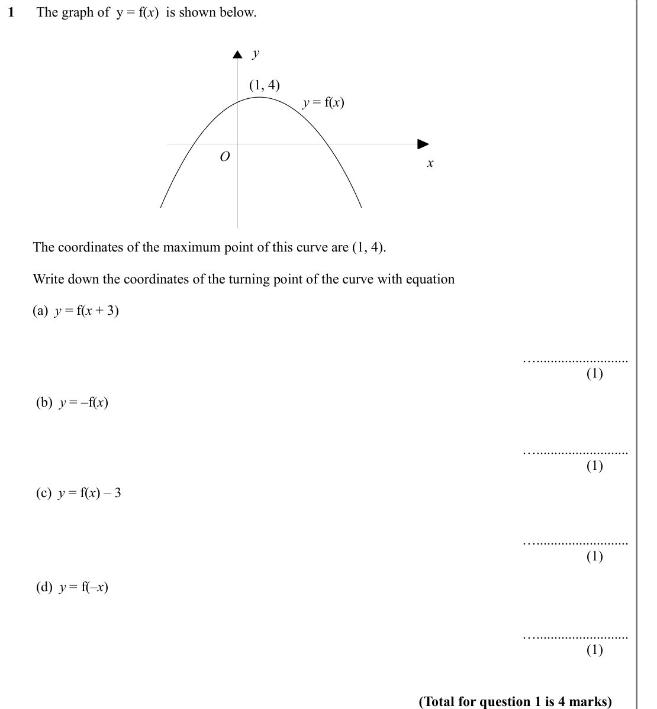
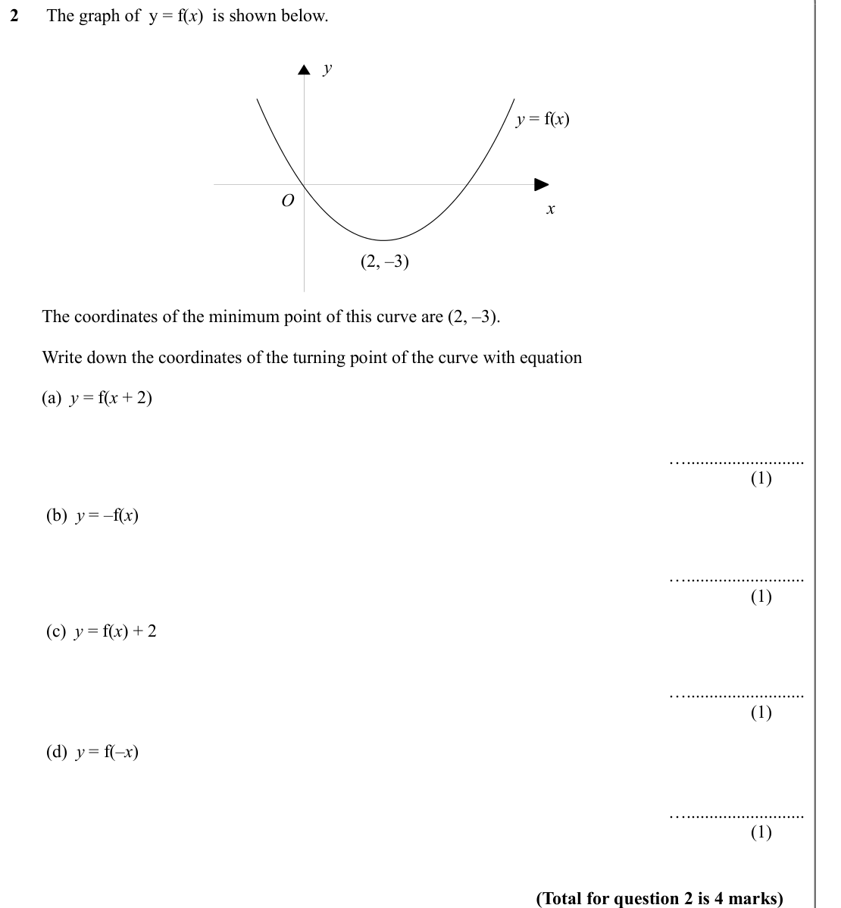
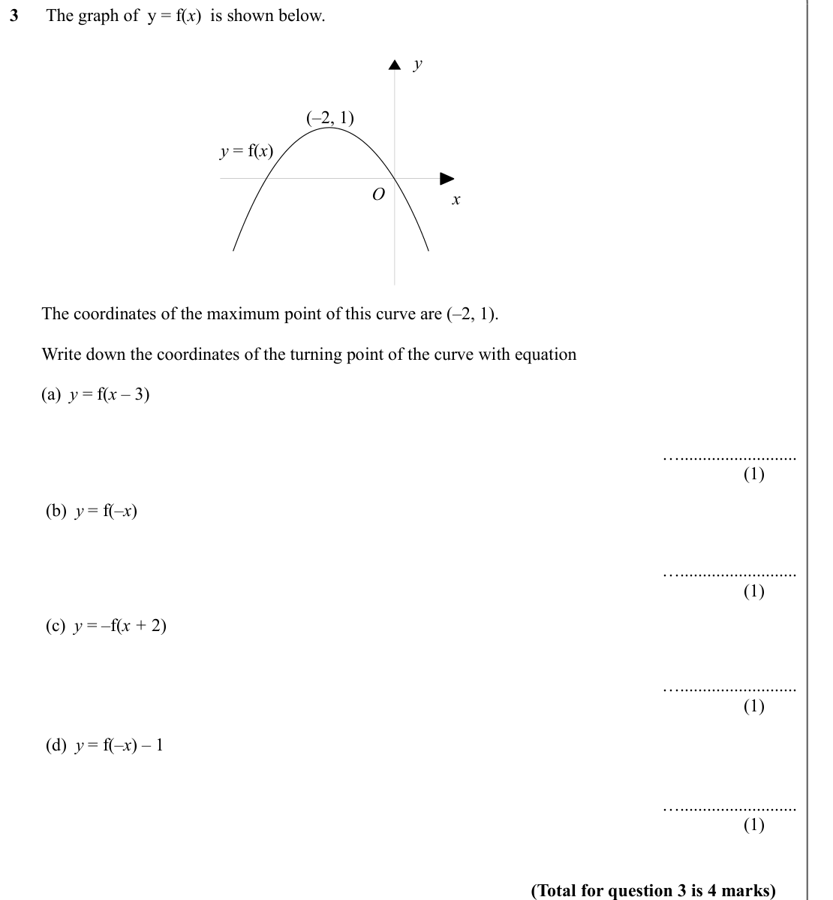
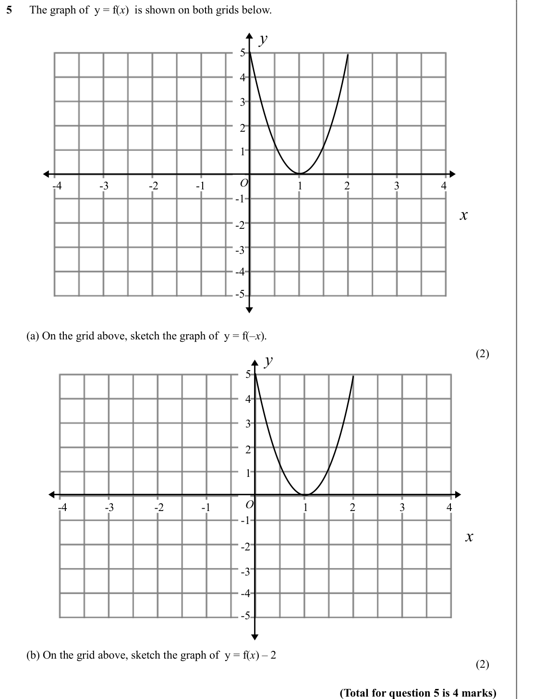
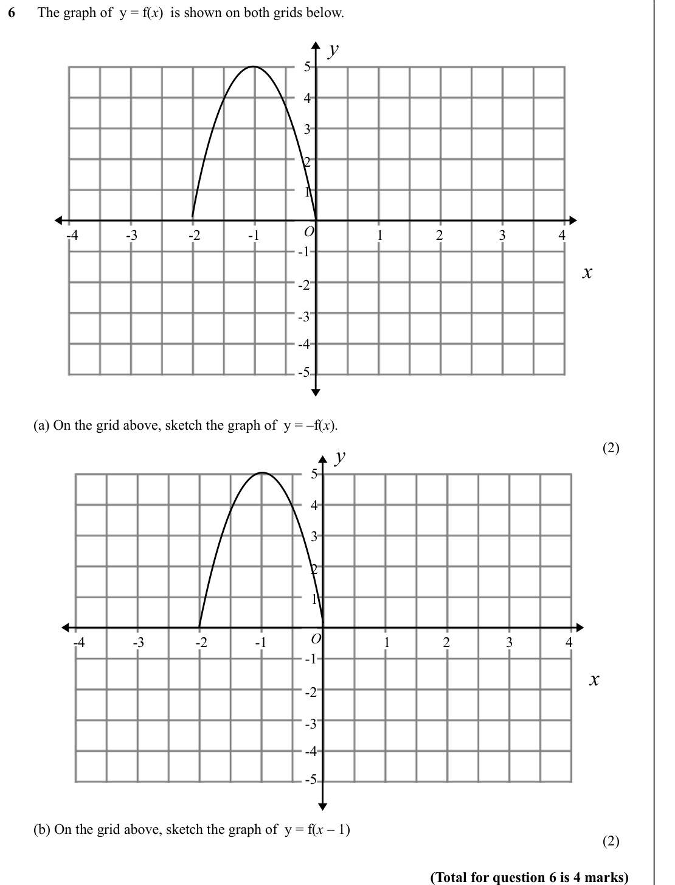
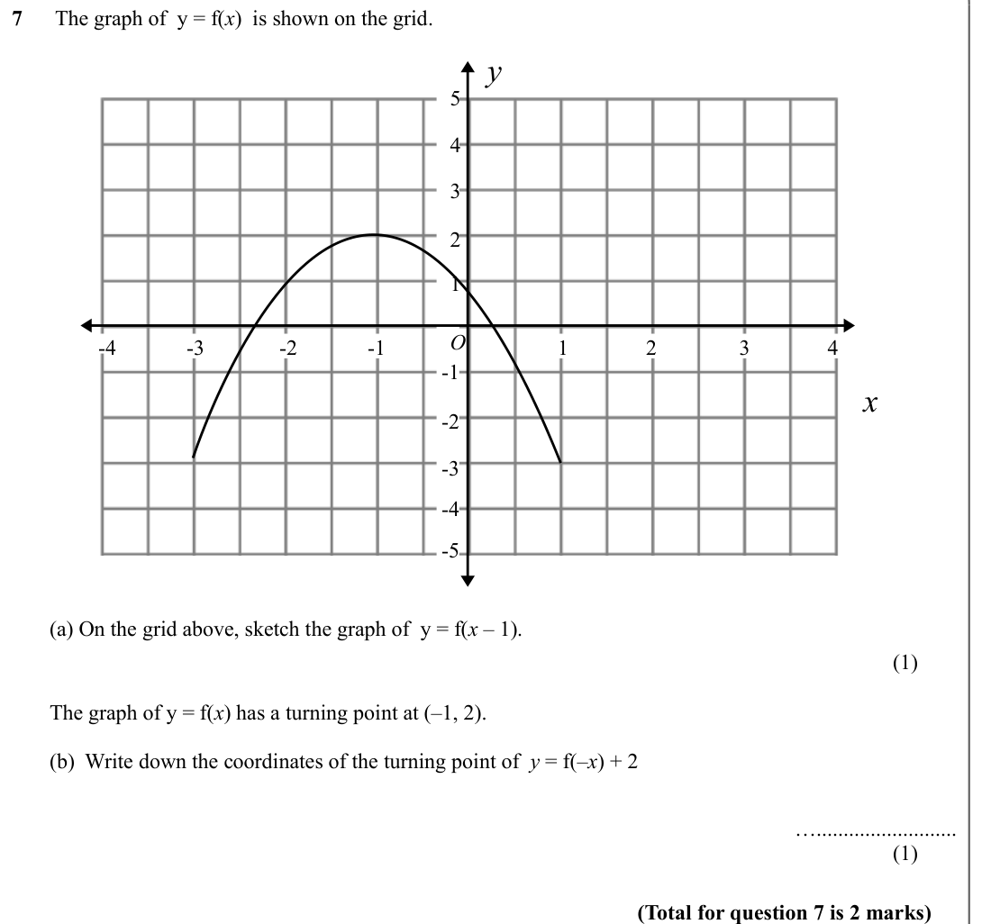

# Transforming Graphs y=f(x) — Exam Questions (IGCSE Maths · Edexcel · Grade 8-9)

Topic code `8.2` · slug `grade-8-9-8-2-transforming-graphs-y-f-x` · source sheet sha256 `13dfcbb474618efe…`

## Q1 (marks not printed · parts a, b, c, d)

Text (lossy): 1      The graph of  y = f(x)  is shown below.  / y / (1, 4) / y = f(x) / O / x /        The coordinates of the maximum point of this curve are (1, 4). /       /        Write down the coordinates of the turning point of the curve with equation /        (a)  y = f(x + 3) / ….......................... / (1) /         (b)  y = –f(x) / ….......................... / (1) /         (c)  y = f(x) – 3 / ….

## Q2 (marks not printed · parts a, b, c, d)

Text (lossy): 2      The graph of  y = f(x)  is shown below.  / y / y = f(x) / O / x / (2, –3) /        The coordinates of the minimum point of this curve are (2, –3). /       /        Write down the coordinates of the turning point of the curve with equation /        (a)  y = f(x + 2) / ….......................... / (1) /         (b)  y = –f(x) / ….......................... / (1) /         (c)  y = f(x) + 2 / 

## Q3 (marks not printed · parts a, b, c, d)

Text (lossy): 3      The graph of  y = f(x)  is shown below.  / y / (–2, 1) / y = f(x) / O / x /        The coordinates of the maximum point of this curve are (–2, 1). /       /        Write down the coordinates of the turning point of the curve with equation /        (a)  y = f(x – 3) / ….......................... / (1) /         (b)  y = f(–x) / ….......................... / (1) /         (c)  y = –f(x + 2) /

## Q4 (marks not printed · parts a, b)

Text (lossy): 4      The graph of  y = f(x)  is shown on both grids below.  / y / 5 / 4 / 3 / 2 / 1 / O / -4 / 4 / 3 / 2 / 1 / -1 / -2 / -3 / -1 / x / -2 / -3 / -4 / -5 /        (a) On the grid above, sketch the graph of  y = –f(x). / (2) / y / 5 / 4 / 3 / 2 / 1 / O / -4 / 4 / 3 / 2 / 1 / -1 / -2 / -3 / -1 / x / -2 / -3 / -4 / -5 /        (b) On the grid above, sketch the graph of  y = f(x + 2) / (2) / (Total f

## Q5 (marks not printed · parts a, b)

Text (lossy): 5      The graph of  y = f(x)  is shown on both grids below.  / y / 5 / 4 / 3 / 2 / 1 / O / -4 / 4 / 3 / 2 / 1 / -1 / -2 / -3 / -1 / x / -2 / -3 / -4 / -5 /        (a) On the grid above, sketch the graph of  y = f(–x). / (2) / y / 5 / 4 / 3 / 2 / 1 / O / -4 / 4 / 3 / 2 / 1 / -1 / -2 / -3 / -1 / x / -2 / -3 / -4 / -5 /        (b) On the grid above, sketch the graph of  y = f(x) – 2 / (2) / (Total f

## Q6 (marks not printed · parts a, b)

Text (lossy): 6      The graph of  y = f(x)  is shown on both grids below.  / y / 5 / 4 / 3 / 2 / 1 / O / -4 / 4 / 3 / 2 / 1 / -1 / -2 / -3 / -1 / x / -2 / -3 / -4 / -5 /        (a) On the grid above, sketch the graph of  y = –f(x). / (2) / y / 5 / 4 / 3 / 2 / 1 / O / -4 / 4 / 3 / 2 / 1 / -1 / -2 / -3 / -1 / x / -2 / -3 / -4 / -5 /        (b) On the grid above, sketch the graph of  y = f(x – 1) / (2) / (Total f

## Q7 (marks not printed · parts a, b)

Text (lossy): 7      The graph of  y = f(x)  is shown on the grid.  / y / 5 / 4 / 3 / 2 / 1 / O / -4 / 4 / 3 / 2 / 1 / -1 / -2 / -3 / -1 / x / -2 / -3 / -4 / -5 /        (a) On the grid above, sketch the graph of  y = f(x – 1). / (1) /        The graph of y = f(x) has a turning point at (–1, 2). /        (b)  Write down the coordinates of the turning point of  y = f(–x) + 2 / ….......................... / (1) /

