# Proof — Exam Questions (IGCSE Maths · Edexcel · Grade 8-9)

Topic code `8.3` · slug `grade-8-9-8-3-proof` · source sheet sha256 `dacc047c1ec7f38f…`

## Q1 (2 marks)

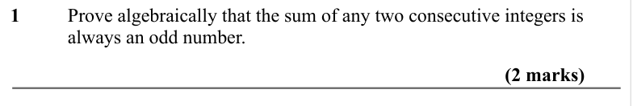

Text (lossy): 1      / Prove algebraically that the sum of any two consecutive integers is  / always an odd number.  / (2 marks)

## Q2 (2 marks)

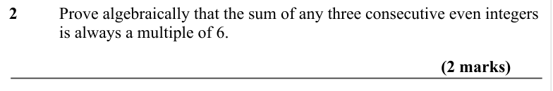

Text (lossy): 2    / Prove algebraically that the sum of any three consecutive even integers  / is always a multiple of 6.  / (2 marks)

## Q3 (2 marks)

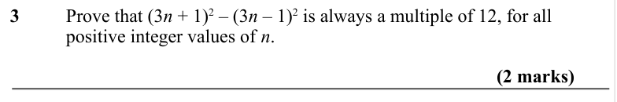

Text (lossy): 3   / Prove that (3 n + 1)2 – (3 n – 1)2 is always a multiple of 12, for all  / positive integer values of n.  / (2 marks)

## Q4 (2 marks)

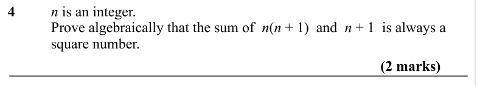

Text (lossy): 4    / n is an integer.  /         / Prove algebraically that the sum of  n(n + 1)  and  n + 1  is always a  / square number.  / (2 marks)

## Q5 (2 marks)

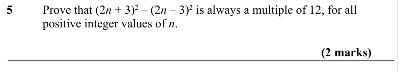

Text (lossy): 5     / Prove that (2 n + 3)2 – (2 n – 3)2 is always a multiple of 12, for all  / positive integer values of n.  / (2 marks)

## Q6 (2 marks)

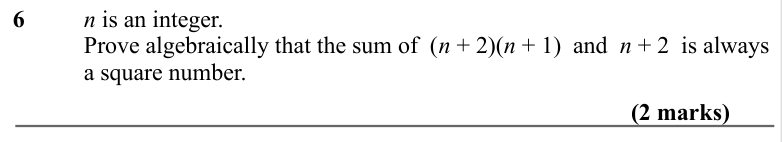

Text (lossy): 6      / n is an integer.  /         / Prove algebraically that the sum of  (n + 2)(n + 1)  and  n + 2  is always  / a square number.  / (2 marks)

## Q7 (2 marks)

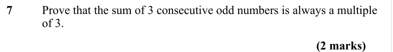

Text (lossy): 7     / Prove that the sum of 3 consecutive odd numbers is always a multiple  / of 3. / (2 marks)

## Q8 (2 marks)

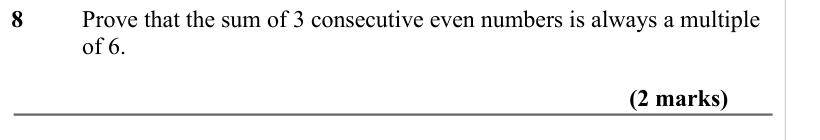

Text (lossy): 8    / Prove that the sum of 3 consecutive even numbers is always a multiple  / of 6. / (2 marks)

## Q9 (2 marks)

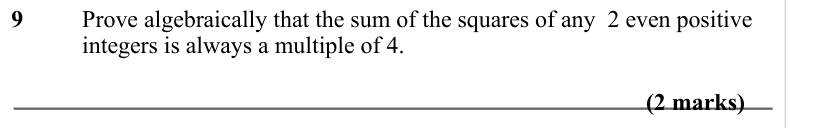

Text (lossy): 9     / Prove algebraically that the sum of the squares of any  2 even positive  / integers is always a multiple of 4. / (2 marks)

## Q10 (2 marks)

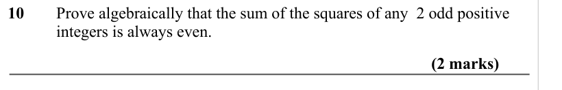

Text (lossy): 10     Prove algebraically that the sum of the squares of any  2 odd positive  / integers is always even. / (2 marks)

## Q11 (3 marks)

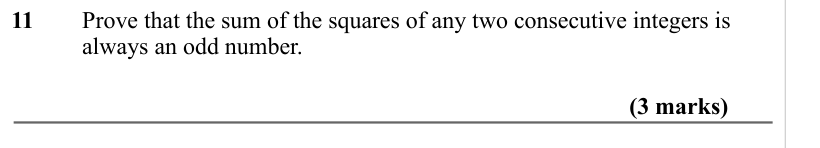

Text (lossy): 11     Prove that the sum of the squares of any two consecutive integers is  / always an odd number.  / (3 marks)

## Q12 (2 marks)

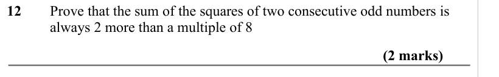

Text (lossy): 12     / Prove that the sum of the squares of two consecutive odd numbers is  / always 2 more than a multiple of 8 / (2 marks)

## Q13 (3 marks)

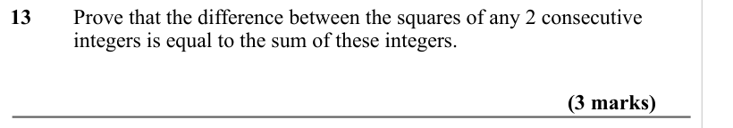

Text (lossy): 13     Prove that the difference between the squares of any 2 consecutive  / integers is equal to the sum of these integers. / (3 marks)

## Q14 (3 marks)

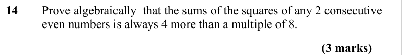

Text (lossy): 14   / Prove algebraically  that the sums of the squares of any 2 consecutive  / even numbers is always 4 more than a multiple of 8.  / (3 marks)

